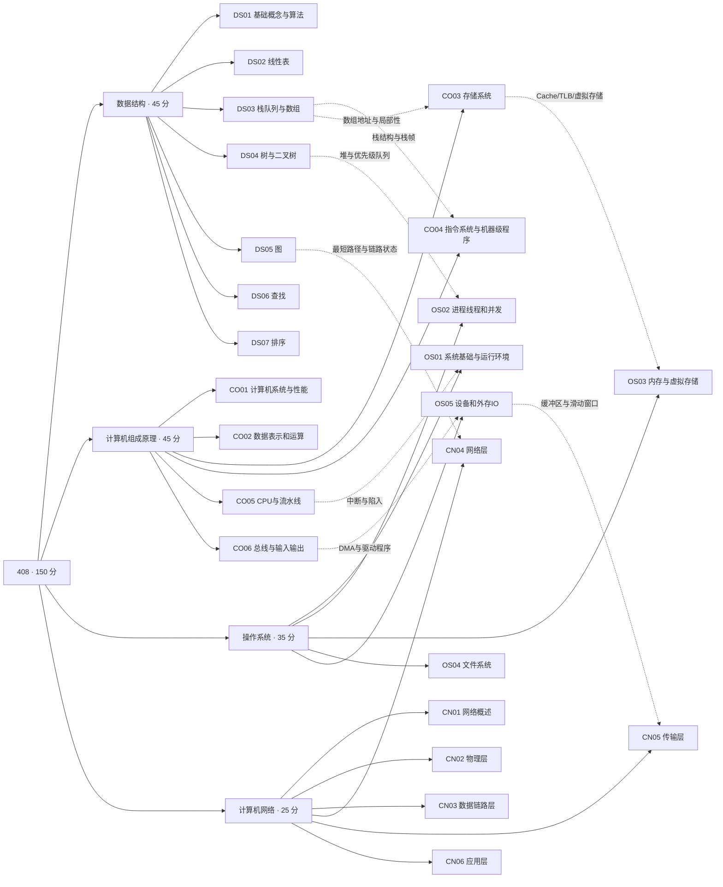

# 408 四科知识图谱：24 章总览

> 这张概览图只画到章节层；217 个细分知识点见 [`concepts.json`](concepts.json)，115 条有类型的关系见 [`relations.csv`](relations.csv)。实线是学科从属，虚线是精选的跨学科理解桥梁，不自动等同于“必学前置”。

## 四科完整知识树

### 数据结构（45 分）

- **DS01 基础概念与算法**（5 节点）：`DS01.01` 逻辑结构与存储结构；`DS01.02` 算法正确性与基本性质；`DS01.03` 渐近时间复杂度；`DS01.04` 递归与递推复杂度；`DS01.05` 空间复杂度
- **DS02 线性表**（6 节点）：`DS02.01` 顺序表存储与寻址；`DS02.02` 顺序表插入删除与移动；`DS02.03` 单链表基本操作；`DS02.04` 双向链表与循环链表；`DS02.05` 链表合并反转与共享后缀；`DS02.06` 双指针与链表算法
- **DS03 栈队列与数组**（8 节点）：`DS03.01` 栈顺序和链式实现；`DS03.02` 合法出栈序列；`DS03.03` 递归调用栈；`DS03.04` 表达式转换与计算；`DS03.05` 队列和循环队列；`DS03.06` 双端队列；`DS03.07` 数组行列优先与地址计算；`DS03.08` 特殊矩阵压缩存储
- **DS04 树与二叉树**（10 节点）：`DS04.01` 树的结点计数与度；`DS04.02` 完全二叉树性质；`DS04.03` 二叉树三种深度遍历；`DS04.04` 层次遍历与重构；`DS04.05` 线索二叉树；`DS04.06` 树与森林转换；`DS04.07` 哈夫曼树和前缀编码；`DS04.08` 并查集；`DS04.09` 堆与堆操作；`DS04.10` 二叉树递归算法设计
- **DS05 图**（10 节点）：`DS05.01` 图的度路径连通性；`DS05.02` 邻接矩阵；`DS05.03` 邻接表十字链表；`DS05.04` 深度优先搜索DFS；`DS05.05` 广度优先搜索BFS；`DS05.06` 最小生成树Prim和Kruskal；`DS05.07` 单源与多源最短路径；`DS05.08` 拓扑排序与唯一性；`DS05.09` AOE关键路径和时间余量；`DS05.10` 欧拉路径与图结构判定
- **DS06 查找**（10 节点）：`DS06.01` 顺序查找与分块查找；`DS06.02` 折半查找与比较次数；`DS06.03` 折半查找判定树；`DS06.04` 二叉搜索树；`DS06.05` AVL平衡二叉树；`DS06.06` 红黑树；`DS06.07` B树与B+树；`DS06.08` 散列表和冲突处理；`DS06.09` 字符串模式匹配与KMP；`DS06.10` 查找效率与平均查找长度
- **DS07 排序**（11 节点）：`DS07.01` 直接与折半插入排序；`DS07.02` 希尔排序；`DS07.03` 冒泡排序；`DS07.04` 简单选择排序；`DS07.05` 快速排序与划分；`DS07.06` 堆排序；`DS07.07` 二路归并排序；`DS07.08` 基数排序；`DS07.09` 外部排序与归并段；`DS07.10` 稳定性与复杂度比较；`DS07.11` 排序过程和趟次识别

### 计算机组成原理（45 分）

- **CO01 计算机系统与性能**（5 节点）：`CO01.01` 软硬件层次与存储程序；`CO01.02` 程序翻译与执行流程；`CO01.03` CPU时间主频与CPI；`CO01.04` 吞吐量与加速比；`CO01.05` MIPS与浮点性能指标
- **CO02 数据表示和运算**（8 节点）：`CO02.01` 进位计数制与编码；`CO02.02` 原码反码补码表示；`CO02.03` 整数运算与溢出标志；`CO02.04` 加减法器与ALU；`CO02.05` 定点乘法和除法；`CO02.06` IEEE754浮点表示；`CO02.07` 浮点运算对阶舍入与溢出；`CO02.08` C语言整数与浮点转换
- **CO03 存储系统**（12 节点）：`CO03.01` SRAM DRAM ROM和Flash；`CO03.02` 存储芯片扩展与编址；`CO03.03` 多模块交叉存储；`CO03.04` 磁盘与SSD存储原理；`CO03.05` 程序局部性；`CO03.06` Cache映射和地址划分；`CO03.07` Cache替换算法LRU/FIFO；`CO03.08` Cache写策略；`CO03.09` Cache命中率与平均访问时间；`CO03.10` 页式虚拟存储与多级页表；`CO03.11` TLB结构与地址转换；`CO03.12` 存储层次性能联合计算
- **CO04 指令系统与机器级程序**（9 节点）：`CO04.01` 指令编码与扩展操作码；`CO04.02` 指令格式与字长；`CO04.03` 寻址方式与有效地址；`CO04.04` PC相对寻址；`CO04.05` 大端小端与数据对齐；`CO04.06` CISC与RISC；`CO04.07` C语言分支循环与机器码；`CO04.08` 函数调用与栈帧；`CO04.09` 编译汇编与链接基本过程
- **CO05 CPU与流水线**（10 节点）：`CO05.01` CPU部件和寄存器；`CO05.02` 指令周期与执行阶段；`CO05.03` 数据通路和控制信号；`CO05.04` 硬布线与微程序控制；`CO05.05` 异常与中断机制；`CO05.06` 流水线阶段时序和性能；`CO05.07` 结构数据控制冒险；`CO05.08` 转发停顿与分支处理；`CO05.09` 超标量和动态流水线；`CO05.10` SIMD多核与硬件多线程
- **CO06 总线与输入输出**（8 节点）：`CO06.01` 系统总线类型与组成；`CO06.02` 总线带宽与突发事务；`CO06.03` 同步异步总线定时；`CO06.04` IO端口与接口；`CO06.05` 程序查询IO；`CO06.06` 中断驱动IO；`CO06.07` DMA传输与通道；`CO06.08` IO性能与CPU开销

### 操作系统（35 分）

- **OS01 系统基础与运行环境**（7 节点）：`OS01.01` 操作系统目标与类型；`OS01.02` 用户态内核态与特权指令；`OS01.03` 异常中断与系统调用；`OS01.04` 装入链接与地址空间；`OS01.05` 进程内存映像；`OS01.06` 内核组织和虚拟机；`OS01.07` 系统引导
- **OS02 进程线程和并发**（12 节点）：`OS02.01` PCB和进程状态转换；`OS02.02` 线程与进程资源共享；`OS02.03` 上下文切换与CPU调度；`OS02.04` FCFS SJF RR和优先级调度；`OS02.05` 高响应比与饥饿；`OS02.06` 同步互斥和临界区；`OS02.07` 信号量PV与经典同步问题；`OS02.08` 互斥锁和原子操作；`OS02.09` 死锁条件预防与避免；`OS02.10` 银行家算法与安全序列；`OS02.11` 进程间通信和管道；`OS02.12` 多处理器调度
- **OS03 内存与虚拟存储**（10 节点）：`OS03.01` 地址空间和地址重定位；`OS03.02` 连续分区与内存保护；`OS03.03` 分段与段页式管理；`OS03.04` 分页和多级页表；`OS03.05` 页表项TLB及地址转换；`OS03.06` 请求分页与缺页中断；`OS03.07` 页面置换LRU FIFO Clock；`OS03.08` 驻留集和页框分配；`OS03.09` 工作集与抖动；`OS03.10` 共享内存与内存映射文件
- **OS04 文件系统**（10 节点）：`OS04.01` 文件控制块FCB与inode；`OS04.02` 文件逻辑结构和操作；`OS04.03` 目录结构与路径解析；`OS04.04` 连续链式索引分配；`OS04.05` FAT与文件簇；`OS04.06` 多级间接索引和文件长度；`OS04.07` 位图空闲块管理；`OS04.08` 硬链接软链接与引用计数；`OS04.09` 文件访问权限与保护；`OS04.10` 文件系统安装与VFS
- **OS05 设备和外存IO**（8 节点）：`OS05.01` IO管理软件层次；`OS05.02` 设备分配与设备独立性；`OS05.03` 系统缓冲与缓冲池；`OS05.04` 磁盘物理结构与寻址；`OS05.05` 磁盘调度SSTF SCAN CSCAN；`OS05.06` IO中断与DMA协作；`OS05.07` 假脱机SPOOLing；`OS05.08` SSD性能与磨损均衡

### 计算机网络（25 分）

- **CN01 网络概述**（5 节点）：`CN01.01` 分层协议接口与服务；`CN01.02` OSI与TCPIP模型；`CN01.03` 吞吐量带宽和时延；`CN01.04` 传输传播排队时延；`CN01.05` 电路交换与分组交换
- **CN02 物理层**（6 节点）：`CN02.01` 比特码元与波特率；`CN02.02` 奈奎斯特与香农定理；`CN02.03` 编码NRZ曼彻斯特；`CN02.04` 调制与频谱效率；`CN02.05` 传输介质特性；`CN02.06` 物理设备中继器集线器
- **CN03 数据链路层**（14 节点）：`CN03.01` 成帧与字节填充；`CN03.02` CRC检错与纠错；`CN03.03` 停等协议；`CN03.04` GBN回退N帧；`CN03.05` SR选择重传；`CN03.06` 滑动窗口与序号空间；`CN03.07` ALOHA与CSMA协议；`CN03.08` CSMA/CD碰撞检测；`CN03.09` CSMA/CA无线接入；`CN03.10` 以太网与帧格式；`CN03.11` 交换机自学习与转发；`CN03.12` 广播域碰撞域VLAN；`CN03.13` 80211无线帧地址；`CN03.14` PPP与点对点链路
- **CN04 网络层**（16 节点）：`CN04.01` IPv4分组头与分片；`CN04.02` IPv4编址与特殊地址；`CN04.03` 子网划分CIDR与掩码；`CN04.04` 最长前缀匹配和路由表；`CN04.05` ARP地址解析；`CN04.06` DHCP动态配置；`CN04.07` ICMP报文；`CN04.08` NAT地址转换；`CN04.09` 距离向量与RIP；`CN04.10` 链路状态与OSPF；`CN04.11` BGP与自治系统；`CN04.12` 路由聚合与层次路由；`CN04.13` IPv6地址与首部；`CN04.14` IP组播；`CN04.15` 移动IP；`CN04.16` SDN与网络层拥塞
- **CN05 传输层**（10 节点）：`CN05.01` 端口与复用分用；`CN05.02` UDP报文与校验；`CN05.03` TCP三次握手；`CN05.04` TCP四次挥手；`CN05.05` TCP序号ACK与可靠传输；`CN05.06` TCP滑动窗口与流量控制；`CN05.07` TCP超时重传和RTT；`CN05.08` TCP慢启动与拥塞避免；`CN05.09` TCP快重传快恢复；`CN05.10` TCP吞吐量与传输时间
- **CN06 应用层**（7 节点）：`CN06.01` 客户服务器与P2P；`CN06.02` DNS域名解析；`CN06.03` FTP控制和数据连接；`CN06.04` SMTP邮件发送；`CN06.05` POP3邮件接收；`CN06.06` HTTP方法报文与连接；`CN06.07` Cookie与Web访问过程

## 为什么是真知识图谱，而不只是章节树？

**结构层**：学科 → 章节 → 知识点，可用于考纲覆盖检查。

**关系层**：`relations.csv` 给出 `prerequisite`（前置依赖）、`related`（相关）、`same_mechanism`（不同课程同一机制）、`cross_application`（知识迁移应用）、`cross_analogy`（类比而不等同）。所有关系仍标 `editorial-hypothesis`，需课程审稿确认。

**证据层**：`exam-links.csv` 的 `concept_id` 对应这份知识树中的叶节点；119 道综合题由题干阅读标注，选择题的候选规则则被明确区分。

**命题层**：AI 命题时应选一个主概念 + 一到两个相关/前置节点 + 一种认知操作（判断边界、计算、推演、反例、程序设计），再设计可诊断的错误选项。

本图为原创重构的概念层次，不复制王道或其他机构的思维导图和教材图像。