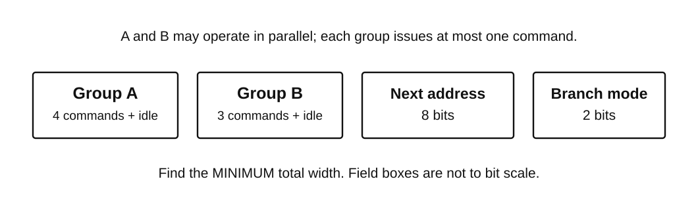
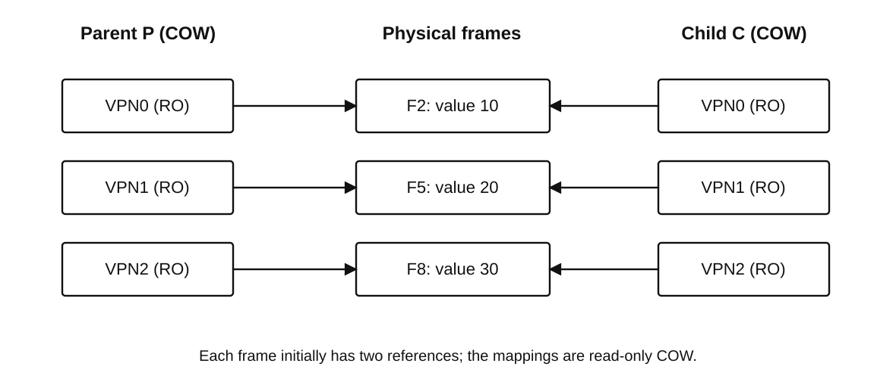

<!-- paper: ai-original/set-01 | kind: questions | status: complete-draft -->
# 408 AI Original · Set 01
## 计算机学科专业基础综合 · 原创模拟卷（完整初稿 v3.2）

**满分150分，考试时间180分钟。** 本卷以2024–2025年真题的题型与知识深度为编辑对标，尚未经考生试做统计校准。不是考试院真题，也不声称已获独立专家终审。

一般约定：除另有说明，数据按题干给定模型解释；`H`表示十六进制；`KiB=2^10 B`，`Mb/s=10^6 bit/s`。单项选择题每题只有一个正确选项。综合题须写出主要推导步骤，允许等价正确解法。

## 一、单项选择题（第1–40题，每题2分，共80分）

### 第 1 题

设数组 `a[0..n-1]` 已存入内存，$n\ge 1$。以下程序中 `j` 仅在开始时初始化，整数运算不会溢出。程序的**最坏时间复杂度**是（　）。

```c
int i = 0, j = 0;
while (i < n) {
    while (j < n && a[j] <= a[i])
        ++j;
    ++i;
}
```

A. $\Theta(\log n)$

B. $\Theta(n\log n)$

C. $\Theta(n)$

D. $\Theta(n^2)$

### 第 2 题

元素 $1,2,3,4,5$ 按此顺序进入一个初始为空、最多容纳 **3 个元素**的栈。允许进栈、出栈交错进行，所有元素最终均须出栈。下列序列中，**不能**作为完整出栈序列的是（　）。

A. 4，3，2，1，5

B. 3，2，4，1，5

C. 2，4，3，1，5

D. 2，1，5，4，3

### 第 3 题

一棵二叉树的结点标识互不相同，其先序序列为 `A B C D E`，后序序列为 `C B E D A`。满足这两个遍历序列的**不同二叉树**共有（　）。

A. 2 棵

B. 4 棵

C. 8 棵

D. 16 棵

### 第 4 题

字符 $a,b,c,d$ 的权值分别为 $1,1,2,2$。按哈夫曼算法构造二进制前缀编码；每步合并两个最小权值，遇到相等权值时允许任意选择。下列叙述中，正确的是（　）。

Ⅰ. 所得哈夫曼树的带权路径长度均为12。

Ⅱ. 每个指定字符的编码长度均唯一确定。

Ⅲ. 所得编码的最大码长可能为2，也可能为3。

A. 仅Ⅰ

B. 仅Ⅱ、Ⅲ

C. Ⅰ、Ⅱ、Ⅲ

D. 仅Ⅰ、Ⅲ

### 第 5 题

设 $G$ 为无权连通无向简单图，$T$ 是以 $s$ 为根的BFS树。从 $G$ 删除一条**非树边** $e$ 得到 $G'$（图5仅作示例）。以下结论对**任意**满足条件的 $G,T,e$ 哪些成立？


Ⅰ. $s$ 到各顶点的最短距离不变。

Ⅱ. 任意两顶点间的最短距离均不变。

Ⅲ. $T$ 仍是 $G'$ 中以 $s$ 为根的BFS树。

正确的是（　）。

A. 仅Ⅰ

B. 仅Ⅰ、Ⅲ

C. 仅Ⅱ、Ⅲ

D. Ⅰ、Ⅱ、Ⅲ

### 第 6 题

无向带权图如图6。按边 $AB,DE,AD$ 在**所有最小生成树**中的情况分类：**必含**（每棵都有）、**可含**（有的有）、**不含**（均没有），依次应为（　）。


A. 必含、必含、不含

B. 可含、必含、可含

C. 必含、可含、不含

D. 可含、必含、不含

### 第 7 题

图7是关键字互异的二叉搜索树，根4为黑色，1、3为红色，2、6、5颜色待定。未画出的空指针均指向**黑色NIL叶结点**。


使其满足红黑树性质时，结点2、6、5的颜色依次是（　）。

A. 黑、红、黑

B. 红、黑、红

C. 黑、黑、红

D. 黑、黑、黑

### 第 8 题

B+树如图8，每框为一磁盘页，记录只存于叶页。根页已缓存、叶页均未缓存；根分隔键为右侧叶页的最小键。


检索 $[18,45]$：先定位18所在候选叶页，再沿叶链扫描，到首个大于45的键停止，**不得借图示跳读**。读取叶页数、返回记录数分别为（　）。

A. 2，4

B. 3，4

C. 3，5

D. 4，4

### 第 9 题

用KMP匹配模式串 `ababaca`（下标从0起）。已匹配前5个字符 `ababa`，下一文本字符 `b` 与模式下标5的 `c` 失配。按已匹配部分的**最长真前后缀**回退，不用 `nextval` 且文本指针不退。

首次回退后，模式指针下标、模式右移量分别为（　）。

A. 3，2

B. 2，3

C. 1，4

D. 0，5

### 第 10 题

记录 $2_a,1,2_b$ 的下标用于区分身份，比较时只看关键字。执行下列划分一次，`swap` 交换整条记录：

```text
pivot=A[n-1].key; i=-1
for j=0,...,n-2:
    if A[j].key<pivot:
        ++i; swap(A[i],A[j])
swap(A[i+1],A[n-1])
```

所得序列、相等关键字的次序是否保持，分别为（　）。

A. $(1,2_a,2_b)$；保持

B. $(1,2_b,2_a)$；保持

C. $(1,2_a,2_b)$；不保持

D. $(1,2_b,2_a)$；不保持

### 第 11 题

磁盘上有4个有序归并段，长度依次为5、10、15、20块。内存仅有2个输入缓冲和1个输出缓冲，每次只能二路归并。合并长度为 $x,y$ 的段需读 $x+y$ 块、写 $x+y$ 块；中间段及最终段均写回磁盘。

将4段合并为一段，最少磁盘块读写次数之和为（　）。

A. 95

B. 190

C. 200

D. 300

### 第 12 题

某8位补码加减运算器计算 $X-Y$，其中 $X=80\mathrm H$、$Y=01\mathrm H$。规定 **CF=1表示无符号减法发生借位**，OF=1表示有符号补码减法溢出。8位结果、CF、OF依次为（　）。

A. 7FH，0，1

B. 7FH，1，0

C. 81H，0，1

D. 7FH，1，1

### 第 13 题

采用IEEE 754 binary32，$\operatorname{RN}_{32}(z)$ 表示先求精确实数 $z$，再按**最近舍入、平局取偶**一次舍入。已知

\[
x=\operatorname{RN}_{32}(1+2^{-24}),\qquad y=\operatorname{RN}_{32}(1+3\times2^{-24}).
\]

$x,y$ 的32位十六进制编码依次为（　）。

A. 3F800000H，3F800001H

B. 3F800001H，3F800002H

C. 3F800001H，3F800003H

D. 3F800000H，3F800002H

### 第 14 题

某C实现中，`int` 为32位；`int16_t` 和 `uint16_t` 各为16位，`uint32_t` 为32位。执行

```c
int16_t s=-3;
uint16_t u=2;
int r=(s<u);
uint32_t v=s+u;
```

`r,v` 的值分别为（　）。

A. 0，4294967295

B. 1，65535

C. 1，4294967295

D. 0，65535

### 第 15 题

数据Cache容量64 B、块长16 B、**2路组相联，LRU替换**，按字节编址，以主存块号低位选组。初始为空，无预取及其他访存。

将访问序列 `00H,20H,10H,40H,20H,00H` 连续执行**两遍，中间不清空**。两遍缺失次数依次为（　）。

A. 5，2

B. 5，3

C. 4，2

D. 4，3

### 第 16 题

某系统虚拟地址为32位，页大小为4 KiB。TLB共16个表项，采用4路组相联；组索引取**虚页号的最低若干位**，其余虚页号位作为标记，不考虑ASID。TLB标记字段位数，以及虚拟地址 `12345000H` 对应的TLB组号，分别为（　）。

A. 20，1

B. 18，0

C. 18，1

D. 16，1

### 第 17 题

某机器按字节编址，转移指令长度为2 B。取指后PC先指向下一条指令；若转移发生，则在该PC基础上加上“**8位有符号位移量乘2**”。现转移指令位于 `0100H`，位移字段为 `FCH`。转移目标地址是（　）。

A. 00F8H

B. 00FAH

C. 00FEH

D. 010AH

### 第 18 题

小端机器中，U16/U8/U32各占2/1/4 B，按各自大小对齐。结构体字段按声明顺序存放，尾部按最大对齐数补齐。

```c
struct R { U16 code; U8 flag; U32 value; } a[3];
```

`a` 首地址1000H，`a[2].value=12345678H`，其中字节34H的地址为（　）。

A. 1012H

B. 1014H

C. 1015H

D. 1016H

### 第 19 题

某微指令由微命令字段A、B、8位下址字段及2位转移方式字段组成。A组有4种互斥操作，B组有3种，**两组可并行**。两组分别编码，全0表示本组不执行；每种操作各分配一个不同的非零码，未用编码保留不用。



各字段均取最短位数，微指令的最小总长度是（　）。

A. 13位

B. 14位

C. 16位

D. 15位

### 第 20 题

处理器M1和M2实现同一指令集体系结构（ISA），分别采用单周期和五级流水线实现。下列属性中，**允许不同且不因此违背ISA一致性**的是（　）。

A. 指令编码中操作码字段的含义

B. 同一算术指令的架构可见运算语义

C. 执行一条给定指令所经历的时钟周期数

D. 架构可见通用寄存器的位宽

### 第 21 题

同步总线时钟100 MHz、宽32位，**每周期两个时钟沿各传一个字**。每次读事务占1周期发命令、2周期等待、4周期传8个字；事务不重叠。取 $1\mathrm{MB}=10^6$ B。

峰值带宽及连续执行此类事务的有效吞吐率约为（　）。

A. 800 MB/s，457.1 MB/s

B. 400 MB/s，457.1 MB/s

C. 800 MB/s，800 MB/s

D. 400 MB/s，228.6 MB/s

### 第 22 题

采用DMA输入方式，CPU已经为一次内存块传输设置好控制参数。下列叙述正确的是（　）。

A. 每传入一个数据字，CPU都必须执行一条输入指令

B. DMA完成中断属于当前指令直接引起的同步异常

C. DMA传输期间，CPU不能执行与该缓冲区无关的任务

D. CPU可与DMA并行工作，DMA完成后可通过中断通知CPU

### 第 23 题

关于系统调用与外部中断，下列叙述正确的是（　）。

Ⅰ. 执行陷入指令发起系统调用，是与当前指令执行同步的事件。

Ⅱ. 外部中断只能在CPU处于用户态时发生。

Ⅲ. 系统调用服务例程和外部中断处理程序执行时，CPU均处于内核态。

A. 仅Ⅰ、Ⅱ

B. 仅Ⅱ、Ⅲ

C. 仅Ⅰ、Ⅲ

D. Ⅰ、Ⅱ、Ⅲ

### 第 24 题

进程P调用一次 `open` 后创建线程T1、T2，两线程均用所得fd读文件，不再调用 `open` 或 `dup`（POSIX式模型）。正确的是（　）。

A. 共享该打开文件对象的当前偏移量，各自保存寄存器现场和线程栈

B. 各自拥有该文件的独立偏移量，并各自保存线程栈

C. 共享该文件的偏移量，也共享同一个用于函数调用的线程栈

D. 不共享文件偏移量，但共享同一个寄存器现场

### 第 25 题

单CPU按**抢占式最短剩余时间优先（SRTF）**调度，无切换开销及I/O；剩余时间相同时继续运行当前进程。

| 进程 | 到达/ms | 执行/ms |
|---|---:|---:|
| P1 | 0 | 7 |
| P2 | 2 | 4 |
| P3 | 4 | 1 |

平均等待时间为（　）。

A. 1 ms

B. 2 ms

C. 3 ms

D. 6 ms

### 第 26 题

系统有A、B两类可重用资源，当前Available=(1,1)，其他状态如下。

| 进程 | Allocation(A,B) | Max(A,B) |
|---|---|---|
| P0 | (1,0) | (2,2) |
| P1 | (0,1) | (2,1) |
| P2 | (1,1) | (2,2) |

采用银行家算法。各请求均**单独从原状态**提出，哪个请求可以批准且批准后仍安全（　）。

A. P0申请(1,0)

B. P1申请(1,0)

C. P2申请(0,1)

D. P0申请(0,1)

### 第 27 题

32位虚拟地址分为页目录索引10位、页表索引10位、页内偏移12位，PTE占4 B。虚地址 `00403008H` 的页目录项给出页表起始**物理地址** `00300000H`，该PTE记录页框号 `00123H`。

PTE的物理地址和最终数据物理地址分别为（　）。

A. 00300003H，00123008H

B. 0030000CH，00123008H

C. 0030000CH，00123308H

D. 00300030H，00123008H

### 第 28 题

进程拥有3个页框，采用固定分配、局部LRU置换。当前已驻留页面按**最久未使用到最近使用**的顺序为 `1，2，3`。依次访问

`2，4，1，2，5，1`

期间缺页次数，以及此后立刻访问尚未驻留的页面6时被淘汰的页号，分别为（　）。

A. 2，2

B. 3，5

C. 4，2

D. 3，2

### 第 29 题

POSIX式文件系统中，文件原有目录项 `a`。依次建立硬链接 `b`、指向路径 `a` 的符号链接 `s`，执行 `fd=open("a",...)`，随后删除 `a`、`b`。无其他打开引用，路径不再重建。

Ⅰ. 可通过fd继续访问原文件。

Ⅱ. s会自动改指向b，仍可通过s访问原文件。

Ⅲ. 原文件数据块至少保留至最后一个打开引用关闭。

正确的是（　）。

A. 仅Ⅰ、Ⅲ

B. 仅Ⅰ、Ⅱ

C. 仅Ⅱ、Ⅲ

D. Ⅰ、Ⅱ、Ⅲ

### 第 30 题

文件系统块长1 KiB、指针长4 B。inode有10个直接、1个一级间接及1个二级间接地址项。文件足够大，inode已缓存，索引块与数据块均未缓存。

读取文件字节偏移 $272\times1024+17$（首字节偏移为0），其索引层次和磁盘块读取次数分别为（　）。

A. 一级间接，2次

B. 二级间接，2次

C. 二级间接，3次

D. 三级间接，4次

### 第 31 题

磁道编号为0–199，磁头当前位于120，向编号增大方向按 **C-SCAN** 服务。待处理请求为10、40、130、170。规定扫到边界199后回到0，**回卷距离计入移动总量**，回卷途中不服务请求；所有请求处理完立即停止。磁头总移动距离为（　）。

A. 119

B. 240

C. 318

D. 398

### 第 32 题

某计算机上电后，CPU从固定ROM地址执行固件。启动盘中引导扇区含引导程序，内核映像位于盘上其他区域，不采用网络启动。下列对启动过程的理解正确的是（　）。

A. CPU上电后即可直接从磁盘扇区取出并执行内核指令

B. 固件可将引导程序装入内存并转交控制，由其装入内核

C. 第一个用户态进程负责装入内核，内核再初始化其地址空间

D. 内核必须先正常运行，固件才可能执行磁盘读取操作

### 第 33 题

H1经R1、R2向H2发送2000 B，三段链路速率依次为4、2、4 Mb/s，逐跳**存储转发**。忽略首部、传播、处理及无关排队时延。

方案P：分为两个1000 B分组连续发送；方案M：发送一个2000 B报文。从H1发送首比特到H2收到末比特，$(T_P,T_M)$ 为（　）。

A. (10 ms，16 ms)

B. (12 ms，12 ms)

C. (12 ms，16 ms)

D. (16 ms，16 ms)

### 第 34 题

某理想低通信道带宽为3 kHz，线性信噪比 $S/N=15$，每个码元最多取8种可区分状态。将奈奎斯特无噪声码元上界与香农噪声容量**同时作为约束**，可得到的比特率上界为（　）。

A. 6 kb/s

B. 12 kb/s

C. 18 kb/s

D. 24 kb/s

### 第 35 题

图35中S1、S2按源MAC地址自学习，表初始为空，所有端口同属一个VLAN。主机均已知目的MAC，**仅依次发送**三个单播帧：H1→H3、H3→H1、H2→H3（无ARP及其他帧）。


处理第3帧时，S1、S2的转发出端口集合分别为（　）。

A. {3}，{2}

B. {1,3}，{2,3}

C. {1,3}，{2}

D. {3}，{2,3}

### 第 36 题

SR协议采用3位序号，发送和接收窗口大小均为4，初始两窗口下沿均为6。发送方依次发6、7、0、1号帧；6丢失，接收方缓存7、0、1并分别确认，发送方已收到ACK7、ACK0、ACK1。重传6被正确接收，但**ACK6丢失**，此后尚未再超时。


此时发送窗口下沿、接收窗口下沿、发送方立即能发送的**新帧数**，依次为（　）。

A. 2，2，4

B. 6，7，0

C. 7，2，1

D. 6，2，0

### 第 37 题

路由器已有下列有效路由，表中开销不用于数据转发时的匹配决策，无NAT或策略路由。

| 目的前缀 | 下一跳 | 开销 |
|---|---|---:|
| 10.40.0.0/16 | A | 1 |
| 10.40.14.0/23 | B | 2 |
| 10.40.8.0/21 | C | 3 |
| 10.40.12.0/22 | D | 9 |

目的IP为 `10.40.13.7` 的分组转发给（　）。

A. 下一跳A

B. 下一跳B

C. 下一跳C

D. 下一跳D

### 第 38 题

TCP接收方下一期待字节为1001，接收缓存2000 B、初始为空。三个数据段首字节序号为1001、1401、1801，每段400 B，按 **1401→1001→1801** 的次序到达。接收方缓存乱序数据并发累计ACK，应用程序暂未读取。


T时刻累计ACK值、未被占用的接收缓存字节数分别为（　）。

A. 1401，1600 B

B. 1801，1200 B

C. 1801，1600 B

D. 2201，800 B

### 第 39 题

TCP采用题定**按RTT分轮模型**：每轮发送不超过 $\min(cwnd,rwnd)$ 个MSS，1 RTT后全部确认，才开始下轮。初始 $cwnd=1$、$ssthresh=4$、$rwnd=6$（单位均为MSS）。每轮后若 $cwnd<4$ 则加倍但不超过4，否则加1。无丢失和重传，RTT=10 ms。

从首轮发送起至18 MSS数据全部确认，共需（　）。

A. 40 ms

B. 45 ms

C. 50 ms

D. 60 ms

### 第 40 题

浏览器已缓存服务器IP，尚未建立TCP连接。通过一条**非流水线HTTP/1.1持久连接**获取HTML，解析后顺序获取其中两个小图像，每个响应收完再发下一请求。忽略TLS、处理和报文发送时间，每次往返均为RTT；第三次握手ACK可携带HTML请求。

从发送SYN到两个图像均收到，最少需（　）。

A. 3 RTT

B. 4 RTT

C. 5 RTT

D. 6 RTT

## 二、综合应用题（第41–47题，共70分）

### 第 41 题

（13分）两个设备分别用**不带头结点的非降序单链表**A、B记录已有的整数版本号。版本号允许重复，也允许为负，但均在 $[-10^6,10^6]$ 内；两表可为空。结点定义如下。

```c
typedef struct Node {
    int key;
    struct Node *next;
} Node;
```

称整数闭区间 $[L,R]$ 为“共同连续版本段”，当且仅当 $L,L+1,\ldots,R$ 中的**每一个不同整数**都至少在A和B中各出现一次。区间长度是 $R-L+1$，不计重复结点。要求寻找长度最大的共同连续版本段；若并列，取起点L最小的一个。


例如，图中共同版本集合为 $\{-2,-1,1,2,3,7,8,9\}$，应选择 $[1,3]$ 而非同长的 $[7,9]$。

请实现函数：

```c
int longestCommonRun(const Node *a, const Node *b, int *lo, int *hi);
```

成功时返回最长长度，并通过lo、hi保存L、R；lo、hi指向互不重叠且不属于输入链表的有效int对象。无公共版本时返回0，且**不修改**`*lo`、`*hi`。两表长度分别为m、n，要求最坏时间 $O(m+n)$、额外空间 $O(1)$；不许改动结点或链接，也不许使用新数组、哈希表、递归或新结点。可假定int至少32位。

（1）说明算法思想及为何不会漏掉最优连续版本段。（4分）

（2）用C或C++写出算法，注明关键步骤。（7分）

（3）分析时间复杂度与额外空间复杂度。（2分）

### 第 42 题

（10分）AVL树关键字互不相同，初始形态如下。规定空子树高度为0、叶结点高度为1，平衡因子为“左子树高度−右子树高度”。


（1）插入15。指出沿插入路径向上遇到的第一个失衡结点及所需旋转类型，并画出调整后的AVL树。（4分）

（2）在（1）所得树上删除50。删除具有两个孩子的结点时，固定用其**中序直接前驱**的关键字替换，再删除前驱原结点。画出删除并完成必要调整后的树，说明是否还需旋转。（3分）

（3）在（2）所得树中，查找不存在的45时，依次与哪些关键字比较？若6个现存关键字等概率被成功查找，以根处比较计1次，平均查找长度是多少？（3分）

### 第 43 题

（12分）教学计算机M按字节编址，字长及所有通用寄存器均为32位。寄存器为R0–R7，R0恒为0。所有指令长4 B；本题中整数和地址运算的32位结果按模 $2^{32}$ 保留。

M采用如下五级单发射、按序流水线。各级组合逻辑延迟为 IF 180 ps、ID 220 ps、EX 200 ps、MEM 240 ps、WB 140 ps；每级流水寄存器开销均为20 ps。


**完整时序约定：** 指令和数据访存无结构冲突，均无Cache缺失；ALU结果在EX结束、load数据在MEM结束可用，之后可前递到后续EX输入，不能跨同周期结束边界抢先使用；WB前半周期写寄存器、ID后半周期读。load-use时冻结IF/ID、向EX插气泡。分支在EX结束判定，预测不跳转；跳转时冲刷当时ID和IF中的两条年轻指令，下一周期重新从目标取指，**即使目标恰已在IF也须冲刷重取**。除以上情况无额外停顿。无访存/无写回的指令也占据对应流水阶段，但不产生副作用。

以下指令依次存放于 `4000H` 起始的连续地址：

| 标号 | 指令 | 功能 |
|---|---|---|
| I1 | `LW R1,0(R2)` | R1←内存中以R2为地址的32位字 |
| I2 | `ADD R3,R1,R4` | R3←R1+R4 |
| I3 | `ADD R5,R3,R6` | R5←R3+R6 |
| I4 | `ADDI R2,R2,4` | R2←R2+4 |
| I5 | `BNZ R5,+1` | 若R5≠0，PC←本指令地址+4+4×1 |
| I6 | `ADD R7,R7,R1` | R7←R7+R1 |
| I7 | `ADD R4,R4,R1` | R4←R4+R1 |

初始R2=`1000H`、R4=3、R6=4、R7=100，数据存储字M[1000H]=2，其余相关初始寄存器为0。第一条指令IF记为第1周期。

（1）M允许的最短时钟周期是多少？（2分）

（2）列出I1、I2、I3的EX与WB周期，指出必要的数据冒险停顿及使用的两处关键前递。（4分）

（3）I5在哪个周期结束时判定跳转？I7最终在哪个周期完成WB？从第1周期开始至该WB结束共历时多少？（4分）

（4）本段执行后R3、R5、R7的值分别是什么？（2分）

### 第 44 题

（11分）沿用第43题M的32位寄存器、4 B定长指令、R0恒0与按字节编址约定，但下面是**单独运行的另一段程序**，寄存器和地址均按本题重新初始化。M为小端机器，系统页大小为4 KiB，题给数据页面均已驻留。

指令字段如下；所有未使用位必须为0，寄存器编号占3位：

| 格式 | [31:26] | [25:23] | [22:20] | [19:17] | [16:0] |
|---|---|---|---|---|---|
| ADD | 000001 | rd | rs | rt | 全0 |

| 格式 | [31:26] | [25:23] | [22:20] | [19:0] |
|---|---|---|---|---|
| LW | 000010 | rd | rs | 有符号字节偏移imm |
| ADDI | 000011 | rd | rs | 有符号立即数imm |
| BNZ | 000100 | 必须000 | rs | 有符号指令位移imm |
| LH | 000101 | rd | rs | 有符号字节偏移imm |

LW读取32位字；LH读取16位半字并**符号扩展到32位**。ADDI把符号扩展后的imm加到R[rs]。BNZ在R[rs]≠0时跳到“本指令地址+4+4×SEXT(imm)”。

以下5条指令从 `8000H` 起连续存放：

```text
L:  LW    R1,0(R2)
    ADD   R3,R3,R1
    ADDI  R2,R2,4
    ADDI  R5,R5,-1
    BNZ   R5,L
```

初始R2=`1FFCH`、R3=0、R5=3。数组a的3个 `int32_t` 元素位于以下虚拟字节地址，代码区与数据区互不重叠：

| 虚拟地址 | +0 | +1 | +2 | +3 |
|---|---|---|---|---|
| 1FFCH | FE | FF | FF | FF |
| 2000H | 05 | 00 | 00 | 00 |
| 2004H | FC | FF | FF | FF |

（1）a的3个有符号值及循环结束时R3的32位十六进制内容是什么？（3分）

（2）循环结束时R2为何值？a占据哪几个虚页号？（2分）

（3）最后一条BNZ中的20位imm字段和整条32位机器码分别是什么？（3分）

（4）若另一个版本将a改为元素数仍为3的 `int16_t` 数组，基址仍满足半字对齐，R3仍累加32位有符号和，除将LW换成LH外，还需修改哪条指令？BNZ位移需不需要改变？说明理由。（3分）

### 第 45 题

（7分）某系统有一个可复用的记录槽 `slot`，生产线程P依次写入版本1、2、3、……。两个订阅线程A、B必须对**每条记录各读取一次**；A、B允许并行读，但只有两者都读完当前记录，P才可覆盖该槽。各读写操作均在有限时间内结束，P/V为原子阻塞操作，调度公平。


某同学定义初值均为0的计数信号量，编写以下循环程序：

```text
semaphore ready=0, doneA=0, doneB=0;
P: while (true) {write(slot); V(ready); V(ready); P(doneA); P(doneB);}
A: while (true) {P(ready); readA(slot); V(doneA);}
B: while (true) {P(ready); readB(slot); V(doneB);}
```

（1）该程序能否保证每条记录被A、B各读取一次？用一条合法执行顺序说明。（2分）

（2）设计正确的信号量及初值，写出三个线程的完整P/V伪代码。要求不覆盖未读完的记录，且不强迫A、B串行读取。（4分）

（3）A已读完当前记录，B仍在读取时，P能否开始写下一条？为什么？（1分）

### 第 46 题

（8分）进程P有三个虚页VPN0、VPN1、VPN2，分别映射到物理页框F2、F5、F8；各页偏移量0处的整数初值依次为10、20、30。P创建子进程C后，双方共享这三个页框，引用计数均为2，双方相应页表项均标为只读COW（写时复制）。



本题规定：写入只读COW页会触发**写保护异常**。若该页框引用计数大于1，则分配新页框、复制原页、让写方改映射新页；若引用计数为1，则只将写方页表项改为可写，**不复制**。异常处理后完成写入。新页框从F9起依次分配，空间充足；读操作无异常，也无缺页或换出。进程退出释放自身引用，但**不主动修改**另一进程的页表项权限。

依次执行：①C写VPN0为11；②P写VPN0为12；③P写VPN1为21；④C退出；⑤P写VPN2为31。

（1）①～③中哪些写入触发写保护异常？哪些需要复制页，分别分配哪个新页框？（3分）

（2）③后④前，P、C分别从VPN0、VPN1、VPN2读到哪三个整数？（3分）

（3）⑤会触发写保护异常吗？要复制页吗？分别说明理由。（2分）

### 第 47 题

（9分）图47的4台路由器由4条双向链路连接，业务网络N只与R4直连；边权为链路费用。各路由器均选择到N的**费用之和最小**的路径，且不存在等费用最短路径。


起初R3—R4费用为1，到N的稳定转发表如下：

| 路由器 | R1 | R2 | R3 |
|---|---|---|---|
| 原下一跳 | R2 | R3 | R4 |

R3—R4费用升至9后，**链路仍可通信**。全部路由器都已获知新费用并算出各自的新下一跳，但写入转发表的时刻不同：更新前使用旧下一跳，更新后使用新下一跳。每次只更新某台路由器到N的表项；**单个分组转发期间表项不再变化**。

IPv4分组每经一台路由器，先将TTL减1，若减至0则丢弃，否则向下一跳转发。忽略其他丢包和控制报文。

（1）全部更新后，R1、R2、R3到N的新下一跳分别是什么？（3分）

（2）若**仅R2已更新**，H从R1接入并向N发送初始TTL=4的分组，它依次到达哪些路由器，最终在哪里被丢弃？为什么？（3分）

（3）R1、R2、R3只能逐台更新，要求任一中间状态到N都**不出现转发环路**。求更新顺序，并证明必要性。（3分）

