<!-- paper: ai-original/set-01 | kind: questions | status: complete-draft -->
# 408 AI Original · Set 01
## 计算机学科专业基础综合 · 原创模拟卷（完整初稿 v1）

**满分150分，考试时间180分钟。** 本卷以2024–2025年真题的题型与知识深度为编辑对标，尚未经考生试做统计校准。不是考试院真题，也不声称已获独立专家终审。

一般约定：除另有说明，数据按题干给定模型解释；`H`表示十六进制；`KiB=2^10 B`，`Mb/s=10^6 bit/s`。单项选择题每题只有一个正确选项。综合题须写出主要推导步骤，允许等价正确解法。

## 一、单项选择题（第1–40题，每题2分，共80分）

### 第 1 题

设数组 `a[0..n-1]` 已存入内存，$n\ge 1$。以下程序中 `j` 仅在开始时初始化，整数运算不会溢出。程序的**最坏时间复杂度**是（　）。

```c
int i = 0, j = 0;
while (i < n) {
    while (j < n && a[j] <= a[i])
        ++j;
    ++i;
}
```

A. $\Theta(\log n)$

B. $\Theta(n\log n)$

C. $\Theta(n)$

D. $\Theta(n^2)$

### 第 2 题

元素 $1,2,3,4,5$ 按此顺序进入一个初始为空、最多容纳 **3 个元素**的栈。允许进栈、出栈交错进行，所有元素最终均须出栈。下列序列中，**不能**作为完整出栈序列的是（　）。

A. 4，3，2，1，5

B. 3，2，4，1，5

C. 2，4，3，1，5

D. 2，1，5，4，3

### 第 3 题

一棵二叉树的结点标识互不相同，其先序序列为 `A B C D E`，后序序列为 `C B E D A`。满足这两个遍历序列的**不同二叉树**共有（　）。

A. 2 棵

B. 4 棵

C. 8 棵

D. 16 棵

### 第 4 题

字符 $a,b,c,d$ 的权值分别为 $1,1,2,2$。按哈夫曼算法构造二进制前缀编码；每步合并两个最小权值，遇到相等权值时允许任意选择。下列叙述中，正确的是（　）。

Ⅰ. 所得哈夫曼树的带权路径长度均为12。

Ⅱ. 每个指定字符的编码长度均唯一确定。

Ⅲ. 所得编码的最大码长可能为2，也可能为3。

A. 仅Ⅰ

B. 仅Ⅱ、Ⅲ

C. Ⅰ、Ⅱ、Ⅲ

D. 仅Ⅰ、Ⅲ

### 第 5 题

设 $G$ 为无权、无向、连通简单图，$T$ 是从顶点 $s$ 出发得到的一棵 BFS 搜索树。删除任意一条**不属于 $T$** 的边 $e$，得到 $G'$。下图仅给出一个例子，以下判断要求对**所有**满足条件的 $G,T,e$ 成立。

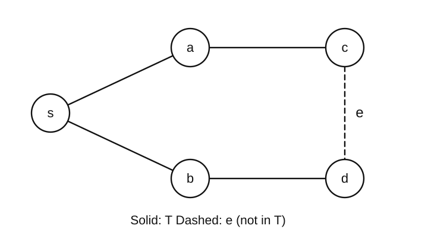

Ⅰ. 从 $s$ 到每个顶点的最短距离不变。

Ⅱ. 任意两个顶点之间的最短距离均不变。

Ⅲ. $T$ 仍可以作为 $G'$ 中从 $s$ 出发的一棵 BFS 搜索树。

正确的是（　）。

A. 仅Ⅰ

B. 仅Ⅰ、Ⅲ

C. 仅Ⅱ、Ⅲ

D. Ⅰ、Ⅱ、Ⅲ

### 第 6 题

无向带权图如下。边权为：$AB=AC=BC=DE=1$，$BD=CD=2$，$AD=4$。对该图的所有最小生成树，按“**每棵都包含／有的包含有的不包含／任何一棵都不包含**”三种情况分类，边 $AB,DE,AD$ 依次属于（　）。

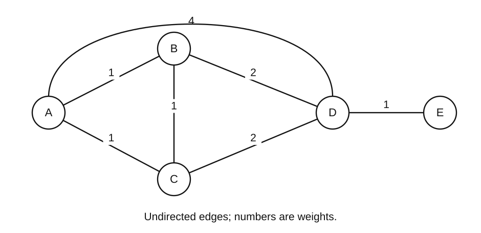

A. 每棵都包含；每棵都包含；任何一棵都不包含

B. 有的包含有的不包含；每棵都包含；有的包含有的不包含

C. 每棵都包含；有的包含有的不包含；任何一棵都不包含

D. 有的包含有的不包含；每棵都包含；任何一棵都不包含

### 第 7 题

下图是关键字互异的二叉搜索树。已知结点4为黑色，结点1、3为红色；结点2、6、5的颜色尚未确定。所有空指针均指向黑色NIL叶结点（多数NIL未画出）。为使它成为一棵合法红黑树，结点 **2、6、5** 的颜色应依次为（　）。

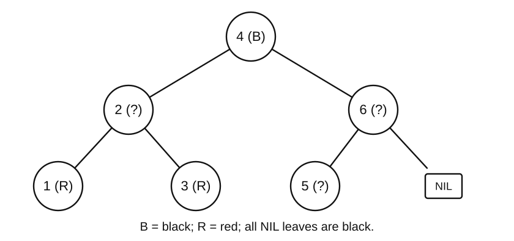

A. 黑、红、黑

B. 红、黑、红

C. 黑、黑、红

D. 黑、黑、黑

### 第 8 题

某 B+ 树如下。每个方框占一个磁盘页，**根页已在内存，叶页均不在内存**；数据记录仅存于叶页。根的两个分隔关键字分别等于第二、第三个叶页中的最小关键字。

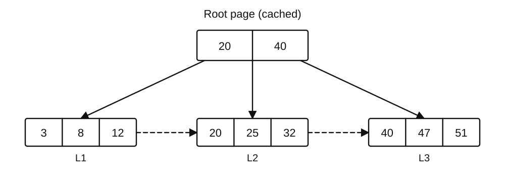

对闭区间 $[18,45]$ 进行范围检索，算法先按下界18沿树下降到候选叶页，再沿叶链向右扫描，遇到第一个大于45的关键字即停止；**不利用题图预知叶页内容而跳页**。实际读取的叶页数与返回的记录数分别为（　）。

A. 2，4

B. 3，4

C. 3，5

D. 4，4

### 第 9 题

采用标准KMP算法匹配模式串 `ababaca`，模式下标从0开始。某时刻已连续匹配模式的前5个字符 `ababa`，接着文本字符 `b` 与模式下标5处的 `c` 失配。算法按**已匹配前缀的最长真前后缀**回退，不使用 `nextval` 优化，文本指针不回退。首次回退后、尚未进行下一次比较时，模式指针下标及模式相对原位置的右移量分别为（　）。

A. 3，2

B. 2，3

C. 1，4

D. 0，5

### 第 10 题

记录的关键字和身份标识分别写成 $2_a,1,2_b$；比较仅比较关键字，不比较身份标识。对该序列执行下列一次划分，`swap` 交换**整条记录**。

```text
pivot = A[n-1].key; i = -1
for j = 0, 1, ..., n-2:
    if A[j].key < pivot:
        i = i + 1
        swap(A[i], A[j])
swap(A[i+1], A[n-1])
```

所得序列以及这一次操作是否保持相等关键字的原相对次序，分别为（　）。

A. $(1,2_a,2_b)$；保持

B. $(1,2_b,2_a)$；保持

C. $(1,2_a,2_b)$；不保持

D. $(1,2_b,2_a)$；不保持

### 第 11 题

磁盘上已有4个有序归并段，分别占5、10、15、20个完整磁盘块。内存只有3个块缓冲区，其中2个用于输入、1个用于输出，因此每次只能二路归并。归并两个分别为 $x,y$ 块的段，必须**读入 $x+y$ 块并写出 $x+y$ 块**；所有中间结果和最终结果均写回磁盘，忽略元数据与预读。将4段合成一段的**最少磁盘块读写次数之和**为（　）。

A. 95

B. 190

C. 200

D. 300

### 第 12 题

某8位补码加减运算器计算 $X-Y$，其中 $X=80\mathrm H$、$Y=01\mathrm H$。规定 **CF=1表示无符号减法发生借位**，OF=1表示有符号补码减法溢出。8位结果、CF、OF依次为（　）。

A. 7FH，0，1

B. 7FH，1，0

C. 81H，0，1

D. 7FH，1，1

### 第 13 题

定义 $\operatorname{RN}_{32}$ 为“先计算精确实数值，再一次舍入为 IEEE 754 binary32”，采用**舍入到最近、平局取最低有效位为偶数**的模式。令

$$x=\operatorname{RN}_{32}(1+2^{-24}),\qquad y=\operatorname{RN}_{32}(1+3\times2^{-24}).$$

$x,y$ 的32位编码（十六进制）依次为（　）。

A. 3F800000H，3F800001H

B. 3F800001H，3F800002H

C. 3F800001H，3F800003H

D. 3F800000H，3F800002H

### 第 14 题

某C实现中 `int` 和 `unsigned int` 均为32位，`int16_t`、`uint16_t` 分别为16位有符号、无符号类型，`uint32_t` 为32位无符号类型。执行下列代码后，`r` 与 `v` 的值分别为（　）。

```c
int16_t s = -3;
uint16_t u = 2;
int r = (s < u);
uint32_t v = s + u;
```

A. 0，4294967295

B. 1，65535

C. 1，4294967295

D. 0，65535

### 第 15 题

某数据Cache容量为64 B，每块16 B，采用**2路组相联、LRU替换**；主存按字节编址，组号取主存块号的低位。Cache初始为空，无预取、无其他访存。CPU按下列地址顺序读数据，并将整个序列**连续执行两遍，中间不清空Cache**：

`00H，20H，10H，40H，20H，00H`

第一遍、第二遍发生的Cache缺失次数分别为（　）。

A. 5，2

B. 5，3

C. 4，2

D. 4，3

### 第 16 题

某系统虚拟地址为32位，页大小为4 KiB。TLB共16个表项，采用4路组相联；组索引取**虚页号的最低若干位**，其余虚页号位作为标记，不考虑ASID。TLB标记字段位数，以及虚拟地址 `12345000H` 对应的TLB组号，分别为（　）。

A. 20，1

B. 18，0

C. 18，1

D. 16，1

### 第 17 题

某机器按字节编址，转移指令长度为2 B。取指后PC先指向下一条指令；若转移发生，则在该PC基础上加上“**8位有符号位移量乘2**”。现转移指令位于 `0100H`，位移字段为 `FCH`。转移目标地址是（　）。

A. 00F8H

B. 00FAH

C. 00FEH

D. 010AH

### 第 18 题

小端机器上三种无符号类型 `U16/U8/U32` 分别占2/1/4 B，对齐要求也分别为2/1/4 B。结构体各字段按声明次序放置，结构体尾部补齐到最大对齐数的倍数。

```c
struct R { U16 code; U8 flag; U32 value; } a[3];
```

`a` 首地址为 `1000H`，`a[2].value=12345678H`。字节 `34H` 的地址为（　）。

A. 1012H

B. 1014H

C. 1015H

D. 1016H

### 第 19 题

某处理器采用 IF、ID、EX、MEM、WB 五级单发射顺序流水线，指令存储器与数据存储器分离。ALU结果在EX结束产生，load数据在MEM结束产生；均可前递至后续指令的EX输入（**不能在同一周期从MEM结束前递到EX结束**）。WB前半周期写寄存器，ID后半周期读寄存器；必要时冻结IF/ID并在EX插入气泡。无其他冒险。

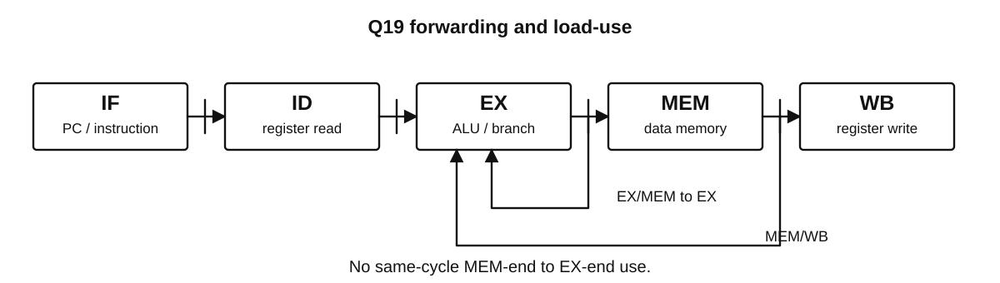

依次执行 `lw r1,0(r2)`、`add r3,r1,r4`、`add r5,r3,r6`。从第一条指令IF记为第1周期，最少停顿周期数及最后一条指令WB所在周期分别为（　）。

A. 0，7

B. 1，7

C. 2，9

D. 1，8

### 第 20 题

处理器M1和M2实现同一指令集体系结构（ISA），分别采用单周期和五级流水线实现。下列属性中，**允许不同且不因此违背ISA一致性**的是（　）。

A. 指令编码中操作码字段的含义

B. 同一算术指令的架构可见运算语义

C. 执行一条给定指令所经历的时钟周期数

D. 架构可见通用寄存器的位宽

### 第 21 题

某同步总线时钟为100 MHz，数据宽度32位，每个**数据传送周期**在两个时钟沿各传一次数据。一次读事务先占1周期发送命令，再等待2周期，然后用4周期连续传送8个字；相邻事务不重叠。以 $1\mathrm{MB}=10^6\mathrm B$ 计，总线的峰值带宽与这种连续事务的有效吞吐率约为（　）。

A. 800 MB/s，457.1 MB/s

B. 400 MB/s，457.1 MB/s

C. 800 MB/s，800 MB/s

D. 400 MB/s，228.6 MB/s

### 第 22 题

采用DMA输入方式，CPU已经为一次内存块传输设置好控制参数。下列叙述正确的是（　）。

A. 每传入一个数据字，CPU都必须执行一条输入指令

B. DMA完成中断属于当前指令直接引起的同步异常

C. DMA传输期间，CPU不能执行与该缓冲区无关的任务

D. CPU可与DMA并行工作，DMA完成后可通过中断通知CPU

### 第 23 题

关于系统调用与外部中断，下列叙述正确的是（　）。

Ⅰ. 执行陷入指令发起系统调用，是与当前指令执行同步的事件。

Ⅱ. 外部中断只能在CPU处于用户态时发生。

Ⅲ. 系统调用服务例程和外部中断处理程序执行时，CPU均处于内核态。

A. 仅Ⅰ、Ⅱ

B. 仅Ⅱ、Ⅲ

C. 仅Ⅰ、Ⅲ

D. Ⅰ、Ⅱ、Ⅲ

### 第 24 题

在题定的POSIX式模型中，进程P先调用一次 `open` 得到fd，随后创建线程T1、T2，两线程均通过该fd读文件；没有 `pread`、`dup` 或再次 `open`。下列关于二者资源的叙述正确的是（　）。

A. 共享该打开文件对象的当前偏移量，各自保存寄存器现场和线程栈

B. 各自拥有该文件的独立偏移量，并各自保存线程栈

C. 共享该文件的偏移量，也共享同一个用于函数调用的线程栈

D. 不共享文件偏移量，但共享同一个寄存器现场

### 第 25 题

单CPU采用**抢占式最短剩余处理时间优先**调度，无切换开销。三个进程均只使用CPU，无I/O，其到达时刻和运行时间如下；剩余时间相同时保持当前进程运行。

| 进程 | 到达时刻/ms | 运行时间/ms |
|---|---:|---:|
| P1 | 0 | 7 |
| P2 | 2 | 4 |
| P3 | 4 | 1 |

三个进程的平均等待时间为（　）。

A. 1 ms

B. 2 ms

C. 3 ms

D. 6 ms

### 第 26 题

系统有A、B两类可重复使用资源，当前可用向量为 `(1,1)`。三个进程的已分配资源和最大需求如下。

| 进程 | Allocation(A,B) | Max(A,B) |
|---|---|---|
| P0 | (1,0) | (2,2) |
| P1 | (0,1) | (2,1) |
| P2 | (1,1) | (2,2) |

采用银行家算法。以下**每个请求均单独从上述原状态提出**，能被立即批准且批准后仍安全的是（　）。

A. P0申请(1,0)

B. P1申请(1,0)

C. P2申请(0,1)

D. P0申请(0,1)

### 第 27 题

某32位虚拟地址按“页目录索引10位、页表索引10位、页内偏移12位”划分，页表项占4 B。对于虚拟地址 `00403008H`，对应页目录项有效，并指出其页表起始**物理**地址为 `00300000H`；该虚地址对应PTE中的页框号为 `00123H`。该PTE的物理地址、最终数据的物理地址分别为（　）。

A. 00300003H，00123008H

B. 0030000CH，00123008H

C. 0030000CH，00123308H

D. 00300030H，00123008H

### 第 28 题

进程拥有3个页框，采用固定分配、局部LRU置换。当前已驻留页面按**最久未使用到最近使用**的顺序为 `1，2，3`。依次访问

`2，4，1，2，5，1`

期间缺页次数，以及此后立刻访问尚未驻留的页面6时被淘汰的页号，分别为（　）。

A. 2，2

B. 3，5

C. 4，2

D. 3，2

### 第 29 题

某文件最初只有目录项 `a`。在POSIX式文件系统中依次建立它的硬链接 `b`、内容为路径字符串 `a` 的符号链接 `s`，再执行 `fd=open("a",...)`，随后删除目录项 `a` 和 `b`。假定无其他打开或映射引用，路径未被重新创建。下列叙述正确的是（　）。

Ⅰ. 仍可通过fd访问原文件内容。

Ⅱ. 符号链接s会自动改为指向b，因而仍可访问原文件。

Ⅲ. 原文件数据块至少保留到最后一个打开引用被关闭。

A. 仅Ⅰ、Ⅲ

B. 仅Ⅰ、Ⅱ

C. 仅Ⅱ、Ⅲ

D. Ⅰ、Ⅱ、Ⅲ

### 第 30 题

某文件系统磁盘块为1 KiB，块指针占4 B。inode含10个直接地址项、1个一级间接地址项和1个二级间接地址项。文件足够大，inode已在内存，但任何索引块和数据块均未缓存。读取文件中从0开始编号、字节偏移为 $272\times1024+17$ 的一个字节，使用的索引层次及所需磁盘块读取次数分别为（　）。

A. 一级间接，2次

B. 二级间接，2次

C. 二级间接，3次

D. 三级间接，4次

### 第 31 题

磁道编号为0–199，磁头当前位于120，向编号增大方向按 **C-SCAN** 服务。待处理请求为10、40、130、170。规定扫到边界199后回到0，**回卷距离计入移动总量**，回卷途中不服务请求；所有请求处理完立即停止。磁头总移动距离为（　）。

A. 119

B. 240

C. 318

D. 398

### 第 32 题

某计算机上电后，CPU从固定ROM地址执行固件。启动盘中引导扇区含引导程序，内核映像位于盘上其他区域，不采用网络启动。下列对启动过程的理解正确的是（　）。

A. CPU上电后即可直接从磁盘扇区取出并执行内核指令

B. 固件可将引导程序装入内存并转交控制，由其装入内核

C. 第一个用户态进程负责装入内核，内核再初始化其地址空间

D. 内核必须先正常运行，固件才可能执行磁盘读取操作

### 第 33 题

H1经R1、R2向H2传送2000 B数据，三段链路速率依次为4 Mb/s、2 Mb/s、4 Mb/s。各节点采用存储转发，忽略首部、传播、排队和处理时延（仅保留因本次传输形成的链路等待）。若将数据划分成两个1000 B分组连续发送，完成时间为 $T_P$；若作为一个2000 B报文逐跳转发，完成时间为 $T_M$。从H1发送第一个比特至H2收到最后一个比特，$(T_P,T_M)$ 为（　）。

A. (10 ms，16 ms)

B. (12 ms，12 ms)

C. (12 ms，16 ms)

D. (16 ms，16 ms)

### 第 34 题

某理想低通信道带宽为3 kHz，线性信噪比 $S/N=15$，每个码元最多取8种可区分状态。将奈奎斯特无噪声码元上界与香农噪声容量**同时作为约束**，可得到的比特率上界为（　）。

A. 6 kb/s

B. 12 kb/s

C. 18 kb/s

D. 24 kb/s

### 第 35 题

如下图，交换机S1、S2均采用源MAC地址自学习，转发表初始为空，所有端口属于同一VLAN，表项不老化。端系统已经知道目标MAC地址，整个过程中**只发送下述三个单播数据帧，不产生ARP或其他帧**：H1→H3、H3→H1、H2→H3，三帧按顺序完全处理。

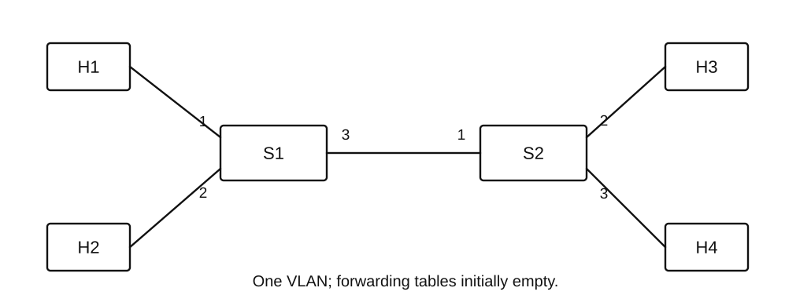

处理第3帧时，S1与S2的转发出端口集合分别为（　）。

A. {3}，{2}

B. {1,3}，{2,3}

C. {1,3}，{2}

D. {3}，{2,3}

### 第 36 题

选择重传SR使用3位序号，发送和接收窗口大小均为4。初始发送窗口和接收窗口下沿均为6，发送方依次发出序号6、7、0、1四帧。6丢失，接收方正确缓存7、0、1，并分别确认；发送方已收到ACK7、ACK0、ACK1。随后6超时重传并被正确接收，但该次ACK6丢失。

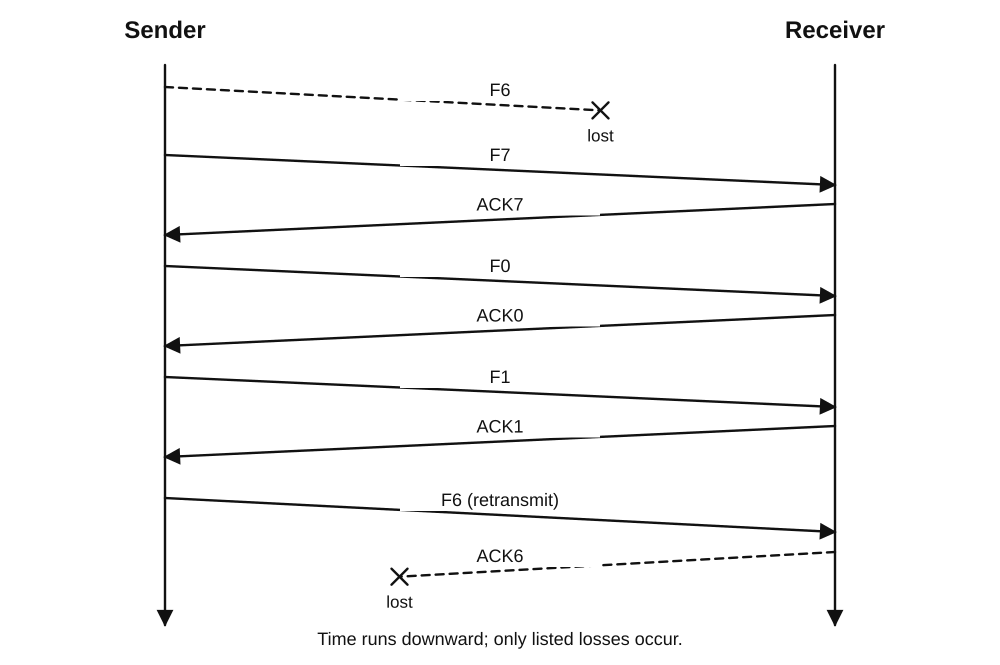

在重传6已被接收、但发送方尚未收到ACK6且未再发生超时的时刻，发送窗口下沿、接收窗口下沿、发送方可立即发送的**新帧数量**依次为（　）。

A. 2，2，4

B. 6，7，0

C. 7，2，1

D. 6，2，0

### 第 37 题

路由器R已安装下列路由，均有效且无策略路由、无NAT。表中的开销只用于生成路由表，不替代转发时的最长前缀匹配。

| 目的前缀 | 下一跳 | 开销 |
|---|---|---:|
| 10.40.0.0/16 | A | 1 |
| 10.40.14.0/23 | B | 2 |
| 10.40.8.0/21 | C | 3 |
| 10.40.12.0/22 | D | 9 |

目的地址为 `10.40.13.7` 的分组应交给（　）。

A. 下一跳A

B. 下一跳B

C. 下一跳C

D. 下一跳D

### 第 38 题

TCP连接已建立，接收方下一期待字节序号为1001，可用于本方向数据的接收缓存共2000 B，初始为空。发送方发出三个数据段，首字节序号依次为1001、1401、1801，每段400 B。接收方按 **1401段、1001段、1801段** 的顺序收到它们，缓存乱序数据，每段到达后立即发累计ACK；应用进程暂不取走数据。

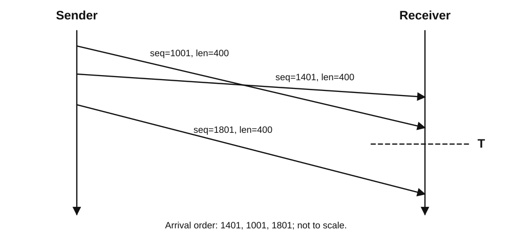

在图中T时刻，累计ACK值及**尚未被已收到数据占用的接收缓存字节数**分别为（　）。

A. 1401，1600 B

B. 1801，1200 B

C. 1801，1600 B

D. 2201，800 B

### 第 39 题

某TCP连接已建立，采用题定的**按RTT分轮模型**：一轮开始最多发出 `min(cwnd,rwnd)` 个MSS，收到该轮全部确认后才开始下一轮；确认均在一轮开始后的1 RTT到达。初始cwnd=1 MSS，ssthresh=4 MSS，rwnd恒为6 MSS。若本轮cwnd小于4，下一轮将其加倍但不超过4；否则下一轮增加1 MSS。无丢失、无重传，RTT=10 ms。

发送18 MSS的数据，从第1轮发送开始到收到最后数据的确认，共需（　）。

A. 40 ms

B. 45 ms

C. 50 ms

D. 60 ms

### 第 40 题

浏览器已缓存目标服务器的有效IP地址，但尚无TCP连接。用HTTP/1.1持久连接请求一个HTML文档，收到并解析后再请求其中的两个小图像；只用一条TCP连接，**不使用流水线，每次完整收到一个响应后才发下一个请求**。忽略TLS、处理时间及各报文发送时间，所有往返均为RTT，第三次握手ACK可携带HTML请求。

从发送SYN开始，到两个图像全部收到，至少需要（　）。

A. 3 RTT

B. 4 RTT

C. 5 RTT

D. 6 RTT

## 二、综合应用题（第41–47题，共70分）

### 第 41 题

（13分）两个设备分别用**不带头结点的非降序单链表**A、B记录已有的整数版本号。版本号允许重复，也允许为负，但均在 $[-10^6,10^6]$ 内；两表可为空。结点定义如下。

```c
typedef struct Node {
    int key;
    struct Node *next;
} Node;
```

称整数闭区间 $[L,R]$ 为“共同连续版本段”，当且仅当 $L,L+1,\ldots,R$ 中的**每一个不同整数**都至少在A和B中各出现一次。区间长度是 $R-L+1$，不计重复结点。要求寻找长度最大的共同连续版本段；若并列，取起点L最小的一个。

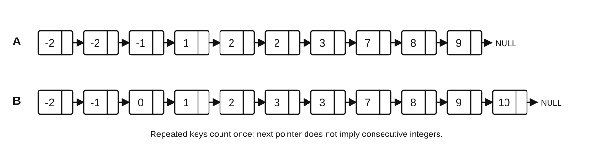

例如，图中共同版本集合为 $\{-2,-1,1,2,3,7,8,9\}$，应选择 $[1,3]$ 而非同长的 $[7,9]$。

请实现函数：

```c
int longestCommonRun(const Node *a, const Node *b, int *lo, int *hi);
```

成功时返回最长长度，并通过lo、hi保存L、R；lo、hi指向互不重叠且不属于输入链表的有效int对象。无公共版本时返回0，且**不修改**`*lo`、`*hi`。两表长度分别为m、n，要求最坏时间 $O(m+n)$、额外空间 $O(1)$；不许改动结点或链接，也不许使用新数组、哈希表、递归或新结点。可假定int至少32位。

（1）说明算法思想及为何不会漏掉最优连续版本段。（4分）

（2）用C或C++写出算法，注明关键步骤。（7分）

（3）分析时间复杂度与额外空间复杂度。（2分）

### 第 42 题

（10分）AVL树关键字互不相同，初始形态如下。规定空子树高度为0、叶结点高度为1，平衡因子为“左子树高度−右子树高度”。

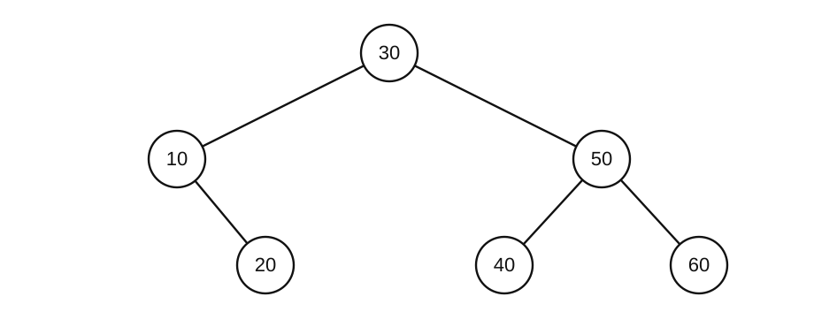

（1）插入15。指出沿插入路径向上遇到的第一个失衡结点及所需旋转类型，并画出调整后的AVL树。（4分）

（2）在（1）所得树上删除50。删除具有两个孩子的结点时，固定用其**中序直接前驱**的关键字替换，再删除前驱原结点。画出删除并完成必要调整后的树，说明是否还需旋转。（3分）

（3）在（2）所得树中，查找不存在的45时，依次与哪些关键字比较？若6个现存关键字等概率被成功查找，以根处比较计1次，平均查找长度是多少？（3分）

### 第 43 题

（12分）教学计算机M按字节编址，字长及所有通用寄存器均为32位。寄存器为R0–R7，R0恒为0。所有指令长4 B；本题中整数和地址运算的32位结果按模 $2^{32}$ 保留。

M采用如下五级单发射、按序流水线。各级组合逻辑延迟为 IF 180 ps、ID 220 ps、EX 200 ps、MEM 240 ps、WB 140 ps；每级流水寄存器开销均为20 ps。

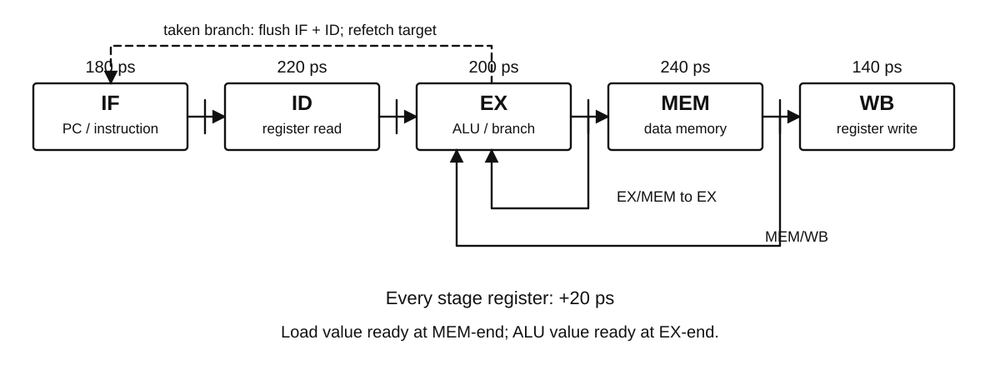

**完整时序约定：** 指令和数据访存无结构冲突，均无Cache缺失；ALU结果在EX结束、load数据在MEM结束可用，之后可前递到后续EX输入，不能跨同周期结束边界抢先使用；WB前半周期写寄存器、ID后半周期读。load-use时冻结IF/ID、向EX插气泡。分支在EX结束判定，预测不跳转；跳转时冲刷当时ID和IF中的两条年轻指令，下一周期重新从目标取指，**即使目标恰已在IF也须冲刷重取**。除以上情况无额外停顿。无访存/无写回的指令也占据对应流水阶段，但不产生副作用。

以下指令依次存放于 `4000H` 起始的连续地址：

| 标号 | 指令 | 功能 |
|---|---|---|
| I1 | `LW R1,0(R2)` | R1←内存中以R2为地址的32位字 |
| I2 | `ADD R3,R1,R4` | R3←R1+R4 |
| I3 | `ADD R5,R3,R6` | R5←R3+R6 |
| I4 | `ADDI R2,R2,4` | R2←R2+4 |
| I5 | `BNZ R5,+1` | 若R5≠0，PC←本指令地址+4+4×1 |
| I6 | `ADD R7,R7,R1` | R7←R7+R1 |
| I7 | `ADD R4,R4,R1` | R4←R4+R1 |

初始R2=`1000H`、R4=3、R6=4、R7=100，数据存储字M[1000H]=2，其余相关初始寄存器为0。第一条指令IF记为第1周期。

（1）M允许的最短时钟周期是多少？（2分）

（2）列出I1、I2、I3的EX与WB周期，指出必要的数据冒险停顿及使用的两处关键前递。（4分）

（3）I5在哪个周期结束时判定跳转？I7最终在哪个周期完成WB？从第1周期开始至该WB结束共历时多少？（4分）

（4）本段执行后R3、R5、R7的值分别是什么？（2分）

### 第 44 题

（11分）沿用第43题M的32位寄存器、4 B定长指令、R0恒0与按字节编址约定，但下面是**单独运行的另一段程序**，寄存器和地址均按本题重新初始化。M为小端机器，系统页大小为4 KiB，题给数据页面均已驻留。

指令字段如下；所有未使用位必须为0，寄存器编号占3位：

| 格式 | [31:26] | [25:23] | [22:20] | [19:17] | [16:0] |
|---|---|---|---|---|---|
| ADD | 000001 | rd | rs | rt | 全0 |

| 格式 | [31:26] | [25:23] | [22:20] | [19:0] |
|---|---|---|---|---|
| LW | 000010 | rd | rs | 有符号字节偏移imm |
| ADDI | 000011 | rd | rs | 有符号立即数imm |
| BNZ | 000100 | 必须000 | rs | 有符号指令位移imm |
| LH | 000101 | rd | rs | 有符号字节偏移imm |

LW读取32位字；LH读取16位半字并**符号扩展到32位**。ADDI把符号扩展后的imm加到R[rs]。BNZ在R[rs]≠0时跳到“本指令地址+4+4×SEXT(imm)”。

以下5条指令从 `8000H` 起连续存放：

```text
L:  LW    R1,0(R2)
    ADD   R3,R3,R1
    ADDI  R2,R2,4
    ADDI  R5,R5,-1
    BNZ   R5,L
```

初始R2=`1FFCH`、R3=0、R5=3。数组a的3个 `int32_t` 元素位于以下虚拟字节地址，代码区与数据区互不重叠：

| 虚拟地址 | +0 | +1 | +2 | +3 |
|---|---|---|---|---|
| 1FFCH | FE | FF | FF | FF |
| 2000H | 05 | 00 | 00 | 00 |
| 2004H | FC | FF | FF | FF |

（1）a的3个有符号值及循环结束时R3的32位十六进制内容是什么？（3分）

（2）循环结束时R2为何值？a占据哪几个虚页号？（2分）

（3）最后一条BNZ中的20位imm字段和整条32位机器码分别是什么？（3分）

（4）若另一个版本将a改为元素数仍为3的 `int16_t` 数组，基址仍满足半字对齐，R3仍累加32位有符号和，除将LW换成LH外，还需修改哪条指令？BNZ位移需不需要改变？说明理由。（3分）

### 第 45 题

（7分）某在线监测系统只有一个可复用的记录槽 `slot`，由一个生产线程P和两个独立的订阅线程A、B共享。P依次产生编号为1、2、3、…的记录。**每条记录必须被A和B各读取一次，且两者均读取完成之后，P才能覆盖该槽写入下一条。** A、B仅读取记录，允许同时读取；`write`、`readA`、`readB`各操作都会在有限时间内结束。三个线程都循环运行，使用原子阻塞型P/V信号量操作，调度公平。


某同学使用以下信号量（初值均为0）设计程序：

```text
semaphore ready = 0, doneA = 0, doneB = 0;

P:                         A:                         B:
while (true) {             while (true) {             while (true) {
    write(slot);               P(ready);                  P(ready);
    V(ready);                  readA(slot);               readB(slot);
    V(ready);                  V(doneA);                  V(doneB);
    P(doneA);              }                         }
    P(doneB);
}
```

（1）上述设计能否保证每条记录都被A、B各读一次？给出一条**合法执行顺序**说明理由。（2分）

（2）设计正确的信号量及初值，并写出P、A、B三个线程的完整P/V伪代码，使每条记录被两个订阅者各读取一次、写入时不覆盖仍在读取的记录，而且**不必让A、B串行读取**。（4分）

（3）若A已读完某条记录，而B仍在读取，P能否开始写下一条？说明理由。（1分）

### 第 46 题

（8分）单CPU系统中，进程P调用阻塞式`read`读取设备数据。内核先配置DMA，将数据写入一个**已驻留、与设备保持一致的内核缓冲区**，然后使P阻塞。本次DMA在P阻塞后才完成；此期间CPU运行进程Q。完成中断的处理程序只确认设备完成并将P加入就绪队列，**不在中断程序内复制到用户缓冲**。唤醒P不会立即抢占Q；P稍后被调度，继续内核中的`read`，复制数据到用户缓冲后返回用户态。

以下事件编号仅作标识：

① P的`read`返回用户态；② DMA将本批数据写入内核缓冲区；③ P进入阻塞队列；④ CPU进入设备完成中断处理程序；⑤ P被加入就绪队列；⑥ 数据从内核缓冲复制到P的用户缓冲。

（1）写出六个事件的正确顺序。（3分）

（2）②的数据搬运是否需要CPU逐字执行复制指令？④入口保存的被中断执行现场属于P还是Q？④执行期间CPU处于什么模式？（3分）

（3）⑤发生后P是否立即占用CPU？此时能否断言本批数据已经写入P的用户缓冲？分别说明。（2分）

### 第 47 题

（9分）主机H已经与服务器V建立TCP连接，准备上传1500 B应用数据。H到V的路径如图47所示，沿途没有NAT和其他更小MTU的链路；图中各MTU均指**IPv4数据报的总长度上限**。本题IPv4首部为20 B、TCP首部为20 B，均无可选字段。V在建立连接时通告的MSS为1000 B。

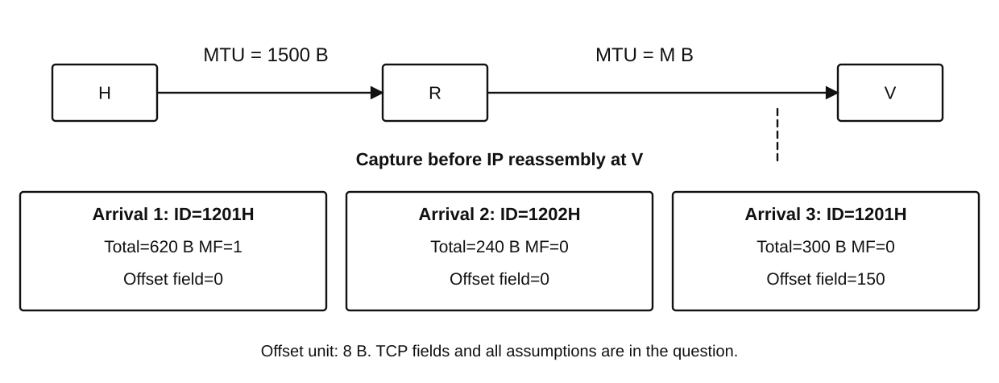

握手完成后，H尚有连续的1500 B数据未获确认，其第一个数据字节的TCP序号为5001。H起初将其中900 B封装为一个TCP段（序号5001），形成IPv4总长度940 B、`DF=1`的数据报。网络抓包观察如下：

| 观察位置 | 记录 |
|---|---|
| H发送端 | IPv4总长度940 B，`DF=1`，TCP数据900 B，序号5001 |
| R1转发端 | 未向R2发出该数据报，向H返回一条**包含下一跳MTU=620 B的ICMP差错报告** |
| V接收端 | 未收到上述900 B数据 |

H收到ICMP报告后，允许将**尚未确认的1500 B字节流重新分段**，并把新数据报继续设置为`DF=1`。此后所有新数据段均正确、按序送达V，没有其他数据交错；发送方无需考虑IP分片和TCP选项。

（1）R1无法向R2转发原数据报的直接原因是什么？R1能否把它分片后继续转发？（2分）

（2）为确保新的IPv4数据报在所有链路上均不需要分片，H能采用的**最大单段TCP数据长度**是多少字节？把1500 B数据按该上限尽量装满每段，需发送几个段？各段的数据长度依次是多少？（3分）

（3）新发送的**第3个TCP数据段**首字节序号是多少？V全部按序收到1500 B后发送的累计ACK确认号是多少？（2分）

（4）随后H还有大量数据持续发送。假定RTT恒为40 ms，接收窗口、拥塞窗口均不构成额外限制；发送方最多允许**同时有N个满载、每段数据长度等于（2）中上限**的TCP数据段处于在途状态，忽略各层首部、ACK及处理开销。为使图中瓶颈链路的理论利用率至少达到75%，N至少是多少？（2分）

