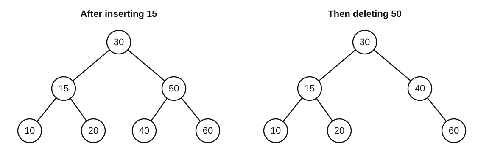

<!-- paper: ai-original/set-01 | kind: solutions | status: complete-draft-author-checked -->
# 408 AI Original · Set 01：参考解答与评分细则

> **完整初稿，等待独立命题审稿与限时试做。** 以下为出题者解答和程序交叉检验，不冒充第二位专家独立签核；验证覆盖见 `verification.md`。学生卷不包含本页答案。

## 选择题答案表

| 题号 | 1 | 2 | 3 | 4 | 5 | 6 | 7 | 8 | 9 | 10 |
|---|---|---|---|---|---|---|---|---|---|---|
| 答案 | C | A | B | D | B | D | C | B | A | D |

| 题号 | 11 | 12 | 13 | 14 | 15 | 16 | 17 | 18 | 19 | 20 |
|---|---|---|---|---|---|---|---|---|---|---|
| 答案 | B | A | D | C | A | C | B | D | D | C |

| 题号 | 21 | 22 | 23 | 24 | 25 | 26 | 27 | 28 | 29 | 30 |
|---|---|---|---|---|---|---|---|---|---|---|
| 答案 | A | D | C | A | B | C | B | D | A | C |

| 题号 | 31 | 32 | 33 | 34 | 35 | 36 | 37 | 38 | 39 | 40 |
|---|---|---|---|---|---|---|---|---|---|---|
| 答案 | C | B | C | B | A | D | D | B | C | B |

## 逐题解析

### 第 1 题

**答案：C。**

外层恰好执行 $n$ 次，给出 $\Omega(n)$ 下界。`j` 单调递增且不超过 $n$，因此所有内层循环体的执行次数合计至多 $n$；每次外层循环至多再产生一次使内层退出的条件判断。总工作量为 $O(n)$，故为 $\Theta(n)$，辅助空间为 $O(1)$。不需要假定数组有序。

A 忽略了外层必须访问的 $n$ 个位置；B 把不存在的折半过程计入；D 将各轮共享的 `j` 错当成每轮从零重启。程序检查对小数组枚举内层增量，并验证其总量不超过 $n$；一般性结论由上述计数证明支持。

### 第 2 题

**答案：A。**

A 要先输出4，就必须在第一次出栈前把1、2、3、4同时压栈，峰值为4，超过容量。B 的最大栈深为3：压入1、2、3，弹出3、2，再压4并弹出4、1，最后处理5。C 先弹2，再压3、4；D 先弹2、1，再压3、4、5。C、D的最大栈深也都是3。

三个干扰项均为正常可行序列，不需要额外限制“连续出栈次数”。枚举所有容量不超过3的合法进出栈过程可交叉核对。

### 第 3 题

**答案：B。**

根为A。若A只有一个孩子，先序根后第一个结点与后序根前最后一个结点应是同一子树根；这里分别为B和D，故A有两个孩子。左子树结点为B、C，右子树为D、E。B只有孩子C，但不能确定C是左孩子还是右孩子；D、E同理。因此共有 $2\times2=4$ 棵。

A 只计入一处左右不确定性；C、D 错把根A的两棵非空子树也当成可以随意换位。根的左右子树顺序已由先序、后序共同确定。

### 第 4 题

**答案：D。**

合并权值依次是 $1+1=2$、$2+2=4$、$2+4=6$，WPL等于所有合并权值之和 $2+4+6=12$，Ⅰ正确。

第一次合并得到内部结点u（权2）。第二次若合并c、d，最终4个字符码长全为2；若合并u、c，则码长可为 $a:3,b:3,c:2,d:1$。两种方案都遵守哈夫曼算法，因此Ⅱ错误，Ⅲ正确。左右子树交换造成码字变化，与这里由平局选择造成的**码长变化**不是同一件事。

### 第 5 题

**答案：B。**

对任意顶点v，树T中从s到v的路径长度为 $d_G(s,v)$。删除的不是树边，这条路径完整保留，故 $d_{G'}(s,v)\le d_G(s,v)$；删边又不可能创造更短路径，故二者相等，Ⅰ正确。沿用原搜索中各邻接表的相对次序，只删掉e，原先各结点的首次发现树边仍能保留，因而可以再次得到T，Ⅲ正确。亦可利用每个结点在T中的父结点仍位于前一BFS层来理解这一结论，但仅有“层距相符”不应替代可实现性说明。

Ⅱ不成立：图中 $d_G(c,d)=1$，删除cd后为4；从s到c、d却仍都是2。此反例也说明“源点距离保持”不是“所有点对距离保持”。A 漏掉仍可实现的T；C 否认Ⅰ且接受Ⅱ；D 错把树路径保留推广到所有点对。

### 第 6 题

**答案：D。**

E仅通过DE连接，故DE是每棵生成树的必选边。ABC中任取两条权1边均能连通这三个顶点，因此AB可选可不选。D到ABC选BD或CD中的一条权2边即可；在环A–B–D–A中，AD是唯一最重边，不能出现在MST中。

最小总权重为 $1+1+2+1=5$，共有 $3\times2=6$ 棵MST。A 把AB误判为必选；B 忽略AD的严格劣势；C 忽略DE是桥。枚举7条边中全部4边子集，可验证这六棵及各边分类。

### 第 7 题

**答案：C。**

2的两个孩子为红色，为避免连续红结点，2必须为黑色。6的右孩子是NIL，故左边经5到NIL的路径不能比右边多一个黑结点，因此5必须为红色。根4左侧路径经过黑结点2，右侧也必须有相同黑结点数，故6为黑色。此时所有根到NIL路径的黑结点数相同。

A 使6左右黑高不一致且左右主子树黑高不同；B 使2与1/3出现红红相邻；D 在6到5的路径多算一个黑结点。验证对三处未知颜色的 $2^3$ 种赋值逐一检查，不涉及插入修复算法。

### 第 8 题

**答案：B。**

下界18小于根分隔值20，首先读取第1叶页，确认其中没有合格记录；再读取第2页返回20、25、32；读取第3页返回40，遇47停止。读取叶页3个，结果4条。根在内存不计磁盘读取，内部关键字也不是另一份数据记录。

A 用已知图示内容跳过了规定必须检索的第1页；C 将47或内部索引重复计入记录；D 把已缓存的根计成叶页读取。题目问的是**指定算法的实际过程**，不是全知条件下最少读取页数。

### 第 9 题

**答案：A。**

`ababa` 的最长相同真前后缀为 `aba`，长度3，因此保留这3个已匹配字符，模式指针由5回到3，模式右移 $5-3=2$。下一次将当前文本字符b与模式下标3处的b比较，但题目问的是进行该比较之前的状态。

B 把长度3误写成下标2；C 没有取最长边界而直接回退到长度1；D 完全放弃可复用前缀。显式约定避免教材 `next` 数组从0或1开始造成的差异。

### 第 10 题

**答案：D。**

pivot关键字为2。第一次比较 $2_a<2$ 为假；遇到1时，i变为0，交换后为 $(1,2_a,2_b)$。最后交换A[1]与枢轴记录A[2]，得到 $(1,2_b,2_a)$，同关键字记录的先后已经颠倒。

A/C 漏做最后一次枢轴交换；B 将“不直接比较相等记录”误认为会保持稳定性。必须模拟给出的严格小于条件，不能只背“快速排序不稳定”。

### 第 11 题

**答案：B。**

最优归并顺序是先合并5与10，得15；再合并两个15，得30；最后合并20与30，得50。读写次数为 $2(15+30+50)=190$。可以利用哈夫曼式最优合并，也可以枚举所有二叉合并安排证明最小值。

A 只计读或只计写；C 对应先(5,10)、再(15,20)、最后合并15和35的非最优安排，读写共200；D 相当于没有利用小段优先，反复搬运更多块。三个缓冲只允许二路归并，不能一次四路合并得到100。

### 第 12 题

**答案：A。**

低8位结果为 $80\mathrm H-01\mathrm H=7F\mathrm H$。无符号解释下 $128-1=127$，无需借位，CF=0；有符号解释下 $-128-1=-129$ 超出8位补码范围，OF=1。

B 交换了借位与有符号溢出的语义；C 错做加法；D 认为只要数学上的有符号结果超范围就有无符号借位。CF的定义已在题干规定，不采用某ISA“进位表示不借位”的另一种约定。

### 第 13 题

**答案：D。**

在 $[1,2)$ 内binary32相邻数的间隔为 $2^{-23}$。x位于编码3F800000和3F800001的数值正中，前者尾数最低位为0，取前者。y位于3F800001和3F800002对应数的正中，后者尾数最低位为0，取后者；其值为 $1+2^{-22}$。

A 对第二次平局总向下舍入；B 对第一次平局总向上舍入；C 把半ULP当作整ULP或机械按十进制“四舍五入”。两次均是对精确实数一次舍入，不涉及C编译器中间扩展精度或反复加法。

### 第 14 题

**答案：C。**

32位int能表示两种16位类型的全部值，故s、u先都提升为int。比较 $-3<2$ 为真，r=1。加法先在int中得到−1，然后赋值到uint32_t，按模 $2^{32}$ 转换为4294967295。

A/D 把16位无符号u误当成无需提升的32位无符号数；B/D 把最后赋值的模数误用为 $2^{16}$。运算不产生有符号溢出，且本题已声明整数宽度，避免实现相关结论。

### 第 15 题

**答案：A。**

共有 $64/(16\times2)=2$ 组。六次访问的块号为0、2、1、4、2、0；块0/2/4映射到组0，块1映射到组1。

第一遍仅第5次访问块2命中，缺失5次。结束时组0从LRU到MRU是[2,0]，组1保留块1。第二遍：0、2、1命中；4缺失并替换0；2命中；0缺失并替换4。故第二遍缺失2次。

B 未正确继承第一遍的LRU状态；C/D 以为数据总容量足够就不会组冲突，或漏算初次装入。逐次组内状态模拟交叉验证两遍分别为5、2。

### 第 16 题

**答案：C。**

页内偏移12位，虚页号20位。TLB共 $16/4=4$ 组，组索引2位，标记为18位。地址虚页号为12345H，其低2位为01，组号1。

A 把整个虚页号都计作标记；B 从页内偏移（低12位全零）错取组号；D 将表项总数16当作组数，误扣4个索引位。

### 第 17 题

**答案：B。**

取指后PC=0102H。FCH作为8位补码是−4，字节位移为−8，故目标为 $0102\mathrm H-8=00FA\mathrm H$。

A 用旧PC=0100H加位移；C 把位移量误按字节、不乘2；D 丢失位移符号。目标地址按偶数字节对齐。

### 第 18 题

**答案：D。**

code偏移0–1，flag偏移2，偏移3为填充，value偏移4–7，结构体大小8 B。`a[2].value`起址为 $1000\mathrm H+2\times8+4=1014\mathrm H$。小端字节顺序为78、56、34、12，因此34位于1016H。

A 漏计填充或错算结构体大小；B 给出字段起址；C 找到的是56H所在字节。对齐与字节序应分别计算，不能将整个地址倒序。

### 第 19 题

**答案：D。**

第一条LW的MEM在第4周期结束，第二条ADD不能在第4周期的EX就使用这个结果，必须停1周期，于第5周期EX执行。第三条ADD在第6周期EX，直接前递第二条第5周期EX结果，无需再停。

三条指令的WB依次为第5、7、8周期。总周期 $3+4+1=8$。A 认为前递能消除load-use；B 承认停顿却没将其计入尾部；C 将第二个ALU-ALU相关也计作停顿。

### 第 20 题

**答案：C。**

指令完成所需的微架构时钟周期属于实现属性；单周期与流水线可用不同阶段、周期及重叠方式实现同一架构可见行为。指令编码、架构寄存器宽度和运算语义则需遵守同一ISA定义。

A/B/D 都改变程序所观察的指令或寄存器规则。比较流水线单条指令延迟与吞吐率时还要注意两者不是同一指标。

### 第 21 题

**答案：A。**

峰值为 $100\times10^6\times2\times4=800\times10^6$ B/s。每事务传 $8\times4=32$ B，历时 $(1+2+4)\times10\mathrm{ns}=70\mathrm{ns}$，故有效吞吐率约 $32/(70\times10^{-9})=457.1$ MB/s。

B 只计一个沿的峰值但实际事务又按双沿；C 忽略命令与等待；D 将双沿技术在峰值和实际传送中都漏算。这里的100 MHz是时钟频率，不是200 MT/s的数据传输率。

### 第 22 题

**答案：D。**

数据由设备/DMA控制逻辑沿总线送入主存，不需要CPU逐字执行输入指令。CPU可以执行其他任务，但可能与DMA竞争总线而暂时受阻；完成通知是外部I/O中断，不是执行当前指令产生的同步异常。

A 混同程序查询方式；B 混同异常和外部中断；C 把局部总线竞争扩大为CPU整个传输期间不能工作。D不意味着CPU可在DMA未完成时安全使用正在写入的数据。

### 第 23 题

**答案：C。**

系统调用入口由指令主动触发，与执行流同步；服务例程和中断处理程序都需要内核权限。外部设备的中断请求不取决于CPU当前是否在用户态，在内核态也可能产生，是否立即响应还取决于屏蔽和优先级。故Ⅰ、Ⅲ正确，Ⅱ错误。

不要把“中断发生之前的CPU模式”与“处理程序开始执行时的模式”混为一谈；A/B/D均包含Ⅱ。

### 第 24 题

**答案：A。**

fd属于进程级文件描述符表，指向同一个打开文件对象，故其文件位置被两个线程共同使用。线程有独立寄存器现场及函数调用栈。这里“独立线程栈”指执行上下文分开，不表示另一个线程在共享地址空间内绝不可能访问其内存。

B 错把一次open当成两个独立打开；C/D 混同共享地址空间与共享执行现场。题目不依赖两个read的并发先后，也不要求推测各次读到了哪些字节。

### 第 25 题

**答案：B。**

运行序列：P1在[0,2)，P2在[2,4)，P3在[4,5)，P2在[5,7)，P1在[7,12)。完成时刻分别为12、7、5。等待时间为完成−到达−CPU运行量，即5、1、0，平均 $(5+1+0)/3=2$ ms。

A 漏掉了某次抢占造成的等待；C 没按每个进程实际等待累计；D 是平均周转时间 $(12+5+1)/3=6$ ms。最终时间轴中没有空闲周期。

### 第 26 题

**答案：C。**

Need分别为P0(1,2)、P1(2,0)、P2(1,1)。四个请求均未超过对应Need和Available，但还必须做试分配后的安全性检查。

A：Available变为(0,1)，P0的Need为(0,2)，没有进程可完成。B：Available为(0,1)，P1仍需(1,0)，也没有进程可完成。D：Available为(1,0)，P0仍需(1,1)，同样不安全。C：Available变为(1,0)，P2的Need变为(1,0)，可先完成P2并归还(1,2)，得到(2,2)，之后P0、P1可先后完成；安全序列如P2、P0、P1。

“当前能凑出请求的资源”不是“试分配后的状态安全”。独立枚举六种进程排列验证C有安全序列，其他三个没有。

### 第 27 题

**答案：B。**

虚地址的目录索引为1、表内索引为3、偏移为8。PTE地址为 $00300000\mathrm H+3\times4=0030000C\mathrm H$。页框基址为 $00123\mathrm H\times 1000\mathrm H=00123000\mathrm H$，加8得到00123008H。

A 忘记PTE占4字节；C 将页表索引错误混入最终页内偏移；D 把十进制12误写成十六进制30或错误再放大步长。目录项的地址不等于它指向的页表基址。

### 第 28 题

**答案：D。**

LRU顺序逐步为：

| 访问 | 是否缺页 | 访问后LRU→MRU |
|---:|---|---|
|2|否|1,3,2|
|4|是，淘汰1|3,2,4|
|1|是，淘汰3|2,4,1|
|2|否|4,1,2|
|5|是，淘汰4|1,2,5|
|1|否|2,5,1|

共3次，之后访问6淘汰2。A漏一次缺页；B未在最后一次命中1后正确维护次序；C将一次命中误计缺页。题干显式提供最初最近使用顺序，避免初始状态不充分。

### 第 29 题

**答案：A。**

硬链接全部删除后，inode的链接计数为0，但打开文件引用还存在，文件内容仍能经fd访问。关闭最后打开引用且无其他引用后，文件系统才可回收其数据块。符号链接保存的是路径字符串a，不会自动寻找原inode的另一个硬链接名字；a被删除后该路径已悬空。

A正确，其他选项均错误包含Ⅱ。不能将链接计数与打开引用计数合并成同一个数。

### 第 30 题

**答案：C。**

每索引块存 $1024/4=256$ 个指针。逻辑块0–9直接寻址，10–265通过一级间接寻址，266起进入二级间接。本字节位于逻辑块272，即二级范围内第6号（从0开始）块。先读二级索引的顶层块，再读对应次层索引块，最后读数据块，共3次。

A误算直接/间接覆盖边界；B只数两层索引而忘记数据；D虚构第三层间接索引。本次读取不包括已在内存中的inode，也不计整块内第17字节的额外I/O。

### 第 31 题

**答案：C。**

路径为120→130→170→199→0→10→40，总距离
$10+40+29+199+10+30=318$，也可算 $(199-120)+199+40=318$。

A漏计199→0的回卷；B是直接从170回到10的C-LOOK式计算；D在最后请求40完成后仍移动到原位置120。必须遵循题定C-SCAN边界和结束条件。

### 第 32 题

**答案：B。**

上电后首先执行可获得的固件，固件定位并转交磁盘引导程序；后者装入并进入内核，内核建立运行环境后启动用户态进程。B符合题定流程。

A把外存扇区当作可直接取指的内存；C颠倒内核与用户态进程的依赖；D错误地把固件自身的设备访问也依赖于尚未装入的内核。这里按题目给定的引导模型作答，不强制等同所有UEFI或嵌入式启动实现。

### 第 33 题

**答案：C。**

1000B分组在三段链路的发送时间分别为2、4、2 ms。第1分组H1→R1为[0,2]，R1→R2为[2,6]，R2→H2为[6,8]；第2分组依次为[2,4]、[6,10]、[10,12]，最终12ms。

一个2000B报文必须在每一跳收齐才发，耗时 $4+8+4=16$ ms。A漏掉尾段发送，B把报文当作可流水分组，D忽略分组转发能重叠。忽略排队指无外来流量，不意味着两个分组可同时占据同一条链路。

### 第 34 题

**答案：B。**

奈奎斯特上界 $2B\log_2 M=2\times3000\times3=18000$ b/s；香农上界 $B\log_2(1+S/N)=3000\log_2 16=12000$ b/s。同时满足应取较小值12kb/s。

A混淆最大码元率6kBaud与比特率；C仅使用奈奎斯特；D用错误状态数或再乘一次2。本题问理论上界，不保证某种具体编码必能达到。

### 第 35 题

**答案：A。**

第1帧使S1学到H1→1，S2学到H1→1；目的H3尚未知时会泛洪。第2帧使S2学到H3→2，S1学到H3→3，而且已知目的H1的方向。第3帧到来时，两台交换机均已知道H3的端口，S1只从3转发，S2只从2转发。

B把两表仍当成目的未知；C只忽略S1之前学得的H3；D只忽略S2之前学得的H3。每次学习看的是**入帧源MAC与入端口**，不是目的地址。

### 第 36 题

**答案：D。**

SR独立确认7、0、1并不确认6。发送窗口必须等下沿6确认后才能越过它，所以仍是{6,7,0,1}，四个位置均已被已发送帧占据，不能发送新帧。

接收方补齐6后，已经缓存的7、0、1可一同按序交付，接收窗口下沿越过1到2。因此为(6,2,0)。A将成功重传视为发送方已知的ACK，或把ACK1当累计确认；B忘记接收方保留乱序帧；C将发送方下沿错误前移一格。若之后再重传6，接收方可重新确认，但不应重复交付数据。

### 第 37 题

**答案：D。**

目的地址匹配/16、/21和/22；/23覆盖第三字节14–15，不包含13。匹配前缀中/22最长，故走D，即使其开销数值较大。

A只选最低开销；B只选全表最长前缀却忘记它必须匹配；C遗漏了更具体且匹配的/22。路由度量主要影响路由学习/选择，不能以不同前缀的开销替代最长匹配。

### 第 38 题

**答案：B。**

T时刻已收到1001–1400和1401–1800两段，形成连续区间1001–1800，因此累计ACK为下一期待字节1801。共800 B已接收且应用未取走，剩余缓存 $2000-800=1200$ B。

A只处理后一到达段而忽略缓存的乱序段；C认为此前乱序段不占缓存；D提前把尚未到达的第3段计入。所问为可用缓存空间，而非要求由它反推某具体TCP实现的通告窗口右边界。

### 第 39 题

**答案：C。**

五轮cwnd依次为1、2、4、5、6 MSS，每轮可发数据也分别为这些数，合计 $1+2+4+5+6=18$ MSS。第5轮在40ms开始，确认在50ms收到。

A计算的是最后一轮开始发送的时刻；B计算的是假设单程传播为半RTT时的接收端到达，而不是最终ACK到达；D误多计一轮。此为已明确的教学分轮模型，不能直接当作所有真实TCP实现的精确逐ACK行为或默认初始窗口。

### 第 40 题

**答案：B。**

TCP建立耗1RTT，第三次握手ACK同时携带HTML请求，再1RTT得到HTML；两个图像按非流水线串行请求，各1RTT。总计 $1+1+2=4$ RTT。

A遗漏首次TCP握手；C重复加入已缓存的DNS查询，或把第三次ACK另算一轮；D按多个非持久连接分别握手。题目明确无TLS、非流水线和已有DNS缓存，避免计时起点或实现细节不明。

### 第 41 题

**（1）两路只读归并 + 公共值去重 + 在线连续段，4分。**

用p、q从两表首结点向后推进。若p的值较小，它不可能再与q及其后更大的值匹配，跳过p处这一组重复值；q较小同理。相等时得到一个公共值v，只处理一次，然后把两表所有值为v的结点全部跳过。

由此产生的公共值序列严格递增且完整。维护上一个公共值prev、当前连续段起点start与长度len：若 $v=prev+1$，延长当前段；否则从v开始新段。每次更新最长记录，并按较小起点打破平局。

**不变量：** 在处理一个新的公共值之前，已经输出到扫描逻辑中的公共值，恰为两表中所有小于当前候选的公共不同值，且顺序递增。每个最大连续段必在逐个公共值扫描时被完整走过；在不匹配分支中不必立刻清空len，下一个公共值与prev的差即可判断是否断开。

**（2）参考实现，7分。**

```c
int longestCommonRun(const Node *a, const Node *b, int *lo, int *hi)
{
    const Node *p = a, *q = b;
    int prev = 0, start = 0, len = 0;
    int best = 0, bestLo = 0, bestHi = 0;

    while (p != NULL && q != NULL) {
        if (p->key < q->key) {
            int v = p->key;
            do { p = p->next; } while (p != NULL && p->key == v);
        } else if (p->key > q->key) {
            int v = q->key;
            do { q = q->next; } while (q != NULL && q->key == v);
        } else {
            int v = p->key;               /* 一个新的公共值 */
            if (len > 0 && v == prev + 1)
                ++len;
            else {
                start = v;
                len = 1;
            }
            prev = v;
            if (len > best || (len == best && start < bestLo)) {
                best = len;
                bestLo = start;
                bestHi = v;
            }
            do { p = p->next; } while (p != NULL && p->key == v);
            do { q = q->next; } while (q != NULL && q->key == v);
        }
    }
    if (best > 0) {
        *lo = bestLo;
        *hi = bestHi;
    }
    return best;
}
```

首个公共值时len=0，不读取尚未生效的prev关系；无公共值时不会写输出。值范围使`prev+1`、连续段长度及返回值均不会溢出32位int。后续同长段起点必更大，显式的平局条件仍保留以清楚表达要求。

**（3）复杂度，2分。** 每个指针只向后移动，每个结点最多被越过一次。重复值跳过循环消耗的也都是尚未越过的结点，因此总时间 $O(m+n)$，不是每轮再扫描整条链表。只用固定数量指针和整数，额外空间 $O(1)$。

**评分细则：** 思想中两路排除逻辑1分、公共值去重1分、连续段维护和最优性说明2分；代码中比较/推进2分、正确跳过重复2分、段更新1分、并列规则1分、空表/无公共值与输出1分；复杂度各1分。等价正确的逐结点扫描方案可满分，不强制照搬变量名或`do...while`。

**验证范围：** 参考C代码与独立的“集合求交后排序分段”基准比较；覆盖空表、全重复、负数、无公共值、同长平局及边界版本。程序测试是有限输入检验，普遍正确性由不变量证明支持；不是另一位命题专家的独立签核。

### 第 42 题

**（1）插入15，4分。** 搜索路径30→10→20，15成为20的左孩子。20的平衡因子为+1；10的平衡因子为−2，是第一个失衡结点。属于10的**右—左（RL）**型：先以20为根右旋，再以10为根左旋，得到以15为根、10和20为左右孩子的子树，接回30左侧。

**（2）删除50，3分。** 50的中序前驱是40。用40替换50，删掉原40叶结点，右子树根40仅有右孩子60。其平衡因子−1；根30左右子树高度都为2，其平衡因子0。无需旋转。



**（3）查找，3分。** 45与30、40、60依次比较，然后遇空左子树，比较3次。成功查找：根30深度1，15与40深度2，10、20、60深度3，故

$$ASL=\frac{1+2+2+3+3+3}{6}=\frac{7}{3}.$$

**评分细则：** 失衡结点10与RL各1分、插入后正确树2分；前驱替换40并删除原结点1分、最终正确树1分、无需旋转及高度理由1分；失败比较序列1分，ASL表达式及结果2分。若（1）画错但（2）（3）在自洽合法树上正确推演，酌情给方法分，不把前题错误重复扣完所有分。

### 第 43 题

**（1）时钟，2分。** 最大组合延迟为MEM的240ps，加阶段寄存器开销20ps，最短时钟周期260ps。不能把5级组合延迟相加作为流水线时钟周期。

**（2）数据冒险，4分。** I1的EX在3、WB在5；I2的EX在5、WB在7；I3的EX在6、WB在8。I2在第4周期停在ID，EX插入1个气泡。I1的load数据由MEM/WB前递至第5周期I2的EX；I2的ALU结果由EX/MEM前递至第6周期I3的EX。

**（3）分支与总时间，4分。** 关键时序如下，`ID*`与`IF*`表示冻结的重复占位：

| 指令 | IF | ID | EX | MEM | WB |
|---|---|---|---|---|---|
| I1 | 1 | 2 | 3 | 4 | 5 |
| I2 | 2 | 3、4* | 5 | 6 | 7 |
| I3 | 3、4* | 5 | 6 | 7 | 8 |
| I4 | 5 | 6 | 7 | 8 | 9 |
| I5 | 6 | 7 | 8 | 9 | 10 |
| I6（错路） | 7 | 8，后被冲刷 | — | — | — |
| I7（第一次取入） | 8，后被冲刷 | — | — | — | — |
| I7（重取，最终） | 9 | 10 | 11 | 12 | 13 |

R5=9，分支在第8周期结束确认跳转，目标为 $4010\mathrm H+4+4=4018\mathrm H$（I7）。最后WB在第13周期结束，总时间 $13\times260=3380$ ps，即3.38ns。也可校验：实际有效指令6条，理想填充排空4周期，load-use1周期，跳转损失2周期，合计13。

**（4）寄存器，2分。** R1=2，R3=2+3=5，R5=5+4=9。I6被冲刷未执行架构写回，R7仍为100。I7最终把R4改为5，但不会追溯改变I2早已读入/使用的原R4=3。

**评分细则：** 时钟取最大阶段及开销各1分；I1–I3周期2分、load-use1分、两处前递共1分；分支周期1分、重取/冲刷解释1分、最终周期与总时间各1分；R3/R5共1分，R7及错路无副作用1分。允许等价清晰的时空图；未明确将被冲刷的I7重取扣对应时间分，但不重复扣数据结果分。

### 第 44 题

**（1）端序与求和，3分。** 小端解码分别为FFFFFFFEH=−2、00000005H=5、FFFFFFFCH=−4，和为−1，故R3=FFFFFFFFH。三个值及和都在32位有符号范围内，没有C有符号溢出问题。

**（2）指针与页号，2分。** 三次步长4后 $R2=1FFC\mathrm H+12=2008\mathrm H$。a[0]占1FFCH–1FFFH，位于虚页1；a[1]、a[2]在虚页2，故虚页号集合为{1,2}。这是虚拟地址范围判断，不是在计算物理页框号。

**（3）编码，3分。** BNZ位于8010H，基准PC为8014H，目标8000H，故

$$imm=(8000\mathrm H-8014\mathrm H)/4=-5.$$

20位补码字段为FFFFBH。opcode=000100，保留字段000，rs=101，因此机器码为

$$ (4\ll26)\;|\;(5\ll20)\;|\;\mathrm{FFFFB}=\mathrm{105FFFFB H}.$$

这里寄存器字段的位置按题给教学ISA，不能套RISC-V/MIPS现成编码。

**（4）半字版本，3分。** 把指针递增改为 `ADDI R2,R2,2`；LH完成半字到32位的符号扩展，R3加法无需改变。循环仍是5条4B指令，分支到L的指令距离未变，imm仍为−5，BNZ机器码不变。数据元素变短并不使指令字长变短。

**评分细则：** 三个值2分、R3结果1分；R2与虚页各1分；位移计算/字段1分、寄存器及opcode拼接1分、整条编码1分；LH符号扩展无需再补动作1分、步长2修改1分、BNZ不变及理由1分。本题与Q43共享机器定义，但不依赖Q43算出的寄存器结果。

### 第 45 题

**（1）错误；构造合法调度（2分）。** P写入第1条记录，连续执行两次 `V(ready)`。随后只调度A：A执行 `P(ready)`、`readA(slot)`、`V(doneA)`，再次循环执行 `P(ready)`、`readA(slot)`、`V(doneA)`。因此A**读了同一条记录两次**，B一次也没读。此时 `ready=0`，B阻塞在 `P(ready)`；P虽然可以消耗一个 `doneA`，但最终阻塞在 `P(doneB)`。根因是共享计数信号量的两份许可**没有绑定到不同订阅者**。

**（2）按订阅者分离通知与完成确认（4分）。** 可设四个初值均为0的计数信号量：`readyA` 和 `readyB` 分别准许A、B读取一条新记录；`doneA` 和 `doneB` 分别表示相应订阅者已完成本条记录的读取。

```text
semaphore readyA=0, readyB=0, doneA=0, doneB=0;

P:                               A:                       B:
while (true) {                   while (true) {           while (true) {
    write(slot);                     P(readyA);               P(readyB);
    V(readyA);                       readA(slot);              readB(slot);
    V(readyB);                       V(doneA);                 V(doneB);
    P(doneA);                    }                        }
    P(doneB);
}
```

每一轮P恰好向A、B各发布一次对应的通知；单个A不可能消费 `readyB`，也不能在P下一轮写入前取得第二次 `readyA`。A、B均先完成 `read` 再分别回报 `done`。P在两次 `P(done…)` 都完成之后才开始下一次写，故不会覆盖任何未完成的读取。A、B没有共用互斥锁，两个 `read` 允许重叠执行。在题设各操作终止且调度公平条件下，四个信号量不会造成循环等待。等价的分离通知与完成屏障方案均可得分。

**（3）不能（1分）。** 此时P最多收到了A的完成确认，尚须等待B的 `doneB`；B正在读取的旧记录仍不能被覆盖。A、B可以并行**读取**，但下一次**写入**必须等待两个订阅者都完成。

**评分细则：** 第（1）问指出无法保证各读一次1分，明确“两份通知可被同一个A连续消耗、B收不到”合法交错1分；第（2）问信号量角色与初值1分、两个订阅者专属通知1分、完成双屏障1分、完整伪代码兼顾并行读取与不覆盖1分；第（3）问“不得覆盖且需等B完成”1分。无需证明四个信号量在所有可能设计中数量最小。

**命题增量：** 与典型生产者—消费者的竞争式消费不同，这里的资源需求是**每个消费者都必须拿到同一个版本**；错误方案允许单个快消费者抢走本应属于另一个消费者的通知许可。考生需要先找调度反例，再改变同步模型，而不是仅补P/V位置。

### 第 46 题

**（1）顺序，3分。** ③→②→④→⑤→⑥→①。题目已保证DMA在P阻塞后才完成，也明确复制在P恢复调度后的read路径执行，因此不需要推测其他I/O实现的竞态。

**（2）硬件与状态，3分。** ②由DMA控制的数据通路把数据写入主存，不要求CPU逐字复制（1分）。④入口被打断的正在运行进程是Q，因此保存的是Q在中断前的执行现场，而不是阻塞进程P的旧现场（1分）；中断程序执行时CPU处于内核态（1分）。P直到⑤发生前仍是阻塞态。

**（3）唤醒不是运行，2分。** P只是进入就绪态；题定策略让Q继续使用剩余时间片，P需等待调度（1分）。本批数据此时只确认已在内核缓冲，⑥尚未完成，所以不能说已交到用户缓冲；必须等P被调度并完成复制（1分）。

**评分细则：** 顺序中③在②前、②在④⑤前、⑤在⑥①前各1分；（2）三项各1分；（3）两项各1分。进程Q的CPU执行、中断上下文与P的进程状态要分开理解。本题显式规定缓冲驻留及DMA一致性，不考未声明的cache维护/页锁定细节。

### 第 47 题

**（1）诊断超出路径MTU，2分。** 原数据报总长度为 `900+20+20=940 B`，而R1到R2下一跳的MTU只有620 B，940大于620。由于`DF=1`，R1**不能分片**该IPv4数据报，只能丢弃并向源端返回相应ICMP差错。不能把原因归结为TCP接收窗口太小、ARP失败或链路实际丢包。

**（2）路径约束决定重新分段，3分。** 新数据报总长须不超过620 B，扣除IPv4和TCP各20 B首部，TCP单段数据最大为
[
L_{\max}=620-20-20=580\ \mathrm{B}.
]
V通告的MSS为1000 B，不构成更紧限制，因此有效最大段数据为**580 B**。将1500 B连续字节流尽量装满：`580+580+340=1500`，共**3个段**。

**（3）从字节流连续性推导，2分。** 第1个新段序号5001，长度580；第2个序号5581，长度580；第3个首字节序号为 **6161**，最后一个字节序号是6500。V收到连续1500 B后累计确认号为 **6501**。原900 B段未到达V，所以不能把它计入累计确认，也不能为重分段后的1500 B额外增加一次TCP序号。

**（4）由MTU结果推导窗口阈值，2分。** 目标吞吐为 `12 Mb/s × 75%=9 Mb/s`。长度580 B的满载数据段最多有N个在途时，按题设理想模型，
[
\min\left(12\times 10^6,\frac{N\times 580\times8}{0.040}\right)\ge9\times10^6.
]
即 `N×580≥45000 B`，所以
[
N_{\min}=\left\lceil\frac{45000}{580}\right\rceil=\boxed{78}.
]
N=77时仅约8.93 Mb/s，达不到9 Mb/s；N=78时窗口上界约9.048 Mb/s，可以满足75%目标。这里考的是由**路径MTU重新限定的数据段大小**如何影响窗口个数，而非随意假设TCP流控或拥塞窗口会限制发送方。

**评分细则：**（1）MTU比较/丢弃1分、DF禁止分片1分；（2）580 B上限1分、3段1分、580/580/340长度1分；（3）第3段序号6161和累计ACK6501各1分；（4）在途数据量与RTT换算1分、上取整得到78段1分。前问算法正确但数值错的，后问按正确方法代入其前问数值可酌情给过程分。

**命题增量：** 整道题只有一个关键故障：**DF=1的数据报无法跨越较小MTU的链路**。由抓包定位原因，随后由同一个MTU得到TCP重分段大小，重分段决定第三段序号与最终ACK，还决定达到指定利用率所需的在途段数；区别于把子网、ARP、TCP和窗口四项平行拼接。原理均在IPv4、ICMP、TCP及数据传输速率的考查范围内。

