<!-- paper: mock-2027/set-1 | kind: questions | status: needs-review -->
# 2027 考研 408 模拟卷 1

> 来源：`sources/mock-2027/pdf/mock2027-set1-paper.pdf`（见 docs/provenance.md）
> ⚠️ 本文件为机器转录草稿，**尚未逐题对照原文**。状态见 meta.yml。
> 学生卷：仅含题干与选项。

## 一、单项选择题（1—40 题，每题 2 分，共 80 分）

### 第 1 题

以下是经典汉诺塔问题的伪代码，在调用hanoi(n, 'A', 'C', 'B'); 时，时间复杂度是（）。


```c
     void hanoi(int n, char from_rod, char to_rod, char aux_rod) {
         if (n == 1) {
```
        只有一个盘子时，直接移动到目标柱子
```c
             return;
         }
         hanoi(n-1, from_rod, aux_rod, to_rod);
```
     将最大的盘子（第n个）从起始柱子移动到目标柱子
```c
         hanoi(n-1, aux_rod, to_rod, from_rod);
     }
```

A. O（2n）
B. O（n）
C. O（n²）
D. O（nlogn）

### 第 2 题

一个容量为3的栈的进栈序列为1,2,3,4，那么有（）个不同的出栈序列?

A. 15
B. 14
C. 13
D. 12

### 第 3 题

循环队列放在一维数组          中，   指向队头元素，   指向队尾元素的后一个位
  置。数组大小不可扩展，并且不考虑额外开销的情况下，该队列的剩余可用空间为（）

A. $M - (rear - front)$
B. $M - (rear - front)\%(M - 1)$
C. $M - (rear - front + M)\%M$
D. $M - 1 - (rear - front + M)\%M$

### 第 4 题

哪种线索二叉树需要（非递归）栈完成各自的遍历？（）
   Ⅰ. 前序线索二叉树  Ⅱ. 中序线索二叉树  Ⅲ. 后序线索二叉树

A. Ⅰ、Ⅲ
B. Ⅰ
C. Ⅲ
D. Ⅰ、Ⅱ、Ⅲ

### 第 5 题

一棵二叉排序树的层序遍历序列是30,20,39,10,23,35,42,15,25。这棵二叉树转换成的树/森林的后根遍历为
   (）

A. 10,15,25,23,20,35,42,39,30
B. 30,20,10,15,23,25,39,35,42
C. 15,10,23,25,20,35,42,39,30
D. 10,15,20,23,25,30,35,39,42

### 第 6 题

下列关于图的说法，正确的有（）
   Ⅰ. 一个有向图的顶点数为n（n>1），边数为m，若该有向图强连通，则n≤m

   Ⅱ. 顶点数为n的有向图，任意情况下强连通，至少需要      条边

   Ⅲ. 结点数为n的有向树，有向边一定为n-1

   Ⅳ. 顶点数为n的无向图若是连通图，至少需要     条边

A. Ⅰ、Ⅱ、Ⅲ
B. Ⅰ、Ⅲ、Ⅳ
C. Ⅰ、Ⅲ
D. Ⅰ、Ⅱ、Ⅲ、Ⅳ

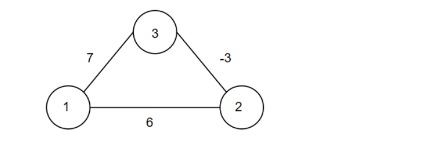

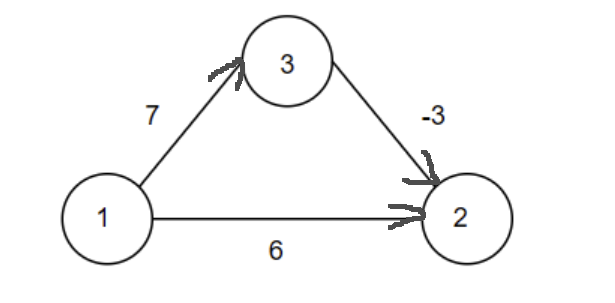

### 第 7 题

根据下图，关于Dijkstra、Prim、Floyd算法说法正确的是（）

A. 用Dijkstra算法求上面右图的结点1单源最短路径，到结点2和结点3的最短路径长度分别为4和7
B. 用Prim算法求左图最小生成树，从结点1出发，得到的最小生成树保留的边权值为-3和6
C. Dijkstra和Prim算法的思想都是基于贪心，都是从当前轮选出的结点作为中间结点去更新未处理结点的 path数组，且更新的策略一样
D. 用Floyd算法求右图的最短路径，经过一轮计算后，得到的矩阵

### 第 8 题

在含有 15个结点的平衡二叉树上，查找关键字为 36(存在该结点)的叶子结点，则依次比较的关键字可能是( )

A. 39，64，36
B. 37，38，47，36
C. 12，63，35，45，36
D. 25，37，28，31，35，36

### 第 9 题

设Hash表长14，Hash函数为                ，依次将15，38，61，84，49添加到表中，用
  平方探测法解决冲突，则49放入的位置是（）

A. 8
B. 3
C. 5
D. 9

### 第 10 题

将关键字 7,5,1,4,6,8,9依次插入初始为空的小根堆H,得到的H是( )。

A. 1,4,5,7,6,8,9
B. 1,4,7,5,6,8,9
C. 1,4,5,6,7,8,9
D. 1,5,4,6,8,9,7

### 第 11 题

在对大量数据进行外部排序时，以下()策略不能有效降低磁盘 IO 操作次数。

A. 选择置换排序
B. 败者树
C. 最佳归并树
D. 适当增大归并路数

### 第 12 题

某基准程序在主频400MHz的处理器上运行，其目标代码有100000条指令，由如下各类指令及时钟周期计数
  混合而成：


          指令类型              指令条数                    CPI

          整数运算                           45000                      1

          数据传送                           32000                      2

         浮点数运算                          15000                      3

          控制传送                           8000                      2

  该程序的执行时间和有效MIPS分别约是（）

A. 250μs、400
B. 400μs、250
C. 425μs、235
D. 500μs、200

### 第 13 题

假设                         ，附加位为2位（又叫保留位，用于保留移出的
  尾数，便于后续舍入），并采用就近舍入方式。在C语言程序中，下列程序段中执行后，a的值为()


```c
    float a=512+1e10;
    a=a-1e10;
```

A. 0
B. 512
C. 1024
D. 256

### 第 14 题

在按字节编址，采用小端存储方式的32位计算机中，按边界对齐方式为以下的C语言结构体变量a分配空间


```c
    struct Inner{
        char a;
        short b;
        int c;
        char d;
    }
    struct Outer{
        short e;
        Inner inner;
        short f;
        int m;
    }
    Outer a;
```
  若a的首地址为2025 BC00H，A的成员变量m的机器数为1234 5678H,则其中56H所在的存储单元地址为（）

A. 2025 BC15H
B. 2025 BC16H
C. 2025 BC10H
D. 2025 BC12H

### 第 15 题

Booth 算法是一种高效的补码一位乘法算法，它利用对乘数和被乘数的特定编码来减少所需的加法和减法操
  作次数。那么设x=-0.1101，y=0.1011，在利用 Booth 算法求x·y时，部分积加[-x]补的次数为()。

A. 0
B. 1
C. 2
D. 3

### 第 16 题

某计算机主存按字节编址，由4个128M×8位的DRAM芯片采用交叉编址方式构成，与宽度为32位的存储器总
  线相连，主存每次最多读写32位数据。考虑到在减少地址线数量的同时尽可能减少刷新开销，则下列说法错
  误的是（）

A. DRAM芯片的数据引脚数为8
B. DRAM芯片有地址引脚数为13
C. DRAM芯片的行缓存大小为16KB
D. CPU访问该主存数据采用同时启动的方式

### 第 17 题

jge addr 表示条件跳转指令，jmp addr 为无条件跳转指令，addr为目标地址，按字节编址，对于如
  下的C语言循环语句及其机器级表示的代码，若jge的机器指令实现采用相对寻址，那么其机器指令里的地址
  码（8位补码）为（），addr2地址为（）


```c
    00E1176D mov [count], 0         int count=0;
    00E11774 cmp [count], 10        while(count<10)
```
    00E11778 jge addr1


```c
    00E1177A mov eax, [count]       {
    00E1177D add eax, 1              count ++ ;
```
    00E11780 mov [count], eax
    00E11783 jmp addr2              }


    00E11785 ...   //while循环语句块之后的指令

A. 0DH，00E11785H
B. 0DH，00E11774H
C. 0BH，00E11785H
D. 0BH，00E11774H

### 第 18 题

对于微程序控制器，下列说法正确的是（）

A. 一条机器指令对应一个微程序，该条机器指令的执行中首条微指令的地址由微地址形成部件给出
B. 一个微程序对应若干条微指令，垂直型微指令较长，且一条微指令只能发出一个微命令
C. 对于字段直接编码方式的微指令，互斥性微命令分居不同字段，各字段送往同一个译码器进行译码
D. 字段间接编码方式的主要作用是缩短微指令字长

### 第 19 题

下列关于单周期数据通路的叙述中，正确的是（）
      I. 单周期数据通路中PC寄存器写使能信号一直有效
      II. 单周期处理器中取指令操作部件中，取指令操作不能和下条指令地址的计算操作同时进行
      III. 在一条指令的执行过程中，单周期处理器的每个控制信号取值一直不变
  IV.一般来说，单周期处理器的时钟周期比多周期处理器的时钟周期长

    V. 单周期数据通路中，任何资源都不能被重复使用，应该使用专用数据通路
    VI. 单周期处理器中，指令从存储器读入IR，然后从IR取出执行

A. I、II、IV、VI
B. III、IV、V
C. II、IV、VI
D. I、II、III、IV、V、VI

### 第 20 题

关于高级流水线的说法中，正确的是（）

A. 超流水线采用更多级的流水线，着重于在时间上并行；多发射流水线同时发射多条指令，并且由多个功能 部件并行执行，着重于空间上并行。
B. 关于多发射流水线的实现，由编译器在编译时完成指令打包或冒险处理的是动态多发射（超标量处理 器），由硬件在执行时完成指令打包或冒险处理的是静态多发射（超长指令字）
C. 超流水线技术通过增加流水线级数来使更多的指令同时在流水线中重叠执行，将指令的执行过程划分为更 多的级数，因此CPI<1
D. 超标量流水线技术不能调整指令的执行顺序，通过编译优化技术，把可并行执行的指令搭配起来一起发 射。

### 第 21 题

以下关于CPU响应外部中断请求的叙述中，错误的是（）

A. 在中断响应周期，CPU将中断允许触发器清0，以使CPU关中断
B. 系统处于开中断时，只要CPU检测到中断信号就会立即响应
C. 在中断响应周期，CPU把取得的中断服务程序的入口地址送往PC
D. CPU允许中断且处于开中断状态，每条指令结束后，CPU都会转到“中断响应周期”进行中断相应处理

### 第 22 题

某计算机的CPU主频为500MHz，某外设接口有一个16位的数据缓冲器，响应的中断服务程序的执行时间为
  500个时钟周期，下列说法正确的是（）

A. 若该外设的最大数据传输速率为20kB/s，那么CPU用于该设备输入输出的时间占整个CPU时间的大约为 1%
B. 若该外设的最大数据传输速率为20kB/s，那么CPU用于该设备输入输出的时间占整个CPU时间的大约为 0.1%
C. 若该外设的最大数据传输速率为2MB/s，那么CPU用于该设备输入输出的时间占整个CPU时间的大约为 10%
D. 若该外设的最大数据传输速率为2MB/s，那么CPU用于该设备输入输出的时间占整个CPU时间的大约为 100%

### 第 23 题

对于微内核与宏内核操作系统设计的区别，下面说法正确的是（）

A. 宏内核设计下，所有内核功能模块都运行在内核态下，微内核设计下，所有内核功能模块都运行在用户 态。
B. 宏内核设计下不同模块间通信通过过程调用，而微内核设计下，不同模块间通信不能直接通过过程调用。
C. 宏内核相较于微内核设计下，特权级切换更为频繁
D. 相对于宏内核设计来说，微内核设计具有更好的安全性和性能。

### 第 24 题

下列关于系统启动过程，说法正确的是()
   Ⅰ. BIOS实现硬件自检功能，并引出启动磁盘的第一个分区的第一个扇区主引导记录MBR
   Ⅱ. 引导扇区的功能是加载操作系统的内核或其他必要的启动代码到内存中

   Ⅲ. 操作系统内核加载完成后，会创建虚拟文件系统（VFS），然后挂载根文件系统并初始化其元数据
   Ⅳ. 所有驱动程序的加载都在操作系统初始化中完成，在这个过程中注册中断向量表

A. Ⅰ、Ⅱ、Ⅲ、Ⅳ
B. Ⅰ、Ⅱ、Ⅲ
C. Ⅰ、Ⅱ
D. Ⅱ、Ⅲ

### 第 25 题

下列选项不属于调用进程调度的时机的是（）

A. 阻塞一个进程
B. 申请内核锁成功时
C. 中断返回之前
D. 终止一个进程

### 第 26 题

假设在单处理机两道程序设计环境下，有4个作业，它们进入系统的时间如表所示，作业调度采用短作业优
  先调度算法，进程调度采用优先级抢占式调度算法。这里规定:优先数越小优先级越高。忽略其他辅助操作的
  占用时间。平均周转时间为（）

A. 70
B. 75
C. 80
D. 85

### 第 27 题

互斥锁是一种用于解决临界区互斥问题的常用手段，对acquire()获取锁或release()释放锁的调用
  必须原子地执行，因此，互斥锁通常采用硬件原语（如Test&Set 指令或exchange 交换指令来实
  现），根据不同的实现方法，可以实现以下两种锁：


  以下说法错误的是（）

A. 使用原子操作指令实现的互斥锁适用于单处理器或共享内存多处理器中多进程同步。
B. 自旋锁不能实现让权等待，但是阻塞锁可以
C. 自旋锁可以实现进程对临界区的先进先出（即按申请顺序访问临界区），不会导致进程饥饿
D. 互斥锁可用于多进（线）程之间，但是只能由获取锁的进（线）程对它进行解锁（即释放）

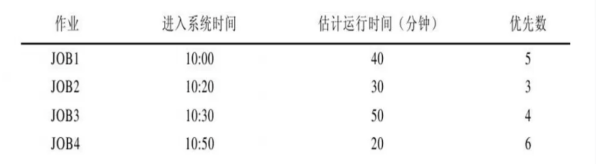

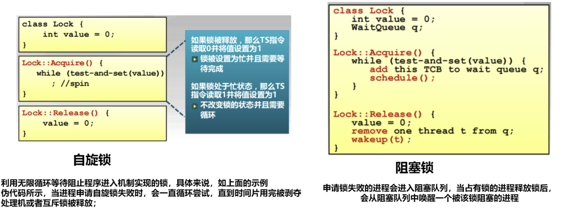

### 第 28 题

某进程的段表内容如下所示


     （段号）      段长     权限     存在位       内存起始地址

           82             200     只读            0                  6000

                       ...                            ...                      ...                          ...                                      ...

           129             100     读写            1                  4000

           130             304     只读            1                  2000

  访问并修改 段号：段内地址             的逻辑地址的数据时，进行地址转换的结
  果是（）

A. 段缺失异常
B. 越权异常
C. 越界异常
D. 得到内存地址

### 第 29 题

以下关于打开文件操作的说法中，错误的是（）

A. 各进程打开文件的初始读写位置被记录在用户级打开文件表中
B. 若一开始文件F被进程P１和P2打开并访问，然后进程P１关闭F，则此时在系统打开文件表中，该文件对 应的表项的链接计数count=1
C. 一个文件被用户进程首次打开会把文件的FCB或inode调入内存，而不会把文件内容读到内存中
D. 子进程可以访问父进程可以访问的文件

### 第 30 题

用户A创建文件F1，用户B在自己目录下创建F1的硬链接F2，并建立F1的软链接F3。用户C创建F3的硬链接
  F4，再创建F3的软链接F5。现删除文件F1，下列说法正确的是（）
      I. F2的计数为1    II. F3的计数为2   III. F4的计数为1  IV.F5的计数为1
    V. 文件的现在所有者是用户B
    VI. F3可以正常打开文件
    VII. F2不能跨文件系统使用，F3可以跨文件系统使用

A. I、II、III、VII
B. I、III、IV、V
C. I、V、VI
D. I、II、IV、VII

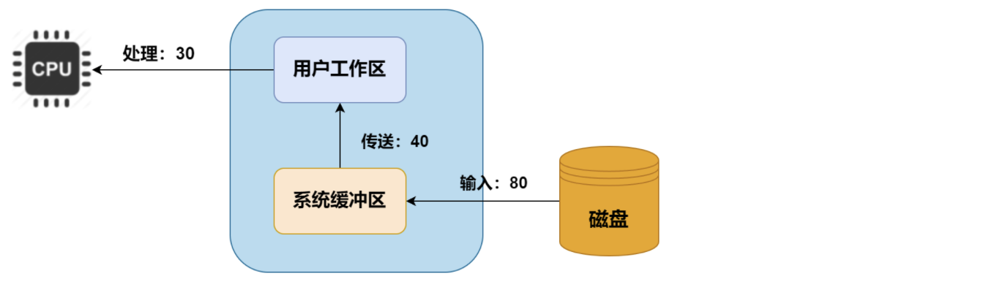

### 第 31 题

设系统缓冲区和用户工作区均采用单缓冲，从磁盘读入一个数据块到系统缓冲区的时间为80μs，从系统缓冲
  区读入一个数据块到用户工作区的时间为40μs，CPU对用户工作区的一个数据块处理分析时间为30μs，如
  果有很多数据需要处理，采用单缓冲区传送磁盘数据，则处理一块数据所用平均时间接近（）μs。

A. 120
B. 110
C. 150
D. 70

### 第 32 题

下列不属于设备独立性软件的功能的是（）

A. 设备分配及回收
B. 逻辑设备和物理设备的映射
C. 设备初始化
D. 缓冲管理

### 第 33 题

（）属于TCP/IP协议族的应用层。

A. 控制报文协议ICMP
B. 地址解析协议ARP
C. 动态主机配置协议DHCP
D. 开放最短路径优先协议OSPF

### 第 34 题

某通信链路的带宽为3kHz，采用4个相位，每个相位具有x种振幅的QAM调制技术。若该链路在无噪声情况
  下的极限数据传输速率大于信噪比为30dB条件下的极限数据传输速率，则x至少是()。

A. 4
B. 8
C. 16
D. 32

### 第 35 题

某局域网采用CSMA/CD协议，主机A和主机B的距离为1km，传播速率为2x 105km/s。t=0时，A发送了数据
  帧，在A数据发送完毕前，B也发送了数据帧，

A. B检测到碰撞的时间相差3μs，则A, B发送的数据发生碰撞 的时间，A检测到碰撞的时间为()
B. 5.5μs，9μs
C. 4μs，8μs
D. 3.5μs，8μs

### 第 36 题

关于PPP（点对点）协议说法，正确的有（）
   Ⅰ. 既支持异步链路，又支持同步链路
   Ⅱ. 可以使用同一个PPP协议连接两个不同网络层协议
Ⅲ. 既支持全双工链路，也支持半双工链路
   Ⅳ. 实现了数据的检错和纠错
   Ⅴ. 不使用帧编号

A. Ⅰ、Ⅱ、Ⅴ
B. Ⅰ、Ⅲ、Ⅴ
C. Ⅰ、Ⅲ、Ⅳ
D. Ⅱ、Ⅲ、Ⅴ

### 第 37 题

某网络的拓扑如下图所示，R1、R2和R3之间的链路的子网掩码均为255.255.255.252，当H1向H3发送一个
  IP分组时，R3发出的分组的源IP和R2收到的分组的目的IP分别为（ ）。

A. 192.168.101.2 , 200.1.1.10
B. 200.1.1.6 , 200.1.1.10
C. 200.1.1.6 , 192.168.101.3
D. 192.168.101.2 , 192.168.101.3

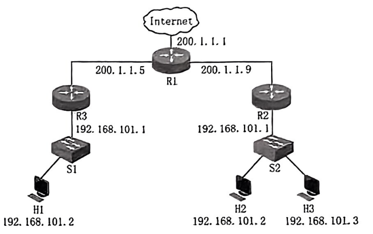

### 第 38 题

BGP交换网络的可达信息是（）

A. 到达某个网络最小度量的距离以及下一跳路由器
B. 到达某个网络最小跳数的距离以及下一跳路由器
C. 到达某个网络的下一跳路由器
D. 到达某个网络所经过的路径

### 第 39 题

在TCP协议里面，主机A发送若干数据给数据B，那么下列说法错误的是（）
  I.若主机B收到两个相同的分组，那么直接丢弃晚来的分组即可，无需其他任何处理
  II.A收到正确的确认报文后，滑动窗口应该往后（序号大的方向）滑动

  III.A的发送缓存一定是发送窗口的子集
  IV.B的接收窗口一定是接收缓存的子集

A. II、III
B. I、II、III
C. I、III、IV
D. I、II、III、IV

### 第 40 题

主机H登录到FTP服务器后进行上传文件，若H向服务器上传一个大小为34000B的文件F。约定最大段长为
  2000B，且均以MSS段向服务器发送数据，设接收缓存足够大，拥塞控制初始阈值为8000B，忽略TCP的传
  输延迟，传输过程中未发生差错、丢包、乱序的现象，那么从建立数据连接开始，到确认F已被服务器全部
  接收为止，至少需要（）RTT。

A. 4.5
B. 5.5
C. 6
D. 7 二、综合应用题：41 ~ 47小题，共70分。

## 二、综合应用题（41—47 题，共 70 分）

### 第 41 题

（13分）大数加法是能够对超长位数的数字进行相加，假如用不带头节点的单链表表示一个十进制数字，请
  设计一个空间复杂度尽可能高效的算法：LinkNode* bignumAdd(LinkNode* L1, LinkNode* L2)，实现两个大
  数的加法，返回结果大数的表示链表首元结点指针。
  示例：


   结果：4321+321=4642。(十进制)
  要求：
  （1）给出算法的基本设计思想
  （2）根据设计思想，采用C或C++语言描述算法，关键之处给出注释。

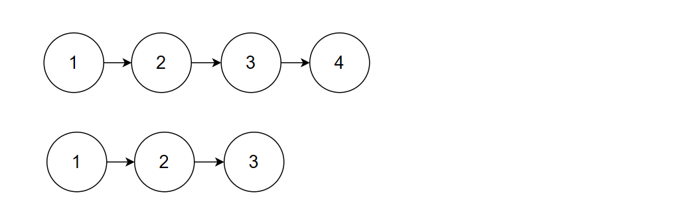

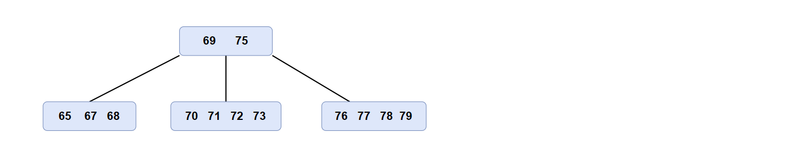

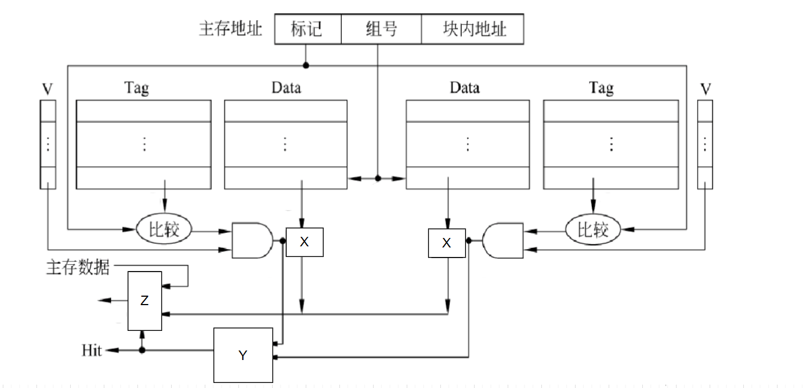

### 第 42 题

（10分）如图所示是一棵5阶B树，请回答以下问题：


  （1）请依次画出插入关键字80，64，66，74的B树形态
  （2）请在（1）的基础上画出删除关键字64后B树的形态

### 第 43 题

（13分）假设主存地址为26位，按字节编址，指令Cache和数据Cache采用回写（Write Back）写策略和
  LRU替换算法，主存块大小为   ，共8个cache行，（1）、（2）、（3）、（4）题均采用下图所示
  cache，请回答以下问题：


  （1）该cache采用什么映射方式？
  （2）假设比较器的输出为Ci，有效位为Vi（i=1，2），试写出Y的输出Hit（Hit=1表示cache命中）的逻辑运
  算表达式。
  （3）图中X用来控制数据区某行数据的输出，那么X应该是什么？Z是什么？Z的功能是什么？
（4）有如下C语言程序段：


```c
    for (k = 1; k < 64; k ++ ){
        A[k] += A[k - 1];
    }
```
  若数组A为double类型，double型数据占8B，变量k为int型，int型数据占4B，变量k分配在寄存器中，数组A
  在主存中的起始地址为080 00C0H，则该程序段执过程中，访问数组A的数据Cache缺失率为多少？（分数
  表示）

  （5）若cache总容量为    ，则此时cache又采用什么映射方式？该cache中比较器的位数是多少？

### 第 44 题

（10分）对于以下指令序列：


    Loop:
          lw $2, 100($6)   ①内存地址$6 + 100处加载一个字到寄存器$2中
          add $3, $2, $7   ②将寄存器$2和$7中的值相加，并将结果存储在寄存器$3中
          sw $3, 100($6)   ③将寄存器$3中的值存储回内存地址$6 + 100处
          lw $5, 200($6)   ④从内存地址$6 + 200处加载一个字到寄存器$5中
          sub $4, $5, $2   ⑤从寄存器$5中的值减去寄存器$2中的值，并将结果存储在寄存器$4中
          sw $4, 300($6)   ⑥将寄存器$4中的值存储回内存地址$6 + 300处
          addi $6, $6, 8   ⑦将寄存器$6中的值增加8
          bne $6, $8, Loop ⑧检查寄存器$6和$8中的值是否不相等。如果不相等，跳转到Loop处
   执行，相等则继续执行下一条指令（跳出循环）

  假设在采用“转发”技术的5段流水线中执行上述循环50次，该流水线数据通路中，主要功能单元的操作时间
  为：存储器—200ps，ALU和加法器—100ps，寄存器堆（读或写）—50ps。寄存器写口和寄存器读口分别
  被安排在一个时钟周期的前、后半个周期内独立工作，分支指令的分支延迟损失时间片为3（需要3个条nop
  指令阻塞）。假设执行循环时流水线已经进入正常状态，即计算时按第一条指令在第1个时钟周期完成，要
  求回答下列问题：
  （1）在不考虑流水段寄存器、多路选择器、控制单元、PC、扩展器和线路等延迟的情况下，5段流水线处
  理器的最小时钟周期为多少?
  （2）不采用分支预测时,那么每次循环执行需要多少时钟周期？
  （3）采用分支预测，并每次预测转移（即预测成功无延迟时间片损失，预测失败仍需要3个分支延迟时间片
  损失），则50次循环里每次循环执行需要多少时钟周期？
  （4）load-user数据冒险可以通过调整指令减少冒险带来的阻塞，题目所示代码应将④号指令调整到第几条
  指令之后最佳？请给出调整后并采用静态分支预测并总是预测转移设计下的程序执行时间（时钟周期数）。

### 第 45 题

（9分）在页式虚拟存储器中，一个程序由1-8共8个页面组成，程序执行过程中依次访问的页面序列为：3，
  4，2，6，4，3，7，4，3，6，3，4，8，4，6；采用固定分配局部置换策略，为进程分配3个页框，回答：
  （1）在先进先出（FIFO）算法和最近最少使用（LRU）算法下，缺页率各是多少？（分数表示）
  （2）若采用时钟置换（CLOCK）算法，缺页次数是多少？若采用改进的CLOCK算法，需要在页表项中增
  加什么信息？相比CLOCK算法，他带来的优点是什么？

### 第 46 题

（6分）存放在某个磁盘上的文件系统采用混合索引分配方式，其FCB中共有13个地址项，10个直接地址，
  一次、二次、三次间接地址各一个。假设每个盘块的大小为512B，若盘块号需要占4B，则：
  （1）该文件系统允许文件的最大长度是多少？（给出计算式即可）
  （2）一个文件的大小为8MB，该文件的FCB里用了多少个地址项？
  （3）假设某个文件的FCB已在内存，但其它信息均在外存，为了修改某个字节的内容，最少需要多少次访
  问磁盘？最多多少次访问磁盘？

### 第 47 题

（9分）小明在学习408时，对计网非常感兴趣，于是通过抓包软件捕获了若干主机H与服务器S的有关TCP
  通信的IP分组，由于不小心打翻了墨水，导致部分数据不可见，具体如下表所示，已知主机H的IP 地址为
   192.168.0.8，服务器S的IP地址为 211.68.71.80。小明找到你这位计网高手，请你帮他分析问题并还原数据
  （用16进制表示）：


（1）表中①、②、④分别是多少？
（2）③是多少？
（3）若此时捕获并给出主机H发出的IP分组中TCP首部如下图所示，请问主机H和服务器S本次TCP连接中主机H
发送多少数据？接收多少数据？（十进制表示）若主机之后再也没收到服务器S的数据，并且没有发生任何异
常，请问下一个来自服务器S的IP分组中，序号和确认号字段分别是多少？

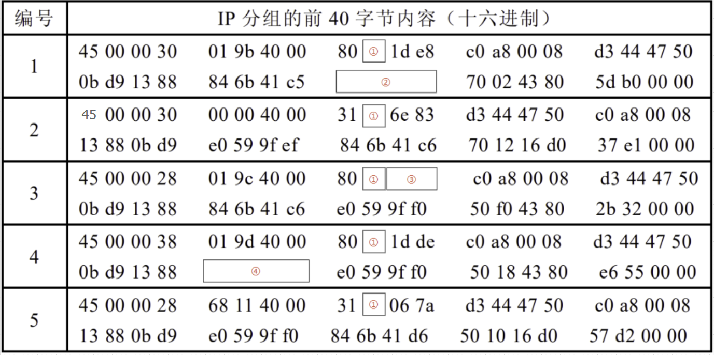

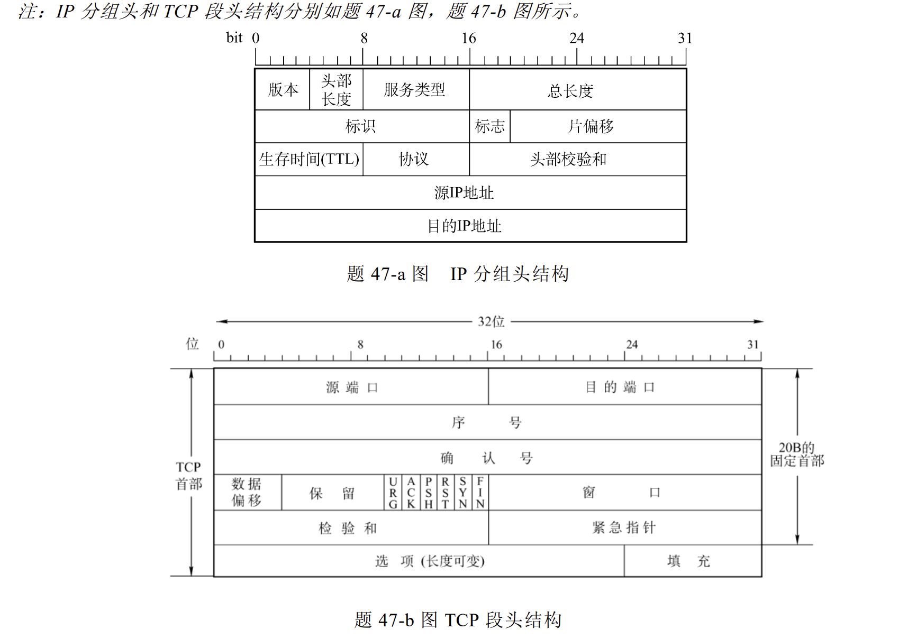

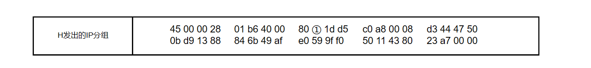
