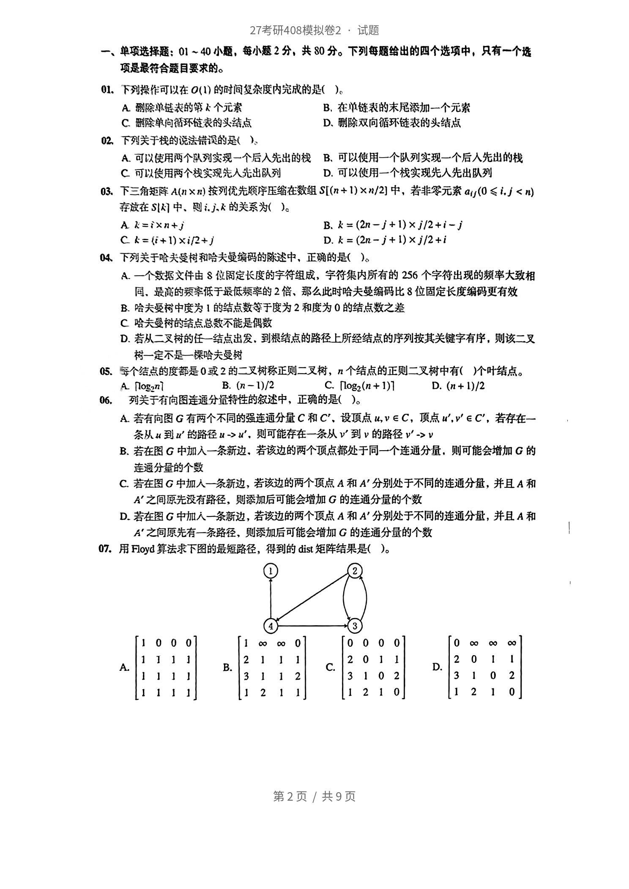
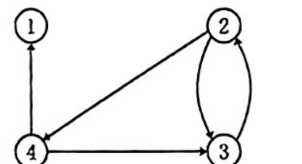
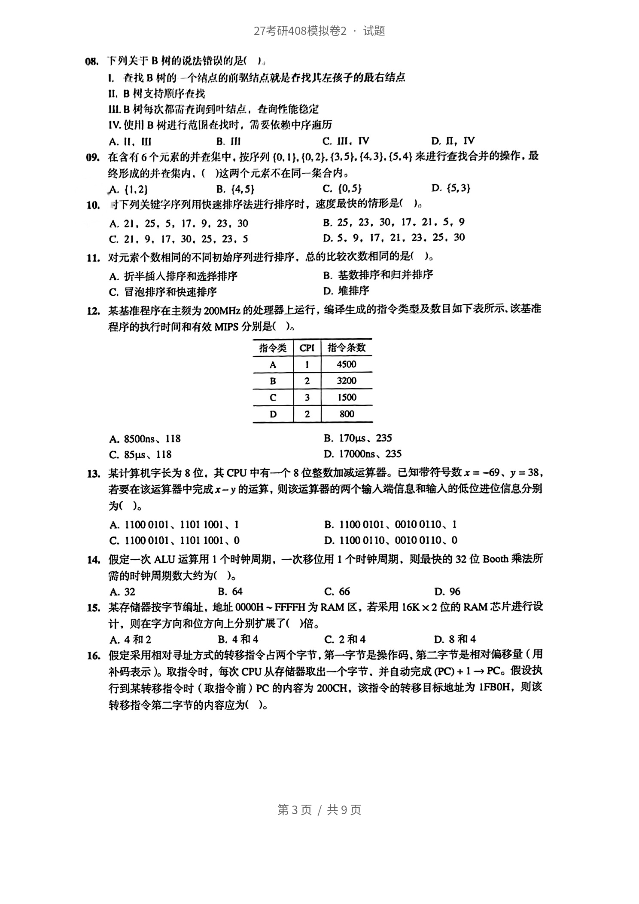
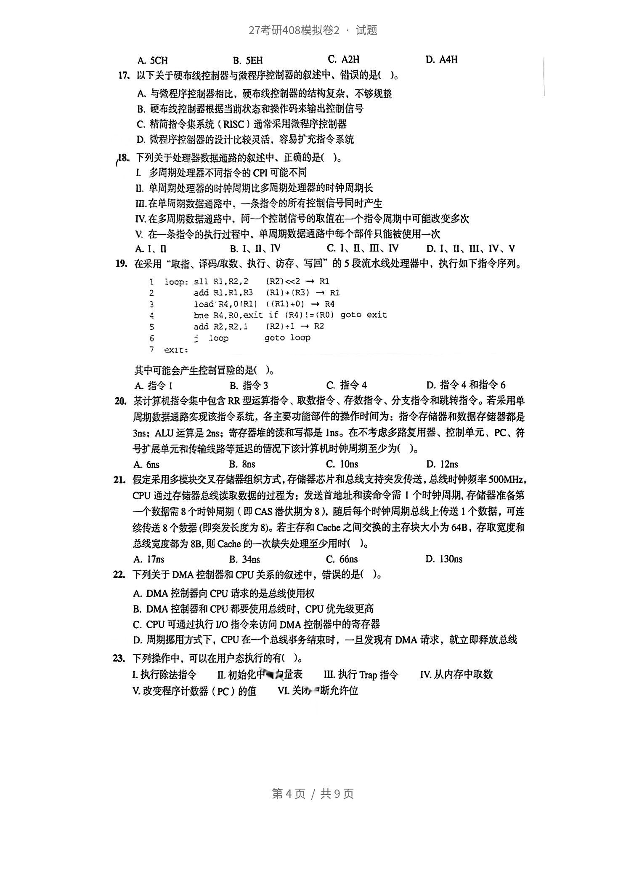
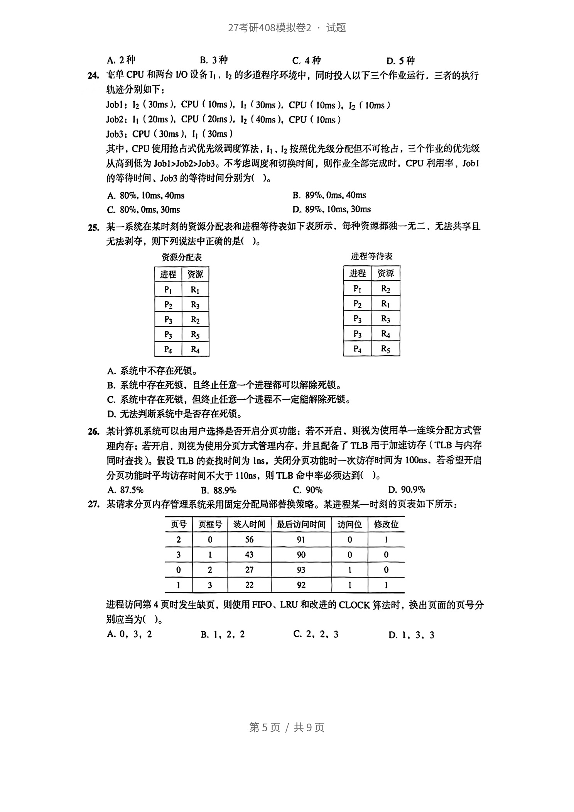
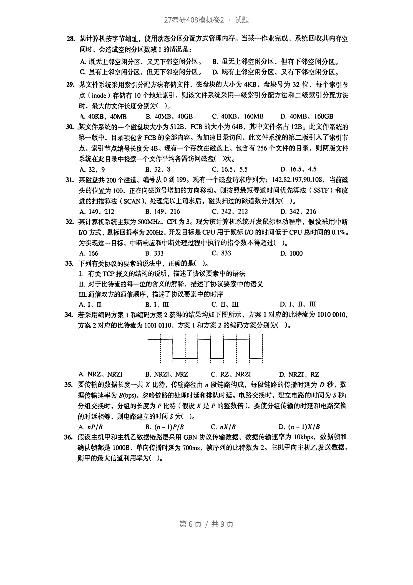
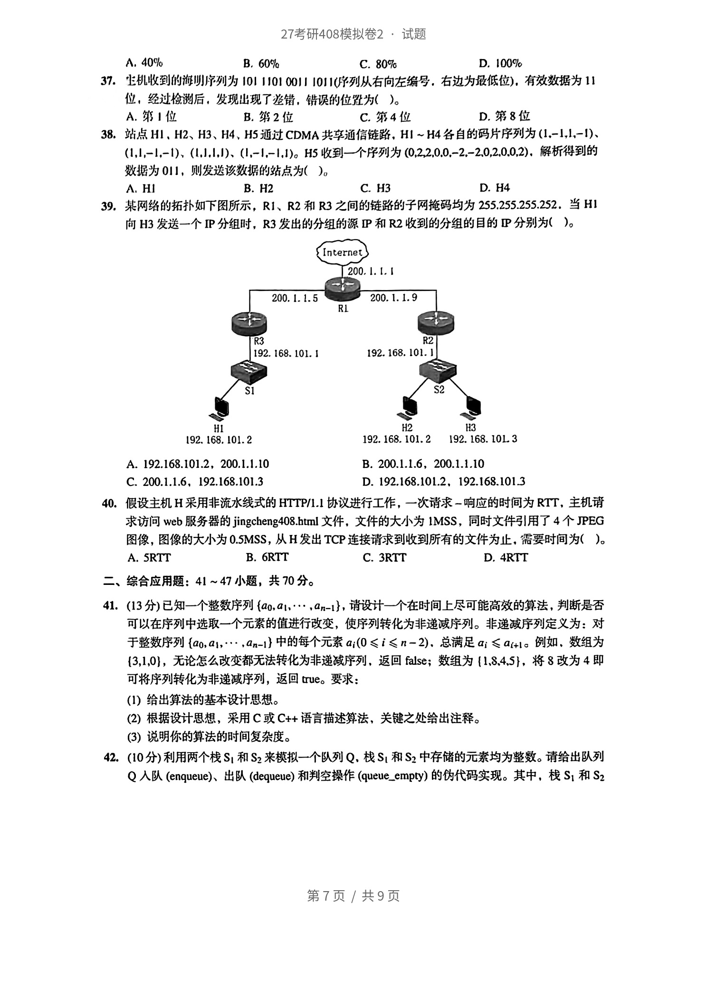
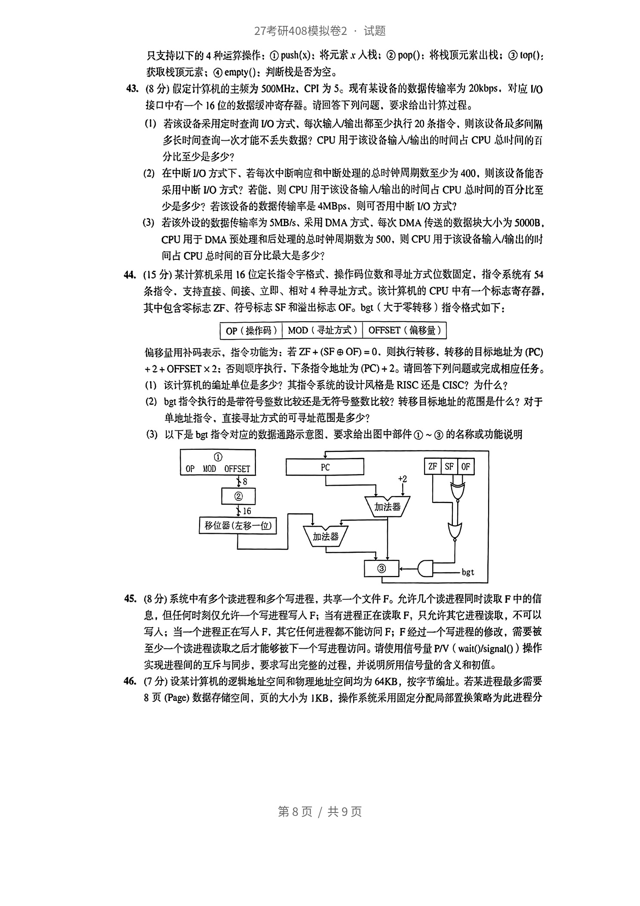
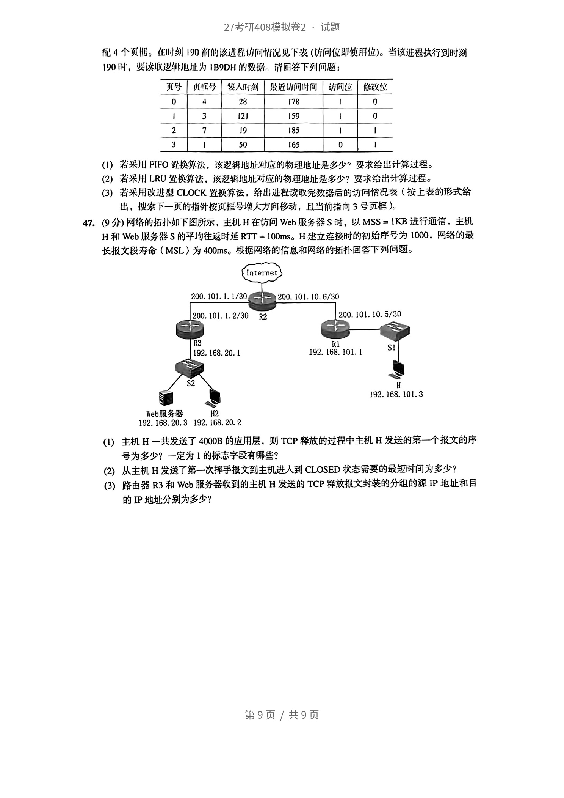

<!-- paper: mock-2027/set-2 | kind: questions | status: needs-review -->
# 2027 考研 408 模拟卷 2

> 来源：`sources/mock-2027/pdf/mock2027-set2-paper.pdf`（见 docs/provenance.md）
> ⚠️ 本文件为机器转录草稿，**尚未逐题对照原文**。状态见 meta.yml。
> 学生卷：仅含题干与选项。

## 一、单项选择题（1—40 题，每题 2 分，共 80 分）

### 第 1 题

下列择作可以在 0(1) 的时间复杂度内完成的是( )。
A除单表的第人个元素  B，在单链表的末尼添加一个元素
C前除单向钻环链衰的头结点

A. II. III
B. III
C. III. IV
D. 删除双向循环链表的头结点 01. 在找B树的一个结点的前驱结点就是存找儿左孩子的戚右结点 IⅡI.B树支持顺序查找 川I.B树每次都需在询到叶结点，查询性能秘定 IV.使用B树进行范围在找时，需要依赖中序历

### 第 2 题

下列关于栈的说法微误的是（）

A. 可以使用两个以列实现一个后入先出的栈
B. 可以使用一个队列实现一个后入先出的栈
C. 可以使用两个視实现先人先出队列
D. 可以使用一个栈实现先人先出队列

### 第 3 题

下三治矩萨 A(n ×n) 按列优先赖序压缩在数组 S[(n +1) ×n/2) 中,若非零元索 aj(0 ≤ i,j <≥)
在放在 S[对中、则的关系为()。
A k=ixn+j

A. $k = i\times n+j$
B. $k = (2n-j+1)\times j/2+i-j$
C. $k = (i+1)\times i/2+j$
D. $k = (2n-j+1)\times j/2+i$

### 第 4 题

下列关于哈夫受树和哈夫曼缩码的陈述中、正确的是()。

A. 一个效据文件由 8 位周定长度的字符组成，字符集内所有的 256 个字符出现的频率大致相 同、最高的频宰低于最低频率的2倍、那么此时哈夫曼编码比8位固定长度编码更有效
B. 哈夫受对中度为1的结点数等于度为2和度为0的结点数之差
C. 哈夫曼树的给结点总效不能是偶数
D. 若从二叉树的任一结点出发，到根结点的路径上所经结点的序列按其关键字有序，则该二叉 初一定不是一棵哈夫受树

### 第 5 题

年个结点的度部是0 或2 的二又树称正则二叉树，Ⅱ 个结点的正则二叉树中有（）个叶结点。
A logan]

A. $\lceil\log_2 n\rceil$
B. $(n-1)/2$
C. $\lceil\log_2(n+1)\rceil$
D. $(n+1)/2$

### 第 6 题

列关于有向图连通分量特性的欲述中，正确的是(）。
A 若有向图 G 有两个不同的强连通分量 C 和 C'、设顶点 u,VE

A. 和A'分别处于不同的连通分量，并且
B. 若在图G中加入一条新边，若该边的两个顶点都处于同一个连通分量，则可能会增加G的 连退分量的个数
C. 顶点u,"e C'，若存在一 条从到钩路径>、则可能存在一条从到的路径"->
D. 若在图G中加入一条新边，若该边的两个顶点

### 第 7 题

用Floyd算法求下图的最短路径，得到的dist矩阵结果是（)。

A. $\begin{bmatrix}1&0&0&0 \\ 1&1&1&1 \\ 1&1&1&1 \\ 1&1&1&1\end{bmatrix}$
B. $\begin{bmatrix}1&\infty&\infty&0 \\ 2&1&1&1 \\ 3&1&1&2 \\ 1&2&1&1\end{bmatrix}$
C. $\begin{bmatrix}0&0&0&0 \\ 2&0&1&1 \\ 3&1&0&2 \\ 1&2&1&0\end{bmatrix}$
D. $\begin{bmatrix}0&\infty&\infty&\infty \\ 2&0&1&1 \\ 3&1&0&2 \\ 1&2&1&0\end{bmatrix}$

### 第 8 题

下列关于

A. II、III
B. III
C. III、IV
D. II、IV

### 第 9 题

在含有 6 个元紊的并在集中,按序列(0. 1],{0,2). (3,5). (4,3). (5,4) 来进行查找合并的操作,最
终形成的并查集内、（这两个元紫不在同一合内。

A. (1.2)
B. (4,5)
C. (0,5)
D. (5,3)

### 第 10 题

寸下列关键字序列用快速排序法进行排序时，速度最快的情形是（）。

A. 21、25, 5,17. 9. 23. 30
B. 25, 23, 30, 17.21. 5. 9
C. 21. 9. 17, 30. 25. 23. 5
D. 5. 9, 17. 21, 23. 25. 30

### 第 11 题

对元素个数相同的不同初始序列进行排序，总的比较次数相同的是）。

A. 折半插人排序和选择排序
B. 基数排序和归并排序
C. 冒泡排序和快速排序
D. 堆排序

### 第 12 题

某基准程序在主为200MHz的处理器上运行，编译生成的指令类型及数目如下表所示.该基准
程序的执行时间和有效 MIPS 分别是()。
指令类  CPI  指令条数
4500
3200
1500
800

A. 8500ns、118
B. 170μs、235
C. 85μs、118
D. 17000ns、235

### 第 13 题

某计算机字长为 8位，其 CPU中有一个8位整数加减运算器。已知带符号数x=-69、y=38,
若要在该运算器中完成x一义的运算，则该运算器的两个输人端信息和输入的低位进位信息分别
为( )。

A. 1100 0101、1101 1001、1
B. 1100 0101、00100110、1
C. 11000101、1101 1001、0
D. 11000110、00100110、0

### 第 14 题

假定一次 ALU 运算用 1 个时钟周期，一次移位用 1 个时钟周期，则最快的 32 位 Booth 乘法所
的时钟周期数大约为()。

A. 32
B. 64
C. 66
D. 96

### 第 15 题

某存储器按字节编址，地址0000H～FFFFH为RAM区，若采用16K×2位的RAM芯片进行设
计，则在字方向和位方向上分别扩展了（倍。

A. 4和2
B. 4和4
C. 2 和4
D. 8 和 4

### 第 16 题

作  假定采用相对寻址方式的转移指令占两个字节，第一字节是揉操作码，第二字节是相对偏移量（用
补码表示)。取指令时，每次 CPU 从存储器取出一个字节、并自动完成(PC)+ 1 →PC。假设执
行到某转移指令时（取指令前）PC的内容为200CH，该指令的转移目标地址为1FB0H，则该
转移指令第二字节的内容应为(）。
第3页／共9页
27考研408模拟卷2：试题

A. SCH
B. SEH
C. A2H
D. A4H

### 第 17 题

以下关于硬布线控制器与微程序控制器的叙述中、错误的是（）。

A. 与缴程序控溺器相比、硬布线控制器的结构复杂，不够规整
B. 硬布线控制器根据当胎状态和操作码来输出控制信号
C. 精指令集系统（RISC）通带采用微程序控制器
D. 微程控創器的设计比较灵活、容易护充指令系统

### 第 18 题

下列关于处理器数据通路的叙逆中、正碗的是()。
多周期处理器不同指令的CPI可能不同
Ⅱ.单搁期处理器的时钟周期比多周期处理器的时钟周期长
1I.在单局期数据路中，一条指令的所有控制信号同时产生
IV.在多阀期数据通路中，一个控制信号的取值在一个指令周期中可能改变多次
V.在一条指令的执行过程中，单周期数据通路中每个部件只能被使用一次
A I、

A. I、II
B. I、II、IV
C. I、II、III、IV
D. I、II、III、IV、V

### 第 19 题

在采用“取指、译码/取数、执行、访存、写回”的5段流水线处理器中，执行如下指令序列。
100p: sll R1.R2,2  (R2)<<2 → R1
add RI.RI.R3  (R1)+(R3) — RI
loadR&.0/R)  ((RI)+0) → R4
bne R4.RO,exit if (R4)!=(Ro) goto exit
add R2,R2,1  (R2)+1 → R2
goto loop
exit:
其中可能会产生控制宣险的是（）。

A. 指令1
B. 指令3
C. 指令4
D. 指令4和指令6

### 第 20 题

某计算机指令集中包含RR型运算指令、取数指令、存数指令、分支指令和跳转指令。若采用单
周期数据通路实现该指令系统，各主要功能部件的操作时间为：指令存储器和数据存储器都是
3ns：ALU运算是2ns；寄存器堆的读和写都是1nS。在不考虑多路复用器、控制单元、PC、符
号扩展单元和传输线路等延迟的情况下该计算机时钟周期至少为（）。

A. 6ns
B. 8ns
C. 10ns
D. 12ns

### 第 21 题

假定采用多模块交叉存储器组织方式，存储器芯片和总线支持突发传送，总线时钟频率500MHz，
CPU通过存储器总线读取数据的过程为：发送首地址和读命令需1个时钟周期，存储器准备第
一个数据需8个时钟周期（即CAS潜伏期为8），随后每个时钟周期总线上传送1个数据，可连
续传送8个数据（即突发长度为8)。若主存和Cache之间交换的主存块大小为64B，存取宽度和
总线宽度都为8B，则Cache的一次缺失处理至少用时（）。

A. 17ns
B. 34ns
C. 66ns
D. 130ns

### 第 22 题

下列关于DMA控制器和CPU关系的叙述中，错误的是（。

A. DMA控制器向CPU请求的是总线使用权
B. DMA控制器和CPU都要使用总线时，CPU优先级更高
C. CPU可通过执行I/O指令来访问DMA控制器中的寄存器
D. 周期挪用方式下，CPU在一个总线事务结束时，一旦发现有DMA请求，就立即释放总线

### 第 23 题

下列操作中，可以在用户态执行的有（）。
L.执行除法指令  Ⅱ 初始化中勺量表  Ⅲ.执行 Trap指令  IV.从内存中取数
V.改变程序计数器（PC）的值  VL关团断允许位
第4页／共9页
27考研408模拟卷2·试题

A. 2 种
B. 3种
C. 4种
D. 5 种

### 第 24 题

单 CPU 和两台 I/O 设备11、I2 的乡道程序环境中，同时投人以下三个作业运行.三者的执行
轨迹分别如下：
Job1 : 12 (30ms ), CPU (10ms ), I, (30ms). CPU (10ms). lz (10ms )
Job2: It (20ms ). CPU (20ms ). I2 (40ms), CPU (10ms)
Job3;CPU(30ms),I, (30ms)
其中，CPU使用抢占式优先级调度算法，11、12按照优先级分配但不可抢占，三个作业的优先级
从高到低为Job1>Job2>Job3。不考虑调度和切换时间，则作业全部完成时，CPU利用毕，Job1
的等待时间、Job3的等待时间分别为（）。

A. 80%, 10ms,40ms
B. 89%.0ms.40ms
C. 80%,0ms,30ms
D. 89%.10ms,30ms

### 第 25 题

某一系统在某时刻的资源分配表和进程等待表如下表所示，每种资源都独一无二、无法共且
无法剥夺，则下列说法中正确的是（）。
资源分配表  进程等待表
进程  资源  进程  资源
R2
P2  R3  P2
P3  R2  P3  R3
P3  Rs  P3  R4
P4  R4  P4  Rs

A. 系统中不存在死锁。
B. 系统中存在死锁，且终止任意一个进程都可以解除死锁。
C. 系统中存在死锁，但终止任意一个进程不一定能解除死锁。
D. 无法判断系统中是否存在死锁。

### 第 26 题

某计算机系统可以由用户选择是否开启分页功能：若不开启，则视为使用单一连续分配方式管
理内存：若开启，则视为使用分页方式管理内存，并且配备了TLB用于加速访存（TLB 与内存
同时查找）。假设TLB的查找时间为1ns，关闭分页功能时一次访存时间为100ns.若希望开启
分页功能时平均访存时间不大于110ns，则TLB命中率必须达到（）。

A. 87.5%
B. 88.9%
C. 90%
D. 90.9%

### 第 27 题

某请求分页内存管理系统采用固定分配局部替换策略。某进程某一时刻的页表如下所示：
页号  页框号  装入时间  最后访问时间  访问位  修改位
56  16
43  90
27  93
22  92
进程访问第4页时发生缺页，则使用FIFO、LRU和改进的CLOCK筹法时，换出页面的页号分
别应当为(）。

A. 0,3,2
B. 1、2,2
C. 2、2、3
D. 1, 3、3 第5页/共9页 27考研408模拟卷2·试题

### 第 28 题

某计算机按字节编址，使用动态分区分配方式管理内存。当某一作业完成、系统回收北内存空
间时、会造成空闲分区数减1的情况是：

A. 既无上邻空闲分区，又无下邻空闲分区。
B. 虽无上邻空闲分区、但有下邻空闲分区。
C. 虽有上邻空闲分区、但无下邻空闲分区。
D. 既有上邻空闲分区、又有下邻空闲分区。

### 第 29 题

某文件系统采用索引分配方法存储文件、磁盘块的大小为4KB，盘块号为32位，每个索引节
点（inode）存储有10个地址索引、则该文件系统采用一级索引分配方法和二级索引分配方法
时，最大的文件长度分别为（）。

A. 40KB40MB
B. 40MB、40GB
C. 40KB.160MB
D. 40MB,160GB

### 第 30 题

某文件系统的一个醛盘块大小为S12B、FCB的大小为64B、其中文件名占12B。此文件系统的
第一版中，目录项包含FCB的全部内容。为加速目录访问，此文件系统的第二版引人了索引节
点、索引节点编号长度为4B。现有一个存放在磁盘上，包含有256个文件的目录，则两版文件
系统在此目录中检索一个文件平均各需访问磁盘()次。

A. 32、9
B. 32. S
C. 16.5.5.5
D. 16.5,4.5

### 第 31 题

某磁盘共200个磁道、编号从0到199。现有一个磁盘请求序列为：142.82.197,90,108，当前磁
头的位置为100、正在向磁道号增加的方向移动。则按照最短寻道时间优先算法（SSTF）和改
进的扫描算法（SCAN）、处理完以上清求后、磁头扫过的磁道数分别为（）。

A. 149、212
B. 149、216
C. 342, 212
D. 342, 216

### 第 32 题

某计算机系统主频为500MHz、CPI为3。现为该计算机系统开发鼠标驱动程序，假设采用中断
IVO方式，鼠标回报率为200Hz、开发目标是CPU用于鼠标IVO的时间低于CPU总时间的0.1%。
为实现这一目标。中断响应和中断处理过程中执行的指令数不得超过（）。

A. 166
B. 333
C. 833
D. 1000

### 第 33 题

下列有关协议的要素的说法中，正确的是（)。

A. I、II
B. I、III
C. II、III
D. I、II、III

### 第 34 题

若采用编码方案1和编码方案2获得的结果均如下图所示，方案1对应的比特流为10100010，
方案2对应的比特流为10010110，方案1和方案2的编码方案分别为（）。

A. NRZ、NRZI
B. NRZI、NRZ
C. RZ、NRZI
D. NRZI、RZ

### 第 35 题

要传输的数据长度一共X比特，传输路径由n段链路构成，每段链路的传播时延为D秒，数
据传输速率为B(bps)，忽路链路的处理时延和排队时延。电路交换时，建立电路的时间为S秒；
分组交换时，分组的长度为P比特（假设X是P的整数倍），要使分组传输的时延和电路交换
的时延相等，则电路建立的时间S为（）。

A. nP/B
B. (n-1)P/B
C. nX/B
D. (n -1)X/B

### 第 36 题

1  假设主机甲和主机乙数据链路层采用GBN协议传输数据，数据传输速率为10kbpS，数据顿和
确认顿都是1000B，单向传播时延为700ms，顿序列的比特数为2。主机甲向主机乙发送数据，
则甲的最大信道利用率为（）。
第6页/共9页
27考研408模拟卷2·试题

A. 40%
B. 60%
C. 80%
D. 100%

### 第 37 题

生机收到的海明序列为101 11010011 1011(序列从右向左编号，右边为最低位)，有效效据为11
位，经过检溯后，发现出现了望错，错误的位置为（）。

A. 第1位
B. 第2 位
C. 第4位
D. 第8位

### 第 38 题

站点 HI、H2、H3、H4、H5 通过 CDMA 共享通信链路,HI ~H4 各自的码片序列为(1.-1,l,-1)、
(1,1,-1,-1)、(1,1,1,1)、(1,-1,-1,1)。H5 收到一个序列为 (0,2,2,0.0,-2,-2.0,2,0.0,2)、解析得到的
数据为011，则发送该效据的站点为（)。

A. HI
B. H2
C. H3
D. H4

### 第 39 题

某网络的拓扑如下图所示，R1、R2和R3之间的链路的子网掩码均为255.255.255.252.当H1
向 H3 发送一个IP分组时，R3发出的分组的源 IP和 R2 收到的分组的目的 P 分别为()。
Internet
200. 1. 1. 1
200.1.1.5  200.1. 1. 9
RI
R3  R2
192. 168.101.1  192. 168, 101. 1
S1  $2
HI  H2  H3
192. 168. 101. 2  192.168.101.2  192.168.10L3

A. 192.168.101.2,200.1.1.10
B. 200.1.1.6,200.1.1.10
C. 200.1.1.6,192.168.101.3
D. 192.168.101.2. 192.168.101.3

### 第 40 题

假设主机H采用非流水线式的HTTP/1.1协议进行工作，一次请求-响应的时间为RTT，主机请
求访问web服务器的jingcheng408.html文件，文件的大小为1MSS，同时文件引用了4个JPEG
图像，图像的大小为0.SMSS，从H发出TCP连接请求到收到所有的文件为止，需要时间为（）。

A. 5RTT
B. 6RTT
C. 3RTT
D. 4RTT 二、综合应用题：41~47小题，共70分。

## 二、综合应用题（41—47 题，共 70 分）

### 第 41 题

（13分)已知一个整数序列(ao,a1,，an-1)，请设计一个在时间上尽可能高效的算法，判断是否
可以在序列中选取一个元素的值进行改变，使序列转化为非递减序列。非递减序列定义为：对
于整数序列 (ao,a1,,an-1) 中的每个元素 ai;(0 ≤i≤ n-2)、总满足ai ≤a+l。例如、数组为
[3,1,0)，无论怎么改变都无法转化为非递减序列，返回false；数组为(1.8.4,5}，将8改为4即
可将序列转化为非递减序列，返回true。要求：
(1）给出算法的基本设计思想。
(2）根据设计思想，采用C或C++语言描述算法，关键之处给出注释。
(3）说明你的算法的时间复杂度。

### 第 42 题

（10分)利用两个栈S,和S2来模拟一个队列Q，栈S,和S2中存储的元素均为整数。请给出队列
Q人队(enqueue)、出队(dequeue)和判空操作(queue_empty）的伪代码实现。其中，栈S，和S2
第7页/共9页
27考研408模拟卷2：试题
只支持以下的4种运操作：①push(x)：将元索人栈：②pop()：将栈顶元素山栈：lop()：
获取栈顶元素：④empty()：判断栈是否为空。

### 第 43 题

(8分）假定计算机的主频为500MHz、CPI为5。现有某设备的数据传输率为20kbps，对应V/O
接口中有一个16位的数据缓冲寄存器。请回答下列问题，要求给出计外过程
(1）若该设备采用定时查询VO方式，每次输人输出都至少执行20条指令、则该议备最多间阶
多长时间查询一次才能不丢失数据？CPU用于该设备输人/输出的时间占CPU总时间的百
分比至少是多少？
(2）在中断1/0方式下、若每次中断响应和中断处理的总时钟周期数至少为400，则该设备能否
采用中断VO方式？若能、则CPU用于该设备输入/输出的时间占CPU总附问的百分比至
少是多少？若该设备的数据传摘是4MBpS、则可否用中断V/O方式？
(3）若该外设的数据传输率为5MB/s、采用DMA方式，每次DMA传送的数据块大小为5000B
CPU用于DMA预处理和后处理的总时钟周期数为S0O，则CPU用于该设备输人/输出的
间占CPU总时间的百分比最大是多少？

### 第 44 题

（15分）某计算机采用16位定长指令字格式、操作码位数和寻址方式位数固定，指令系统有54
条指令，支持直接、间接、立即、相对4种寻址方式。该计算机的CPU中有一个标志寄存器、
其中包含零标志ZF、符号标志SF和溢出标志OF。bgt（大于零转移）指令格式如下：
OP（操作码）  MOD（寻址方式）  OFFSET（偏移量）
偏移量用补码表示，指令功能为：若ZF+(SF④OF)=0，则执行转移、转移的目标地址为(PC)
+2+OFFSET×2：否则顺序执行.下条指令地址为(PC)+2。请回答下列问题或完成相应任务。
(I）该计算机的缩址单位是多少？其指令系统的设计风格是RISC还是CISC？为什么？
(2）bgl指令执行的是带符号整数比较还是无符号整数比较？转移目标地址的范围是什么？对于
单地址指令，直接寻址方式的可寻址范围是多少？
(3）以下是bgl指令对应的数据通路示意图，要求给出图中部件①～③的名称或功能说明
OPMOD  OFFSET  PC  ZF  SF  OF
16  加法器
移位器（左移一位）
加法器
bgt

### 第 45 题

（8分）系统中有多个读进程和多个写进程，共享一个文件F。允许几个读进程同时读取F中的信
息，但任何时刻仅允许一个写进程写人F；当有进程正在读取F，只允许其它进程读取，不可以
写入；当一个进程正在写人F，其它任何进程都不能访问F；F经过一个写进程的修改，需要被
至少一个读进程读取之后才能够被下一个写进程访问。请使用信号量P/V（wait()/signalO)）操作
实现进程间的互斥与同步，要求写出完整的过程，并说明所用信号量的含义和初值。

### 第 46 题

（7分）设某计算机的逻辑地址空间和物理地址空间均为64KB，按字节编址。若某进程最多需要
8页(Page）数据存储空间，页的大小为IKB，操作系统采用固定分配局部置换策略为此进程分
第8页/共9页
27考研408模拟卷2：试题
配4个页框。时刻190前的该选程访回况见下表（访向位即便用位）。当该进程执行到时刻
190时，婴述吸逻非地证为1B9DH的数据，消回答下列向题：
装人叫刻  股近访间时间  修改位
28  178
[2]  159
19  185
50  165
(1)  若采用FIFO置换穿法，该逻辑地址对应的物理地址是多少？要求给出计算过程。
(2)  若采用LRU换效法，该逻辑地址对应的物理地址是多少？要求给出计穿过程。
(3)  若采用改进型CLOCK划换算法，给出进程读取完数据后的访问惰况表（按上表的形式给
出，搜索下一页的指针按页框号增大方向移动，且当前指向3号页框）

### 第 47 题

(9分)网络的拓扑如下图所示，主机H在访问Web服务器S时，以MSS=IKB进行逾信，主机
H和Wcb服务器S的平均往返时延RTT=100mS。H建立连按时的初始序号为1000.网络的最
长报文段寿命（MSL）为400mS。根据网络的信息和网络的拓扑回答下列向题。
Intemet
200.101.1.1/30  200.101.10.6/30
200.101.1.2/30  R2  200.101.10.5/30
R3  R1
192. 168. 20. 1  192. 168. 101. 1
$2
192. 168. 101.3
Web服务器  H2
192.168.20.3192.168.20.2
(1) 三  主机 H 一共发送了 4000B 的应用层，则 TCP释放的过程中主机 H 发送的第一个报文的序
号为多少？一定为1的标志字段有哪些？
(2）从主机H 发送了第一次挥手报文到主机进人到 CLOSED 状态需要的最短时间为多少？
路由器R3和Web服务器收到的主机H发送的TCP释放报文封装的分组的源IP地址和目
(3)足
的IP地址分别为多少？
第9页／共9页

