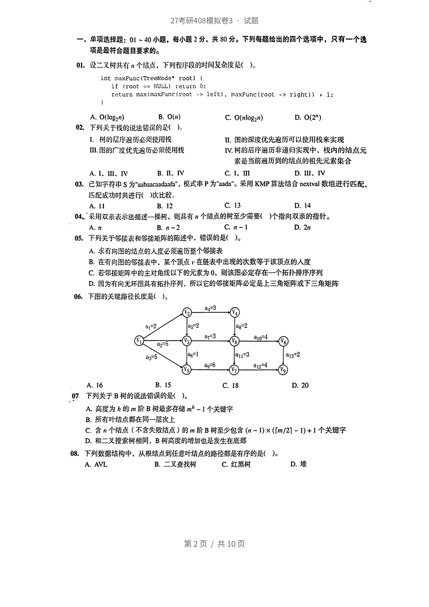
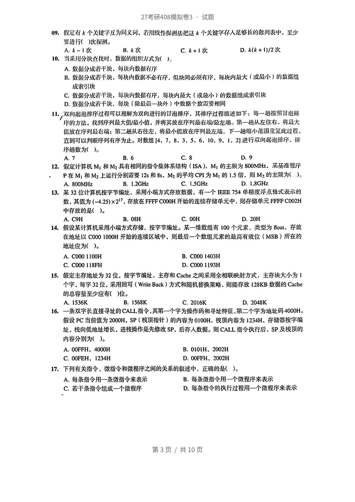
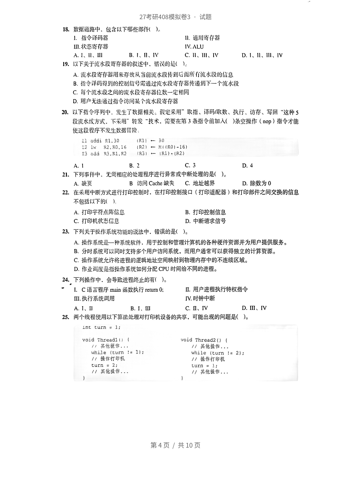
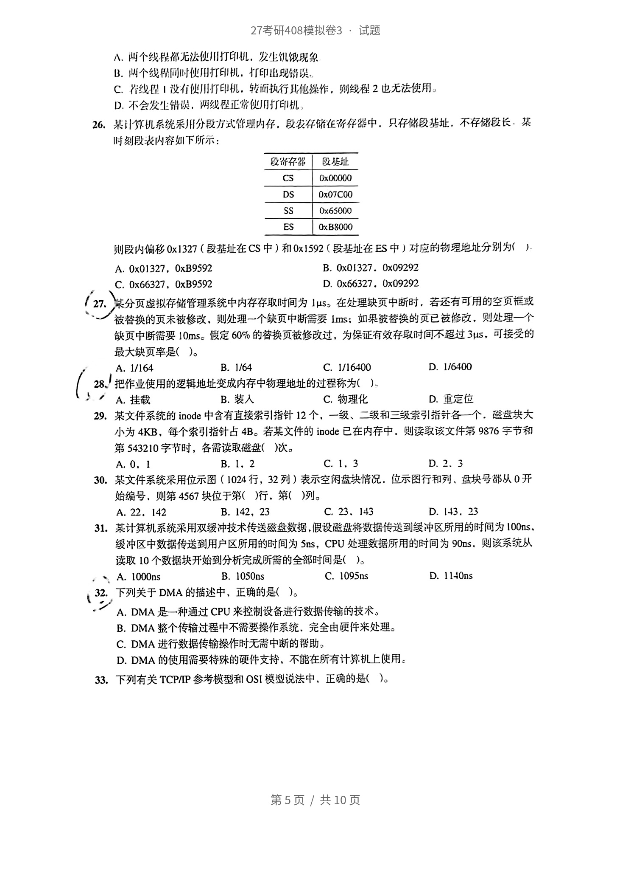
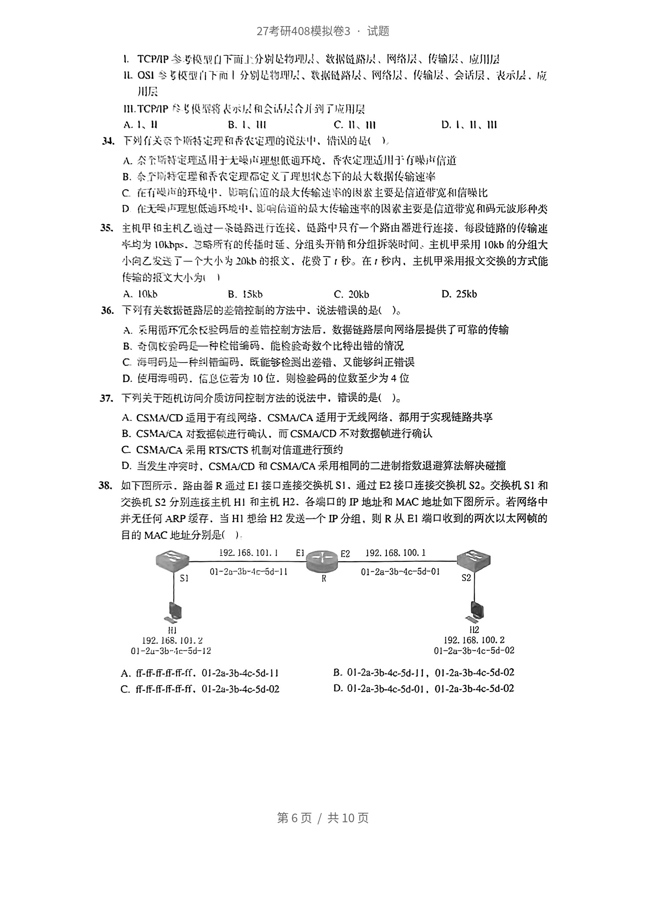
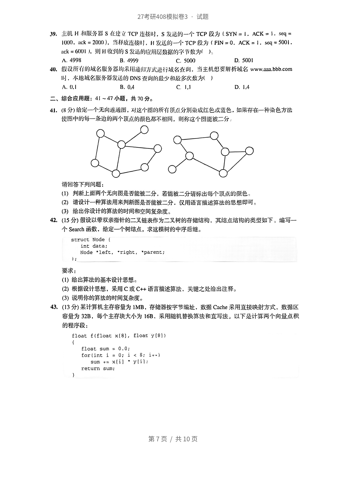
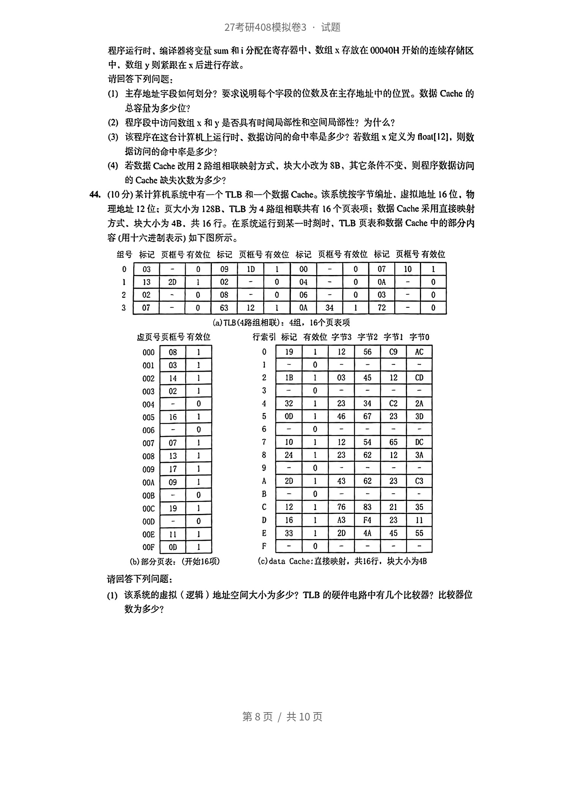
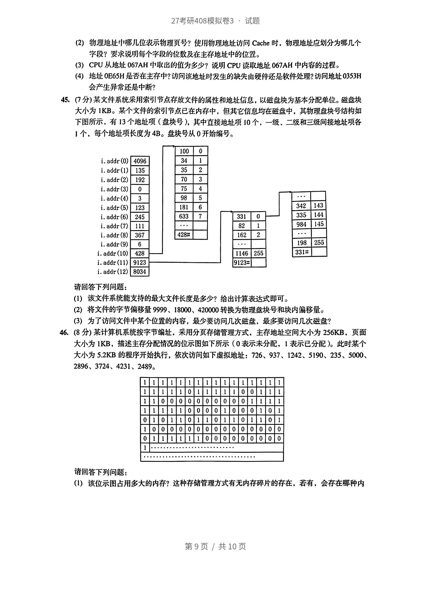
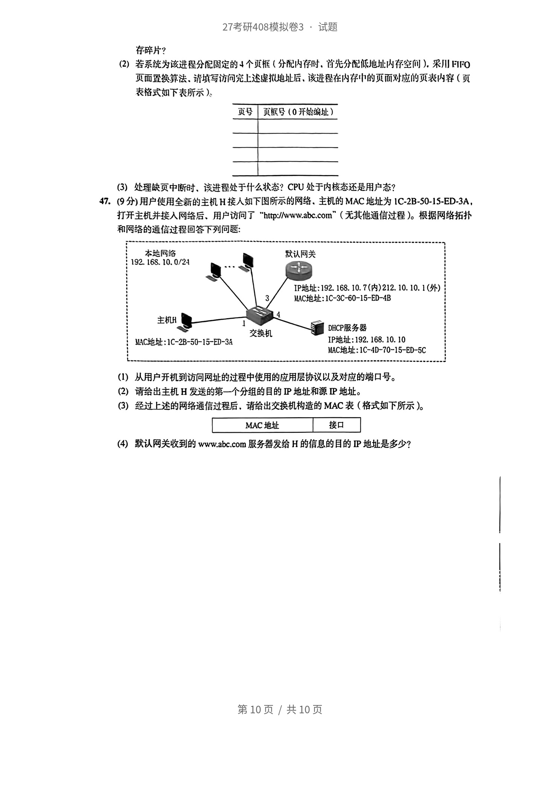

<!-- paper: mock-2027/set-3 | kind: questions | status: needs-review | PARTIAL -->
# 2027 考研 408 模拟卷 3

> ⛔ **部分草稿**：7 题选项不全（9(A), 25(A), 33(A), 34(A), 37(B), 39(A), 40(B)）；OCR 未校对，见 docs/mock2027-set3-ocr-checkpoint.md。

> 来源：`sources/mock-2027/pdf/mock2027-set3-paper.pdf`（见 docs/provenance.md）
> ⚠️ 本文件为机器转录草稿，**尚未逐题对照原文**。状态见 meta.yml。
> 学生卷：仅含题干与选项。

## 一、单项选择题（1—40 题，每题 2 分，共 80 分）

### 第 1 题

设二叉树共有n个结点。下列理序段的时间复杂度是（）。
incmaxFunc(TteeNode'root)(
if(root=NULL)returnO:
toturnmax(maxFunc(root ->left).maxFunc(root ->right))+l;

A. $O(logan)$
B. $O(n)$
C. $O(nlog2n)$
D. 0(2")

### 第 2 题

下列关于找的说法错误的是（）。
01. 树的层序趣历必须使用权  TI.图的深度优先遍历可以使用权来实现
IⅡI.图的广度优先迪历必须使用权  IV.树的后序遍历非递归实现中，内的结点元
索是当前遍历到的结点的祖先元素集合

A. 1. III. IV
B. II. IV
C. 1. ⅡI
D. III.IV

### 第 3 题

已知字符申S为"aabaacasdafa"、模式串P为"aada"。采用KMP算法结合nextval数组进行匹配，
匹配成功时共进行（）次比较。

A. 11
B. 12
C. 13
D. 14

### 第 4 题

采用双亲表示法描述一棵树、则具有n个结点的树至少需要（）个指向双亲的指针。

A. n
B. n -2
C. n-1
D. 2n

### 第 5 题

下列关于邻接表和邻接矩阵的陈述中。错误的是（）。

A. 求有向凶的结点的人度必须追历整个邻接表
B. 在有向图的邻按表中，某个项点在链表中出现的次数等于该顶点的人度
C. 若邻接矩阵中的主对角线以下的元素为0，则该图必定存在一个拓扑排序序列
D. 因为有向无环图具有拓扑序列所以它的邻接矩阵必定是上三角矩阵或下三角矩阵

### 第 6 题

下图的关键路径长度是（）。
8y-3
85-2  ag=2
a=3  a10-4
82-5
85-5  [a6-]  811=3  a13-2
ag=6  a12=4

A. 16
B. 15
C. 18
D. 20

### 第 7 题

下列关于B树的说法错误的是（）。

A. 高度为h的m阶B树最多存储mh-1个关键字
B. 所有叶结点都在同一层次上
C. 含n个结点（不含失败结点）的m阶B树至少包含（n-1)×（[m/2]-1)+1个关键字
D. 和二叉拽索树相同，B树高度的增加也是发生在底部

### 第 8 题

下列数据结构中，从根结点到任意叶结点的路径都是有序的是（）。

A. AVL
B. 二叉查找树
C. 红黑树
D. 堆 第2页/共10页 27考研408模拟卷3·试题

### 第 9 题

仪定有k个关健字正为同义同，若川线性探谢法把这个关键穿存人足乡长的列表中，至少
要进行)次探测。
^. k -1 次

A. 
B. k次
C. k +1 次
D. k(k + 1)/2次

### 第 10 题

当采川分块在找时．数据的组织方式为（）。

A. 数分成着干块，低块内数据有序
B. 效据分成诺干块，每块内效据不必有序，但块间必须有序，每块内效大（或屁小）的效据组 成瓷引块
C. 数据分成着干块，郁块内数据有序，每块内股大（或反小）的效据组成紫引块
D. 数据分成若干块，每块（除圾后一块外）中效据个数需要相同

### 第 11 题

双向起泡排序过褪可以理解为双向逃行的日泡排序，其排序过程描还如下：每一题按照冒泡排
序的方法，找到序列最大似/最小值，并将其放在序列最右给/最左端，第一从左往右，格最大
值放在序列圾右端：第二趟从右往左，将最小值放在序列最左。下一越缩小范围丞复此过是。
直到可以判断序列有序为止。对数组[4，7.8.3.5.6.10.9.1.2]进行双向起泡排序、排
序趟数为()。

A. 7
B. 6
C. 8
D. 9

### 第 12 题

1  假定计算机M，和M2具有相同的指令集体系结构（ISA）.M的主频为800MHz，某基准程序
P在M,和M2上运行分别带要12s和8s，M2的平均CPI为M,的15倍，则M2的主须为(）

A. 800MHz
B. 1.2GHz
C. 1.5GHz
D. 1.8GHz

### 第 13 题

某32位计算机按字节编址，采用小端方式存放数据，有一个IEEE754单精度浮点洛式表示的
数，其值为（-4.25)×217，存放在FFFFC000H开始的连续存储单元中，则存储单元FFFFC002H
中存放的是()。

A. C9H
B. 08H
C. 00H
D. 20H

### 第 14 题

假设某计算机采用小端方式存储，按字节编址。某一维数组有100个元素。类型为 Hoat。存放
在地址以C0001000H开始的连续区域中，则最后一个数组元紧的最高有效位（MSB）所在的
地址应为()。

A. C000 1100H
B. C000 1403H
C. C000 118FH
D. C000 1193H

### 第 15 题

假定主存地址为32位，按字节编址，主存和Cache之间采用全相联映射方式.主存块大小为1
个字，每字32位，采用回写（WriteBack）方式和随机替换策略，则能存放12SKB数据的Cache
的总容量至少应有()位。

A. 1536K
B. 1568K
C. 2016K
D. 2048K

### 第 16 题

一条双字长直接寻址的CALL指令,其第一个字为操作码和寻址特征、第二个字为地址码4000H。
假设PC当前值为2000H，SP（栈顶指针）的内容为0100H.栈顶内容为1234H.存储器按字编
址，栈向低地址增长，进栈操作是先修改SP，后存入数据。则CALL指令执行后、SP及栈顶的
内容分别为()。

A. 00FFH，4000H
B. 0101H、2002H
C. 00FEH,1234H
D. 00FFH、2002H

### 第 17 题

.下列有关指令、微指令和微程序之间的关系的叙述中。正确的是（）。

A. 每条指令用一条微指令来表示
B. 每条微指令用一个微程序来表示
C. 若干条指令组成一个微程序
D. 每条指令的执行过程用一个微程序来表示 第3页/共10页 27考研408模拟卷3：试题

### 第 18 题

数据通路中、包含以下哪些部件（)。
01. 指令译码器  n.通川寄存器
IM.状态寄存器  IV.ALU

A. I、II、U
B. 1、I、IV
C. 11、111、IV
D. 1、II、III、IV

### 第 19 题

以下关于流水段将存器的叙述中，错设的是（）。

A. 流水段贫存器用来存放从当前流水段传到后而所有流水段的信息
B. 指令详网得刘的控制佰号需通过滋水段动存器传递到下一个流水段
C. 每个流水段之间的流水段夺存器位数一定相同
D. 用户无法通过指今访问某个流水晟寄存器

### 第 20 题

以下指今序列中，发生丁数据相关。很定采用”取指、译码/吸数、执行、访存、写回“这种5
段流水线方式.下采用"转发“技术，篇要在第3条指令前加入（）条空搬作（nop）指令才能
使这段屋序不发生改据后险：
addiR1,30  (1) 30
131x52.50.16  (R2) —N((RO)-16)
I3adSR3,Rl,R2  (R3)—(RI)+(R2)

A. 1
B. 2
C. 3
D. 4

### 第 21 题

下列事件中．无须相应的处理程序进行异常或中断处理的是（）。

A. 页
B. 访向Cache缺失
C. 地址越界
D. 除数为 0

### 第 22 题

在采用中断方式进行打印控制时，在打印控制接口（打印适配器）和打印部件之间交换的信息
不包括以下的（）。

A. 打印字符点库信息
B. 打印控制信息
C. 打印机状态信息
D. 中断请求信号

### 第 23 题

下列关于摄作系统功能的说法中，错误的是（）。

A. 操作系统是一种系流软件，用于控制和管理计算机的各种硬件资源并为用户提供服务。
B. 分时系统可以同时支持多个用户访问系统，而用户通常可以获得独立的计算资源。
C. 操作系统元许将进程的逻辑地址空间映射到物理内存中的不连续区域。
D. 作业满度是指操作系统如何分配CPU时间给不同的进程。

### 第 24 题

下列操作中会导致进程终止的有（）。
LC语言程序main函数执行rerurnO;  Ⅱ用户进程执行特权指令
Ⅲ.执行系统调用  IV.时钟中断

A. 1、II
B. I、IⅡI
C. II、IV
D. Ⅲ、IV

### 第 25 题

两个线程使用以下算法处理对打印机设备的共享，可能出现的问题是（）。
int turn = l;
voi Threadi()(  void Thread2()（
/其摄作.，  /其他操作...
while (turn != 1):  while (turn != 2);
/操作打印机  /）操作打印机
turn = 2:  turn = l;
1/共佗操作..  1/其他探作...
第4页／共10页
27考研408模拟卷3：试题
入，两个线程邪无法川打印机，发生饥绒现象

A. 
B. 两个线解回时便用打印机，打印出现错哭，
C. 准线见！设有伙川灯印机，转而执行其他操作，则程2也无法使用。
D. 不会发生带误，两线翌正常伙打印机

### 第 26 题

某计矫机系统采用分段方式管理内存，段农存储在价器中，只存储段基址，不存储段长，某
附时刻段表内容如下所示：
cs  0x00000
DS  Dx07C00
ss  0x65000
ES  0xB8000
则段内偏移0x1327（段基址在CS中）和0xi592（段基址在ES中）对应的物理地址分别为（）：

A. 0x01327，0xB9592
B. 0x01327。0x09292
C. 0x66327.0xB9592
D. 0x66327.0x09292

### 第 27 题

某分页虚拟存储管理系统中内存存取时间为1uS，在处理缺页中断时，若还有可用的空页框或
被替换的页未被修改，则处理一个缺页中断需要Ims；如果筱替换的页已被修改，则处理一个
缺页中断要10mS。假定60%的替换页被修改过，为保证有效存取时间不过3us，可接受的
最大缺页率是（）。

A. 1/164
B. 1/64
C. 1/16400
D. 1/6400

### 第 28 题

把作业使用的逻辑地址变成内存中物理地址的过程称为),

A. 挂载
B. 装人
C. 物理化
D. 重定位

### 第 29 题

某文件系统的inode中含有直接索引指针12个，一级、二级和三级索引指针各一个。磁盘块大
小为4KB，每个索引指针占4B。若某文件的inode已在内存中，则读取该文件第9876宇节和
第543210字节时，各需读取磁盘（)次。

A. 0. 1
B. 1. 2
C. 1. 3
D. 2. 3

### 第 30 题

某文件系统采用位示图（1024行，32列）表示空闲盘块情况位示图行和列、盘块号都从0开
始编号，则第4567块位于第)行、第()列。

A. 22.142
B. 142, 23
C. 23. 143
D. 143. 23

### 第 31 题

某计算机系统采用双缓冲技术传送磁盘数据，假设磁盘将数据传送到级冲区所用的时间为100ms，
级冲区中数据传送到用户区所用的时间为5ns，CPU处理数据所用的时间为90ns.则该系统从
读取10个数据块开始到分析完成所需的全部时间是（）。

A. 1000ns
B. 1050ns
C. 1095ns
D. 1140ns

### 第 32 题

下列关于DMA的描述中、正确的是()。

A. DMA是一种通过CPU来控制设备进行数据传输的技术。
B. DMA整个传输过程中不密要操作系统、完全由硬件采处理
C. DMA进行数据传输操作时无需中断的帮助。
D. DMA的使用需要特殊的硬件支持、不能在所有计效机上使用。

### 第 33 题

下列有关TCP/P参考模型和OSI模型说法中，正确的是（）。
第5页/共10页
27考研408模拟卷3：试题
01. TCPP参考模型口下而小分别整物现、数据链路层、网络层、传输层、应川层
儿OS参专核型下而分别整物、装据链路层、网络层、传输层、会话层、表示层、应
用层
III.TCPP模报将太层和会话合川别了成用层
A 1、II

A. 
B. 1、uI
C. 11、111
D. 1、11、111

### 第 34 题

下列价关交个期特定理和香农定现的说法中、借议的退），
八茶个所定班运用于尤心理想低通环晚，香农定理适川于有哦信道

A. 
B. 余子的特定理和秀农定理而定义丁理想状念下的最大教据传翁速率
C. 在有哦节的环现中，响你道的最大传输逆率的因紧主要是信道带宽和信哦比
D. 在无吸而理包低通环绶、包响陪道的最大传输速率的因紊主变是信道带觉和码元波形种炎

### 第 35 题

主机甲和主机乙巡过一杀辞路进行连接、链路中只有一个路由器进行连接，每段链路的传输速
毕均为10Kbps，多略所有的传插时延、分组头开销和分组拆装时间、主机甲采用10kb的分组大
小向乙发送了一个大小为20kb的报文、花费了，秒。在，秒内，主机甲采用报文交换的方式能
传输的报文大小为）

A. 10kb
B. 1skb
C. 20kb
D. 25kb

### 第 36 题

下列有关效据路层的差错控制的方法中、说法错误的是（）。

A. 采用循不亢余反验码后的差控制方法后.数据链路层向网络层提供了可靠的传输
B. 奇侧校验码是一种检错筹码、能检验奇数个比待出错的情况
C. 海明码感一种纠需留码、既能多检测出差错、又能够约正错误
D. 使用浸明码.信息位若为10位．则检验码的位数至少为4位

### 第 37 题

下列关于随机访问介质访问控制方法的说法中，错误的是（）。

A. CSMA/CD造用于有级网路CSMA/CA适用于无线网络.都用于实现链路共享
B. CSMA/CA对数据赖进行确认．而CSMA/CD不对数据赖进行确认 CCSMA/CA采用RTSICTS机制对信道进行预约
C. 
D. 当发生冲案时、CSMA/CD和CSMA/CA采用相同的二进制指数退避算法解决碰撞

### 第 38 题

如下图所示.路由器R遍过EI接口连接交换机SI、通过E2接口连接交换机S2。交换机S1和
交换机S2分别连接主机HI和主机H2各端口的IP地址和MAC地址如下图所示。若网络中
并无任何ARP缓存.当HI想给H2发送一个IP分组，则R从E1端口收到的两次以太网顿的
目的MAC地址分别是（）：
192168.101.1  2192.168.100.1
01-2-3b-4c5d-11  01-2a-3b-4c-5d-01
$2
112
192. 168.101.2  192.168.100.2
01-2u-3b-ic-5d-12  01-2a-3b-4c-5d-02

A. ff-ff-ff-f-ff-ff. O1-2a-3b-4c-5d-11
B. 01-2a-3b-4c-5d-11, 01-2a-3b-4c-5d-02
C. ff-f-ff-f-ff-ff.01-2a-3b-4c-5d-02
D. 01-2a-3b-4c-5d-01,01-2a-3b-4c-5d-02 第6页/共10页 27考研408模拟卷3·试题

### 第 39 题

主机H和服介器S在处立TCP连按时，S发送的一个TCP段为SYN=1.ACK=1.Seq=
1000。nck=2000)，当格放连按剂].H发送的一个TCP段为（FIN=0.ACK=1.5eq=5001.
nck=6001，则H收例的S发送的应川虐摄的实准效为）
866V

A. 
B. 4999
C. 5000
D. 5001

### 第 40 题

假设所有的域名服务器均朵川逆归方式进行域名优询，当主机想要解析域名www.aabbb.com
川，不地成名服务器发送的DNS资询的显少和政乡次数为）

A. 0.1
B. 0.4  C 1.1
C. 
D. 1.4 二、综合应用题：41～47小题，共70分。

## 二、综合应用题（41—47 题，共 70 分）

### 第 41 题

（8分）给定一个无向连通图，对这个图的所有顶点分别裂成红色或蓝色，如果存在一种染色方法
使图中的每一条边的两个项点的颜色恣不相同。则称这个图能被二分。
请回答下列问题：
(1)  判断上面两个无向图是否能被二分，若能被二分请标出每个顶点的颜色。
(2)  请设计一种算法用来判断图是否能被二分。仅用语言描述算法的思想即可，
(3）给出你设计的算法的时间和空间复杂度。

### 第 42 题

（15分）假设以带双亲指针的二叉链表作为二叉树的存结构.其结点结构的类型如下，编写一
个Search函数，给定一个树结点，求这棵树的中序后继。
struct Node-(
int data;
Node *left.'rigbt,'parent:
要求:
（I）给出算法的基本设计思想，
(2）根据设计思想，采用C或C++语言描述算法，关键之处给出注释。
(3）说明你的算法的时间复杂度。

### 第 43 题

（13分）某计算机主存容量为1MB，存储器按字节编址，数据Cache采用直按缺时方式，数据区
容量为32B，每个主存块大小为16B、采用随机替换算法和直写法、以下是计算两个向量点积
的程序段：
float f(float x[8], Eloat y8])
float sum = 0.0:
for(int i = 0:i < 8;i+-)
sum += x(i] - y[il:
return  sum;
第7页/共10页
27考研408模拟卷3：试题
程序运行时、编译器将变sum和i分配在寄存器中、数组x存放在00040H开始的连续存储区
中，数组则紧跟在x后进行存放。
请回答下列问题：
(I）主存地址字段如何划分？要求说明每个字段的位数及在主存地址中的位咒。数据Cachc的
总容量为多少位？
(2）程序段中访问数组×和是否具有时间局部性和空间局部性？为什么？
(3）该程序在这台计算机上运行时、数据访问的命中率是多少？若数组x定义为foal[12]，则数
据访问的命中率是多少？
(4）若数据Cache改用2路组相联映射方式，块大小改为SB，其它条件不变，则程序数据访问
的Cache缺失次数为多少？

### 第 44 题

（10分）某计算机系统中有一个TLB和一个数据Cache。该系统按字节编址，虚拟地址16位，物
理地址12位：页大小为12SB、TLB为4路组相联共有16个页表项；数据Cache采用直接映射
方式.块大小为4B，共16行。在系统运行到某一时刻时、TLB页表和数据Cache中的部分内
容（用十六进制表示）如下图所示。
组号  标记  页框号有效位  标记  页框号有效位  标记  页框号有效位  标记  页框号有效位
03  09  1D  00  07  10
13  2D  02  04  0A
02  08  06  03
07  63  12  0A  34  72
(a)TLB(4路组相联)：  4组，  16个页表项
虚页号页框号有效位  行索引  标记  有效位  Z字节3  字节2  字节1  字节0
000  80  19  12  56  C9  AC
001  03
002  14  1B  03  45  12  CD
003  02
004  32  23  34  C2  2A
S00  16  OD  46  67  23  3D
006
007  07  10  12  54  65  DC
008  13  24  23  62  12  3A
600  17
O0A  60  2D  43  62  23  C3
OOB
00C  19  12  76  83  21  35
OOD  16  A3  F4  23
00E  33  2D  4A  45  55
O0F  OD
(b)部分页表：  (开始16项)  (c)dataCache：直接映射，共16行，块大小为4B
请回答下列问题：
（1）该系统的虚拟（逻辑）地址空间大小为多少？TLB的硬件电路中有几个比较器？比较器位
数为多少？
第8页／共10页
27考研408模拟卷3：试题
(2）物理地址中哪几位表示物理页号？使用物理地址访问Cache时，物理地址应划分为哪几个
字段？要求说明每个字段的位效及在主存地址中的位置。
(3）CPU从地址067AH中取出的值为多少？说明CPU读取地址067AH中内容的过程。
(4）地址0E65H是否在主存中？访问该地址时发生的缺失由硬件还是软件处理?访向地址0353H
会产生异常还是中断？

### 第 45 题

（7分）某文件系统采用索引节点存放文件的属性和地址信息，以磁盘快为基本分配单位。磁盘块
大小为1KB。某个文件的紫引节点已在内存中，但其它信息均在磁盘中，其物理盘块号结构如
下图所示，有13个地址项（盘块号），其中直接地址项10个，一级、二级和三级间接地址项各
1个，每个地址项长度为4B。盘块号从0开始编号。
100
i. addr (0)  4096  34
i. addr(1)  135  35
i. addr (2)  192  70
i. addr(3)  75
i.addr(4)  86
i. addr (5)  123  181  342  143
i. addr(6)  245  633  331  335  144
i. addr(7)  82  786  145
i. addr (8)  367  428#  162
i. addr(9)  198  255
i.addr(10)  428  1146  255  331=
i.addr(11)  9123  9123=
i.addr(12)  8034
请回答下列问题：
(1）该文件系统能支持的最大文件长度是多少？给出计算表达式即可。
(2）将文件的字节偏移量9999、18000、420000转换为物理盘块号和块内偏移量。
(3）为了访问文件中某个位置的内容，最少要访问几次磁盘，最多要访问几次磁盘？

### 第 46 题

（8分）某计算机系统按字节编址，采用分页存储管理方式，主存地址空间大小为256KB，页面
大小为1KB，描述主存分配情况的位示图如下所示（0表示未分配，1表示已分配）。此时某个
大小为5.2KB的程序开始执行，依次访问如下虚拟地址：726、937、1242、5190、235、5000、
2896、3724、4231、2489。
请回答下列问题：
（1）该位示图占用多大的内存？这种存储管理方式有无内存碎片的存在，若有，会存在哪种内
第9页/共10页
27考研408模拟卷3·试题
存碎片？
(2）若系统为该进程分配固定的4个更框（分配内存时。首先分配低地址内存空间），采川FIFO
页而置换算法，请填写访问究上述虚拟地址后、该进程在内存中的页而对应的页表内容（页
表格式如下表所示）
页号  页掘号（0开始综址）
(3）处理缺页中断时、该进程处于什么状态？CPU处于内核态还是用户态？

### 第 47 题

(9分)用户使用全新的主机H接人如下图所示的网络，主机的MAC地址为1C-2B-50-15-ED-3A，
打开主机并接入网络后、用户访问了"http://www.abc.com"（无其他通信过程）。根据网络拓扑
和网络的通信过程回答下列问题：
本地网路  欲认网关
192.168.10.0/24
IP地址：192.168.10.7(内)212.10.10.1(外)
MAC地址：1C-3C-60-15-ED-4B
主机H
交换机  DHCP服务器
JMIAC地址：1C-2B-50-15-ED-3A  IP地址：192.168.10.10
MAC地址：1C-4D-70-15-ED-5C
（1）从用户开机到访问网址的过程中使用的应用层协议以及对应的端口号。
(2）请给出主机H发送的第一个分组的目的IP地址和源IP地址。
(3）经过上述的网络通信过程后，请给出交换机构造的MAC表（格式如下所示）。
MAC地址  接口
(4）默认网关收到的www.abc.com服务器发给H的信息的目的IP地址是多少？
第10页/共10页

