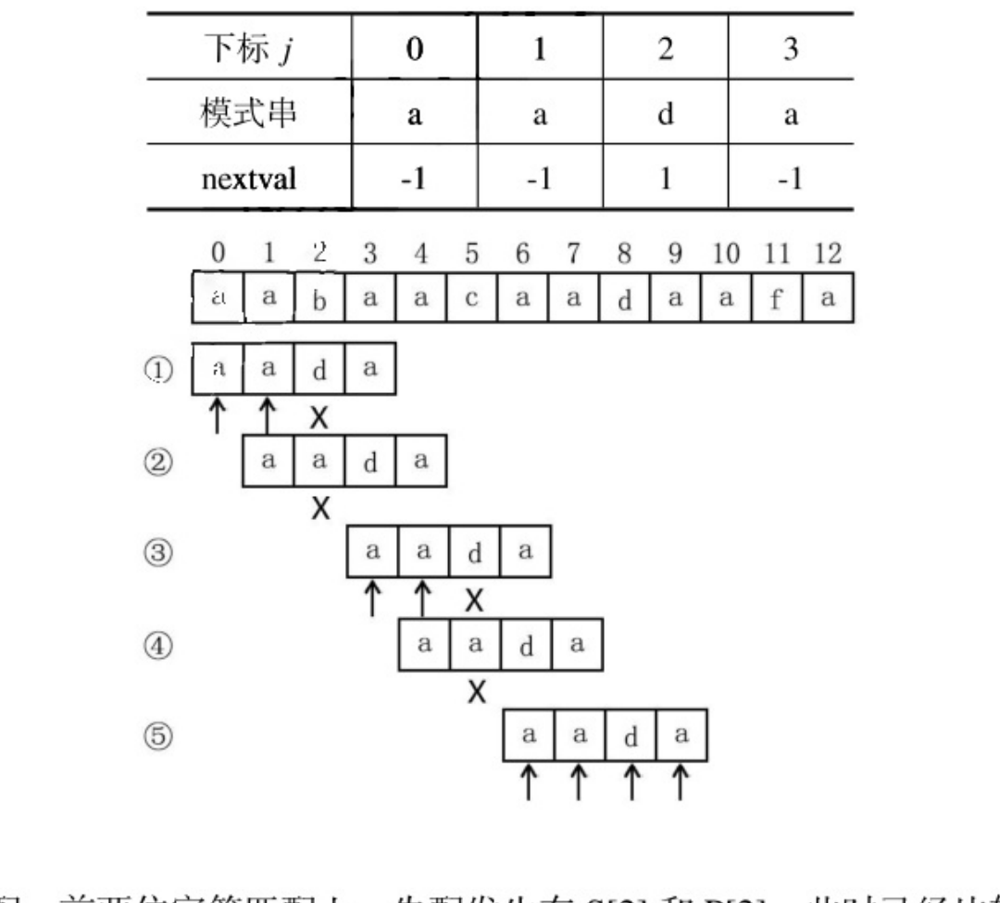
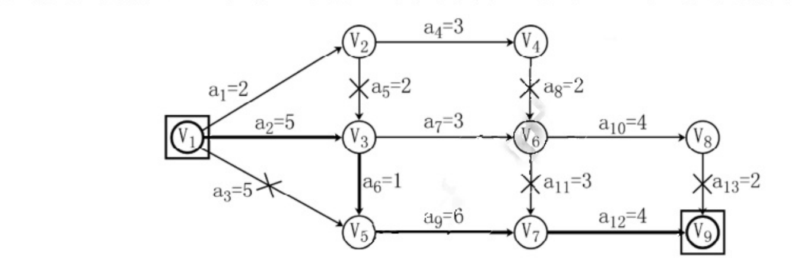
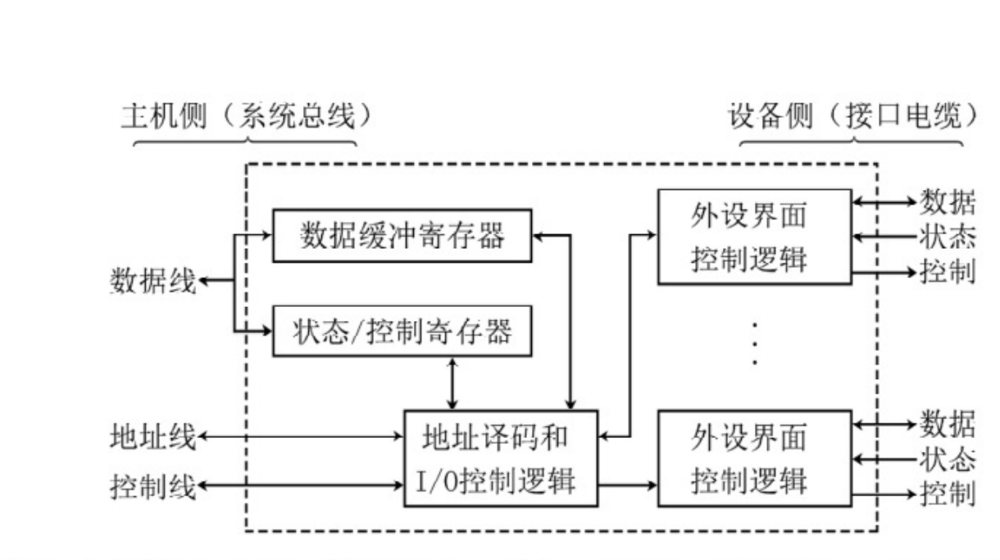

<!-- paper: mock-2027/set-3 | kind: solutions | status: needs-review -->
# 2027 考研 408 模拟卷 3 参考答案

> 来源：`sources/mock-2027/pdf/mock2027-set3-solution.pdf`。转写记录见 `build/_scratch/reports/mock-2027-set-3-solutions.md`。
> 选择题答案：已从底本切出 40/40 题。
> 选择题答案来自卷首答案表（`tools/answer_grid*.py` 的三路读法互校：OCR 读页面像素 / 读文字层 / 人工直读裁带图，哪几路读到就哪几路互校）与逐题解析流，逐题来源见各题上方注释。
> 选择题 Q1–Q40 的解析正文已按解析卷 p1–p5 的页图人工逐题录入；答案字母保持原 40/40 不变。源文异文按原印保留并就地标注。
> 综合题答案的第 6、7、8、9 页为**人工转录**（按底本页图逐字抄；来源与核对记录见 `solution-pages.yml`），其余页为 OCR 初稿。
> 综合题文字若来自扫描件则为 **OCR 初稿**，存在形近误识（如 `pminl`/`BTreeroot`/`elseif`），**未擅自改写**，
> 核对前请勿当作定论。逐题状态见 `meta.yml`。

## 一、单项选择题（1—40 题，每小题 2 分，共 80 分）

### 第 1 题

<!-- 底本解析 p1；人工逐题录入 -->

答案：B

【解析】此题目的算法的意思是计算出二叉树的最大深度，通过简单地遍历一遍二叉树内的所有结点即可求出结果。此算法的时间复杂度是 O(n)。

### 第 2 题

<!-- 底本解析 p1；人工逐题录入 -->

答案：C

【解析】I 错误，树的层序遍历一般使用队列。II 正确，图的深度优先遍历必须使用栈。III 错误，图的广度优先遍历一般使用队列。IV 正确。

### 第 3 题

<!-- 底本解析 p1–p2；人工逐题录入 -->

答案：B

【解析】首先要计算模式串 P="aada" 的 nextval 数组：

(1) j=0，默认 next[0]=-1，nextval[1]=-1；
(2) j=1，前面字符串为 "a"，next[1]=0，nextval[1]=-1；
(3) j=2，前面字符串为 "aa"，next[2]=1，nextval[1]=1；
(4) j=3，前面字符串为 "aad"，next[3]=0，nextval[1]=-1。

| 下标 j | 0 | 1 | 2 | 3 |
|---|---|---|---|---|
| 模式串 | a | a | d | a |
| nextval | -1 | -1 | 1 | -1 |



匹配过程：

(1) 第一次匹配，前两位字符匹配上，失配发生在 S[2] 和 P[2]，此时已经比较了三次；
(2) 查 nextval 数组知，下次对比 S[2] 和 P[1]，比较一次；
(3) 发现不同（S[2]≠P[1]），nextval[1] 是 -1，下次比较时主串向后移动一位，模式串回到首位，即对比 S[3] 和 P[0]，这次依次向后比较三次，在 S[5] 和 P[2] 失配；
(4) 查 nextval 数组知，下次对比 S[5] 和 P[1]，比较一次；
(5) 同样发现不同，主串后移一位，模式串 P 回到首位，依次比较四次发现匹配上。

共匹配 3+1+3+1+4=12 次。

> 源文第 (1)–(4) 行均印作 `nextval[1]`，与上方表格下标 0–3 不一致；按原印抄录，未改，待复核。

### 第 4 题

<!-- 底本解析 p2；人工逐题录入 -->

答案：C

【解析】每个指向双亲的指针都对应树中的一个分支，含有 n 个结点的树中最少有 n-1 个分支。

### 第 5 题

<!-- 底本解析 p2；人工逐题录入 -->

答案：D

【解析】D 错误。下三角矩阵说明编号大的顶点是弧尾，编号小的顶点是弧头，不会出现编号小的顶点指向编号大的顶点情形，此时说明该有向图拥有拓扑排序，但拥有拓扑排序序列的有向图的邻接矩阵不一定是三角矩阵，有向无环图具有拓扑排序序列，其邻接矩阵没有明显的特征。

### 第 6 题

<!-- 底本解析 p2；人工逐题录入 -->

答案：A

【解析】此题可用关键路径常规的求解方法，一步步计算。也可根据竟成 408《数据结构考研复习全书》关键路径小节介绍的快速手算关键路径的方法：

ve(源点)=0，ve(j)=max_i{ve(i)+w(i,j)}，从前往后计算最早开始事件 ve 的值，将其余从源点到 V_j 的所有路径中，路径长度比 ve 小的且终点为 V_j 的边从图中删除（和 ve 值相等的路径上的边不用删除），即删除的一定是非关键的边。当 ve(V_j) 求解完毕时，剩余能连通源点和汇点的路径都是关键路径。可得到如下图所示的结果，由此可知，AOE 图的关键路径是 16。



### 第 7 题

<!-- 底本解析 p2；人工逐题录入 -->

答案：D

【解析】A 正确，当关键字最多的情况时，B 树是满 m 叉树，每个结点都有 m-1 个关键字。C 正确，除根结点外所有非失败结点至少 ⌈m/2⌉-1 个关键字，根结点至少有 1 个关键字。D 错误，和二叉搜索树不同，二叉搜索树高度的增加发生在底部，而 B 树的高度增加发生在顶部。

### 第 8 题

<!-- 底本解析 p2；人工逐题录入 -->

答案：D

【解析】AVL 和二叉查找树很类似，从根结点到叶子结点不一定有序，红黑树是一种二叉查找树，同理该路径不一定有序；堆符合这样的定义，应选 D。

### 第 9 题

<!-- 底本解析 p2；人工逐题录入 -->

答案：D

【解析】第 1 个关键字至少要探测 1 次，第 2 个关键字至少要探测 2 次，第 3 个关键字至少要探测 3 次，…，第 k 个关键字至少要探测 k 次，至少共需进行 k(k+1)/2 次探测。

### 第 10 题

<!-- 底本解析 p2；人工逐题录入 -->

答案：B

【解析】分块查找是将数据分为若干块，不要求索引块内数据个数相等，且块内数据不必有序，块间有序，每块内最大（或最小）的数据组成索引块，故本题选 B。

### 第 11 题

<!-- 底本解析 p2；人工逐题录入 -->

答案：B

【解析】第一趟从左往右排序结果为 4，7，3，5，6，8，9，1，2，[10]，[10] 表示已经排好的序列，下同；第二趟排序结果为 [1]，4，7，3，5，6，8，9，2，[10]；第三趟排序结果为 [1]，4，3，5，6，7，8，2，[9，10]；第四趟排序结果为 [1，2]，4，3，5，6，7，8，[9，10]；第五趟排序结果为 [1，2]，3，4，5，6，7，[8，9，10]，此时已有序，但仍需要一趟无交换的排序才能判断已经有序。所以总共需要 6 趟排序，答案为 B。

### 第 12 题

<!-- 底本解析 p2；人工逐题录入 -->

答案：D

【解析】设 M1 的 CPI 为 m，M2 的主频为 x，基准程序 P 的指令数为 12s×800MHz/m=8s×x/1.5m，解得 x=1800MHz=1.8GHz。故正确答案为 D。

### 第 13 题

<!-- 底本解析 p2；人工逐题录入 -->

答案：B

【解析】(-4.25)×2^17 转换成机器数为：C908 0000H，按小端方式存放，则存储单元 FFFFC002H 中存放的是 08H，故选 B。

### 第 14 题

<!-- 底本解析 p3；人工逐题录入 -->

答案：C

【解析】float 数据类型占 4 字节，数组中最后一个元素的地址为：C0001000H+99×4=C000118CH，由于采用小端方式存储，MSB 在内存的最高地址处，也就是 C000118FH，故选 C。

### 第 15 题

<!-- 底本解析 p3；人工逐题录入 -->

答案：D

【解析】主存块大小为 4B，按字节编址，所以块内地址占 2 位，全相联映射方式下，主存地址只包含两个字段，标志位占 32-2=30 位。因为采用回写方式，所以需要 1 位修改位；因为采用随机替换策略，所以不需要替换控制位；此外，还需要 1 位有效位。故 Cache 的总容量至少有 (128KB/4B)×(1+30+32+1)=2048K，本题选 D。

### 第 16 题

<!-- 底本解析 p3；人工逐题录入 -->

答案：D

【解析】当子程序调用 CALL 指令时，首先需要将程序断点（PC 的值）保存在栈中，然后将 CALL 指令的地址码送入 PC。因为指令为双字长，所以取出 CALL 指令后，PC 的值需要加 2，即 2002H。当 CALL 指令执行后，先将 SP 的值减 1，此时 SP=00FFH，然后程序断点 2002H 进栈，栈顶内容为 2002H。

### 第 17 题

<!-- 底本解析 p3；人工逐题录入 -->

答案：D

【解析】一条机器指令对应一个微程序，微程序由微指令序列构成。

### 第 18 题

<!-- 底本解析 p3；人工逐题录入 -->

答案：C

【解析】数据通路是指令执行过程中数据所经过的路径，其部件包括通用寄存器堆、状态寄存器和 ALU，指令译码器属于控制部件，因此本题选 C。

### 第 19 题

<!-- 底本解析 p3；人工逐题录入 -->

答案：C

【解析】每两个相邻流水段之间的流水段寄存器用以记录所有在后面阶段要用到的各种信息，故 A 正确；指令译码得到的控制信号也通过流水段寄存器传送到后面各个流水段中，B 正确；因为每个流水段间传递的信息不一样，所以各流水段寄存器的长度也不一样，C 错误；流水段寄存器对用户透明，D 正确。

### 第 20 题

<!-- 底本解析 p3；人工逐题录入 -->

答案：C

【解析】如下表所示，不采用“转发”技术，需要在第 3 条指令前加入 3 条空操作（nop）指令才能使这段程序不发生数据冒险。

| 指令 | 1 | 2 | 3 | 4 | 5 | 6 | 7 | 8 | 9 | 10 |
|---|---|---|---|---|---|---|---|---|---|---|
| I1 | IF | ID | EX | M | WB |  |  |  |  |  |
| I2 |  | IF | ID | EX | M | WB |  |  |  |  |
| nop |  |  | IF | ID | EX | M | WB |  |  |  |
| nop |  |  |  | IF | ID | EX | M | WB |  |  |
| nop |  |  |  |  | IF | ID | EX | M | WB |  |
| I3 |  |  |  |  |  | IF | ID | EX | M | WB |

### 第 21 题

<!-- 底本解析 p3；人工逐题录入 -->

答案：B

【解析】缺页会导致缺页中断，要访问的页不在主存，需要操作系统采用缺页处理程序将其调入主存后再进行访问；地址越界是访问的地址超过了所允许访问的地址空间，属于程序性异常，需要相应的处理程序进行处理；除数为 0 是常见的异常情况，需要由相应的处理程序进行处理；访问 Cache 缺失仅仅说明要访问的内容不在 Cache，当前程序还可以继续进行下去（比如程序可以到主存中去找需要的内容），而且 Cache 的缺失处理由硬件完成。所以答案为 B。

### 第 22 题

<!-- 底本解析 p4；人工逐题录入 -->

答案：D

【解析】I/O 接口的功能和基本结构如下图所示。打印控制接口是一种 I/O 接口，打印控制接口和打印部件之间即设备侧交换的信息不包含中断请求信号，因为中断请求信号是 I/O 接口发送给 CPU 的。打印机的控制过程通常是，CPU 先将需打印的字符编码送到打印控制接口中，打印控制接口再将字符编码转换为点阵信息，然后通过打印电缆传送到打印机，以控制打印针头在何处进行打印。同时，打印控制接口需要将“初始化”“选通”“自动走纸”等打印控制信息通过电缆传送到打印机，并通过电缆把打印机的“联机”“忙”“缺纸”等状态信号取到打印控制接口以供 CPU 来读取。综上所述，本题选 D。



### 第 23 题

<!-- 底本解析 p4；人工逐题录入 -->

答案：D

【解析】本题考查操作系统的概念，其中 A 选项为正确选项；B 选项考察了分时系统的独立性，为正确选项；C 选项考察了操作系统的存储管理，为正确选项；D 选项中作业调度指的是操作系统如何选择作业开始运行，操作系统如何分配 CPU 时间给不同的进程由进程调度决定，为错误选项。因此选 D。

### 第 24 题

<!-- 底本解析 p4；人工逐题录入 -->

答案：A

【解析】进程的终止方式有正常结束、异常结束和外界干预三种，其中 I 属于正常结束，II 属于异常结束，因此选 A。

### 第 25 题

<!-- 底本解析 p4；人工逐题录入 -->

答案：C

【解析】本题考查单标志法的缺点，若 Thread1 没有将 turn 置为 2，则线程 2 会一直等待。因此选 C。

### 第 26 题

<!-- 底本解析 p4；人工逐题录入 -->

答案：A

【解析】前者段基址为 0x00000，段内偏移为 0x1327，计算得到物理地址为 0x01327；后者段基址为 0xB8000，段内偏移为 0x1592，计算得物理地址为 0xB9592。因此选 A。

### 第 27 题

<!-- 底本解析 p4；人工逐题录入 -->

答案：D

【解析】设缺页率为 P，则有效存取时间为 1μs（访问页表）+P×(0.6×10ms+0.4×1ms)（处理缺页）+1μs（访问内存），计算得 P=1/6400，选 D。

### 第 28 题

<!-- 底本解析 p4；人工逐题录入 -->

答案：D

【解析】简单的概念考察：把作业地址空间使用的逻辑地址变成内存的物理地址称为重定位。因此选 D。

### 第 29 题

<!-- 底本解析 p4；人工逐题录入 -->

答案：B

【解析】12 个直接索引指针对应 12 个硬盘块，即文件的前 12×4KB=49152B，9876B<49152B，故位于直接索引指针对应的块中，只需读取磁盘 1 次即可得到文件内容；一级索引指针对应 4KB/4B 块，即 1024×4KB≈4000000B，543210B<49152B+4000000B，故需读盘两次，第一次得到文件地址，第二次得到文件内容。因此选 B。

### 第 30 题

<!-- 底本解析 p4；人工逐题录入 -->

答案：B

【解析】类比行优先矩阵存储，行号=4567/32=142，列号=(4567%32)=23，故选 B。

### 第 31 题

<!-- 底本解析 p4；人工逐题录入 -->

答案：C

【解析】第一次需要 100ns+5ns+90ns=195ns，之后 9 次每次需要 max(100ns,90ns+5ns)=100ns，因此共 9×100ns+195ns=1095ns，因此选 C。

### 第 32 题

<!-- 底本解析 p4；人工逐题录入 -->

答案：D

【解析】A 选项中，尽管传输的开始和结束时需要 CPU 的参与，但传输过程由 DMA 控制器完成。B 选项中，DMA 需要驱动程序设置传输参数，在后处理时需要有中断机制的支持，所以需要操作系统，并不是全部由硬件完成。C 选项中，DMA 开始和结束时都需要用中断通知 CPU。D 选项正确，DMA 需要 DMA 控制器来实现。因此选 D。

### 第 33 题

<!-- 底本解析 p4；人工逐题录入 -->

答案：C

【解析】OSI 模型是一个七层模型，自下而上分别是物理层、数据链路层、网络层、传输层、会话层、表示层、应用层；TCP/IP 参考模型是一个四层模型，自下而上分别为网络接口层、网络层、传输层、应用层，并未区分物理层和数据链路层，并将表示层和会话层合并到了应用层。故 I 错误，II、III 正确，选择 C 选项。

### 第 34 题

<!-- 底本解析 p4–p5；人工逐题录入 -->

答案：B

【解析】奈奎斯特定理应用于无噪声理想低通环境，定义了极限码元传输速率 2W（W 为信道带宽），其信道的传输速率可以通过码元传输速率 ×log2 N（N 为码元波形种类）得到，故在无噪声理想低通环境中，影响信道的最大传输速率的因素主要是信道带宽和码元波形种类；香农定理应用于有噪声的环境，定义了极限数据传输速率 C=Wlog2(1+S/N)，故在有噪声的环境中，影响信道的最大传输速率的因素主要是信道带宽和信噪比。故 B 选项错误，奈奎斯特定理只定义了极限码元传输速率，极限传输速率是通过波特率计算得到。

### 第 35 题

<!-- 底本解析 p5；人工逐题录入 -->

答案：B

【解析】采用分组交换时，报文被分为 2 个分组，分组交换的时间为 20kb/10kbps+(2-1)×10kb/10kbps=3s；采用报文交换时，每一段链路的时延相同，故每段链路的传输时延为 1.5s，数据的长度为 1.5s×10kbps=15kb，选择 B 选项。

### 第 36 题

<!-- 底本解析 p5；人工逐题录入 -->

答案：A

【解析】使用了 CRC 差错检测的技术，只能检测到一定的比特数的错误，同时差错的帧将会被丢弃，即使使用了 CRC 差错检测的技术，数据链路层依旧无法向网络层提供可靠的传输，A 选项错误；奇偶校验码通过将所有的比特位进行异或的方式来检验比特的错误，检测得到的结果是否满足奇校验或者偶校验的要求来判断是否有差错，由于偶数个差错恰好可以通过异或将差错影响抵消掉，所以只能校验奇数个比特错，无法校验偶数个比特错，选项 B 正确；海明码通过设置多个校验位，每个校验位检验一部分数据，结合实现了检错和纠错，C 选项正确；海明码的使用要求 n 位数据采用 k 位校验位满足 n+k≤2^k-1，当 n=10 时，k≥4，D 选项正确。

### 第 37 题

<!-- 底本解析 p5；人工逐题录入 -->

答案：D

【解析】CSMA/CD 和 CSMA/CA 都用于实现链路的共享，其中 CSMA/CD 用于有线网络，CSMA/CA 用于无线网络，选项 A 正确；CSMA/CA 加入 ACK 是实现避免冲突的方法之一，其他的介质访问控制方式都无需确认，选项 B 正确；CSMA/CA 为解决隐蔽站问题，引入了 RTS/CTS 来对信道进行预约，选项 C 正确；发生冲突时，CSMA/CD 采用二进制指数退避算法进行退避，但是 CSMA/CA 的退避算法和 CSMA/CD 的算法并不完全相同，其采用退避计时器的方式，当退避计时器减到 0 就发送整个帧，选项 D 错误。

### 第 38 题

<!-- 底本解析 p5；人工逐题录入 -->

答案：A

【解析】当网络中都没有 ARP 缓存时，主机 H1 需要先通过 ARP 找到 H2 的 IP 地址对应的 MAC 地址，R 先收到的为 H1 发送的 ARP 请求分组，其目的 MAC 地址为 ff-ff-ff-ff-ff-ff，由于 H1 和 H2 不在一个局域网，所以 H1 获取 H2 的 IP 地址映射的 MAC 地址为 R 的 E1 端口，故 R 收到的第二个 MAC 帧的目的地址为 E1 端口的 MAC 地址，即 01-2a-3b-4c-5d-11，故选择 A 选项。

### 第 39 题

<!-- 底本解析 p5；人工逐题录入 -->

答案：B

【解析】TCP 规定 SYN=1、FIN=1 的报文段需要消耗序号，因为他们需要收到确认，而 ACK 报文段若不发送数据，则不消耗序号。服务器发送的 SYN=1，ACK=1 的报文即为第二次握手的报文，此报文的序号为 1000，同时此次握手会占据一个序号，H 发送的 FIN=0，ACK=1 的报文即为第四次挥手的报文，表示已经收到了 6001 之前的所有报文，同时，服务器的第三次挥手的报文需要占据序号，即服务器真正发送的数据的序号为 1001~5999，一共 4999B，选择 B 选项。

### 第 40 题

<!-- 底本解析 p5；人工逐题录入 -->

答案：A

【解析】当本机具有 DNS 缓存时，无需向本地域名服务器发出查询请求，本地域名服务器发出的 DNS 查询最少为 0 次；由于采用递归查询的方式，无论域名具有多少级，本地域名服务器均只需要向根域名服务器发出一次查询，故本地域名服务器最多发出一次 DNS 查询。选择 A 选项。

## 二、综合应用题（41—47 题，共 70 分）

### 第 41 题

<!-- 底本第 5—6 页；OCR 初稿，未逐字核对；其中第 6 页为**人工转录** -->

【答案要点】

（1）右图不能被二分，左图能被二分，染色情况如下图所示。
（2）从任意一个结点开始，将其染成红色，并从这个结点开始对整个图进行遍历；在遍历的过程中，如果当前遍历到的结点 a 有一条边指向了 b，那么可能会出现两种情况；1、b 没有被染色，那就将它染成与结点 a 不同的颜色，并且继续遍历与 b 相连的结点；2、a 与 b 颜色相同，说明给定的图不能被二分，直接返回；3、a 与 b 颜色不同，跳过 b 点。
（3）上述遍历过程无论是使用深度优先搜索还是广度优先搜索，时间复杂度都为 O(n+m)，n 和
m 分别是图中的顶点数目和边数。空间复杂度为 O(n)，主要是需要一个数组来存储各个点的颜色和是否已访问。
<!-- 第 41 题第 1 问的染色示意图（底本把它印在第 41 题第 3 问之后）；裁自底本第 6 页 -->


### 第 42 题

<!-- 底本第 6 页；**人工转录**（按底本页图逐字抄，来源见 `solution-pages.yml`） -->

【答案要点】

（1）根据中序后继的定义，如果一个结点有中序后继，则它满足两个条件的其中一条：1、有右子树，从而中序后继为右子树的最左结点；2、无右子树但是有父结点，并且这棵树是父结点的左孩子，中序后继为父结点。
（2）算法实现：
```c
Node *Search(Node *node) {
    if (node->right) {  //满足条件1
        Node *t = node;
        while (t->left) { t = t->left; } //找到右子树的最左结点
        return t;
    } else if (node->parent && node->parent->left == node) {
        return node -> parent; //满足条件2
    } else {                  //两个条件都不满足
        return nullptr;
    }
}
```
（3）若父结点是后继，则在 O(1) 的时间复杂度就可以获取到后继。而获取右子树的最左结点，最坏情况下需要访问的结点数量等于树的高度。故最坏时间复杂度为 O(h)。算法不需要额外的空间，故空间复杂度为 O(1)。h 为树的高度。

### 第 43 题

<!-- 底本第 6—7 页；**人工转录**（按底本页图逐字抄，来源见 `solution-pages.yml`） -->

【答案要点】

（1）主存地址空间大小为 1MB，所以主存地址位数为 20 位；每个主存块大小为 16B，按字节编址，故块内地址为 4 位；Cache 共有 32B/16B=2 行，行号占 1 位。综上，主存地址字段划分如下：

| 标记 | Cache 行号 | 块内地址 |
| --- | --- | --- |
| 高 15 位 | 中间 1 位 | 低 4 位 |

因为采用随机替换算法和直写法，所以 Cache 行中没有替换控制位和修改位。每个 Cache 行中包含 1 位有效位、15 位标记位和 16B 的数据，故 Cache 总容量为 2×(1+15+16×8)b=288b。
（2）数组 x 和 y 都按存放顺序访问，空间局部性较好，但每个数组元素只访问一次，故没有时间局部性。
（3）Cache 共有 2 行；4 个数组元素占一个主存块；数组 x 的 8 个元素（共 32B）连续存放在主存 00040H 开始的 32 个单元中，数组 y 的 8 个元素连续存放在主存 00060H 开始的 32 个单元中，故 x[0]~x[3] 和 y[0]~y[3] 都映射到 Cache 第 0 行，x[4]~x[7] 和 y[4]~y[7] 都映射到
Cache 第 1 行。因为 x[i] 和 y[i] 总是映射到同一个 Cache 行，相互淘汰对方，故每次都不命中，命中率为 0。
若数组 x 定义为 float[12]，则 x 共有 48B，y[0]~y[3] 映射到第 1 行，y[4]~y[7] 映射到第 0 行，
x[i] 和 y[i] 不会映射到同一个 Cache 行中，每调入一个主存块，装入 4 个数组元素，第一个元素不命中，后面 3 个总命中，故命中率为 75%。
（4）改用 2 路组相联映射，块大小改为 8B，则 Cache 共 2 组，每组 2 行，2 个数组元素占一个主存块。x[0]~x[1]、x[4]~x[5]、y[0]~y[1]、y[4]~y[5] 映射到第 0 组，x[2]~x[3]、x[6]~x[7]、
y[2]~y[3]、y[6]~y[7] 映射到第 1 组。因为每组有两行，所以 x[i] 和 y[i] 可以存放到同一个
Cache 组的不同行内，所以每调入一块，装入的 2 个数组元素中，第 2 个数组元素总是命中，缺失次数为 8 次。

### 第 44 题

<!-- 底本第 7 页；**人工转录**（按底本页图逐字抄，来源见 `solution-pages.yml`） -->

【答案要点】

（1）虚拟地址 16 位，按字节编址，则虚拟地址空间大小为 64KB。TLB 采用 4 路组相联映射，故有 4 个比较器，比较器位数与 TLB 标记位数相同。由页大小为 128B 得 16 位虚拟地址的低
7 位为页内偏移量，则高 9 位为虚页号；TLB 共 4 组，则虚页号中的低 2 位为组号，高 7 位为 TLB 标记，则比较器位数为 7 位。
（2）12 位物理地址中高 5 位为物理页号。物理地址字段划分如下：

| 标记 | Cache 行号 | 块内地址 |
| --- | --- | --- |
| 高 6 位 | 中间 4 位 | 低 2 位 |

（3）地址 067AH=0000 0110 0111 1010B，所以，虚页号为 000001100B，映射到 TLB 的第 0 组，将 0000011B=03H 与 TLB 第 0 组的 4 个标记比较，虽然和其中一个相等，但对应的有效位为 0，其余都不等，所以 TLB 缺失，需要访问主存中的慢表。直接查看 000001100B=00CH
处的页表项，有效位为 1，取出物理页号 19H=11001B，和页内偏移 1111010B 拼接成物理地址 110011 1110 10B。根据中间 4 位 1110 直接找到 Cache 第 14 行（即第 E 行），其有效位为 1，且标记为 33H=110011B，正好等于物理地址高 6 位，故 Cache 命中。最后根据物理地址最低两位 10，取出字节 2 中的内容 4AH=01001010B。
（4）地址 0E65H=0000 1110 0110 0101B，虚页号 000011100，映射到 TLB 第 0 组，且 TLB 命中，则一定在主存中，物理地址为 1000 0110 0101B，映射到 Cache 第 9 行，Cache 缺失，由硬件处理。地址 0353H=0000 0011 0101 0011B，TLB 和页表均未命中，产生缺页，缺页属于异常。

### 第 45 题

<!-- 底本第 7—8 页；**人工转录**（按底本页图逐字抄，来源见 `solution-pages.yml`） -->

【答案要点】

（1）该文件系统按磁盘块分配，每个地址项长度 4B，磁盘块大小 1KB，因此一个块可存放 1KB/4B=256
个地址项。文件索引结点共可存放 10+1×256+1×256^{2}+1×256^{3} 个地址项，该文件系统所支持的最大文件长度为 (10+1×256+1×256^{2}+1×256^{3})×1KB=10KB+256KB+64MB+16GB。
（2）① 9999/1024=9，9999%1024=783，因此逻辑盘块号为 9，直接索引第 9 个地址，得到物理盘块号为 6，块内偏移量为 783。
② 18000/1024=17，18000%1024=592，逻辑盘块号为 17，通过一级间接索引 i.addr(10) 对应盘块查找到第 7 个地址项为 633，可得物理盘块号为 633，块内偏移量 592。
③ 420000/1024=410，420000%1024=160，逻辑盘块号为 410，410-10-256=144，通过二级简介索引可得物理盘块号为 335，块内偏移量 160。
（3）最少访问 1 次磁盘（即可通过直接地址项直接读取文件盘块），最多访问 4 次磁盘（通过三级间接索引读取文件盘块）。

### 第 46 题

<!-- 底本第 8 页；**人工转录**（按底本页图逐字抄，来源见 `solution-pages.yml`） -->

【答案要点】

（1）位示图大小为 256KB/1KB=256b=32B。会有内部碎片存在。
（2）由位示图可得，前四个空闲页框为 21、27、28、34；进程依次访问的页号为 0、0、1、5、0、
4、2、3、4、2。

| 页号 | 0 | 0 | 1 | 5 | 0 | 4 | 2 | 3 | 4 | 2 |
| --- | --- | --- | --- | --- | --- | --- | --- | --- | --- | --- |
| 页框号 21 | 0 | 0 | 0 | 0 | 0 | 0 | 2 | 2 | 2 | 2 |
| 页框号 27 | | | 1 | 1 | 1 | 1 | 1 | 3 | 3 | 3 |
| 页框号 28 | | | | 5 | 5 | 5 | 5 | 5 | 5 | 5 |
| 页框号 34 | | | | | 4 | 4 | 4 | 4 | 4 | 4 |

页表如下：

| 页号 | 页框号（0 开始编址） |
| --- | --- |
| 2 | 21 |
| 3 | 27 |
| 5 | 28 |
| 4 | 34 |

（3）进程处于阻塞态，CPU 处于内核态。

### 第 47 题

<!-- 底本第 8—9 页；**人工转录**（按底本页图逐字抄，来源见 `solution-pages.yml`） -->

【答案要点】

（1）当主机接入网络后，需要通过 DHCP 获取 IP 地址，DHCP 客户端的端口号为 68；主机访问网址时，由于是全新的接入，无任何 DNS 缓存，需要使用 DNS 解析域名，DNS 的端口号为 53；主机访问网址时，要通过 HTTP 协议才能请求和传输信息，HTTP 的端口号为 80。
（2）当主机接入网络后，发出的第一个 IP 分组即为 DHCP DISCOVER 报文，源 IP 地址为 0.0.0.0，目的地址为 255.255.255.255。
（3）当主机 H 发送 DHCP 发送报文时，MAC 表便知道 MAC 地址 1C-2B-50-15-ED-3A 源于 1 号接口；DHCP 服务器返回 DHCP OFFER 时，便得知 DHCP 服务器的 MAC 地址 1C-4D-70-15-ED-5C 源自于 4 号端口；主机通过 ARP 获取 www.abc.com 的 IP 地址对应的 MAC 地址时，由于不在同一局域网，获取的是默认网关的 MAC 地址，默认网关发送 ARP 响应报文时，交换机感知到默认网关的 MAC 地址源于 3 号接口，由此构造下列 MAC 表：

| MAC 地址 | 接口 |
| --- | --- |
| 1C-2B-50-15-ED-3A | 1 |
| 1C-4D-70-15-ED-5C | 4 |
| 1C-3C-60-15-ED-4B | 3 |

（4）采用了 NAT 之后，主机在外部统一的表现为外部 IP，默认网关收到的 IP 分组的目的 IP 为
212.10.10.1。
