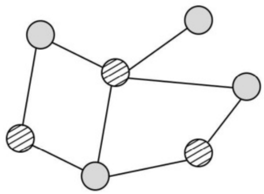

<!-- paper: mock-2027/set-3 | kind: solutions | status: needs-review -->
# 2027 考研 408 模拟卷 3 参考答案

> 来源：`sources/mock-2027/pdf/mock2027-set3-solution.pdf`。转写记录见 `build/_scratch/reports/mock-2027-set-3-solutions.md`。
> 选择题答案：已从底本切出 40/40 题。
> 选择题答案来自卷首答案表（`tools/answer_grid*.py` 的三路读法互校：OCR 读页面像素 / 读文字层 / 人工直读裁带图，哪几路读到就哪几路互校）与逐题解析流，逐题来源见各题上方注释。
> 综合题答案的第 6、7、8、9 页为**人工转录**（按底本页图逐字抄；来源与核对记录见 `solution-pages.yml`），其余页为 OCR 初稿。
> 综合题文字若来自扫描件则为 **OCR 初稿**，存在形近误识（如 `pminl`/`BTreeroot`/`elseif`），**未擅自改写**，
> 核对前请勿当作定论。逐题状态见 `meta.yml`。

## 一、单项选择题（1—40 题，每小题 2 分，共 80 分）

### 第 1 题

<!-- 底本第 1 页；来源：答案表·解析流 -->

答案：B

### 第 2 题

<!-- 底本第 1 页；来源：答案表·解析流 -->

答案：C

### 第 3 题

<!-- 底本第 1 页；来源：答案表·解析流 -->

答案：B

### 第 4 题

<!-- 底本第 2 页；来源：答案表·解析流 -->

答案：C

### 第 5 题

<!-- 底本第 2 页；来源：答案表·解析流 -->

答案：D

### 第 6 题

<!-- 底本第 2 页；来源：答案表·解析流 -->

答案：A

### 第 7 题

<!-- 底本第 2 页；来源：答案表·解析流 -->

答案：D

### 第 8 题

<!-- 底本第 2 页；来源：答案表·解析流 -->

答案：D

### 第 9 题

<!-- 底本第 2 页；来源：答案表·解析流 -->

答案：D

### 第 10 题

<!-- 底本第 2 页；来源：答案表·解析流 -->

答案：B

### 第 11 题

<!-- 底本第 2 页；来源：答案表·解析流 -->

答案：B

### 第 12 题

<!-- 底本第 2 页；来源：答案表·解析流 -->

答案：D

### 第 13 题

<!-- 底本第 2 页；来源：答案表·解析流 -->

答案：B

### 第 14 题

<!-- 底本第 3 页；来源：答案表·解析流 -->

答案：C

### 第 15 题

<!-- 底本第 3 页；来源：答案表·解析流 -->

答案：D

### 第 16 题

<!-- 底本第 3 页；来源：答案表·解析流 -->

答案：D

### 第 17 题

<!-- 底本第 3 页；来源：答案表·解析流 -->

答案：D

### 第 18 题

<!-- 底本第 3 页；来源：答案表·解析流 -->

答案：C

### 第 19 题

<!-- 底本第 3 页；来源：答案表·解析流 -->

答案：C

### 第 20 题

<!-- 底本第 3 页；来源：答案表·解析流 -->

答案：C

### 第 21 题

<!-- 底本第 3 页；来源：答案表·解析流 -->

答案：B

### 第 22 题

<!-- 底本第 3 页；来源：答案表·解析流 -->

答案：D

### 第 23 题

<!-- 底本第 4 页；来源：答案表·解析流 -->

答案：D

### 第 24 题

<!-- 底本第 4 页；来源：答案表·解析流 -->

答案：A

### 第 25 题

<!-- 底本第 4 页；来源：答案表·解析流 -->

答案：C

### 第 26 题

<!-- 底本第 4 页；来源：答案表·解析流 -->

答案：A

### 第 27 题

<!-- 底本第 4 页；来源：答案表·解析流 -->

答案：D

### 第 28 题

<!-- 底本第 4 页；来源：答案表·解析流 -->

答案：D

### 第 29 题

<!-- 底本第 4 页；来源：答案表·解析流 -->

答案：B

### 第 30 题

<!-- 底本第 4 页；来源：答案表·解析流 -->

答案：B

### 第 31 题

<!-- 底本第 4 页；来源：答案表·解析流 -->

答案：C

### 第 32 题

<!-- 底本第 4 页；来源：答案表·解析流 -->

答案：D

### 第 33 题

<!-- 底本第 4 页；来源：答案表·解析流 -->

答案：C

### 第 34 题

<!-- 底本第 4 页；来源：答案表·解析流 -->

答案：B

### 第 35 题

<!-- 底本第 5 页；来源：答案表·解析流 -->

答案：B

### 第 36 题

<!-- 底本第 5 页；来源：答案表·解析流 -->

答案：A

### 第 37 题

<!-- 底本第 5 页；来源：答案表·解析流 -->

答案：D

### 第 38 题

<!-- 底本第 5 页；来源：答案表·解析流 -->

答案：A

### 第 39 题

<!-- 底本第 5 页；来源：答案表·解析流 -->

答案：B

### 第 40 题

<!-- 底本第 5 页；来源：答案表·解析流 -->

答案：A

## 二、综合应用题（41—47 题，共 70 分）

### 第 41 题

<!-- 底本第 5—6 页；OCR 初稿，未逐字核对；其中第 6 页为**人工转录** -->

【答案要点】

（1）右图不能被二分，左图能被二分，染色情况如下图所示。
（2）从任意一个结点开始，将其染成红色，并从这个结点开始对整个图进行遍历；在遍历的过程中，如果当前遍历到的结点 a 有一条边指向了 b，那么可能会出现两种情况；1、b 没有被染色，那就将它染成与结点 a 不同的颜色，并且继续遍历与 b 相连的结点；2、a 与 b 颜色相同，说明给定的图不能被二分，直接返回；3、a 与 b 颜色不同，跳过 b 点。
（3）上述遍历过程无论是使用深度优先搜索还是广度优先搜索，时间复杂度都为 O(n+m)，n 和
m 分别是图中的顶点数目和边数。空间复杂度为 O(n)，主要是需要一个数组来存储各个点的颜色和是否已访问。
<!-- 第 41 题第 1 问的染色示意图（底本把它印在第 41 题第 3 问之后）；裁自底本第 6 页 -->


### 第 42 题

<!-- 底本第 6 页；**人工转录**（按底本页图逐字抄，来源见 `solution-pages.yml`） -->

【答案要点】

（1）根据中序后继的定义，如果一个结点有中序后继，则它满足两个条件的其中一条：1、有右子树，从而中序后继为右子树的最左结点；2、无右子树但是有父结点，并且这棵树是父结点的左孩子，中序后继为父结点。
（2）算法实现：
```c
Node *Search(Node *node) {
    if (node->right) {  //满足条件1
        Node *t = node;
        while (t->left) { t = t->left; } //找到右子树的最左结点
        return t;
    } else if (node->parent && node->parent->left == node) {
        return node -> parent; //满足条件2
    } else {                  //两个条件都不满足
        return nullptr;
    }
}
```
（3）若父结点是后继，则在 O(1) 的时间复杂度就可以获取到后继。而获取右子树的最左结点，最坏情况下需要访问的结点数量等于树的高度。故最坏时间复杂度为 O(h)。算法不需要额外的空间，故空间复杂度为 O(1)。h 为树的高度。

### 第 43 题

<!-- 底本第 6—7 页；**人工转录**（按底本页图逐字抄，来源见 `solution-pages.yml`） -->

【答案要点】

（1）主存地址空间大小为 1MB，所以主存地址位数为 20 位；每个主存块大小为 16B，按字节编址，故块内地址为 4 位；Cache 共有 32B/16B=2 行，行号占 1 位。综上，主存地址字段划分如下：

| 标记 | Cache 行号 | 块内地址 |
| --- | --- | --- |
| 高 15 位 | 中间 1 位 | 低 4 位 |

因为采用随机替换算法和直写法，所以 Cache 行中没有替换控制位和修改位。每个 Cache 行中包含 1 位有效位、15 位标记位和 16B 的数据，故 Cache 总容量为 2×(1+15+16×8)b=288b。
（2）数组 x 和 y 都按存放顺序访问，空间局部性较好，但每个数组元素只访问一次，故没有时间局部性。
（3）Cache 共有 2 行；4 个数组元素占一个主存块；数组 x 的 8 个元素（共 32B）连续存放在主存 00040H 开始的 32 个单元中，数组 y 的 8 个元素连续存放在主存 00060H 开始的 32 个单元中，故 x[0]~x[3] 和 y[0]~y[3] 都映射到 Cache 第 0 行，x[4]~x[7] 和 y[4]~y[7] 都映射到
Cache 第 1 行。因为 x[i] 和 y[i] 总是映射到同一个 Cache 行，相互淘汰对方，故每次都不命中，命中率为 0。
若数组 x 定义为 float[12]，则 x 共有 48B，y[0]~y[3] 映射到第 1 行，y[4]~y[7] 映射到第 0 行，
x[i] 和 y[i] 不会映射到同一个 Cache 行中，每调入一个主存块，装入 4 个数组元素，第一个元素不命中，后面 3 个总命中，故命中率为 75%。
（4）改用 2 路组相联映射，块大小改为 8B，则 Cache 共 2 组，每组 2 行，2 个数组元素占一个主存块。x[0]~x[1]、x[4]~x[5]、y[0]~y[1]、y[4]~y[5] 映射到第 0 组，x[2]~x[3]、x[6]~x[7]、
y[2]~y[3]、y[6]~y[7] 映射到第 1 组。因为每组有两行，所以 x[i] 和 y[i] 可以存放到同一个
Cache 组的不同行内，所以每调入一块，装入的 2 个数组元素中，第 2 个数组元素总是命中，缺失次数为 8 次。

### 第 44 题

<!-- 底本第 7 页；**人工转录**（按底本页图逐字抄，来源见 `solution-pages.yml`） -->

【答案要点】

（1）虚拟地址 16 位，按字节编址，则虚拟地址空间大小为 64KB。TLB 采用 4 路组相联映射，故有 4 个比较器，比较器位数与 TLB 标记位数相同。由页大小为 128B 得 16 位虚拟地址的低
7 位为页内偏移量，则高 9 位为虚页号；TLB 共 4 组，则虚页号中的低 2 位为组号，高 7 位为 TLB 标记，则比较器位数为 7 位。
（2）12 位物理地址中高 5 位为物理页号。物理地址字段划分如下：

| 标记 | Cache 行号 | 块内地址 |
| --- | --- | --- |
| 高 6 位 | 中间 4 位 | 低 2 位 |

（3）地址 067AH=0000 0110 0111 1010B，所以，虚页号为 000001100B，映射到 TLB 的第 0 组，将 0000011B=03H 与 TLB 第 0 组的 4 个标记比较，虽然和其中一个相等，但对应的有效位为 0，其余都不等，所以 TLB 缺失，需要访问主存中的慢表。直接查看 000001100B=00CH
处的页表项，有效位为 1，取出物理页号 19H=11001B，和页内偏移 1111010B 拼接成物理地址 110011 1110 10B。根据中间 4 位 1110 直接找到 Cache 第 14 行（即第 E 行），其有效位为 1，且标记为 33H=110011B，正好等于物理地址高 6 位，故 Cache 命中。最后根据物理地址最低两位 10，取出字节 2 中的内容 4AH=01001010B。
（4）地址 0E65H=0000 1110 0110 0101B，虚页号 000011100，映射到 TLB 第 0 组，且 TLB 命中，则一定在主存中，物理地址为 1000 0110 0101B，映射到 Cache 第 9 行，Cache 缺失，由硬件处理。地址 0353H=0000 0011 0101 0011B，TLB 和页表均未命中，产生缺页，缺页属于异常。

### 第 45 题

<!-- 底本第 7—8 页；**人工转录**（按底本页图逐字抄，来源见 `solution-pages.yml`） -->

【答案要点】

（1）该文件系统按磁盘块分配，每个地址项长度 4B，磁盘块大小 1KB，因此一个块可存放 1KB/4B=256
个地址项。文件索引结点共可存放 10+1×256+1×256^{2}+1×256^{3} 个地址项，该文件系统所支持的最大文件长度为 (10+1×256+1×256^{2}+1×256^{3})×1KB=10KB+256KB+64MB+16GB。
（2）① 9999/1024=9，9999%1024=783，因此逻辑盘块号为 9，直接索引第 9 个地址，得到物理盘块号为 6，块内偏移量为 783。
② 18000/1024=17，18000%1024=592，逻辑盘块号为 17，通过一级间接索引 i.addr(10) 对应盘块查找到第 7 个地址项为 633，可得物理盘块号为 633，块内偏移量 592。
③ 420000/1024=410，420000%1024=160，逻辑盘块号为 410，410-10-256=144，通过二级简介索引可得物理盘块号为 335，块内偏移量 160。
（3）最少访问 1 次磁盘（即可通过直接地址项直接读取文件盘块），最多访问 4 次磁盘（通过三级间接索引读取文件盘块）。

### 第 46 题

<!-- 底本第 8 页；**人工转录**（按底本页图逐字抄，来源见 `solution-pages.yml`） -->

【答案要点】

（1）位示图大小为 256KB/1KB=256b=32B。会有内部碎片存在。
（2）由位示图可得，前四个空闲页框为 21、27、28、34；进程依次访问的页号为 0、0、1、5、0、
4、2、3、4、2。

| 页号 | 0 | 0 | 1 | 5 | 0 | 4 | 2 | 3 | 4 | 2 |
| --- | --- | --- | --- | --- | --- | --- | --- | --- | --- | --- |
| 页框号 21 | 0 | 0 | 0 | 0 | 0 | 0 | 2 | 2 | 2 | 2 |
| 页框号 27 | | | 1 | 1 | 1 | 1 | 1 | 3 | 3 | 3 |
| 页框号 28 | | | | 5 | 5 | 5 | 5 | 5 | 5 | 5 |
| 页框号 34 | | | | | 4 | 4 | 4 | 4 | 4 | 4 |

页表如下：

| 页号 | 页框号（0 开始编址） |
| --- | --- |
| 2 | 21 |
| 3 | 27 |
| 5 | 28 |
| 4 | 34 |

（3）进程处于阻塞态，CPU 处于内核态。

### 第 47 题

<!-- 底本第 8—9 页；**人工转录**（按底本页图逐字抄，来源见 `solution-pages.yml`） -->

【答案要点】

（1）当主机接入网络后，需要通过 DHCP 获取 IP 地址，DHCP 客户端的端口号为 68；主机访问网址时，由于是全新的接入，无任何 DNS 缓存，需要使用 DNS 解析域名，DNS 的端口号为 53；主机访问网址时，要通过 HTTP 协议才能请求和传输信息，HTTP 的端口号为 80。
（2）当主机接入网络后，发出的第一个 IP 分组即为 DHCP DISCOVER 报文，源 IP 地址为 0.0.0.0，目的地址为 255.255.255.255。
（3）当主机 H 发送 DHCP 发送报文时，MAC 表便知道 MAC 地址 1C-2B-50-15-ED-3A 源于 1 号接口；DHCP 服务器返回 DHCP OFFER 时，便得知 DHCP 服务器的 MAC 地址 1C-4D-70-15-ED-5C 源自于 4 号端口；主机通过 ARP 获取 www.abc.com 的 IP 地址对应的 MAC 地址时，由于不在同一局域网，获取的是默认网关的 MAC 地址，默认网关发送 ARP 响应报文时，交换机感知到默认网关的 MAC 地址源于 3 号接口，由此构造下列 MAC 表：

| MAC 地址 | 接口 |
| --- | --- |
| 1C-2B-50-15-ED-3A | 1 |
| 1C-4D-70-15-ED-5C | 4 |
| 1C-3C-60-15-ED-4B | 3 |

（4）采用了 NAT 之后，主机在外部统一的表现为外部 IP，默认网关收到的 IP 分组的目的 IP 为
212.10.10.1。
