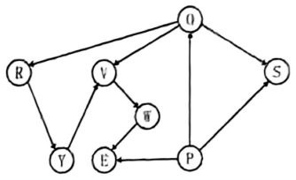
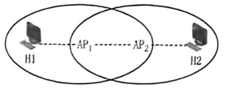
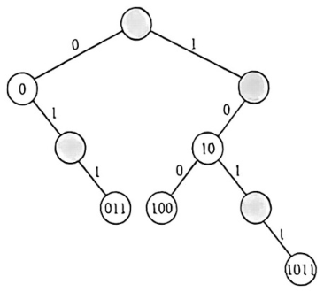
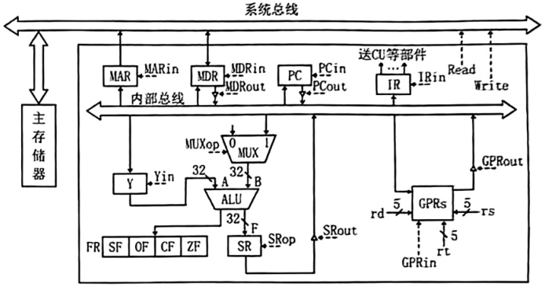
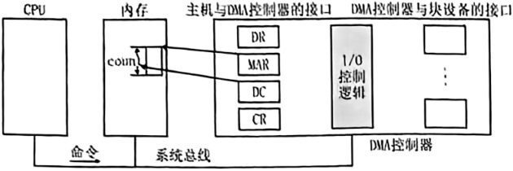
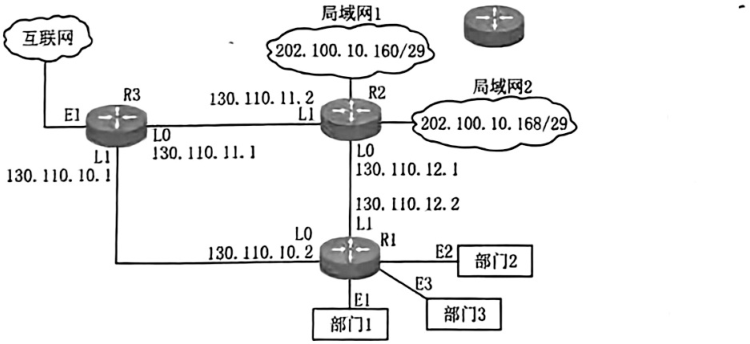

<!-- paper: mock-2027/set-4 | kind: questions | status: needs-review -->
# 2027 考研 408 模拟卷 4

> 来源：`sources/mock-2027/pdf/mock2027-set4-paper.pdf`（见 docs/provenance.md S1）
> ⚠️ 本文件为**机械转写稿**，尚未逐题对照原文。逐题状态见 `meta.yml`，
> 转写存疑点见 `build/_scratch/reports/`。

## 一、单项选择题（1—40 题，每小题 2 分，共 80 分）

### 第 1 题

<!-- 底本第 2 页 -->

假设下列程序段的所有输入都是合法的，则下列程序段的空间复杂度是（）。

```c
int fun(int *arr, int m, int n)
    if (m == n)
        return 1;
    else {
        int mid = (m + n) / 2;
        return fun(arr, m, mid) + fun(arr, mid + 1, n);
    }
```

A. O(log_{2}n)
B. O(n)
C. O(nlog_{2}n)
D. O(2^{n})

### 第 2 题

<!-- 底本第 2 页 -->

已知一个带有表头结点的双向循环链表 L，结点结构为 [prev][data][next]，其中，prev 和 next 分别是指向其直接前驱和直接后继结点的指针。现要添加一个结点（指针 x 指向该插入结点）到指针 p 所指的结点的前一位置，正确的语句序列是（）。

A. x -> next = p; x -> prev = p -> prev; p -> prev -> next = x; p -> prev = x;
B. x -> next = p; x -> prev = p -> prev; p -> prev = x; p -> prev -> next = x;
C. x -> next = p; p -> prev = x; x -> prev = p -> prev; p -> prev -> next = x;
D. p -> prev = x; x -> next = p; x -> prev = p -> prev; p -> prev -> next = x;

### 第 3 题

<!-- 底本第 2 页 -->

下列关于二叉树的遍历的陈述中，正确的是（）。

I. 存在一棵二叉树的叶结点在先序、中序、后序遍历序列中相对位置可能不同

II. 要交换二叉树的所有分支结点的左右子树的位置，利用中序遍历框架解决最合适

III. 含有4个结点的二叉树最多有14种形态

IV. 一棵非空的二叉树的前序序列和中序序列正好相反，则该二叉树一定只有一个叶结点

A. III、IV
B. II、III、IV
C. II、III
D. IV

### 第 4 题

<!-- 底本第 2 页 -->

设森林 F 中有 3 棵树，第一、第二、第三棵树的结点个数分别为 M_{1}，M_{2} 和 M_{3}。将森林 F 转化成对应的二叉树 T，若以第一棵树的根结点作为 T 的根结点，则 T 的根结点的右子树上的结点个数是（）。

A. M_{1}
B. M_{2} + M_{2}
C. M_{3}
D. M_{2} + M_{3}

### 第 5 题

<!-- 底本第 2 页 -->

将关键字 41，38，31，12，19，8 依次插入空的红黑树后，下列对结果的树说法错误的是（）。

A. 有 2 个红色结点，4 个黑色结点
B. 12 和 41 的黑高相同
C. 8 是 31 的孩子
D. 树中存在相邻的黑色内部结点

### 第 6 题

<!-- 底本第 2 页 -->

下列说法错误的是（）。

A. 若一棵二叉排序树中一个结点有两个孩子，则它的中序后继结点没有左孩子，它的中序前驱结点没有右孩子
B. 若二叉排序树中一个结点 x 的右子树为空，且 x 有一个后继 y，则 y 一定是 x 的祖先，且其左孩子也是 x 的祖先（结点本身也视为自己的一个祖先）
C. 中序线索树中，从最左边的结点开始不断地查找右线索，不一定能遍历树内所有的结点
D. 若 x 是二叉排序树的叶结点，y 是其父结点，那么 y 的数值要么是树中大于 x 的数值的最小关键字，要么是树中小于 x 的数值的最大关键字

### 第 7 题

<!-- 底本第 2 页 -->

下列关于图的陈述说法错误的是（）。

A. 强连通的有向图的任何顶点到其他所有顶点都有弧
B. 有向完全图一定是强连通有向图
C. DFS 生成树的高度一般不小于 BFS 生成树的高度
D. 当各边上的权值相同时，BFS 算法可用来解决单源最短路径问题

### 第 8 题

<!-- 底本第 3 页 -->

下列关于最小生成树的陈述中，错误的是（）。

A. 设 (u,v) 是连通图 G 中的权重最小的边，那么 (u,v) 是 G 的某棵最小生成树中的一条边
B. 设 e 是连通图 G = (V,E) 的某条环路上权重最大的边，那么图 G 中存在一棵不包含边 e 的最小生成树
C. 若图的所有边的权重有正有负，则任一连接所有结点且总权重最小的一个边集合必然形成一棵树
D. 若 T 是图 G 的一棵最小生成树，如果减小了 T 中的一条边的权重，那么 T 仍然是 G 的一棵最小生成树

### 第 9 题

<!-- 底本第 3 页 -->

给定如下图所示的有序图，该图的拓扑排序有序序列的个数是（）。

<!-- 图见底本第 3 页；归属依据：人工登记 figures.yml -->


A. 5
B. 6
C. 7
D. 8

### 第 10 题

<!-- 底本第 3 页 -->

下列关于选择-置换排序的说法正确的是（）。

I. 创建初始段文件过程中，需要不断地在内存工作区中选择不小于旧的 MINIMAX 的最小值，此过程需利用败者树实现

II. 不断选择新的 MINIMAX 记录时，为防止新加入的关键字值更小，每个叶结点都附加一个序号位，当进行关键字比较时，先比较序号，序号大的为胜者；序号相同的关键字值小的为胜者

III. 置换选择排序算法得到的初始归并段的长度并不受内存容量的限制，且获得的归并段的平均长度为内存工作区大小的两倍

A. I、III
B. II、III
C. I、II、III
D. I、II

### 第 11 题

<!-- 底本第 3 页 -->

对各种内部排序方法来说（）。

A. 快速排序时间性能最佳
B. 基数排序和归并排序是稳定的排序方法
C. 快速排序是一种选择排序
D. 堆排序所用的辅助空间较大

### 第 12 题

<!-- 底本第 3 页 -->

在高级语言源程序要执行时，将高级语言转换为机器语言，并且翻译一句执行一句，这样的程序为（）。

A. 汇编程序
B. 链接程序
C. 编译程序
D. 解释程序

### 第 13 题

<!-- 底本第 3 页 -->

对于 IEEE 754 单精度浮点数加减运算，若运算结果直接取阶大的数，则两操作数的阶码之差的绝对值大于等于（）。

A. 24
B. 25
C. 126
D. 128

### 第 14 题

<!-- 底本第 4 页 -->

一个 8 位的二进制整数由 2 个 "0" 和 6 个 "1" 组成，采用补码或者移码表示，则下列说法中正确的是（）。

A. 若采用移码表示，偏置值为 127，则此整数最小为 -64
B. 若采用移码表示，偏置值为 128，则此整数最大为 123
C. 若采用补码表示，则此整数最小为 -96
D. 若采用补码表示，则此整数最大为 252

### 第 15 题

<!-- 底本第 4 页 -->

已知整数 A、B 的机器数分别是 BCH 和 71H，如果在 8 位加法器中计算 A-B，那么运算后的溢出标志 OF、符号标志 SF、进/借位标志 CF 分别是（）。

A. 1、0、0
B. 1、0、1
C. 0、1、1
D. 0、0、0

### 第 16 题

<!-- 底本第 4 页 -->

下列存储器中，属于易失性存储器的是（）。

A. Cache
B. EPROM
C. Flash Memory
D. CD-ROM

### 第 17 题

<!-- 底本第 4 页 -->

一个八体低位交叉存储器，每个存储体的容量为 256M × 64 位，若每个体的存储周期为 80ns，那么该存储器能提供的最大带宽是（）。

A. 426.67MB/s
B. 800MB/s
C. 213.33MB/s
D. 400MB/s

### 第 18 题

<!-- 底本第 4 页 -->

假定编译器对 C 源程序中的变量和 MIPS 中寄存器进行了以下对应：变量 f、g、h、i、j 分别对应寄存器 $s0、$s1、$s2、$s3、$s4。一条 C 语言赋值语句编译后生成如下代码序列。这条 C 语言赋值语句是（）。

```asm
and $t0, $s1, $s2
sub $t1, $s3, $s4
sub $s0, $t1, $t0
```

A. f = (i - j) - (g&h)
B. f = (g&h) - (i - j)
C. f = (i - j) - (g + h)
D. f = (g + h) - (i - j)

### 第 19 题

<!-- 底本第 4 页 -->

下列与微指令格式相关的描述中，正确的是（）。

A. 相对于字段直接编码法，直接控制法的控存利用率更高
B. 相对于直接控制法，字段直接编码法的执行速度更快
C. 相对于计数器法，下址字段法（断定法）的微指令格式更短
D. 相对于垂直型微指令，一条水平型微指令中包含的微命令更多

### 第 20 题

<!-- 底本第 4 页 -->

在微程序控制器中，执行指令微程序的首条微指令地址是由（）得到的。

A. 指令操作码
B. 程序计数器 PC
C. 微指令下址字段
D. μPC+1

### 第 21 题

<!-- 底本第 4 页 -->

下列选项中，不会引起指令流水线阻塞的是（）。

A. 外部中断
B. 执行空操作指令
C. Cache 缺失
D. 访存冲突

### 第 22 题

<!-- 底本第 4 页 -->

以下有关 I/O 接口的叙述中，错误的是（）。

A. I/O 接口就是像显卡或网卡之类的一种外设控制逻辑
B. I/O 接口中主机侧数据宽度与设备侧数据宽度不一定相同
C. 采用统一编址时，根据指令类型可区分访问主存还是访问 I/O 端口
D. 采用统一编址时，可利用主存的存储保护措施对 I/O 端口进行存储保护

### 第 23 题

<!-- 底本第 4 页 -->

下列说法中正确的有（）。

I. 配备了虚拟存储器的多道程序环境中，运行的进程越多，CPU 利用率越高。

II. 外核是不同于微内核和宏内核的一种操作系统内核架构

III. 操作系统提供给用户的接口包括联机接口和脱机接口，图形用户界面（GUI）是一种脱机接口。

IV. 内存映射文件技术结合了虚拟内存管理技术与文件管理技术，方便易用，节省空间

A. 1个
B. 2个
C. 3个
D. 4个

### 第 24 题

<!-- 底本第 5 页 -->

某时刻，某计算机系统中共有 10 个进程和 3 台打印机，使用信号量管理打印机的互斥访问，则该信号量的取值范围是（）。

A. -10 到 3
B. -6 到 3
C. -7 到 3
D. -3 到 10

### 第 25 题

<!-- 底本第 5 页 -->

下列关于线程的描述中，正确的是（）。

A. 在一个进程中创建一个新线程比创建一个新进程所需的工作量多
B. 进程间通信和同一进程中的线程间通信差不多。
C. 多处理机系统适合使用多线程技术。
D. 用户级线程的调度由操作系统完成。

### 第 26 题

<!-- 底本第 5 页 -->

计算机系统按字节寻址，物理地址为 1MB，虚拟地址空间由 32 个 2KB 的页组成，页表用 3 位表示当前页的读、写和执行权限，则虚拟地址长度为（）；页表总长度为（）。

A. 20 位，32B
B. 20 位，48B
C. 16 位，32B
D. 16 位，48B

### 第 27 题

<!-- 底本第 5 页 -->

某分页存储管理系统中，逻辑地址长度为 16 位，物理地址长度为 18 位，每页的大小为 2KB，部分页表如下。

| 页号 | 页框号 |
| --- | --- |
| 0 | 100 |
| 1 | 68 |
| 2 | 36 |
| 3 | 50 |
| … | … |

则逻辑地址 0x1234 对应的物理地址为：

A. 0x12334
B. 0x12234
C. 0x43210
D. 0x22234

### 第 28 题

<!-- 底本第 5 页 -->

文件系统使用 FAT 方式组织文件，若块大小为 4KB，FAT 表项长度为 32 位，其中用 1 位表示占用，1 位表示损坏，其余用于表示块号，则分区的最大长度为（），4GB 大小分区的 FAT 表长度为（）。

A. 8TB，4KB
B. 4TB，4KB
C. 8TB，4MB
D. 4TB，4MB

### 第 29 题

<!-- 底本第 5 页 -->

某 Unix 系统中，多个单独设备上的多个文件系统被挂载到一个统一的文件系统中。假设某光盘文件系统中包含一个路径名为/usr/bin/vim 的文件，且光盘被挂载到/media/disk 处，则整个文件系统中这个文件的路径名是（）。

A. /usr/bin/vim
B. /media/vim
C. /media/usr/bin/vim
D. /media/disk/usr/bin/vim

### 第 30 题

<!-- 底本第 5 页 -->

下列关于文件操作的描述中，正确的是（）。

I. 文件创建操作需要用户提供文件名和文件路径

II. 文件打开操作会将文件的 FAT 从磁盘中复制到内存中

III. 文件打开操作可能会失败

IV. 任何文件系统中，文件删除操作都会立即从磁盘上删除文件的内容。

V. 链接操作能够创建指向文件的硬链接

A. I、III
B. I、IV
C. II、IV
D. I、V

### 第 31 题

<!-- 底本第 6 页 -->

下列关于固态硬盘（SSD）的说法中，错误的是（）

A. 固态硬盘不受震动和物理冲击的影响，更适合移动设备使用。
B. 写入固态硬盘时，应优先选择较老的块，而保留较新的块备用。
C. 固态硬盘的数据存储于 Flash 芯片之中。
D. 机械硬盘使用的磁盘调度算法不一定适用于固态硬盘。

### 第 32 题

<!-- 底本第 6 页 -->

以下关于格式化的描述中，正确的是（）

A. 低级格式化会将磁盘分成多个逻辑分区
B. 低级格式化后，磁盘可以直接存储数据
C. 高级格式化可以被用户随时执行，而不会破坏数据。
D. 高级格式化会为指定分区分配文件系统，并初始化其元数据结构。

### 第 33 题

<!-- 底本第 6 页 -->

在网络体系结构中，各层的 PDU 由 SDU 和 PCI 构成，OSI 参考模型自下而上的第一层、第二层、第三层的 SDU 分别为（）。

A. 比特流、数据帧、数据分组
B. 数据帧、数据分组、报文段
C. 比特流、数据分组、报文段
D. 报文段、数据分组、数据帧

### 第 34 题

<!-- 底本第 6 页 -->

链路的带宽约为 10kHz，信噪比为 30dB，信号采用 4 个幅值的 ASK 调制，信道的极限码元传输速率为（）。

A. 50Baud
B. 100Baud
C. 50kBaud
D. 100kBaud

### 第 35 题

<!-- 底本第 6 页 -->

主机的数据链路层采用 GBN 协议传输数据，并采用 3bit 给帧进行编号，从 0 时刻开始，主机开始发送数据，当主机发送了 5 号数据帧后，收到了 3 号数据帧的确认，在 t 时段内未收到任何确认帧且发送的帧未超时，在 t 时段内主机可发送的数据帧数为（）。

A. 2
B. 3
C. 4
D. 5

### 第 36 题

<!-- 底本第 6 页 -->

主机要发送的字符序列为 101110，双方约定的生成多项式 P(x) = x^{3} + 1，则发送方需要添加的 FCS 应为（）

A. 100
B. 11
C. 011
D. 0011

### 第 37 题

<!-- 底本第 6 页 -->

如下图所示，H1 的 MAC 地址为 01-23-45-67-89-0a，AP1 的 MAC 地址为 01-23-45-67-89-0b，AP2 的 MAC 地址为 01-23-45-67-89-0c，H2 的 MAC 地址为 01-23-45-67-89-0d，H1 沿着图中链路发送一个封装访问 Internet 的 IP 分组的 IEEE 802.11 数据帧给 H2，则 AP1 发送的帧的地址 1、地址 2、地址 3 和地址 4 分别是（）。

<!-- 图见底本第 6 页；归属依据：人工登记 figures.yml -->


A. 01-23-45-67-89-0c，01-23-45-67-89-0b，01-23-45-67-89-0d，01-23-45-67-89-0a
B. 01-23-45-67-89-0a，01-23-45-67-89-0d，01-23-45-67-89-0b，01-23-45-67-89-0c
C. 01-23-45-67-89-0a，01-23-45-67-89-0b，01-23-45-67-89-0c，01-23-45-67-89-0a
D. 01-23-45-67-89-0d，01-23-45-67-89-0c，01-23-45-67-89-0b，01-23-45-67-89-0a

### 第 38 题

<!-- 底本第 7 页 -->

下列有关网络的路由算法中，说法正确的是（）

I. RIP、OSPF、BGP 均为工作在网络层的协议

II. RIP 更适合小型的、静态的网络，OSPF 更适合大型的、动态的网络

III. RIP 限制了最多能到达 16 跳，OSPF 无限制

IV. RIP 交换的路由信息为完整的路由表，OSPF 交换的路由信息为直连的链路状态

A. I、II、III
B. I、II、IV
C. II、III、IV
D. I、II、III、IV

### 第 39 题

<!-- 底本第 7 页 -->

主机甲和主机乙已经建立了 TCP 建立，甲以 MSS = 1KB 进行数据传输，主机乙的初始接收窗口为 30KB，主机乙只有当接收窗口满时才会将数据提交给应用层，初始的拥塞控制阈值为 4KB，经过 6RTT 后（之前未发生拥塞），主机甲收到 3 个重复 ACK，当 7 个 RTT 后，主机甲的发送窗口为（）。

A. 1KB
B. 2KB
C. 4KB
D. 5KB

### 第 40 题

<!-- 底本第 7 页 -->

下列关于网络应用模型的叙述中，错误的是（）。

A. DNS、FTP 均基于 C/S 模式进行设计
B. C/S 模型中，用户之间必须通过服务器进行通信
C. P2P 模型中，每个节点既可以充当客户端又可以充当服务器
D. P2P 模型相较于 C/S 模型更加安全和稳定

## 二、综合应用题（41—47 题，共 70 分）

### 第 41 题

<!-- 底本第 7 页 -->

（10分）仅由字符 0 和 1 组成的字符串，可以用一种称为基数树的数据结构来存储，在基数树中，按照从根结点开始，左分支赋予 0，右分支赋予 1 的规则，每个结点的关键字，可以用一条从根结点到该结点的简单路径来确定。例如，给定字符串集合 S = {1011, 10, 011, 100, 0}，集合 S 可以存储在一棵如下图所示的基数树中，树中灰色的结点表示该结点对应的关键字不属于集合 S（灰色结点存在的用途是为了建立通往其他结点的路径）。

基数树中任意关键字都是由字符 0 或 1 组成。对于基数树中的存储的任意两个关键字 a = a_{0}a_{1}⋯a_{m}，b = b_{0}b_{1}⋯b_{n}，若下述两条规则之一成立，则可判定 a < b：

规则一：存在一个整数 x，满足条件 0 ≤ x ≤ min(m, n)，使得对所有的 j = 0, 1, ⋯, x-1，a_{j} = b_{j}均成立，且 a_{x} < b_{x}。

规则二：m < n，且对所有的 j = 0, 1, ⋯, m，a_{j} = b_{j} 均成立。

例如，对于 a = 101，b = 110，根据规则一，可判定 a < b (x = 1)；对于 a = 101，b = 1011，根据规则二，可判定 a < b (m = 2, n = 3)。

根据上面的介绍，请回答下列问题：

（1）本题中介绍的基数树这种数据结构是否符合二叉排序树的定义？请说明理由。

（2）试说明基数树这种数据结构是如何查找出一个关键字的，并给出能实现查找功能的数据结构的结点定义 TreeNode()：

（3）集合 S 的排序功能可否基于基数树来实现？若能，请给出尽可能高效的排序方法，并给出该方法对应的时间复杂度。若不能，请说明理由。

<!-- 图见底本第 7 页；归属依据：人工登记 figures.yml -->


### 第 42 题

<!-- 底本第 8 页 -->

（13分）无向图 G 中有 n 个顶点，顶点之间的邻接关系用邻接矩阵 AdjGrid 表示，AdjGrid[i][j] =1 表示存在一条顶点 i 与顶点 j 连接的边，否则不存在该边，且 AdjGrid[i][j] = AdjGrid[j][i]。图的结构如下所示：

```text
const int MAX_SIZE = 200;

typedef struct {
    int n;
    int AdjGrid[MAX_SIZE][MAX_SIZE];
} Graph;
```

请给出一个时间上尽可能高效的算法，计算图 M 的连通分量的数量。要求：

（1）给出算法的基本设计思想。

（2）根据设计思想，采用 C 或 C++ 语言描述算法，关键之处给出注释。

（3）说明你的算法的时间复杂度。

### 第 43 题

<!-- 底本第 8 页 -->

（13分）某 C 语言程序中的一个代码段为："while(arr[i] == k) i += 1;"，在计算机 M 上对其编译时，编译器将 i 和 k 分别分配在寄存器 R2 和 R0 中，arr[0] 的地址存放在 R3 中。该代码段对应的汇编代码如下：

```text
1   00401000    loop: sll  R1,R2,2     (R2)<<2 → R1
2   00401004          add  R1,R1,R3    (R1)+(R3) → R1
3   00401008          load R4,0(R1)    ((R1)+0) → R4
4   0040100C          bne  R4,R0,exit  if (R4) != (R0) goto exit
5   00401010          add  R2,R2,1     (R2)+1 → R2
6   00401014          jmp  loop        goto loop
7                 exit:
```

计算机 M 的指令格式及其说明如下：

| 格式 | 6 位 | 5 位 | 5 位 | 5 位 | 5 位 | 6 位 | 指令功能或指令类型说明 |
| --- | --- | --- | --- | --- | --- | --- | --- |
| R 型 | 000000 | rs | rt | rd | imm | op1 | 双目运算或移位指令 |
| I 型 | op2 | rs | rt | imm | | | 含 ALU 运算，条件转移和访存操作 3 类指令 |
| J 型 | op3 | imm | | | | | PC 的低 26 位 ← imm |

其中，op1～op3 为操作码，rs、rt、rd 为通用寄存器编号（寄存器 R0、R1、R2、R3、R4 编号分别为 0、1、2、3、4），imm 为立即数。

请回答下列问题：

（1）计算机 M 的编址单位是多少？数组 arr 每个元素占几个字节？

（2）计算机 M 的通用寄存器最多有多少个？若 I 型指令定义了 40 种操作，那么 J 型指令最多可定义多少种操作？

（3）该指令序列中，哪些为 I 型，哪些为 J 型？若 M 采用 "取指、译码/取数、执行、访存、写回" 的 5 段流水线处理器，且则哪些指令可能会导致控制冒险？

（4）已知移位指令是将 rt 内容根据 imm 字段进行移位，结果送往 rd，rs 字段为 0，且逻辑左移、逻辑右移、算术左移、算术右移的操作码分别为 10H、11H、12H、13H，请写出指令 1 的机器码（十六进制表示）。

### 第 44 题

<!-- 底本第 9 页 -->

（10分）题 43 中的计算机 M，其 CPU 中部分数据通路如下图所示。其中 GPRs 为通用寄存器组；FR 为标志寄存器，用于存放 ALU 产生的标志信息；带箭头虚线表示控制信号，如控制信号 Read、Write 分别表示主存读、主存写，MDRin 表示内部总线上数据写入 MDR，MDRout 表示 MDR 的内容送内部总线；ALU 和移位寄存器 SR 都具有直送功能，此时控制信号为 mov，

请回答下列问题：

（1）PC 和 IR 的位数分别是多少？二路选择器 MUX 的输入端 0 的输入值应是多少？

（2）ALU 内部为什么通常使用并行进位加法器，而不是串行进位加法器？

（3）若数组 arr 中的数组元素为 int 类型，则题 43 中的指令 4 不需要用到 FR 中的哪个标志？题43 中的指令 6 是否需要用到 FR？

（4）写出指令 2 的控制信号序列，包括取指阶段（不考虑 PC 增量操作）和执行阶段（执行加法指令时 ALUop = add）。

<!-- 图见底本第 9 页；归属依据：人工登记 figures.yml -->


### 第 45 题

<!-- 底本第 9 页 -->

（8分）假设系统有 5 类临界资源 R1、R2、R3、R4，资源数量分别为 1、2、2、1 个单位。某时刻有 3 个进程 P1、P2、P3。其中 P1 已占有 1 个单位的 R2，申请 1 个单位的 R1；P2 已占有 1 个单位的 R3 和 1 个单位的 R1，申请 1 个单位的 R4；P3 已占有 1 个单位的 R2 和 1 个单位的 R4，申请 1 个单位的 R2 和 1 个单位的 R3。请回答下列问题。

（1）画出该时刻的资源分配图，并判断当前系统是否处于死锁状态。

（2）产生死锁的必要条件有哪些？给出一种避免死锁的方法。

### 第 46 题

<!-- 底本第 10 页 -->

（7分）用户在使用计算机时，通过键盘输入命令，使得用户程序执行 fread() 库函数，调用相关的系统调用，之后 CPU 执行 I/O 指令，从磁盘获取文件数据。磁盘与 CPU 之间采用 DMA 方式进行数据传输，DMA 控制器如下图所示。

请回答下列问题。

（1）键盘输入命令采用什么 I/O 方式？程序在调用系统调用时，CPU 处于什么状态？I/O 指令属于特权指令还是非特权指令？

（2）从磁盘获取数据时，DMA 控制器中 MAR 和 DC 的作用分别是什么？

（3）通常把 I/O 软件组织成 4 个层次，分别为：用户层软件、与设备无关的 I/O 软件、设备驱动程序和中断处理程序。其中，将逻辑设备名映射成物理设备名的是哪一层次？计算数据所在磁盘的柱面号、磁头号、扇区号的是哪一层次？

<!-- 图见底本第 10 页；归属依据：人工登记 figures.yml -->


### 第 47 题

<!-- 底本第 10 页 -->

（9分）某网络拓扑所下图所示，网络中的路由器均运行 RIP 路由协议，其中各个路由器和局域网的相关信息已经在图中进行了标注，根据网络拓扑回答下列问题。

（1）将 IP 地址空间 130.120.10.0/24 划分给部门 1、部门 2 和部门 3，已知三个部门的员工数始终按照部门 1 的员工数量与部门 2 的员工数量相等，部门 1 的员工数量等于部门 3 的员工数量的一半进行发展，请给出合理的子网划分结果。

（2）请给出 R1 的路由表，要求能到达图中各个局域网（路由表格式如下所示），并使得路由表项尽可能小。

| 目的网络 | 下一跳 | 接口 |
| --- | --- | --- |

（3）在 t 时刻 R2 检测到局域网 1 不可达，向 R1 通告一次距离向量，则 R1 更新后，其到达局域网的距离为多少？并给出变化理由。

<!-- 图见底本第 10 页；归属依据：人工登记 figures.yml -->

