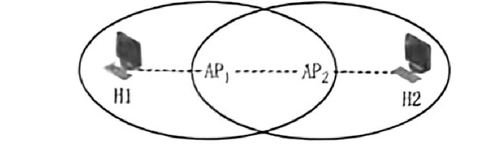
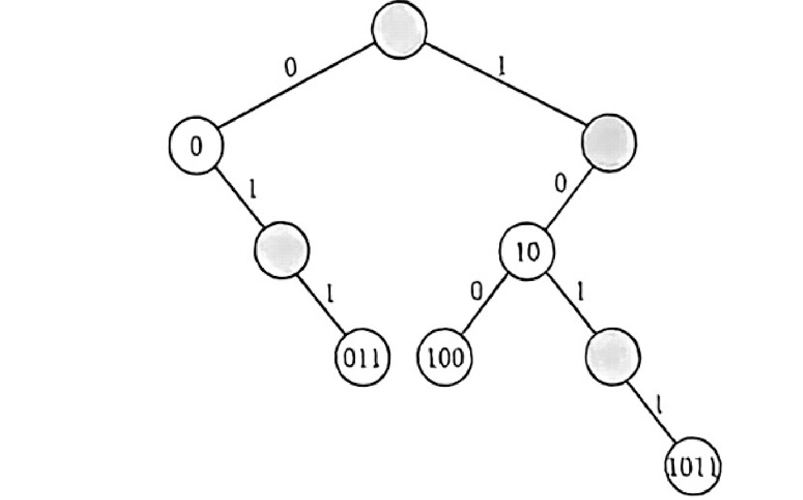
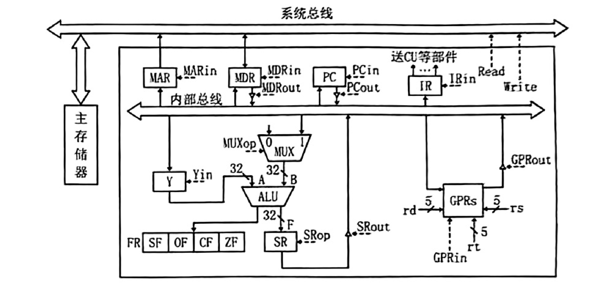
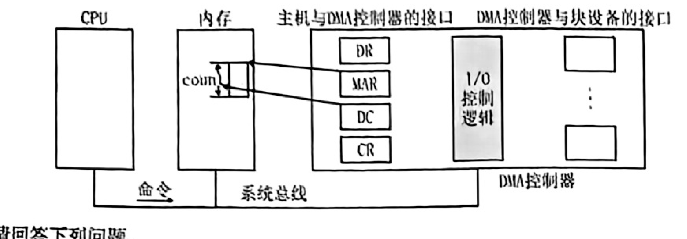
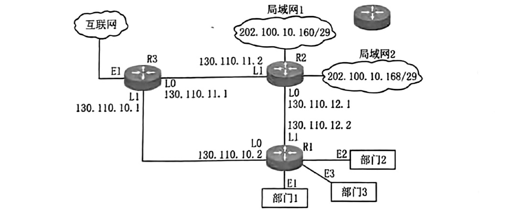

<!-- paper: mock-2027/set-4 | kind: questions | status: needs-review -->
# 2027 考研 408 模拟卷 4

> **⚠️ 这是「未校对」的机器转录草稿，不是可发布的正式题库。**
>
> - **来源**：用户提供的扫描 PDF `sources/mock-2027/pdf/mock2027-set4-paper.pdf`（10 页，**无文本层**）。转录方式 = OCR 初稿 + **逐题源页渲染图人工定点核对重录**（pymupdf，350–1200dpi 局部放大）。
> - **完成度**：**47 题（1—47）** 的题干与选项/分问均已按源页渲染图逐题核对过一遍；本文件与 `solutions.md` 的题号集合一致。
> - **未完成（重要）**：逐题 `proofread` 计数为 **0/47**。`needs-review` 只表示「已按源页局部核对题干/选项」，**不等于**全文逐字校对，也不等于解题结果已被验算。数值题与源 PDF 的独立验算（人工闸门 C10）**尚未做**。
> - **图片**：正文引用的图均已裁入本目录 `assets/` 并以**相对链接**引用，没有整页截图、没有外链、没有 base64 内联。
> - **已知源卷疑点**：按 `docs/qa-policy.md` §6「保留原文、加标记、不改写」处理，逐题说明见下文各题注与 `docs/mock4-*` 审计文档。
> - 逐题状态与 `notes` 见 `meta.yml`；全库完成度见 `index/coverage.md`。

> **重要：本文件是 OCR/源图混合转录稿，不是最终校对版。** 47道题已按原始试题PDF分段，其中未逐字复核的题干、公式、代码和选项仍可能包含OCR误字。已经逐页人工核对的第1、2、4、5、7、9、15、19、23、26、27、28、30、31、32、33、34、35、38、40题特别注明。
>
> **2026-10-17 第二轮定点核验（本分支）：** 另有 **第3、10、11、12、13题** 已按试题PDF第2–3页渲染图（400dpi）逐字核对并重录题干与 A—D 选项（原OCR稿选项挤在同一行且含大量误字）。
>
> **2026-10-17 第三轮定点核验（本分支）：** 再有 **第14、16、17、18、20、21、22题** 按试题PDF**第4页**渲染图逐字重录（数值项/代码块另以 700–900dpi 定点放大复核）；原OCR稿这些题的选项同样挤行或用了错误分隔符。
>
> **2026-10-17 第四轮定点核验（本分支）：** 再有 **第24、29题**（C4 不齐名单内）与 **第25题**（结构上从未被 C4 抓到、但正文同样是未校对 OCR）按试题PDF**第5页**渲染图逐字重录（选项数值/路径另以 500–600dpi 定点放大复核）。至此本卷已有 **35 道选择题**的题干/选项经源页图核对（第1、2、3、4、5、7、9、10、11、12、13、14、15、16、17、18、19、20、21、22、23、24、25、26、27、28、29、30、31、32、33、34、35、38、40题）。
>
> **2026-10-17 第五轮定点核验（本分支）：** 再有 **第36、37、39题**（C4 不齐名单的最后 3 题）按试题PDF**第6–7页**渲染图逐字重录；第37题题干在**第6页末**、选项在**第7页首**（跨页），其拓扑图已确认为本题专属并裁入 `assets/q37-fig1.png`。选项十六进制串/生成多项式另以 700–1000dpi 定点放大复核。至此本卷已有 **38 道选择题**的题干/选项经源页图核对（第1—5、7、9—25、26—35、36、37、38、39、40题中含 38 道；即全部选择题中仅 6、8 未核对）。
>
> **2026-10-17 第六轮定点核验（本分支）：** 最后补上 **第6、8题**（结构上从未被 C4 抓到、但正文同为未校对 OCR）按试题PDF**第2–3页**渲染图逐字重录（选项另以 500–550dpi 定点放大复核）。
>
> **至此全部 40 道选择题（1—40）的题干与 A—D 选项均已按源页图逐题核对。**
>
> **2026-10-17 第七轮定点核验（本分支，开始处理综合题）：** **第41、42题** 的题干、分问、公式与代码按试题PDF**第7页末—第8页**渲染图逐字重录。第41题含基数树插图，已确认为本题专属并裁入 `assets/q41-fig1.png`；其集合 $S$ 的末项经 **1200dpi** 定点放大并与图中白结点集合交叉验证，确定为单个 `0`（非 `01`）。第42题无插图（「图的结构」指 `Graph` 结构体定义）。
>
> **2026-10-17 第八轮定点核验（本分支）：** **第43、44题** 的题干、汇编代码表、指令格式表、分问与图按试题PDF**第8—9页**渲染图逐字重录。**第44题**的部分数据通路图已确认为本题专属并裁入 `assets/q44-fig1.png`（原OCR稿把整幅图识别成乱码 ASCII 串，已删除并替换为图引用）。第43题无插图（汇编表与指令格式表都是表格）。
>
> **2026-10-17 第九轮定点核验（本分支）：** **第45、46、47题** 的题干、分问与图按试题PDF**第9—10页**渲染图逐字重录。**第46题**的 DMA 控制器结构图、**第47题**的网络拓扑图均已确认为本题专属并裁入 `assets/q46-fig1.png`、`assets/q47-fig1.png`（原OCR稿把这两幅图分别识别成乱码 ASCII 串，已删除并替换为图引用）。第45题**无插图**（第(1)问要求考生自己画资源分配图；解答配图属解析产物，放在 `draft-ocr-all-solutions.md`）。
>
> **至此 47 题（1—47）的题干与选项/分问均已按源页渲染图逐题核对过一遍。** 全卷状态一律 `needs-review`，`proofread` 计数仍为 **0/47**。
>
> 原卷：[`sources/mock-2027/pdf/mock2027-set4-paper.pdf`](../../../sources/mock-2027/pdf/mock2027-set4-paper.pdf)。所有题号与来源PDF页码可追溯；学生卷不含答案。

## 一、单项选择题（1—40）

### 第 1 题

<!-- source: 试题PDF第2页; verification: image-reviewed question/options; status: needs-review -->

假设下列程序段的所有输入都是合法的，则下列程序段的空间复杂度是（ ）。

> **程序段：** 源PDF第2页的代码字体不能由当前OCR完整还原，请在程序代码复核完成前参照原卷代码。

A. $O(\log_2 n)$
B. $O(n)$
C. $O(n\log_2 n)$
D. $O(2^n)$

> 此题仅按原PDF图像校对了以上题干及备选项；不得据此判定标准答案或整题proofread。

### 第 2 题

<!-- source: 试题PDF第2页; verification: image-reviewed question/options; status: needs-review -->

已知一个带表头结点的双向循环链表L，结点结构为 `prev | data | next`，其中 `prev` 和 `next` 分别是指向其直接前驱和直接后继结点的指针。现要添加一个结点（指针 `x` 指向该插入结点）到指针 `p` 所指结点的前一位置，正确的语句序列是（ ）。

A. `x->next=p; x->prev=p->prev; p->prev->next=x; p->prev=x;`
B. `x->next=p; x->prev=p->prev; p->prev=x; p->prev->next=x;`
C. `x->next=p; p->prev=x; x->prev=p->prev; p->prev->next=x;`
D. `p->prev=x; x->next=p; x->prev=p->prev; p->prev->next=x;`

> 此题仅按原PDF图像校对了以上题干及备选项；不得据此判定标准答案或整题proofread。

### 第 3 题

<!-- source: 试题PDF第2页; verification: image-reviewed question/options; status: needs-review -->

下列关于二叉树的遍历的陈述中，正确的是（ ）。

Ⅰ. 存在一棵二叉树的叶结点在先序、中序、后序遍历序列中相对位置可能不同
Ⅱ. 要交换二叉树的所有分支结点的左右子树的位置，利用中序遍历框架解决最合适
Ⅲ. 含有4个结点的二叉树最多有14种形态
Ⅳ. 一棵非空的二叉树的前序序列和中序序列正好相反，则该二叉树一定只有一个叶结点

A. Ⅲ、Ⅳ
B. Ⅱ、Ⅲ、Ⅳ
C. Ⅱ、Ⅲ
D. Ⅳ

> 本题题干、Ⅰ—Ⅳ 四条陈述与 A—D 选项均按试题PDF**第2页**渲染图（400dpi）逐字核对后重录；原OCR稿此处整段误字（「二又树」「正殉」「逼历」「时结点」「IIT」等）已按源图修正。仅核对题干与选项，**未**据此判定标准答案，整题仍未 proofread。


### 第 4 题

<!-- source: 试题PDF第2页; verification: image-reviewed question/options; status: needs-review -->

设森林 $F$ 中有3棵树，第一、第二、第三棵树的结点个数分别为 $M_1$、$M_2$ 和 $M_3$。将森林 $F$ 转化成对应的二叉树 $T$，若以第一棵树的根结点作为 $T$ 的根结点，则 $T$ 的根结点的右子树上的结点个数是（ ）。

A. $M_1$
B. $M_2+M_2$
C. $M_3$
D. $M_2+M_3$

> **源卷疑点：** 选项B按PDF可见字样保留为 $M_2+M_2$，与D的排布可能涉及原卷笔误；未经来源勘误核查不擅自更正。

> 此题仅按原PDF图像校对了以上题干及备选项；不得据此判定标准答案或整题proofread。

### 第 5 题

<!-- source: sources/mock-2027/pdf/mock2027-set4-paper.pdf; pdf-pages: 2; verification: 源页图已核对题干选项 -->

将关键字41、38、31、12、19、8依次插入空的红黑树后，下列对结果的树说法错误的是（ ）。

A. 有2个红色结点、4个黑色结点
B. 12和41的黑高相同
C. 8是31的孩子
D. 树中存在相邻的黑色内部结点


### 第 6 题

<!-- source: 试题PDF第2页; verification: image-reviewed question/options; status: needs-review -->

下列说法错误的是（ ）。

A. 若一棵二叉排序树中一个结点有两个孩子，则它的中序后继结点没有左孩子，它的中序前驱结点没有右孩子
B. 若二叉排序树中一个结点 $x$ 的右子树为空，且 $x$ 有一个后继 $y$，则 $y$ 一定是 $x$ 的祖先，且其左孩子也是 $x$ 的祖先（结点本身也视为自己的一个祖先）
C. 中序线索树中，从最左边的结点开始不断地查找右线索，不一定能遍历树内所有的结点
D. 若 $x$ 是二叉排序树的叶结点，$y$ 是其父结点，那么 $y$ 的数值要么是树中大于 $x$ 的数值的最小关键字，要么是树中小于 $x$ 的数值的最大关键字

> 本题题干与 A—D 选项按试题PDF**第2页**渲染图（A—D 另以 550dpi 定点放大复核）逐字重录；原OCR稿「镑误」「二又排序树」、把变量 $x$/$y$ 认成 `?`/`》`、以及「报大关键字」（实为**最大关键字**）等已按源图修正。本题此前不在既有审计的 17 题名单内（选项结构侥幸未被 C4 抓到），但正文同样是未校对的 OCR，本轮一并按源页核对。仅核对题干与选项，**未**据此判定标准答案，整题仍未 proofread。


### 第 7 题

<!-- source: 试题PDF第2页末至第3页首; verification: image-reviewed question/options; status: needs-review -->

下列关于图的陈述，说法错误的是（ ）。

A. 强连通的有向图的任何顶点到其他所有顶点都有路径
B. 有向完全图一定是强连通有向图
C. DFS生成树的高度一般不小于BFS生成树的高度
D. 当各边上的权值相同时，BFS算法可用来解决单源最短路径问题

> 此题仅按原PDF图像校对了以上题干及备选项；不得据此判定标准答案或整题proofread。

### 第 8 题

<!-- source: 试题PDF第3页; verification: image-reviewed question/options; status: needs-review -->

下列关于最小生成树的陈述中，错误的是（ ）。

A. 设 $(u,v)$ 是连通图 $G$ 中的权重最小的边，那么 $(u,v)$ 是 $G$ 的某棵最小生成树中的一条边
B. 设 $e$ 是连通图 $G=(V,E)$ 的某条环路上权重最大的边，那么图 $G$ 中存在一棵不包含边 $e$ 的最小生成树
C. 若图的所有边的权重有正有负，则任一连接所有结点且总权重最小的一个边集合必然形成一棵树
D. 若 $T$ 是图 $G$ 的一棵最小生成树，如果减小了 $T$ 中的一条边的权重，那么 $T$ 仍然是 $G$ 的一棵最小生成树

> 本题题干与 A—D 选项按试题PDF**第3页**渲染图（A—D 另以 500dpi 定点放大复核）逐字重录；原OCR稿「不列关于最小生成岩」「权重最小的力」「某提地小生成给」「不包念演v」「最小生歹树」「财么」等已按源图修正，变量 $G$/$e$/$T$/$u$/$v$ 亦按源图恢复为数学记号。本题此前不在既有审计的 17 题名单内（选项结构侥幸未被 C4 抓到），但正文同样是未校对的 OCR，本轮一并按源页核对。仅核对题干与选项，**未**据此判定标准答案，整题仍未 proofread。


### 第 9 题

<!-- source: 试题PDF第3页; verification: image-reviewed question/options; status: needs-review -->

给定如下图所示的有序图。该图的拓扑排序有序序列的个数是（ ）。

> **图示：** 原卷第3页下列选项上方有一幅有向图。请参照原PDF及本对话ZIP附件的第9题局部图，不能忽略图的边方向。

A. 5
B. 6
C. 7
D. 8

> 此题仅按原PDF图像校对了以上题干及备选项；不得据此判定标准答案或整题proofread。

### 第 10 题

<!-- source: 试题PDF第3页; verification: image-reviewed question/options; status: needs-review -->

下列关于选择-置换排序的说法正确的是（ ）。

Ⅰ. 创建初始段文件过程中，需要不断地在内存工作区中选择不小于旧的 MINIMAX 的最小值。此过程需利用败者树实现
Ⅱ. 不断选择新的 MINIMAX 记录时，为防止新加入的关键字值更小，每个叶结点都附加一个序号位，当进行关键字比较时，先比较序号，序号大的为胜者；序号相同的关键字值小的为胜者
Ⅲ. 置换选择排序算法得到的初始归并段的长度并不受内存容量的限制，且获得的归并段的平均长度为内存工作区大小的两倍

A. Ⅰ、Ⅲ
B. Ⅱ、Ⅲ
C. Ⅰ、Ⅱ、Ⅲ
D. Ⅰ、Ⅱ

> 本题题干、Ⅰ—Ⅲ 三条陈述与 A—D 选项按试题PDF**第3页**渲染图（400dpi）逐字核对后重录；原OCR稿「MINTMAX」「工.」「IIL」「1 了 王」等误字已按源图修正。仅核对题干与选项，**未**据此判定标准答案，整题仍未 proofread。


### 第 11 题

<!-- source: 试题PDF第3页; verification: image-reviewed question/options; status: needs-review -->

对各种内部排序方法来说（ ）。

A. 快速排序时间性能最佳
B. 基数排序和归并排序是稳定的排序方法
C. 快速排序是一种选择排序
D. 堆排序所用的辅助空间较大

> 本题题干与 A—D 选项按试题PDF**第3页**渲染图（400dpi）逐字核对后重录；原OCR稿「块速」「基致」「竟定」「推排序」「铺助」等误字已按源图修正。仅核对题干与选项，**未**据此判定标准答案，整题仍未 proofread。


### 第 12 题

<!-- source: 试题PDF第3页; verification: image-reviewed question/options; status: needs-review -->

在高级语言源程序要执行时，将高级语言转换为机器语言，并且翻译一句执行一句，这样的程序为（ ）。

A. 汇编程序
B. 链接程序
C. 编译程序
D. 解释程序

> 本题题干与 A—D 选项按试题PDF**第3页**渲染图（400dpi）逐字核对后重录；原OCR稿「机嚣语言」「一名」「这笠」「甫天和旭售」等误字已按源图修正（D项实为「解释程序」）。仅核对题干与选项，**未**据此判定标准答案，整题仍未 proofread。


### 第 13 题

<!-- source: 试题PDF第3页; verification: image-reviewed question/options; status: needs-review -->

对于 IEEE 754 单精度浮点数加减运算，若运算结果直接取阶大的数，则两操作数的阶码之差的绝对值大于等于（ ）。

A. 24
B. 25
C. 126
D. 128

> 本题题干与 A—D 选项按试题PDF**第3页**渲染图（400dpi）逐字核对后重录；原OCR稿「阶公之差」已按源图修正为「阶码之差」。仅核对题干与选项，**未**据此判定标准答案，整题仍未 proofread。


### 第 14 题

<!-- source: 试题PDF第4页; verification: image-reviewed question/options; status: needs-review -->

一个 8 位的二进制整数由 2 个“0”和 6 个“1”组成，采用补码或者移码表示，则下列说法中正确的是（ ）。

A. 若采用移码表示，偏置值为 127，则此整数最小为 -64
B. 若采用移码表示，偏置值为 128，则此整数最大为 123
C. 若采用补码表示，则此整数最小为 -96
D. 若采用补码表示，则此整数最大为 252

> 本题题干与 A—D 选项按试题PDF**第4页**渲染图（数值项另以 700dpi 定点放大复核）逐字重录；原OCR稿此处几乎全行误字（「二进制莹数」「组碟」「采出补丰」「倍哇值」「立2」等）已按源图修正。仅核对题干与选项，**未**据此判定标准答案，整题仍未 proofread。
>
> **数值自洽旁证（非 proofread）：** 8 位、2 零 6 一中移码最小者取 `00111111`=63，63−127=−64，与 A 项自洽，也与本卷答案 key 的 A 一致。此项为转录后的算术旁证，**不是**对源卷命题的独立验算（C10 仍属人工闸门，未做）。


### 第 15 题

<!-- source: 试题PDF第4页; verification: image-reviewed question/options; status: needs-review -->

已知整数A、B的机器数分别是BCH和71H，如果在8位加法器中计算A−B，那么运算后的溢出标志OF、符号标志SF、进/借位标志CF分别是（ ）。

A. 1、0、0
B. 1、0、1
C. 0、1、1
D. 0、0、0

> 此题仅按原PDF图像校对了以上题干及备选项；不得据此判定标准答案或整题proofread。

### 第 16 题

<!-- source: 试题PDF第4页; verification: image-reviewed question/options; status: needs-review -->

下列存储器中，属于易失性存储器的是（ ）。

A. Cache
B. EPROM
C. Flash Memory
D. CD-ROM

> 本题题干与 A—D 选项按试题PDF**第4页**渲染图（400dpi）逐字重录；原OCR稿「存尘器」「马失性存让器」及缺分隔符的选项已按源图修正。题干为「**易**失性」（四个选项中仅 Cache 为易失性，与源卷自洽）。仅核对题干与选项，**未**据此判定标准答案，整题仍未 proofread。


### 第 17 题

<!-- source: 试题PDF第4页; verification: image-reviewed question/options; status: needs-review -->

一个八体低位交叉存储器，每个存储体的容量为 256M × 64 位，若每个体的存储周期为 80ns，那么该存储器能提供的最大带宽是（ ）。

A. 426.67MB/s
B. 800MB/s
C. 213.33MB/s
D. 400MB/s

> 本题题干与 A—D 选项按试题PDF**第4页**渲染图（400dpi）逐字重录；原OCR稿「336M」「景大带宽」「426.67MBA」「S9OMBA」「21333MBA」等已按源图修正为 256M、最大带宽、426.67MB/s、800MB/s、213.33MB/s、400MB/s。仅核对题干与选项，**未**据此判定标准答案，整题仍未 proofread。


### 第 18 题

<!-- source: 试题PDF第4页; verification: image-reviewed question/options; status: needs-review -->

假定编译器对 C 源程序中的变量和 MIPS 中寄存器进行了以下对应：变量 $f$、$g$、$h$、$i$、$j$ 分别对应寄存器 $S0、$S1、$S2、$S3、$S4。一条 C 语言赋值语句编译后生成如下代码序列。这条 C 语言赋值语句是（ ）。

```asm
and  $t0, $S1, $S2
sub  $t1, $S3, $S4
sub  $S0, $t1, $t0
```

A. $f = (i - j) - (g \& h)$
B. $f = (g \& h) - (i - j)$
C. $f = (i - j) - (g + h)$
D. $f = (g + h) - (i - j)$

> 本题题干、三行代码序列与 A—D 选项按试题PDF**第4页**渲染图逐字重录（代码块另以 900dpi 定点放大复核）；原OCR稿把代码认成「anG Ss0，S5S13，5S5S2」这类乱码，选项认成「J= (中-(8&州」等，已按源图修正。仅核对题干与选项，**未**据此判定标准答案，整题仍未 proofread。
>
> **字形存疑（已标注，未猜）：** 源扫描件的 MIPS 助记符与寄存器字形偏大写，呈现为 `sub` / `$S0`。本稿按 MIPS 常规小写助记符写作 `and`/`sub`（首行 `and` 在源页明确为小写），寄存器保留源页可见的 `$S0`…`$S4` 大写形式。若要求与源卷字形完全一致，请以源页为准。


### 第 19 题

<!-- source: 试题PDF第4页; verification: image-reviewed question/options; status: needs-review -->

下列与微指令格式相关的描述中，正确的是（ ）。

A. 相对于字段直接编码法，直接控制法的控存利用率更高
B. 相对于直接控制法，字段直接编码法的执行速度更快
C. 相对于计数器法，下址字段法（断定法）的微指令格式更短
D. 相对于垂直型微指令，一条水平型微指令中包含的微命令更多

> 此题仅按原PDF图像校对了以上题干及备选项；不得据此判定标准答案或整题proofread。

### 第 20 题

<!-- source: 试题PDF第4页; verification: image-reviewed question/options; status: needs-review -->

在微程序控制器中，执行指令微程序的首条微指令地址是由（ ）得到的。

A. 指令操作码
B. 程序计数器 PC
C. 微指令下址字段
D. μPC+1

> 本题题干与 A—D 选项按试题PDF**第4页**渲染图（400dpi）逐字重录；原OCR稿「微程厅」「hPC+l」已按源图修正为「微程序」「μPC+1」。仅核对题干与选项，**未**据此判定标准答案，整题仍未 proofread。


### 第 21 题

<!-- source: 试题PDF第4页; verification: image-reviewed question/options; status: needs-review -->

下列选项中，不会引起指令流水线阻塞的是（ ）。

A. 外部中断
B. 执行空操作指令
C. Cache 缺失
D. 访存冲突

> 本题题干与 A—D 选项按试题PDF**第4页**渲染图（400dpi）逐字重录；原OCR稿「胃蜜」（阻塞）已按源图修正，并把原本挤在两行的四个选项拆为独立行。仅核对题干与选项，**未**据此判定标准答案，整题仍未 proofread。


### 第 22 题

<!-- source: 试题PDF第4页; verification: image-reviewed question/options; status: needs-review -->

以下有关 I/O 接口的叙述中，错误的是（ ）。

A. I/O 接口就是像显卡或网卡之类的一种外设控制逻辑
B. I/O 接口中主机侧数据宽度与设备侧数据宽度不一定相同
C. 采用统一编址时，根据指令类型可区分访问主存还是访问 I/O 端口
D. 采用统一编址时，可利用主存的存储保护措施对 I/O 端口进行存储保护

> 本题题干与 A—D 选项按试题PDF**第4页**渲染图（400dpi）逐字重录；原OCR稿把 I/O 认成「LO」「IO」、且 B 项用逗号作分隔符（导致 C4 漏检 B），已按源图统一为 `I/O` 与 `B.`。仅核对题干与选项，**未**据此判定标准答案，整题仍未 proofread。


### 第 23 题

<!-- source: 试题PDF第4页末至第5页首; verification: image-reviewed question/options; status: needs-review -->

下列说法中正确的有（ ）。

I. 配备了虚拟存储器的多道程序系统中，运行的进程越多，CPU利用率越高。
II. 外核是不同于微内核和宏内核的一种操作系统内核结构。
III. 操作系统提供给用户的接口包括联机接口和脱机接口，图形用户界面（GUI）是一种脱机接口。
IV. 内存映射文件技术结合了虚拟内存管理技术与文件管理技术，方便易用，节省空间。

A. 1个
B. 2个
C. 3个
D. 4个

> 此题仅按原PDF图像校对了以上题干及备选项；不得据此判定标准答案或整题proofread。

### 第 24 题

<!-- source: 试题PDF第5页; verification: image-reviewed question/options; status: needs-review -->

某时刻，某计算机系统中共有 10 个进程和 3 台打印机，使用信号量管理打印机的互斥访问，则该信号量的取值范围是（ ）。

A. -10 到 3
B. -6 到 3
C. -7 到 3
D. -3 到 10

> 本题题干与 A—D 选项按试题PDF**第5页**渲染图（500dpi 复核选项数值）逐字重录；原OCR稿「基时岂」「计算贫系统」「信号厂」「信叶尼的挨值范围」「-10旬3」「-3下10」等已按源图修正。仅核对题干与选项，**未**据此判定标准答案，整题仍未 proofread。


### 第 25 题

<!-- source: 试题PDF第5页; verification: image-reviewed question/options; status: needs-review -->

下列关于线程的描述中，正确的是（ ）。

A. 在一个进程中创建一个新线程比创建一个新进程所需的工作量多
B. 进程间通信和同一进程中的线程间通信差不多。
C. 多处理机系统适合使用多线程技术。
D. 用户级线程的调度由操作系统完成。

> 本题题干与 A—D 选项按试题PDF**第5页**渲染图（350–500dpi）逐字重录；原OCR稿「所短的工作攻乡」「进程问通信」「差不乡」已按源图修正。本题此前不在既有审计的 17 题名单内（选项结构侥幸未被 C4 抓到），但正文同样是未校对的 OCR，本轮一并按源页核对。仅核对题干与选项，**未**据此判定标准答案，整题仍未 proofread。


### 第 26 题

<!-- source: sources/mock-2027/pdf/mock2027-set4-paper.pdf; pdf-pages: 5; verification: 源页图已核对题干选项 -->

计算机系统按字节寻址，物理地址为1MB，虚拟地址空间由32个2KB的页组成，页表用3位表示当前页的读、写和执行权限，则虚拟地址长度为（ ），页表总长度为（ ）。

A. 20位、32B
B. 20位、48B
C. 16位、32B
D. 16位、48B


### 第 27 题

<!-- source: 试题PDF第5页; verification: image-reviewed question/options; status: needs-review -->

某分页存储管理系统中，逻辑地址长度为16位，物理地址长度为18位，每页的大小为2KB，部分页表如下。

| 页号 | 页框号 |
|---:|---:|
| 0 | 100 |
| 1 | 68 |
| 2 | 36 |
| 3 | 50 |
| … | … |

则逻辑地址 `0x1234` 对应的物理地址为（ ）。

A. `0x12334`
B. `0x12234`
C. `0x43210`
D. `0x22234`

> 此题仅按原PDF图像校对了以上题干及备选项；不得据此判定标准答案或整题proofread。

### 第 28 题

<!-- source: sources/mock-2027/pdf/mock2027-set4-paper.pdf; pdf-pages: 5; verification: 源页图已核对题干选项 -->

某文件系统使用FAT方式组织文件，若块大小为4KB，FAT表项长度为32位，其中用1位表示占用、1位表示损坏，其余用于表示块号，则分区的最大长度为（ ），4GB大小分区的FAT表长度为（ ）。

A. 8TB、4KB
B. 4TB、4KB
C. 8TB、4MB
D. 4TB、4MB


### 第 29 题

<!-- source: 试题PDF第5页; verification: image-reviewed question/options; status: needs-review -->

某 Unix 系统中，多个单独设备上的多个文件系统被挂载到一个统一的文件系统中。假设某光盘文件系统中包含一个路径名为 /usr/bin/vim 的文件，且光盘被挂载到 /media/disk 处，则整个文件系统中这个文件的路径名是（ ）。

A. /usr/bin/vim
B. /media/vim
C. /media/usr/bin/vim
D. /media/disk/usr/bin/vim

> 本题题干与 A—D 选项按试题PDF**第5页**渲染图（选项另以 600dpi 定点放大复核）逐字重录；原OCR稿把路径分隔符 `/` 认成 `y`（`/mediaydisk`、`/mediayvim`、`/mediaydiskyusrbinNvim`）、把 `/usr/bin/vim` 认成 `/usrbin/vim`，已按源图修正。挂载点确认为 `/media/disk`。仅核对题干与选项，**未**据此判定标准答案，整题仍未 proofread。


### 第 30 题

<!-- source: sources/mock-2027/pdf/mock2027-set4-paper.pdf; pdf-pages: 5,6; verification: 源页图已核对题干选项 -->

下列关于文件操作的描述中，正确的是（ ）。

I. 文件创建操作需要用户提供文件名和存储路径。
II. 文件打开操作会将文件的FAT从磁盘中复制到内存中。
III. 文件打开操作可能会失败。
IV. 任何文件系统中，文件删除操作都会立即从磁盘上删除文件的内容。
V. 链接操作能够创建指向文件的硬链接。

A. I、III
B. I、IV
C. II、IV
D. I、V

> 来源布局：第5页末行题干，第6页顶部的I—V陈述及A—D选项均属于第30题；第31题随后开始。


### 第 31 题

<!-- source: sources/mock-2027/pdf/mock2027-set4-paper.pdf; pdf-pages: 6; verification: 源页图已核对题干选项 -->

下列关于固态硬盘（SSD）的说法中，错误的是（ ）。

A. 固态硬盘不受震动和撞击冲击的影响，更适合移动设备使用。
B. 写入固态硬盘时，应优先选择较老的块，而保留较新的块备用。
C. 固态硬盘的数据存储于Flash芯片之中。
D. 机械硬盘使用的磁头调度算法不一定适用于固态硬盘。


### 第 32 题

<!-- source: 试题PDF第6页; verification: image-reviewed question/options; status: needs-review -->

以下关于格式化的描述中，正确的是（ ）。

A. 低级格式化会将磁盘划分成多个逻辑分区
B. 低级格式化后，磁盘可以直接存储数据
C. 高级格式化可以在用户随时执行，而不会破坏数据
D. 高级格式化会为指定分区分配文件系统，并初始化其元数据结构

> 此题仅按原PDF图像校对了以上题干及备选项；不得据此判定标准答案或整题proofread。

### 第 33 题

<!-- source: 试题PDF第6页; verification: image-reviewed question/options; status: needs-review -->

在网络体系结构中，各层的PDU由SDU和PCI构成。OSI参考模型自下而上的第一层、第二层、第三层的SDU分别为（ ）。

A. 比特流、数据帧、数据分组
B. 数据帧、数据分组、报文段
C. 比特流、数据分组、报文段
D. 报文段、数据分组、数据帧

> 此题仅按原PDF图像校对了以上题干及备选项；不得据此判定标准答案或整题proofread。

### 第 34 题

<!-- source: sources/mock-2027/pdf/mock2027-set4-paper.pdf; pdf-pages: 6; verification: 源页图已核对题干选项 -->

链路的带宽为10kHz，信噪比为30dB，信号采用4个幅值的ASK调制，信道的极限码元传输速率为（ ）。

A. 50Baud
B. 100Baud
C. 50kBaud
D. 100kBaud


### 第 35 题

<!-- source: 试题PDF第6页; verification: image-reviewed question/options; status: needs-review -->

主机的数据链路层采用GBN协议传输数据，并采用3bit给帧进行编号，从0时刻开始，主机开始发送数据。当主机发送了5号数据帧后，收到了3号数据帧的确认，在$t$时段内未收到任何确认且已发送的帧未超时，在$t$时段内主机可发送的数据帧数为（ ）。

A. 2
B. 3
C. 4
D. 5

> 此题仅按原PDF图像校对了以上题干及备选项；不得据此判定标准答案或整题proofread。

### 第 36 题

<!-- source: 试题PDF第6页; verification: image-reviewed question/options; status: needs-review -->

主机要发送的字符序列为 101110，双方约定的生成多项式 $P(x) = x^3 + 1$，则发送方需要添加的 FCS 应为（ ）。

A. 100
B. 11
C. 011
D. 0011

> 本题题干与 A—D 选项按试题PDF**第6页**渲染图（生成多项式另以 700dpi 定点放大复核）逐字重录；原OCR稿「主负可发送的于符序列」「生成乡项式」「P(z) = 妇+ 1」等已按源图修正。仅核对题干与选项，**未**据此判定标准答案，整题仍未 proofread。
>
> **算术旁证（非 proofread）：** 除数 $x^3+1 \Rightarrow 1001$，被除数 101110 补 3 个 0 为 101110000，长除余数 = `011`，与 C 项及本卷答案 key 的 C 一致。此为转录后自查，**不是**对源卷命题的独立验算（C10 人工闸门仍未做）。


### 第 37 题

<!-- source: 试题PDF第6页末（题干与图）至第7页首（选项）; verification: image-reviewed question/options+figure; status: needs-review -->

如下图所示，H1 的 MAC 地址为 01-23-45-67-89-0a，AP1 的 MAC 地址为 01-23-45-67-89-0b，AP2 的 MAC 地址为 01-23-45-67-89-0c，H2 的 MAC 地址为 01-23-45-67-89-0d，H1 沿着图中链路发送一个封装访问 Internet 的 IP 分组的 IEEE 802.11 数据帧给 H2，则 AP1 发送的帧的地址 1、地址 2、地址 3 和地址 4 分别是（ ）。



A. 01-23-45-67-89-0c，01-23-45-67-89-0b，01-23-45-67-89-0d，01-23-45-67-89-0a
B. 01-23-45-67-89-0a，01-23-45-67-89-0d，01-23-45-67-89-0b，01-23-45-67-89-0c
C. 01-23-45-67-89-0a，01-23-45-67-89-0b，01-23-45-67-89-0c，01-23-45-67-89-0a
D. 01-23-45-67-89-0d，01-23-45-67-89-0c，01-23-45-67-89-0b，01-23-45-67-89-0a

> **跨页归属：** 题干与拓扑图在**试题PDF第6页末**，四个选项在**第7页首**。第38题自第7页选项结束后才开始，本图不含第38题任何内容。题干中的 4 个 MAC 地址在源页即为 `…-0c` / `…-0d`，原OCR稿认成 `04-23-35-67-89.0c` 与 `01-23-45-67-89-04`，已按源图修正。
>
> **图归属已确认并入库：** `assets/q37-fig1.png`，由 `mock2027-set4-paper.pdf` **第6页**渲染图（400dpi）裁出，裁切区域只含本题拓扑（两个相交椭圆代表两个无线小区，H1—AP₁-----AP₂—H2 及虚线链路）。图中标签 H1/AP₁/AP₂/H2 与题干所述一一对应，**未**错挂到相邻的第36/38题。
>
> 本题题干、拓扑图与 A—D 选项按源页渲染图逐字重录（四个选项的十六进制串另以 700dpi 定点放大复核）。仅核对题干与选项，**未**据此判定标准答案，整题仍未 proofread。


### 第 38 题

<!-- source: sources/mock-2027/pdf/mock2027-set4-paper.pdf; pdf-pages: 7; verification: 源页图已核对题干选项 -->

下列有关网络的路由算法中，说法正确的是（ ）。

I. RIP、OSPF、BGP均为工作在网络层的协议。
II. RIP更适合小型的、静态的网络，OSPF更适合大型的、动态的网络。
III. RIP限制了最多能到达16跳，OSPF无限制。
IV. RIP交换的路由信息为完整的路由表，OSPF交换的路由信息为连通的链路状态。

A. I、II、III
B. I、II、IV
C. II、III、IV
D. I、II、III、IV


### 第 39 题

<!-- source: 试题PDF第7页; verification: image-reviewed question/options; status: needs-review -->

主机甲和主机乙已经建立了 TCP 建立，甲以 MSS = 1KB 进行数据传输，主机乙的初始接收窗口为 30KB，主机乙只有当接收窗口满时才会将数据提交给应用层。初始的拥塞控制阈值为 4KB。经过 6RTT 后（之前未发生拥塞），主机甲收到 3 个重复 ACK，当 7 个 RTT 后，主机甲的发送窗口为（ ）。

A. 1KB
B. 2KB
C. 4KB
D. 5KB

> 本题题干与 A—D 选项按试题PDF**第7页**渲染图逐字重录（「TCP 建立」一句另以 1000dpi 定点放大复核）；原OCR稿「主仙山利主机乙已络建立了TCP 什立」「歼据传箱」「矶娩按收育口」「为 39KB」（实为 30KB）「焉复 ACK」「发选欠口」等已按源图修正。
>
> **源文疑点，保留原文未改写：** 源页该句**确实**写作「已经建立了 TCP **建立**」（「建立」重复出现），系源卷自身的重复用词。按 `docs/qa-policy.md` §6「保留原文、加标记、不改写」处理，**未**擅自改成「TCP 连接」。此处以 1000dpi 复核过，非 OCR 误字。
>
> 仅核对题干与选项，**未**据此判定标准答案，整题仍未 proofread。


## 二、综合应用题（41—47）


### 第 40 题

<!-- source: sources/mock-2027/pdf/mock2027-set4-paper.pdf; pdf-pages: 7; verification: 源页图已核对题干选项 -->

下列关于网络应用模型的叙述中，错误的是（ ）。

A. DNS、FTP均基于C/S模式进行设计。
B. C/S模型中，用户之间必须通过服务器进行通信。
C. P2P模型中，每个节点既可以充当客户端又可以充当服务器。
D. P2P模型相较于C/S模型更加安全和稳定。


### 第 41 题

<!-- source: 试题PDF第7页末至第8页首; verification: image-reviewed question/options+figure; status: needs-review -->

（10 分）仅由字符 0 和 1 组成的字符串，可以用一种称为基数树的数据结构来存储。在基数树中，按照从根结点开始，左分支赋予 0，右分支赋予 1 的规则，每个结点的关键字，可以用一条从根结点到该结点的简单路径来确定。例如，给定字符串集合 $S = \{1011, 10, 011, 100, 0\}$，集合 $S$ 可以存储在一棵如下图所示的基数树中，树中灰色的结点表示该结点对应的关键字不属于集合 $S$（灰色结点存在的用途是为了建立通往其他结点的路径）。



基数树中任意关键字都是由字符 0 或 1 组成。对于基数树中存储的任意两个关键字 $a = a_0a_1\cdots a_m$，$b = b_0b_1\cdots b_n$，若下述两条规则之一成立，则可判定 $a < b$：

规则一：存在一个整数 $x$，满足条件 $0 \le x \le \min(m,n)$，使得对所有的 $j = 0,1,\cdots,x-1$，$a_j = b_j$ 均成立，且 $a_x < b_x$。
规则二：$m < n$，且对所有的 $j = 0,1,\cdots,m$，$a_j = b_j$ 均成立。
例如，对于 $a = 101$，$b = 110$，根据规则一，可判定 $a < b$（$x = 1$）；对于 $a = 101$，$b = 1011$，根据规则二，可判定 $a < b$（$m = 2, n = 3$）。

根据上面的介绍，请回答下列问题：

(1) 本题中介绍的基数树这种数据结构是否符合二叉排序树的定义？请说明理由。
(2) 试说明基数树这种数据结构是如何查找出一个关键字的，并给出能实现查找功能的数据结构的结点定义 `TreeNode()`。
(3) 集合 S 的排序功能可否基于基数树来实现？若能，请给出尽可能高效的排序方法，并给出该方法对应的时间复杂度。若不能，请说明理由。

> **跨页归属：** 题干前半与基数树图在**试题PDF第7页末**；两条比较规则、三个小问在**第8页首**。第42题自第8页三个小问结束后才开始，本图不含第42题任何内容。
>
> **图归属已确认并入库：** `assets/q41-fig1.png`，由 `mock2027-set4-paper.pdf` **第7页**渲染图（400dpi）裁出，裁切区域只含本题基数树。图上白色结点为 $\{0, 011, 10, 100, 1011\}$，与题干集合 $S$ 逐项吻合；灰色结点为路径结点。**未**错挂到相邻题。
>
> **集合 $S$ 末项的读法与交叉验证：** 原OCR稿与本轮早期较低分辨率读数都把末项认成 `01`；经 **1200dpi** 定点放大，源页末项为单个 **`0`**，即 $S = \{1011, 10, 011, 100, 0\}$。该读法与图上白色结点集合逐项一致、互为旁证：若末项是 `01`，则图上「01」所在位置应是白结点而实为灰结点，与图矛盾。故取 `0`。
>
> 本题题干、两条规则与三个小问按源页渲染图逐字重录（规则段落另以 350–450dpi 逐行复核）；原OCR稿「宇符虽」「莽殖树」「关馆字」「酚杀规则」以及把整段规则识别成乱码等，已按源图修正。**未**据此判定标准答案，整题仍未 proofread。


### 第 42 题

<!-- source: 试题PDF第8页; verification: image-reviewed question/options+code; status: needs-review -->

（13 分）无向图 $G$ 中有 $n$ 个顶点，顶点之间的邻接关系用邻接矩阵 `AdjGrid` 表示，`AdjGrid[i][j] = 1` 表示存在一条顶点 $i$ 与顶点 $j$ 连接的边，否则不存在该边，且 `AdjGrid[i][j] = AdjGrid[j][i]`。图的结构如下所示：

```c
const int MAX_SIZE = 200;

typedef struct {
    int n;
    int AdjGrid[MAX_SIZE][MAX_SIZE];
} Graph;
```

请给出一个时间上尽可能高效的算法，计算图 M 的连通分量的数量。要求：

(1) 给出算法的基本设计思想。
(2) 根据设计思想，采用 C 或 C++ 语言描述算法，关键之处给出注释。
(3) 说明你的算法的时间复杂度。

> **源文疑点，保留原文未改写：** 题干开头写「无向图 **G**」，而设问句写「计算图 **M** 的连通分量的数量」——源页两处字母不一致，已以 **900dpi** 定点放大确认，非 OCR 误读。按 `docs/qa-policy.md` §6「保留原文、加标记、不改写」处理，**未**擅自统一成同一个字母。
>
> 本题题干、结构体定义与三个小问按试题PDF**第8页**渲染图逐字重录；原OCR稿把代码认成 `consE LO MBNLSIZE = 2007` / `cypesefg Stxrucr 【(` / `int AdajGriG{NRX_SIZEIIMNX_SIZE]:` 等乱码，已按源图修正为 `const int MAX_SIZE = 200;` 与 `Graph` 结构体。本题**无插图**（「图的结构」指上面的 `Graph` 结构体定义，不是图片）。仅核对题干与代码，**未**据此判定标准答案，整题仍未 proofread。


### 第 43 题

<!-- source: 试题PDF第8页（题干、汇编代码、指令格式表）至第9页首（四个小问）; verification: image-reviewed question+tables; status: needs-review -->

（13 分）某 C 语言程序中的一个代码段为：`"while(arr[i] == k)  i += 1;"`，在计算机 M 上对其编译时，编译器将 i 和 k 分别分配在寄存器 R2 和 R0 中，arr[0] 的地址存放在 R3 中。该代码段对应的汇编代码如下：

```asm
1  00401000  loop: sll  R1,R2,2      (R2)<<2 → R1
2  00401004        add  R1,R1,R3     (R1)+(R3) → R1
3  00401008        load R4,0(R1)     ((R1)+0) → R4
4  0040100C        bne  R4,R0,exit   if (R4) != (R0) goto exit
5  00401010        add  R2,R2,1      (R2)+1 → R2
6  00401014        jmp  loop         goto loop
7            exit:
```

计算机 M 的指令格式及其说明如下：

| 格式 | 6 位 | 5 位 | 5 位 | 5 位 | 5 位 | 6 位 | 指令功能或指令类型说明 |
|---|---|---|---|---|---|---|---|
| R 型 | 000000 | rs | rt | rd | imm | op1 | 双目运算或移位指令 |
| I 型 | op2 | rs | rt | imm（16 位，跨后三栏） | ／ | ／ | 含 ALU 运算，条件转移和访存操作 3 类指令 |
| J 型 | op3 | imm（26 位，跨后五栏） | ／ | ／ | ／ | ／ | PC 的低 26 位 ← imm |

其中，op1 ~ op3 为操作码，rs、rt、rd 为通用寄存器编号（寄存器 R0、R1、R2、R3、R4 编号分别为 0、1、2、3、4），imm 为立即数。

请回答下列问题：

(1) 计算机 M 的编址单位是多少？数组 arr 每个元素占几个字节？
(2) 计算机 M 的通用寄存器最多有多少个？若 I 型指令定义了 40 种操作，那么 J 型指令最多可定义多少种操作？
(3) 该指令序列中，哪些为 I 型，哪些为 J 型？若 M 采用 "取指、译码/取数、执行、访存、写回" 的 5 段流水线处理器，且则哪些指令可能会导致控制冒险？
(4) 已知移位指令是将 rt 内容根据 imm 字段进行移位，结果送往 rd。rs 字段为 0，且逻辑左移、逻辑右移、算术左移、算术右移的操作码分别为 10H、11H、12H、13H，请写出指令 1 的机器码（十六进制表示）。

> **跨页归属：** 题干、汇编代码表与指令格式表在**试题PDF第8页**；「其中，op1 ~ op3 …」说明与四个小问在**第9页首**。第44题自第9页第(4)问结束后才开始。本题**无插图**（汇编表与指令格式表都是表格，不是图片）。
>
> 题干、汇编代码表、指令格式表与四个小问按源页渲染图逐字重录（汇编表另以 650dpi、格式表 550dpi、小问 700dpi 定点放大复核）。原OCR稿把汇编表认成 `SIL1 也,BR2,2` / `oaG R4.0(RI)` / `goro loop` / `区 [二`，把指令格式表认成 `wa [mas [Ta [oa | waaagete` 等乱码，已按源图全部修正。指令格式表的位宽经核对自洽（R 型 6+5+5+5+5+6 = 32 位）。
>
> **源文疑点，保留原文未改写：** 第(3)问源页作「…的 5 段流水线处理器，**且则**哪些指令可能会导致控制冒险？」——多一个「且」字（700dpi 复核确认非 OCR 误读）。按 `docs/qa-policy.md` §6「保留原文、加标记、不改写」处理，**未**擅自删改。
>
> 仅核对题干与题面表格，**未**据此判定标准答案，整题仍未 proofread。


### 第 44 题

<!-- source: 试题PDF第9页; verification: image-reviewed question+figure; status: needs-review -->

（10 分）题 43 中的计算机 M，其 CPU 中部分数据通路如下图所示，其中 GPRs 为通用寄存器组；FR 为标志寄存器，用于存放 ALU 产生的标志信息；带箭头虚线表示控制信号，如控制信号 Read、Write 分别表示主存读、主存写，MDRin 表示内部总线上数据写入 MDR，MDRout 表示 MDR 的内容送内部总线；ALU 和移位寄存器 SR 都具有直送功能，此时控制信号为 mov。



请回答下列问题：

(1) PC 和 IR 的位数分别是多少？二路选择器 MUX 的输入端 0 的输入值应是多少？
(2) ALU 内部为什么通常使用并行进位加法器，而不是串行进位加法器？
(3) 若数组 arr 中的数组元素为 int 类型，则题 43 中的指令 4 不需要用到 FR 中的哪个标志？题 43 中的指令 6 是否需要用到 FR？
(4) 写出指令 2 的控制信号序列，包括取指阶段（不考虑 PC 增量操作）和执行阶段（执行加法指令时 ALUop = add）。

> **图归属已确认并入库：** `assets/q44-fig1.png`（2232×1033，PNG，227 KB），由 `mock2027-set4-paper.pdf` **第9页**渲染图（400dpi）裁出，裁切区域只含本题数据通路图：主存储器 ↔ 系统总线；CPU 框内含 MAR/MDR/PC/IR、内部总线、MUX（MUXop）、Y（Yin）、ALU（A/B、32 位、F 输出）、SR（SRop/SRout）、FR（SF/OF/CF/ZF）、GPRs（GPRout/GPRin、rd/rs/rt 各 5 位）以及 Read/Write 控制信号。题干「其 CPU 中部分数据通路如下图所示」与图中标注一一对应，**未**错挂到相邻的第43/45题。
>
> 题干与四个小问按试题PDF**第9页**渲染图逐字重录；原OCR稿把整幅数据通路图识别成
> `系统总线 / <一天 / 几Rin DRin PCin 这人等部人 / 主 存 / MUXopNux 7 / 器 Tin [2 A321e / GPRin`
> 这类乱码（见本提交前版本），已删除并替换为上面的图引用 —— 不再用乱码「装作」正文。
>
> 仅核对题干与题面，**未**据此判定标准答案，整题仍未 proofread。


### 第 45 题

<!-- source: 试题PDF第9页; verification: image-reviewed question; status: needs-review -->

（8 分）假设系统有 5 类临界资源 R1、R2、R3、R4，资源数量分别为 1、2、2、1 个单位。某时刻有 3 个进程 P1、P2、P3。其中 P1 已占有 1 个单位的 R2，申请 1 个单位的 R1；P2 已占有 1 个单位的 R3 和 1 个单位的 R1，申请 1 个单位的 R4；P3 已占有 1 个单位的 R2 和 1 个单位的 R4，申请 1 个单位的 R2 和 1 个单位的 R3。请回答下列问题。

(1) 画出该时刻的资源分配图，并判断当前系统是否处于死锁状态。
(2) 产生死锁的必要条件有哪些？给出一种避免死锁的方法。

> 本题题干与两个小问按试题PDF**第9页**渲染图（650dpi 定点放大复核）逐字重录；原OCR稿把数字 `1` 认成 `|`/`!`、把 `P1` 认成 `P1!`、`R1` 认成 `RI1`，已按源图修正。
>
> **本题无插图**（第(1)问要求考生**自己画**资源分配图）。对应的**解答配图**属解析产物，已裁入 `assets/q45-ans-graph.png` 并在 `draft-ocr-all-solutions.md` 中引用 —— **不**放在学生卷（`questions.md`）里。
>
> **源文疑点，保留原文未改写：** 源页写「假设系统有 **5 类**临界资源 R1、R2、R3、R4」—— 声称 5 类却只列出 **4** 个（R1–R4），且资源数量也只给了 4 个数（1、2、2、1）。650dpi 复核确认这是**源卷自身的数目不一致**，非 OCR 误读。按 `docs/qa-policy.md` §6「保留原文、加标记、不改写」处理，**未**擅自改成「4 类」。
>
> 仅核对题干与题面，**未**据此判定标准答案，整题仍未 proofread。


### 第 46 题

<!-- source: 试题PDF第10页; verification: image-reviewed question+figure; status: needs-review -->

（7 分）用户在使用计算机时，通过键盘输入命令，使得用户程序执行 fread() 库函数，调用相关的系统调用，之后 CPU 执行 I/O 指令，从磁盘获取文件数据。磁盘与 CPU 之间采用 DMA 方式进行数据传输，DMA 控制器如下图所示。



请回答下列问题。

(1) 键盘输入命令采用什么 I/O 方式？程序在调用系统调用时，CPU 处于什么状态？I/O 指令属于特权指令还是非特权指令？
(2) 从磁盘获取数据时，DMA 控制器中 MAR 和 DC 的作用分别是什么？
(3) 通常把 I/O 软件组织成 4 个层次，分别为：用户层软件、与设备无关的 I/O 软件、设备驱动程序和中断处理程序。其中，将逻辑设备名映射成物理设备名的是哪一层次？计算数据所在磁盘的柱面号、磁头号、扇区号的是哪一层次？

> **图归属已确认并入库：** `assets/q46-fig1.png`（1935×674，PNG），由 `mock2027-set4-paper.pdf` **第10页**渲染图（400dpi）裁出，只含本题 DMA 控制器结构图。题干「DMA 控制器如下图所示」与图中标注一一对应，**未**错挂到相邻的第45/47题；也**不是整页**（400dpi 整页约 3307×4677）。
>
> 题干与三个小问按试题PDF**第10页**渲染图逐字重录；原OCR稿把整幅 DMA 控制器结构图识别成
> `CPU 内作 主机与DA控制器的接口DAA控制加与闫设关的接口 / 口] / 国 E 1/0 / 串硬呈而EGG 0 : / Lrc 带儿 / L / 6 和 ITEDE`
> 这类乱码（见本提交前版本），已删除并替换为上面的图引用。文字部分亦修正 `(07 分)`→`(7 分)`、`fsead0 库两效`→`fread() 库函数`、`唯盘`→`磁盘`、`VO`→`I/O` 等。
>
> 仅核对题干与题面，**未**据此判定标准答案，整题仍未 proofread。


### 第 47 题

<!-- source: 试题PDF第10页; verification: image-reviewed question+figure; status: needs-review -->

（9 分）某网络拓扑所下图所示，网络中的路由器均运行 RIP 路由协议，其中各个路由器和局域网的相关信息已经在图中进行了标注。根据网络拓扑回答下列问题。

(1) 将 IP 地址空间 130.120.10.0/24 划分给部门 1、部门 2 和部门 3，已知三个部门的员工数始终按照部门 1 的员工数量与部门 2 的员工数量相等，部门 1 的员工数量等于部门 3 的员工数量的一半进行发展，请给出合理的子网划分结果。
(2) 请给出 R1 的路由表，要求能到达图中各个局域网络（路由表格式如下所示），并使得路由表项尽可能小。

| 目的网络 | 下一跳 | 接口 |
|---|---|---|
|  |  |  |

(3) 在 t 时刻 R2 检测到局域网 1 不可达，向 R1 通告一次距离向量，则 R1 更新后，其到达局域网的距离为多少？并给出变化理由。



> **图归属已确认并入库：** `assets/q47-fig1.png`（2348×959，PNG），由 `mock2027-set4-paper.pdf` **第10页**渲染图（400dpi）裁出，只含本题网络拓扑。题干「某网络拓扑所下图所示」与图中标注一一对应，**未**错挂到相邻的第46题；也**不是整页**。
>
> **源文疑点，保留原文未改写（两处）：**
> 1. 题干首句源页作「某网络拓扑**所**下图所示」——「所」当为「如」，系源卷笔误（650dpi 复核确认非 OCR 误读）。
> 2. 源图右上角有**一个未标注、且不与任何结点相连的孤立路由器图标**（在「局域网1」右上方）。已确认该图标在源页就无连线、无标签，**未**为它编造归属或名称，图中原样保留。
>
> 原OCR稿把整幅拓扑图识别成 `局域网1 / 2 / 83 130.110. 101.2 =R2 局示由2 / 本三=全 区半 / LT 4130.110.11.1 10 / UL / io =一电 E2| 部D ]` 等乱码，已删除并替换为上面的图引用。
>
> 仅核对题干与题面，**未**据此判定标准答案，整题仍未 proofread。