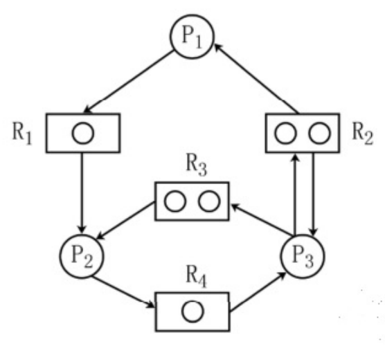
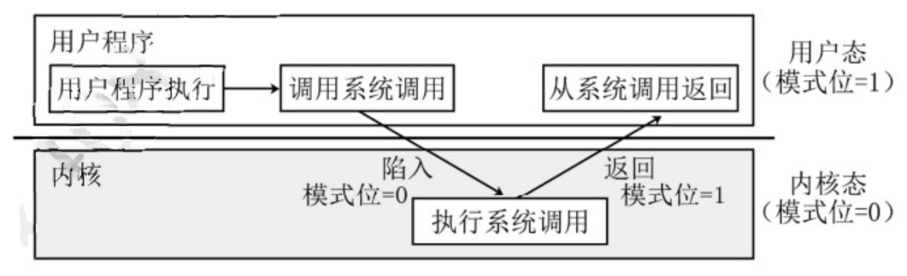
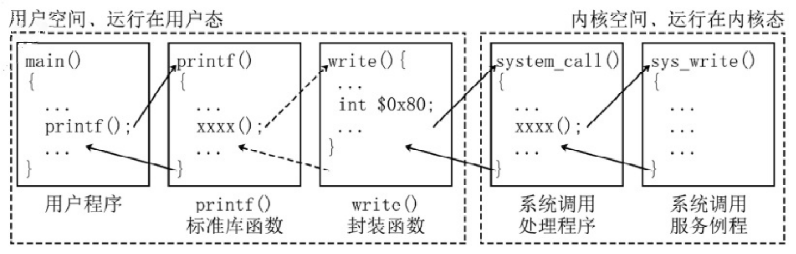

<!-- paper: mock-2027/set-4 | kind: solutions | status: needs-review -->
# 2027 考研 408 模拟卷 4 参考答案

> 来源：`sources/mock-2027/pdf/mock2027-set4-solution.pdf`。转写记录见 `build/_scratch/reports/mock-2027-set-4-solutions.md`。
> 选择题答案：已从底本切出 40/40 题。
> 选择题答案来自卷首答案表（`tools/answer_grid*.py` 的三路读法互校：OCR 读页面像素 / 读文字层 / 人工直读裁带图，哪几路读到就哪几路互校）与逐题解析流，逐题来源见各题上方注释。
> 综合题答案的第 5、6、7、8 页为**人工转录**（按底本页图逐字抄；来源与核对记录见 `solution-pages.yml`），即本卷综合题的答案页**全部**为人工转录。
> 底本的印写错误一律照抄未改（逐条记在 `meta.yml`）；逐题状态见 `meta.yml`。

## 一、单项选择题（1—40 题，每小题 2 分，共 80 分）

### 第 1 题

<!-- 底本第 1 页；来源：答案表·解析流 -->

答案：B

### 第 2 题

<!-- 底本第 1 页；来源：答案表·解析流 -->

答案：A

### 第 3 题

<!-- 底本第 1 页；来源：答案表·解析流 -->

答案：A

### 第 4 题

<!-- 底本第 1 页；来源：答案表·解析流 -->

答案：D

### 第 5 题

<!-- 底本第 1 页；来源：答案表·解析流 -->

答案：C

### 第 6 题

<!-- 底本第 2 页；来源：答案表·解析流 -->

答案：C

### 第 7 题

<!-- 底本第 2 页；来源：答案表·解析流 -->

答案：A

### 第 8 题

<!-- 底本第 2 页；来源：答案表·解析流 -->

答案：C

### 第 9 题

<!-- 底本第 2 页；来源：答案表·解析流 -->

答案：B

### 第 10 题

<!-- 底本第 2 页；来源：答案表·解析流 -->

答案：A

### 第 11 题

<!-- 底本第 2 页；来源：答案表·解析流 -->

答案：B

### 第 12 题

<!-- 底本第 2 页；来源：答案表·解析流 -->

答案：D

### 第 13 题

<!-- 底本第 2 页；来源：答案表·解析流 -->

答案：B

### 第 14 题

<!-- 底本第 2 页；来源：答案表·解析流 -->

答案：A

### 第 15 题

<!-- 底本第 3 页；来源：答案表·解析流 -->

答案：A

### 第 16 题

<!-- 底本第 3 页；来源：答案表·解析流 -->

答案：A

### 第 17 题

<!-- 底本第 3 页；来源：答案表·解析流 -->

答案：B

### 第 18 题

<!-- 底本第 3 页；来源：答案表·解析流 -->

答案：C

### 第 19 题

<!-- 底本第 3 页；来源：答案表·解析流 -->

答案：D

### 第 20 题

<!-- 底本第 3 页；来源：答案表·解析流 -->

答案：A

### 第 21 题

<!-- 底本第 3 页；来源：答案表·解析流 -->

答案：B

### 第 22 题

<!-- 底本第 3 页；来源：答案表·解析流 -->

答案：C

### 第 23 题

<!-- 底本第 3 页；来源：答案表·解析流 -->

答案：B

### 第 24 题

<!-- 底本第 3 页；来源：答案表·解析流 -->

答案：C

### 第 25 题

<!-- 底本第 3 页；来源：答案表·解析流 -->

答案：C

### 第 26 题

<!-- 底本第 4 页；来源：答案表·解析流 -->

答案：D

### 第 27 题

<!-- 底本第 4 页；来源：答案表·解析流 -->

答案：B

### 第 28 题

<!-- 底本第 4 页；来源：答案表·解析流 -->

答案：D

### 第 29 题

<!-- 底本第 4 页；来源：答案表·解析流 -->

答案：D

### 第 30 题

<!-- 底本第 4 页；来源：答案表·解析流 -->

答案：A

### 第 31 题

<!-- 底本第 4 页；来源：答案表·解析流 -->

答案：B

### 第 32 题

<!-- 底本第 4 页；来源：答案表·解析流 -->

答案：D

### 第 33 题

<!-- 底本第 4 页；来源：答案表·解析流 -->

答案：B

### 第 34 题

<!-- 底本第 4 页；来源：答案表·解析流 -->

答案：C

### 第 35 题

<!-- 底本第 4 页；来源：答案表·解析流 -->

答案：D

### 第 36 题

<!-- 底本第 4 页；来源：答案表·解析流 -->

答案：C

### 第 37 题

<!-- 底本第 4 页；来源：答案表·解析流 -->

答案：A

### 第 38 题

<!-- 底本第 5 页；来源：答案表·解析流 -->

答案：C

### 第 39 题

<!-- 底本第 5 页；来源：答案表·解析流 -->

答案：A

### 第 40 题

<!-- 底本第 5 页；来源：答案表·解析流 -->

答案：D

## 二、综合应用题（41—47 题，共 70 分）

### 第 41 题

<!-- 底本第 5 页；**人工转录**（按底本页图逐字抄，来源见 `solution-pages.yml`） -->

【答案要点】

（1）基数树这种数据结构不符合二叉排序树的定义。因为存在这样的根结点，根结点关键字<左孩子结点的关键字<右孩子结点的关键字。例如，在题目举例介绍的基数树中，结点 10 的左孩子是 100，右孩子是 101（灰色结点），100>10，不满足二叉排序树的定义。
（2）每个结点的关键字可以通过从树根到该结点的一条简单路径来确定。用 bool 类型的 isEnd 变量判断当前结点是否为深色结点，如果要查询的关键字已经结束，但树内当前查询的结点的 isEnd==false，则说明查找失败；同时，如果查询的过程中，无法在树内向下移动的时候，也表明查找失败。若遍历过程中匹配到非深色节点，那么查找成功。
```c
struct TreeNode {
    bool isEnd;  // 标记当前结点是否为深色结点
    string result; // isEnd == True时，result存储相应的位串的结果
    TreeNode *lChild, *rChild;
}
```
（3）可以基于基数树实现集合 S 的排序功能。将 S 中的元素按定义的规则存入基数树中（时间复杂度是 O(n)），通过先序遍历的方法，当遇到一个结点内 isEnd==true 时，输出结点内的 result。遍历一遍后，即可有序输出树内存储的元素。查找方法的时间复杂度是 O(n)。

### 第 42 题

<!-- 底本第 5—6 页；**人工转录**（按底本页图逐字抄，来源见 `solution-pages.yml`） -->

【答案要点】

（1）采用深度优先遍历的方法。使用一层循环枚举顶点，确保每个顶点被访问，每次从一个顶点出发能遍历一个连通分量，搜索过程中将已访问的顶点标记为已访问。循环中每次进入一个顶点代表处理一个连通分量。
（2）算法实现：
```c
// 深度优先搜索
void dfs(Graph &G, int cur, int *visit) {
    visit[cur] = 1;
    // 遍历每个相邻的未访问顶点
    for (int i = 0; i < G.n; ++i) {
        if (cur == i || visit[cur] == 1) continue;
        if (G.AdjGrid[cur][i] == 0) continue;
        // 排除了自身、已访问、无路径三种情况
        dfs(G, i, visit);
    }
}

int func(Graph &G) {
    int ans = 0;
    // 递归进行深度优先，顶点有已访问和未访问两种状态
    int visit[MAX_SIZE];
    for (int i = 0; i < G.n; ++i) visit[i] = 0;
    // 遍历每一个顶点，如果未被访问，则从该点出发进行深度优先遍历
    for (int i = 0; i < G.n; ++i) {
        if (visit[i] == 0) {
            ++ans;
            dfs(G, i, visit); // 遍历完毕后该连通分量的顶点都被标记为已访问
        }
    }
    return ans;
}
```
（3）算法中，每个顶点的要检查其他所有结点的邻接状况，邻接矩阵中每一个点对会被访问一次，故时间复杂度为 O(n^{2})。

### 第 43 题

<!-- 底本第 6 页；**人工转录**（按底本页图逐字抄，来源见 `solution-pages.yml`） -->

【答案要点】

（1）指令长度均为 32 位，根据汇编代码可以看出一条指令占 4 个地址，所以一个地址中有 8 位，可得编址单位为字节。每次循环取数组元素时，其下标都要乘以 4，所以每个数组元素占 4 个字节。
（2）指令格式中通用寄存器编号有 5 位，则通用寄存器最多有 2^{5}=32 个。I 型和 J 型指令的操作码字段都为 6 位，J 型指令最多可定义 2^{6}-40-1=23 种操作（R 型至少有一种）。
（3）指令 2、3、4、5 为 I 型，指令 6 为 J 型。各类转移指令的执行会改变指令执行顺序，从而引发控制冒险，故指令 4 和 6 可能会导致控制冒险。
（4）指令 1 功能为（R2）<<2→R1，rt 为 00010，rd 为 00001，imm 为 00010，由于数组下标 i 一定大于等于 0，所以采用逻辑左移，操作码为 010000，指令 1 的机器码为 00020890H。说明：R1 的寄存器编号是 1，1 对应的二进制为 00001。在 408 真题中，题目中经常默认用这种对应关系，而不加特别说明。

### 第 44 题

<!-- 底本第 6—7 页；**人工转录**（按底本页图逐字抄，来源见 `solution-pages.yml`） -->

【答案要点】

（1）PC 和 IR 均为 32 位。由于每条指令长度为 4B，按字节编址，顺序执行时，下条指令地址为 (PC)+4，所以输入端 0 的值应为 4。
（2）并行进位加法器的进位之间没有依赖关系，相比于串行进位加法器的运算速度更快。
（3）指令 4 进行有符号数比较，而 CF 仅对无符号数的加减运算有意义，故不需要用到 CF。指令 6 为无条件转移指令，不需要根据标志判断是否进行转移，故不需要用到 FR。
（4）① PCout=1、MARin=1。将 PC 的值送至 MAR，(PC)→MAR。② Read，MDRin=1。CU 通过控制总线向主存发出读命令。③ MDRout=1、IRin=1。将 MDR 的内容送至 IR。④ GPRout=1、Yin=1。将 R1 的值送往 Y，(R1)→Y。⑤ GPRout=1、MUXop=1、ALUop=add、SRop=mov。将 R1 与 R3 的值相加，送至 SR。⑥ SRout=1，GPRin=1。将相加的结果送至 R1。

### 第 45 题

<!-- 底本第 7 页；**人工转录**（按底本页图逐字抄，来源见 `solution-pages.yml`） -->

【答案要点】

（1）该时刻资源分配图如下：

上述资源分配图无法化简，所以系统处于死锁状态。
（2）必要条件：① 互斥条件：一段时间内某资源仅为一个进程所占有；② 不剥夺：只能进程主动释放已占有资源；③ 请求并保存：进程已经保持了至少一个资源，又提出了新的资源请求；④ 循环等待：存在一种进程资源的循环等待链，链中每个进程已获得的资源同时被链中下一个进程所请求。
采用银行家算法防止系统进入不安全状态可以避免死锁。

### 第 46 题

<!-- 底本第 7—8 页；**人工转录**（按底本页图逐字抄，来源见 `solution-pages.yml`） -->

【答案要点】

（1）键盘作为字符设备，传输速率较低，通常采用中断 I/O 方式。
程序在调用系统调用时，CPU 处于用户态，如下图所示。


I/O 指令属于特权指令。
（2）MAR 为内存地址寄存器，用于存放本次数据从磁盘传输到内存的起始目标地址；DC 为数据计数器，用于存放本次 CPU 要读取的字（节）数。
（3）与设备无关的 I/O 软件用于设备命名、设备保护以及设备的分配与释放等，将逻辑设备名映射成物理设备名是在这一层次完成的。设备驱动程序可以将上层 I/O 请求转换为针对设备的具体命令和参数（即题中的柱面号、磁头号和扇区号）。

### 第 47 题

<!-- 底本第 8 页；**人工转录**（按底本页图逐字抄，来源见 `solution-pages.yml`） -->

【答案要点】

（1）部门 1 的员工等于部门 2 的员工数量，均为部门 3 的员工数量的一半，故本题采用变长子网划分，部门 3 的 IP 数等于部门 1 和部门 2 的 IP 总数之和，部门 1 和部门 2 的 IP 总数相同（均分另一半 IP 空间），故一种划分为（其他合理的按照比例划分答案也正确）：部门 1：130.120.10.0/26；部门 2：130.120.10.64/26；部门 3：130.120.10.128/25。
（2）局域网 1 和局域网 2 可以进行路由聚合，通向互联网的路由为默认路由，路由表格式如下所示。

| 目的网络 | 下一跳 | 接口 |
| --- | --- | --- |
| 130.120.10.0/26 | - | E1 |
| 130.120.10.64/26 | - | E2 |
| 130.120.10.128/25 | - | E3 |
| 202.100.10.160/29 | 130.110.12.1 | L1 |
| 0.0.0.0/0 | 130.110.10.1 | L0 |

（3）R2 检测到局域网 1 不可达，通告一个距离为 16 的向量，但是 R3 会通告一个距离为 2 的向量，R1 会认为可以从 R3 达到局域网 1，此时认为达到局域网 1 的距离为 3，即为 RIP 的慢收敛特性。
