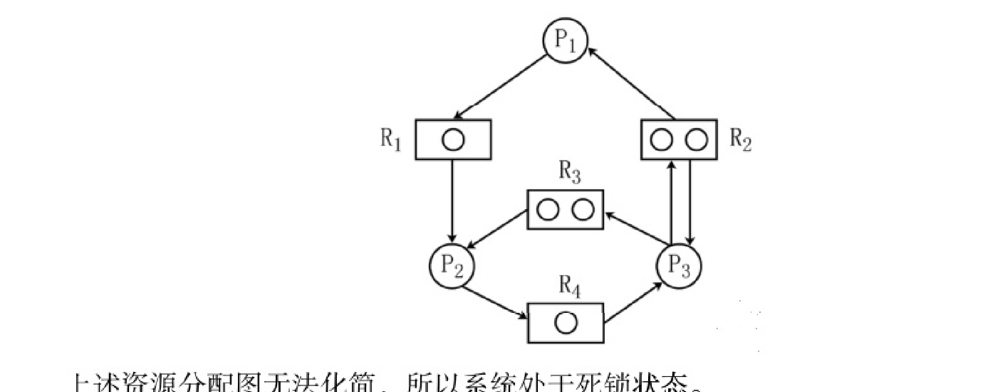
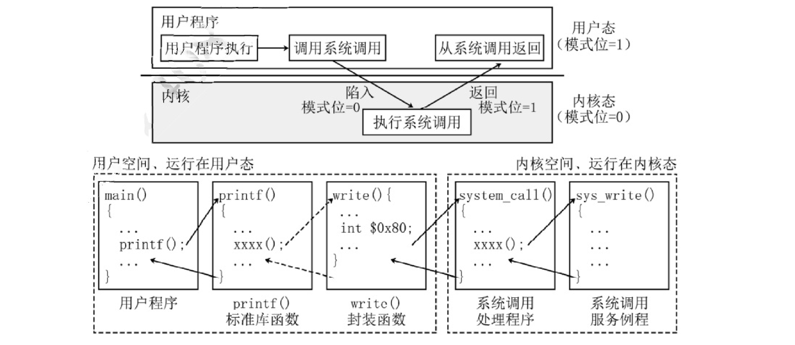

<!-- paper: mock-2027/set-4 | kind: solutions | status: needs-review -->
# 2027 考研 408 模拟卷 4 · 答案与解析

> 📦 **集成说明（2026-10-18）**：本文件自 PR8 `446c78e`（其源头为 `work/408-mock4-dell-source-review-20261017@97e1f17`）迁入；40 个选择题答案字母已与源 PDF 第 1 页答案表逐条复核一致。本分支的 `questions.md` 采用 main `25f1217` 的源页第 2—10 页人工逐页转录；两者同源但独立转录，文字可能有个别差异。本卷状态为 `needs-review`，不是 `proofread`。

> **⚠️ 这是「未校对」的机器转录草稿，不是可发布的正式解析。**
>
> - **1—40 题答案字母**：逐条抄录自 `sources/mock-2027/pdf/mock2027-set4-solution.pdf` **第 1 页「一、单项选择题」答案表**，并与源页原表逐字核对一致（另以 Q38/Q39/Q40 的解析正文旁证）。这证明的是「**抄录与源表一致**」，**不等于**命题方给出的字母本身无误。
> - **41—47 题解析**：已按解析 PDF 第 5—8 页渲染图逐段重录（原稿这 7 题多为全行乱码）。
> - **未完成（重要）**：逐题 `proofread` 计数为 **0/47**；解析中的计算与结论**未**做独立验算（人工闸门 C10）。
> - **解答配图**：第 45、46 题的解答插图已裁入 `assets/`（`q45-ans-graph.png`、`q46-ans-fig.png`）并以相对链接引用；这类**解答产物只放在本文件，不放学生卷 `questions.md`**。
> - **已知源卷疑点**：按 `docs/qa-policy.md` §6 保留原文并逐题登记，未擅自改写命题。

> 本文件 **1—40题答案字母** 根据该卷原答案PDF第一页选项表逐条核对（不代表题目整体proofread）。
>
> **2026-10-17 第七轮（本分支）：** 综合题 **第41、42题** 的解析文字、公式与 C/C++ 代码已按解析PDF**第5—6页**渲染图逐段重录核对（原稿这两题几乎是全行乱码）；**第41题的代码注释段落此前被误串进第42题，已移除并归还**。状态为 `needs-review`，**不是** proofread。
>
> **2026-10-17 第八轮（本分支）：** 综合题 **第43、44题** 的解析文字与公式已按解析PDF**第6—7页**渲染图逐段重录核对（原稿这两题有上标幂丢失、控制信号步骤编号被打乱等缺陷，已修）。状态为 `needs-review`，**不是** proofread。
>
> **2026-10-17 第九轮（本分支）：** 综合题 **第45、46、47题** 的解析文字、表格与插图已按解析PDF**第7—8页**渲染图逐段重录核对。至此 **全部 41—47 七道综合题**的解析均已按源页图重录。状态为 `needs-review`，**不是** proofread。
>
> **全卷 47 题的题干与解析至此均已按源页渲染图逐题核对过一遍**；但 `proofread` 计数仍为 **0/47**（逐题全文校对与计算复核属另一道人工闸门 C10，尚未做）。本文件仍然是**工作稿**，不是可发布的正式 `solutions.md`（见源分支文档 `docs/mock4-canonical-promotion-20261017.md` 的升级判定；该文档未随本候选分支携带）。
>
> 来源：[`sources/mock-2027/pdf/mock2027-set4-solution.pdf`](../../../sources/mock-2027/pdf/mock2027-set4-solution.pdf)。逐题源文件索引请查看本卷审校清单。

## 一、选择题答案（1—40）

### 第 1 题　答案：B

**答案来源：** 原解析PDF第1页选择题答案速查表，源页图核对。

**详细解析：** 原解析PDF已包含；OCR尚未逐题可靠配对，待审核原页文字与公式后录入。


### 第 2 题　答案：A

**答案来源：** 原解析PDF第1页选择题答案速查表，源页图核对。

**详细解析：** 原解析PDF已包含；OCR尚未逐题可靠配对，待审核原页文字与公式后录入。


### 第 3 题　答案：A

**答案来源：** 原解析PDF第1页选择题答案速查表，源页图核对。

**详细解析：** 原解析PDF已包含；OCR尚未逐题可靠配对，待审核原页文字与公式后录入。


### 第 4 题　答案：D

**答案来源：** 原解析PDF第1页选择题答案速查表，源页图核对。

**详细解析：** 原解析PDF已包含；OCR尚未逐题可靠配对，待审核原页文字与公式后录入。


### 第 5 题　答案：C

**答案来源：** 原解析PDF第1页选择题答案速查表，源页图核对。

**详细解析：** 原解析PDF已包含；OCR尚未逐题可靠配对，待审核原页文字与公式后录入。


### 第 6 题　答案：C

**答案来源：** 原解析PDF第1页选择题答案速查表，源页图核对。

**详细解析：** 原解析PDF已包含；OCR尚未逐题可靠配对，待审核原页文字与公式后录入。


### 第 7 题　答案：A

**答案来源：** 原解析PDF第1页选择题答案速查表，源页图核对。

**详细解析：** 原解析PDF已包含；OCR尚未逐题可靠配对，待审核原页文字与公式后录入。


### 第 8 题　答案：C

**答案来源：** 原解析PDF第1页选择题答案速查表，源页图核对。

**详细解析：** 原解析PDF已包含；OCR尚未逐题可靠配对，待审核原页文字与公式后录入。


### 第 9 题　答案：B

**答案来源：** 原解析PDF第1页选择题答案速查表，源页图核对。

**详细解析：** 原解析PDF已包含；OCR尚未逐题可靠配对，待审核原页文字与公式后录入。


### 第 10 题　答案：A

**答案来源：** 原解析PDF第1页选择题答案速查表，源页图核对。

**详细解析：** 原解析PDF已包含；OCR尚未逐题可靠配对，待审核原页文字与公式后录入。


### 第 11 题　答案：B

**答案来源：** 原解析PDF第1页选择题答案速查表，源页图核对。

**详细解析：** 原解析PDF已包含；OCR尚未逐题可靠配对，待审核原页文字与公式后录入。


### 第 12 题　答案：D

**答案来源：** 原解析PDF第1页选择题答案速查表，源页图核对。

**详细解析：** 原解析PDF已包含；OCR尚未逐题可靠配对，待审核原页文字与公式后录入。


### 第 13 题　答案：B

**答案来源：** 原解析PDF第1页选择题答案速查表，源页图核对。

**详细解析：** 原解析PDF已包含；OCR尚未逐题可靠配对，待审核原页文字与公式后录入。


### 第 14 题　答案：A

**答案来源：** 原解析PDF第1页选择题答案速查表，源页图核对。

**详细解析：** 原解析PDF已包含；OCR尚未逐题可靠配对，待审核原页文字与公式后录入。


### 第 15 题　答案：A

**答案来源：** 原解析PDF第1页选择题答案速查表，源页图核对。

**详细解析：** 原解析PDF已包含；OCR尚未逐题可靠配对，待审核原页文字与公式后录入。


### 第 16 题　答案：A

**答案来源：** 原解析PDF第1页选择题答案速查表，源页图核对。

**详细解析：** 原解析PDF已包含；OCR尚未逐题可靠配对，待审核原页文字与公式后录入。


### 第 17 题　答案：B

**答案来源：** 原解析PDF第1页选择题答案速查表，源页图核对。

**详细解析：** 原解析PDF已包含；OCR尚未逐题可靠配对，待审核原页文字与公式后录入。


### 第 18 题　答案：C

**答案来源：** 原解析PDF第1页选择题答案速查表，源页图核对。

**详细解析：** 原解析PDF已包含；OCR尚未逐题可靠配对，待审核原页文字与公式后录入。


### 第 19 题　答案：D

**答案来源：** 原解析PDF第1页选择题答案速查表，源页图核对。

**详细解析：** 原解析PDF已包含；OCR尚未逐题可靠配对，待审核原页文字与公式后录入。


### 第 20 题　答案：A

**答案来源：** 原解析PDF第1页选择题答案速查表，源页图核对。

**详细解析：** 原解析PDF已包含；OCR尚未逐题可靠配对，待审核原页文字与公式后录入。


### 第 21 题　答案：B

**答案来源：** 原解析PDF第1页选择题答案速查表，源页图核对。

**详细解析：** 原解析PDF已包含；OCR尚未逐题可靠配对，待审核原页文字与公式后录入。


### 第 22 题　答案：C

**答案来源：** 原解析PDF第1页选择题答案速查表，源页图核对。

**详细解析：** 原解析PDF已包含；OCR尚未逐题可靠配对，待审核原页文字与公式后录入。


### 第 23 题　答案：B

**答案来源：** 原解析PDF第1页选择题答案速查表，源页图核对。

**详细解析：** 原解析PDF已包含；OCR尚未逐题可靠配对，待审核原页文字与公式后录入。


### 第 24 题　答案：C

**答案来源：** 原解析PDF第1页选择题答案速查表，源页图核对。

**详细解析：** 原解析PDF已包含；OCR尚未逐题可靠配对，待审核原页文字与公式后录入。


### 第 25 题　答案：C

**答案来源：** 原解析PDF第1页选择题答案速查表，源页图核对。

**详细解析：** 原解析PDF已包含；OCR尚未逐题可靠配对，待审核原页文字与公式后录入。


### 第 26 题　答案：D

**答案来源：** 原解析PDF第1页选择题答案速查表，源页图核对。

**详细解析：** 原解析PDF已包含；OCR尚未逐题可靠配对，待审核原页文字与公式后录入。


### 第 27 题　答案：B

**答案来源：** 原解析PDF第1页选择题答案速查表，源页图核对。

**详细解析：** 原解析PDF已包含；OCR尚未逐题可靠配对，待审核原页文字与公式后录入。


### 第 28 题　答案：D

**答案来源：** 原解析PDF第1页选择题答案速查表，源页图核对。

**详细解析：** 原解析PDF已包含；OCR尚未逐题可靠配对，待审核原页文字与公式后录入。


### 第 29 题　答案：D

**答案来源：** 原解析PDF第1页选择题答案速查表，源页图核对。

**详细解析：** 原解析PDF已包含；OCR尚未逐题可靠配对，待审核原页文字与公式后录入。


### 第 30 题　答案：A

**答案来源：** 原解析PDF第1页选择题答案速查表，源页图核对。

**详细解析：** 原解析PDF已包含；OCR尚未逐题可靠配对，待审核原页文字与公式后录入。


### 第 31 题　答案：B

**答案来源：** 原解析PDF第1页选择题答案速查表，源页图核对。

**详细解析：** 原解析PDF已包含；OCR尚未逐题可靠配对，待审核原页文字与公式后录入。


### 第 32 题　答案：D

**答案来源：** 原解析PDF第1页选择题答案速查表，源页图核对。

**详细解析：** 原解析PDF已包含；OCR尚未逐题可靠配对，待审核原页文字与公式后录入。


### 第 33 题　答案：B

**答案来源：** 原解析PDF第1页选择题答案速查表，源页图核对。

**详细解析：** 原解析PDF已包含；OCR尚未逐题可靠配对，待审核原页文字与公式后录入。


### 第 34 题　答案：C

**答案来源：** 原解析PDF第1页选择题答案速查表，源页图核对。

**详细解析：** 原解析PDF已包含；OCR尚未逐题可靠配对，待审核原页文字与公式后录入。


### 第 35 题　答案：D

**答案来源：** 原解析PDF第1页选择题答案速查表，源页图核对。

**详细解析：** 原解析PDF已包含；OCR尚未逐题可靠配对，待审核原页文字与公式后录入。


### 第 36 题　答案：C

**答案来源：** 原解析PDF第1页选择题答案速查表，源页图核对。

**详细解析：** 原解析PDF已包含；OCR尚未逐题可靠配对，待审核原页文字与公式后录入。


### 第 37 题　答案：A

**答案来源：** 原解析PDF第1页选择题答案速查表，源页图核对。

**详细解析：** 原解析PDF已包含；OCR尚未逐题可靠配对，待审核原页文字与公式后录入。


### 第 38 题　答案：C

**答案来源：** 原解析PDF第1页选择题答案速查表，源页图核对。

**详细解析：** 原解析PDF已包含；OCR尚未逐题可靠配对，待审核原页文字与公式后录入。


### 第 39 题　答案：A

**答案来源：** 原解析PDF第1页选择题答案速查表，源页图核对。

**详细解析：** 原解析PDF已包含；OCR尚未逐题可靠配对，待审核原页文字与公式后录入。


### 第 40 题　答案：D

**答案来源：** 原解析PDF第1页选择题答案速查表，源页图核对。

**详细解析：** 原解析PDF已包含；OCR尚未逐题可靠配对，待审核原页文字与公式后录入。


## 二、综合应用题解析（41—47）


### 第 41 题

**源页：** 解析PDF第 5 页（(1)(2)(3) 三问均在本页）。

<!-- verification: 源页图逐字重录 solution text+code（(2) 代码块 450–550dpi 复核）; status: needs-review -->

**解析（按源页逐字重录）：**

**(1)** 基数树这种数据结构不符合二叉排序树的定义。因为存在这样的根结点，根结点关键字 < 左孩子结点的关键字 < 右孩子结点的关键字。例如，在题目举例介绍的基数树中，结点 10 的左孩子是 100，右孩子是 101（灰色结点），100 > 10，不满足二叉排序树的定义。

**(2)** 每个结点的关键字可以通过从树根到该结点的一条简单路径来确定。用 bool 类型的 isEnd 变量判断当前结点是否为深色结点，如果要查询的关键字已经结束，但树内当前查询的结点的 isEnd == false，则说明查找失败；同时，如果查询的过程中，无法在树内向下移动的时候，也表明查找失败。若遍历过程中匹配到非深色节点，那么查找成功。

```c
struct TreeNode {
    bool isEnd;  // 标记当前结点是否为深色结点
    string result; // isEnd == True时，result存储相应的位串的结果
    TreeNode *lChild, *rChild;
}
```

**(3)** 可以基于基数树实现集合 S 的排序功能。将 S 中的元素按定义的规则存入基数树中（时间复杂度是 $O(n)$），通过先序遍历的方法，当遇到一个结点内 isEnd == true 时，输出结点内的 result。遍历一遍后，即可有序输出树内存储的元素。查找方法的时间复杂度是 $O(n)$。

> **本轮对 Q41 解析的实修（原稿缺陷 → 源页实际）：**
> - **(1) 整段丢字**：原稿漏掉「**根结点关键字 <**」与「**结点 10**」，读起来成了「因为存在这样的根结点，左孩子结点的关键字 < 右孩子结点的关键字」。
> - **(2) 代码块被 OCR 打坏**：`bool isEna` → **`bool isEnd`**；`TreeNode *1Child，*rChildy` → **`TreeNode *lChild, *rChild;`**；行内注释被截成「`// 标`」；结构体收尾 `}` 被认成 `】`。
> - **(3) 复杂度符号错**：`O(m)` → **$O(n)$**；`O(D` → **$O(n)$**。
> - **跨题串段已移除**：原稿把本题 (2) 代码注释里的一行（「`isEnd == True时，result存储相应的位串的结果`」）**误串进了第 42 题的 (1)** —— 本轮已从第 42 题删除，并归还到本题 (2) 的代码块中。
>
> **源文保留项（不改写）：** 源页 `struct TreeNode` 的收尾**只有一个 `}`、没有分号**（已 450–550dpi 复核确认非 OCR 误读）。按 `docs/qa-policy.md` §6「保留原文、加标记、不改写」处理，**未**自行补分号。
>
> 本题解析文字、公式与代码均按源页图重录；仅表示「解析文字已按源页核对」，**不等于**该题证明过程或代码正确性已被独立验算（C10 人工闸门未做）。整题仍未 proofread。


### 第 42 题

**源页：** 解析PDF第 5 页末（(1) 前半）至第 6 页（(1) 结尾、(2) 代码、(3)）。

<!-- verification: 源页图逐字重录 solution text+code; status: needs-review -->

**解析（按源页逐字重录）：**

**(1)** 采用深度优先遍历的方法。使用一层循环枚举顶点，确保每个顶点被访问，每次从一个顶点出发能遍历一个连通分量，搜索过程中将已访问的顶点标记为已访问。循环中每次进入一个顶点代表处理一个连通分量。

**(2)** 算法实现：

```c
// 深度优先搜索
void dfs(Graph &G, int cur, int *visit) {
    visit[cur] = 1;
    // 遍历每个相邻的未访问顶点
    for (int i = 0; i < G.n; ++i) {
        if (cur == i || visit[cur] == 1) continue;
        if (G.AdjGrid[cur][i] == 0) continue;
        // 排除了自身、已访问、无路径三种情况
        dfs(G, i, visit);
    }
}

int func(Graph &G) {
    int ans = 0;
    // 递归进行深度优先，顶点有已访问和未访问两种状态
    int visit[MAX_SIZE];
    for (int i = 0; i < G.n; ++i) visit[i] = 0;
    // 遍历每一个顶点，如果未被访问，则从该点出发进行深度优先遍历
    for (int i = 0; i < G.n; ++i) {
        if (visit[i] == 0) {
            ++ans;
            dfs(G, i, visit); // 遍历完毕后该连通分量的顶点都被标记为已访问
        }
    }
    return ans;
}
```

**(3)** 算法中，每个顶点的要检查其他所有结点的邻接状况，邻接矩阵中每一个点对会被访问一次，故时间复杂度为 $O(n^2)$。

> **本轮对 Q42 解析的实修：**
> - **移除跨题串段（本批明确要求）：** 原稿 (1) 里混入了**第 41 题**代码注释的一行
>   「`True时，result存储相应的位串的结果`」，已删除；该行已归还到第 41 题 (2) 的代码块中。
> - **(2) 代码几乎全行乱码** → 源页实际：
>   `void afs(Graph &gG，int cur，int *visit)` → `void dfs(Graph &G, int cur, int *visit)`；
>   `visit[cur] = 17` → `visit[cur] = 1;`；
>   `forillac kt = < G.n; ++i) 《` → `for (int i = 0; i < G.n; ++i) {`；
>   `if (cur    11 visit[cur] == 1) continue;` → `if (cur == i || visit[cur] == 1) continue;`；
>   `if (G.adjGrid[cur] [i] == 0) concinuey` → `if (G.AdjGrid[cur][i] == 0) continue;`；
>   `afs(G，i，visit)7 / 于 / )}` → `dfs(G, i, visit); } }`；
>   `int visit [MAX_SIZE]` → `int visit[MAX_SIZE];`；`++ansi` → `++ans;`；`return ansy` → `return ans;`。
> - **(3) 复杂度符号错**：`O(0D)` → **$O(n^2)$**。
>
> **源文保留项（观察，不改写）：** 源页 (2) 循环体内写作
> `if (cur == i || visit[cur] == 1) continue;` —— 用 `visit[cur]` 判重，而 `cur` 在函数入口刚被置为 1，
> 按通常写法这一处多为 `visit[i]`。已按 350–550dpi 复核确认这就是**源页的写法**，不是 OCR 误读；
> 按 `docs/qa-policy.md` §6 保留原文并在此登记，**不**代为改写。本条仅为转写观察，不构成对该题代码的评分判断。
>
> 本题解析文字与代码均按源页图重录；**不等于**该算法描述已被独立验算（C10 人工闸门未做）。整题仍未 proofread。


### 第 43 题

**源页：** 解析PDF第 6 页（(1)—(4) 四问均在本页）。

<!-- verification: 源页图逐字重录 solution text（含幂次与机器码）; status: needs-review -->

**解析（按源页逐字重录）：**

**(1)** 指令长度均为 32 位，根据汇编代码可以看出 一条指令占 4 个地址，所以一个地址中有 8 位，可得编址单位为字节。每次循环取数组元素时，其下标都要乘以 4，所以每个数组元素占 4 个字节。

**(2)** 指令格式中通用寄存器编号有 5 位，则通用寄存器最多有 $2^5 = 32$ 个。I 型和 J 型指令的操作码字段都为 6 位，J 型指令最多可定义 $2^6 - 40 - 1 = 23$ 种操作（R 型至少有一种）。

**(3)** 指令 2、3、4、5 为 I 型，指令 6 为 J 型。各类转移指令的执行会改变指令执行顺序，从而引发控制冒险，故指令 4 和 6 可能会导致控制冒险。

**(4)** 指令 1 功能为（R2）<< 2 → R1，rt 为 00010，rd 为 00001，imm 为 00010，由于数组下标 i 一定大于等于 0，所以采用逻辑左移，操作码为 010000，指令 1 的机器码为 00020890H。
说明：R1 的寄存器编号是 1，1 对应的二进制为 00001。在 408 真题中，题目中经常默认用这种对应关系，而不加特别说明。

> **本轮对 Q43 解析的实修：** 原稿把**上标幂认成普通数字并串行**——`25 = 32` → **$2^5 = 32$**；`25 - 40- 1 = 23` → **$2^6 - 40 - 1 = 23$**（两处指数都丢了，第二处底数也被认错）。另 `JJ型` → `J型`；`(R2 ) << 2 一 R1` → `（R2）<< 2 → R1`；`r上t 为` → `rt 为`。
>
> **算术旁证（自查，非 proofread）：** 按源页 (4) 给出的字段值拼接 32 位 R 型指令
> `000000 | rs=00000 | rt=00010 | rd=00001 | imm=00010 | op1=010000`
> = `0x00020890`，与源页写出的「00020890H」**一致**；且 `op1 = 010000` = 16 = `10H`，
> 与题干「逻辑左移的操作码为 10H」**一致**。两项均为**转录后自查**，不是对源卷命题的独立验算（C10 人工闸门未做）。


### 第 44 题

**源页：** 解析PDF第 6 页末（(1)(2) 与 (3) 前半）至第 7 页（(3) 结尾、(4)）。

<!-- verification: 源页图逐字重录 solution text; status: needs-review -->

**解析（按源页逐字重录）：**

**(1)** PC 和 IR 均为 32 位。由于每条指令长度为 4B，按字节编址，顺序执行时，下条指令地址为 (PC) + 4，所以输入端 0 的值应为 4。

**(2)** 并行进位加法器的进位之间没有依赖关系，相比于串行进位加法器的运算速度更快。

**(3)** 指令 4 进行有符号数比较，而 CF 仅对无符号数的加减运算有意义，故不需要用到 CF。指令 6 为无条件转移指令，不需要根据标志判断是否进行转移，故不需要用到 FR。

**(4)** ① PCout = 1、MARin = 1。将 PC 的值送至 MAR，(PC)→MAR。② Read，MDRin = 1。CU 通过控制总线向主存发出读命令。③ MDRout = 1、IRin = 1。将 MDR 的内容送至 IR。④ GPRout = 1、Yin = 1。将 R1 的值送往 Y，(R1)→Y。⑤ GPRout = 1、MUXop = 1、ALUop = add、SRop = mov。将 R1 与 R3 的值相加，送至 SR。⑥ SRout = 1，GPRin = 1。将相加的结果送至 R1。

> **本轮对 Q44 解析的实修：** 原稿 (1) `PC 和了 均为32 位` → `PC 和 IR 均为 32 位`；原稿 (3) `CE 仅对无符号数的加减旋符有音义` → `CF 仅对无符号数的加减运算有意义`；原稿 (4) 的**步骤编号被 OCR 全数打乱**（`四PCout=1` / `@ Read` / `@ MDRout` / `送至 豚` / `(RD一Y` / `G GPRout` / `G@ SRout`），已按源页恢复为 ①②③④⑤⑥ 与控制信号名（`IR`、`R1`）。
>
> **源文保留项（不改写）：** 源页 (4) 第 ② 步只写「**Read，MDRin = 1**」，`Read` 后**没有** `= 1`；而 ①③④⑤⑥ 五步的控制信号都写作 `xxx = 1`。已按 400–500dpi 复核确认这就是源页写法，按 `docs/qa-policy.md` §6 保留原文，**未**自行补成 `Read = 1`。
>
> 本题解析文字按源页图重录；**不等于**该控制信号序列已被独立验算（C10 人工闸门未做）。整题仍未 proofread。


### 第 45 题

**源页：** 解析PDF第 7 页（(1)(2) 均在本页）。

<!-- verification: 源页图逐字重录 solution text；资源分配图为源页插图，已裁入 assets; status: needs-review -->

**解析（按源页逐字重录）：**

**(1)** 该时刻资源分配图如下：



上述资源分配图无法化简，所以系统处于死锁状态。

**(2)** 必要条件：
① 互斥条件：一段时间内某资源仅为一个进程所占有；
② 不剥夺：只能进程主动释放已占有资源；
③ 请求并保持：进程已经保持了至少一个资源，又提出了新的资源请求；
④ 循环等待：存在一种进程资源的循环等待链，链中每个进程已获得的资源同时被链中下一个进程所请求。

采用银行家算法防止系统进入不安全状态可以避免死锁。

> **图已入库：** `assets/q45-ans-graph.png`（2194×862，PNG），由解析 PDF **第7页**渲染图（450dpi）裁出，只含本题参考答案的资源分配图。**这是解析产物（参考答案图），因此放在本文件、不放在学生卷** —— 题干第(1)问要求考生自己画。
>
> **本轮对 Q45 解析的实修：** 原稿把整幅资源分配图识别成 `个 / R | O DOOR / Ra / OO / R4 已 / Le` 等乱码（见本提交前版本），已删除并替换为图引用；原稿把 `① ② ③ ④` 全数认成 `@`，已按源页恢复；原稿标题 `4S5.【解析】` → `45`。
>
> **箭头方向经 800dpi 定点放大确认（与题干一致）：** R1→P2、R3→P2、R2→P1、R1 由 P1 申请；P2→R4（申请）；R4→P3、R2→P3（分配）与 P3→R2（申请）构成双向、P3→R3（申请）。即 **P3 持有 R2 与 R4、申请 R2 与 R3**，与题干「P3 已占有 1 个单位的 R2 和 1 个单位的 R4，申请 1 个单位的 R2 和 1 个单位的 R3」**一致**。（题/图之间关于「P3 既持有又申请 R2」的构造本身如此，非转录错误。）
>
> 本题解析文字与图按源页图重录；**不等于**「该系统是否死锁」的结论已被独立验算（C10 人工闸门未做）。整题仍未 proofread。


### 第 46 题

**源页：** 解析PDF第 7 页（(1) 与用户态/内核态插图）至第 8 页（(2)(3)）。

<!-- verification: 源页图逐字重录 solution text；用户态/内核态插图为源页插图，已裁入 assets; status: needs-review -->

**解析（按源页逐字重录）：**

**(1)** 键盘作为字符设备，传输速率较低，通常采用中断 I/O 方式。
程序在调用系统调用时，CPU 处于用户态，如下图所示。



I/O 指令属于特权指令。

**(2)** MAR 为内存地址寄存器，用于存放本次数据从磁盘传输到内存的起始目标地址；DC 为数据计数器，用于存放本次 CPU 要读取的字（节）数。

**(3)** 与设备无关的 I/O 软件用于设备命名、设备保护以及设备的分配与释放等，将逻辑设备名映射成物理设备名是在这一层次完成的。设备驱动程序可以将上层 I/O 请求转换为针对设备的具体命令和参数（即题中的柱面号、磁头号和扇区号）。

> **图已入库：** `assets/q46-ans-fig.png`（2830×1229，PNG），由解析 PDF **第7页**渲染图（420dpi）裁出，只含 (1) 的「用户态/内核态」参考答案插图。**这是解析产物，放在本文件、不放在学生卷。**
>
> **本轮对 Q46 解析的实修：** 原稿把整幅用户态/内核态插图识别成 `用户程序 用户态 / 用户科序并行| |亲朋系统调用| … / P ie0 / int $0x80; / Printf0 xxx0; / printf () Write()` 等乱码（见本提交前版本），已删除并替换为图引用；`(0` → `(1)`；`中断 IO 方式` → `中断 I/O 方式`；`IJ/O 指令属于特权指令` 的乱码前缀已清除；句末缺失的句号按源页补齐。
>
> 本题解析文字与图按源页图重录；**不等于**答案正确性已被独立验算（C10 人工闸门未做）。整题仍未 proofread。


### 第 47 题

**源页：** 解析PDF第 8 页（(1)(2)(3) 均在本页）。

<!-- verification: 源页图逐字重录 solution text; status: needs-review -->

**解析（按源页逐字重录）：**

**(1)** 部门 1 的员工等于部门 2 的员工数量，均为部门 3 的员工数量的一半，故本题采用变长子网划分，部门 3 的 IP 数等于部门 1 和部门 2 的 IP 总数之和，部门 1 和部门 2 的 IP 总数相同（均分另一半 IP 空间），故一种划分为（其他合理的按照比例划分答案也正确）：
部门 1：130.120.10.0/26；部门 2：130.120.10.64/26；部门 3：130.120.10.128/25。

**(2)** 局域网 1 和局域网 2 可以进行路由聚合，通向互联网的路由为默认路由，路由表格式如下所示。

| 目的网络 | 下一跳 | 接口 |
|---|---|---|
| 130.120.10.0/26 | − | E1 |
| 130.120.10.64/26 | − | E2 |
| 130.120.10.128/25 | − | E3 |
| 202.100.10.160/29 | 130.110.12.1 | L1 |
| 0.0.0.0/0 | 130.110.10.1 | L0 |

**(3)** R2 检测到局域网 1 不可达，通告一个距离为 16 的向量，但是 R3 会通告一个距离为 2 的向量，R1 会认为可以从 R3 达到局域网 1，此时认为达到局域网 1 的距离为 3，即为 RIP 的慢收敛特性。

> **本轮对 Q47 解析的实修：** 原稿把 (1) 中的「IP」全数认成 `耳`（`部门 3 的耳数` / `另一半耳空间`）；`(D` → `(1)`；路由表被识别成无表格线的散行且接口名错（`El` → `E1`、`LI1` → `L1`、`LO` → `L0`、`0.0.0.00` → `0.0.0.0/0`），下一跳的破折号被认成 `=`；标题 `47.【解析】` 前缺编号行。以上均已按源页修正为上面的正式表格。
>
> **说明：** 源页路由表「下一跳」列在本机路由（E1/E2/E3 三个直连子网）处记作短横线 `−`（表示直连、无下一跳）。已按 400dpi 复核确认，**未**臆造下一跳地址。
>
> 本题解析文字与表格按源页图重录；**不等于**该子网划分与路由表已被独立验算（C10 人工闸门未做）。整题仍未 proofread。