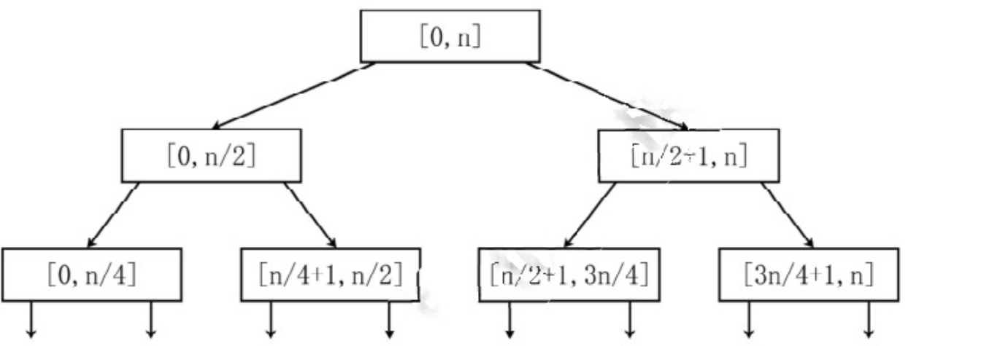
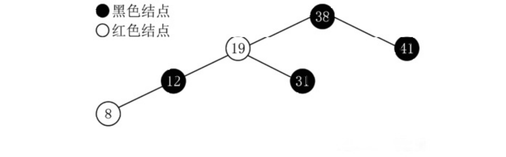
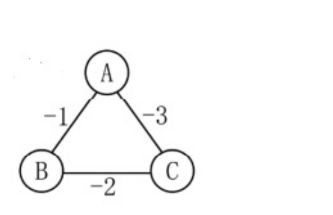
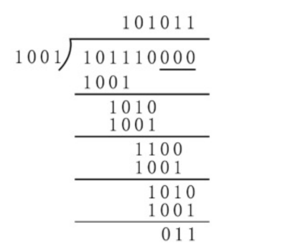

<!-- paper: mock-2027/set-4 | kind: solutions | status: needs-review -->
# 2027 考研 408 模拟卷 4 · 答案与解析

> 📦 **集成说明（2026-10-17）**：本文件自 `work/408-mock4-dell-source-review-20261017@97e1f17` 迁入候选分支；40 个选择题答案字母已与源 PDF 第 1 页答案表逐条复核一致。候选分支的 `questions.md` 仍是 main 上的机器转录稿，文字可能与本文解析不完全一致；本卷状态为 `needs-review`，不是 `proofread`。

> **⚠️ 这是「未校对」的机器转录草稿，不是可发布的正式解析。**
>
> - **1—40 题答案字母**：逐条抄录自 `sources/mock-2027/pdf/mock2027-set4-solution.pdf` **第 1 页「一、单项选择题」答案表**，并与源页原表逐字核对一致（另以 Q38/Q39/Q40 的解析正文旁证）。这证明的是「**抄录与源表一致**」，**不等于**命题方给出的字母本身无误。
> - **41—47 题解析**：已按解析 PDF 第 5—8 页渲染图逐段重录（原稿这 7 题多为全行乱码）。
> - **未完成（重要）**：逐题 `proofread` 计数为 **0/47**；解析中的计算与结论**未**做独立验算（人工闸门 C10）。
> - **解答配图**：第 45、46 题的解答插图已裁入 `assets/`（`q45-ans-graph.png`、`q46-ans-fig.png`）并以相对链接引用；这类**解答产物只放在本文件，不放学生卷 `questions.md`**。
> - **已知源卷疑点**：按 `docs/qa-policy.md` §6 保留原文并逐题登记，未擅自改写命题。

> 本文件 **1—40题答案字母** 根据该卷原答案PDF第一页选项表逐条核对（不代表题目整体proofread）。
>
> **2026-10-17 第七轮（本分支）：** 综合题 **第41、42题** 的解析文字、公式与 C/C++ 代码已按解析PDF**第5—6页**渲染图逐段重录核对（原稿这两题几乎是全行乱码）；**第41题的代码注释段落此前被误串进第42题，已移除并归还**。状态为 `needs-review`，**不是** proofread。
>
> **2026-10-17 第八轮（本分支）：** 综合题 **第43、44题** 的解析文字与公式已按解析PDF**第6—7页**渲染图逐段重录核对（原稿这两题有上标幂丢失、控制信号步骤编号被打乱等缺陷，已修）。状态为 `needs-review`，**不是** proofread。
>
> **2026-10-17 第九轮（本分支）：** 综合题 **第45、46、47题** 的解析文字、表格与插图已按解析PDF**第7—8页**渲染图逐段重录核对。至此 **全部 41—47 七道综合题**的解析均已按源页图重录。状态为 `needs-review`，**不是** proofread。
>
> **全卷 47 题的题干与解析至此均已按源页渲染图逐题核对过一遍**；但 `proofread` 计数仍为 **0/47**（逐题全文校对与计算复核属另一道人工闸门 C10，尚未做）。本文件仍然是**工作稿**，不是可发布的正式 `solutions.md`（见源分支文档 `docs/mock4-canonical-promotion-20261017.md` 的升级判定；该文档未随本候选分支携带）。
>
> 来源：[`sources/mock-2027/pdf/mock2027-set4-solution.pdf`](../../../sources/mock-2027/pdf/mock2027-set4-solution.pdf)。逐题源文件索引请查看本卷审校清单。

## 一、选择题答案与解析（1—40）

> 2026-10-18：Q1—40 的解析正文已按 `sources/mock-2027/pdf/mock2027-set4-solution.pdf` **原页逐题重录**（底本 8 页、无文本层；各题注记实际 PDF 页码）。答案字母取自第 1 页答案表，**未改动**。
> 仍为 `needs-review`：`proofread` 计数 0，解析中的计算与结论**未**做独立验算（人工闸门 C10）。

### 第 1 题　答案：B

**源页：** 解析PDF第 1 页。

可以写出算法的递归表达式是 $S(n) = 2 \times S(n/2) + 1$；可以画出该递归式对应的递归树，如下图所示：



该递归树类似于一个满二叉树，共有结点的数目是 $2^{\log_2 n} - 1 = n - 1$ 个，每个结点所对应的空间复杂度是 $O(1)$，该算法的总的空间复杂度就是 $O(n)$。

### 第 2 题　答案：A

**源页：** 解析PDF第 1 页。

双向链表，需要修改 4 个指针。A 选项即先将待插入的结点的 prev 和 next 指针链接到链表的相应结点上，然后再将 prev 结点的 next 指针和 p 结点的 prev 指针设置成正确内容。

### 第 3 题　答案：A

**源页：** 解析PDF第 1 页。

Ⅰ 错误，任一二叉树的叶结点在先序，中序，后序遍历序列中相对位置一定是相同的。

Ⅱ 错误，要交换二叉树的所有分支结点的左右子树的位置，利用前序或后序遍历框架解决最合适，只要保证先处理好左右子树，再处理根结点的思路就行。

Ⅲ 正确，含有 $n$ 个结点的二叉树最多有 $C_{2n}^{n}/(n+1)$ 种。

Ⅳ 正确，NLR 和 LNR 顺序相反，说明对于每一层的 L，N，R，中 L 为空或 R 为空，得到的树的结果就是该二叉树仅有一个叶子结点。

### 第 4 题　答案：D

**源页：** 解析PDF第 1 页。

将森林转换成二叉树方法是“左孩子右兄弟”。森林中每棵树都相互独立，可将每棵树的根结点全部视作兄弟。题目内的森林转换后，树 2 作为树 1 的根结点的右子树，树 3 作为树 2 的根结点的右子树。森林 $F$ 对应二叉树根结点的右子树上的结点个数是 $M_2 + M_3$。

### 第 5 题　答案：C

**源页：** 解析PDF第 1 页。

最后红黑树的形态如下图所示：



源解析只有这一张图，没有附带文字说明。

### 第 6 题　答案：C

**源页：** 解析PDF第 2 页。

A 正确，该结点的中序后继结点是它的右子树的最左边的结点，所以它没有左孩子。它的中序前驱结点是它的左子树的最右边的结点，所以它没有右孩子。

B 正确，可以通过具体的例子来验证该结论。

C 错误，该说法等价于从 BST 中的最小值结点处不断地寻找后继结点，显然如此可以遍历树中所有的结点。

D 正确，因为 $x$ 是一个根结点，$x$ 要么是 $y$ 的右孩子（$y$ 在 $x$ 的左边，$y$ 的数值比 $x$ 的小），要么是 $y$ 的右孩子（$y$ 在 $x$ 的右边，$y$ 的数值比 $x$ 的大），又因为 $x$ 没有左子树和右子树，所以 $y$ 即是 $x$ 的前驱或后继的结点。即 $y$ 的数值要么是树中大于 $x$ 的数值的最小关键字，要么是树中小于 $x$ 数值的最大关键字。

> **源文疑点（保留原文）：** 第二处按对称关系应为「左孩子」，源页同样印作「右孩子」，未擅改。

### 第 7 题　答案：A

**源页：** 解析PDF第 2 页。

A 错误，强连通的有向图的任何顶点到其他顶点都有路径，而非弧。

### 第 8 题　答案：C

**源页：** 解析PDF第 2 页。

C 错误，若图的所有边的权重都是正数，则任一连接所有结点且总权重最小的一个边集合必然形成一棵树。因为假设边子集 $T$ 中存在环，则某两点间存在多条通路，移除其中一条通路得子集 $T'$，$T'$ 仍连通所有点。因边的权重为正，有 $w(A') < w(A)$，结论与条件矛盾，所以 $T$ 必定是树。若边的权重准许为负，则子集 $T$ 不一定就是树，例如，如右图所示的图中三条边的总权重最小。



> **源文疑点（保留原文）：** 式中写作 $w(A') < w(A)$，按上下文应为 $w(T') < w(T)$；源页如此，未擅改。

### 第 9 题　答案：B

**源页：** 解析PDF第 2 页。

拓扑排序的算法描述如下：

（1）从有向图中任意选择一个入度为 0（也就是没有前驱）的顶点 $x$，将顶点 $x$ 输出。图中可能存在多个入度为 0 的顶点，随机选一个即可，这导致拓扑序列可能不唯一。

（2）从该图中删除顶点 $x$，并删除所有以顶点 $x$ 为弧尾的边（即：以顶点 $x$ 为起点的边）。

（3）重复步骤（1）和（2），直到该图中不存在入度为 0 的顶点时为止。若此时图中还有顶点未输出，则说明该图中存在回路（环），不存在拓扑序列。

根据上述算法描述求解，图中一共有 6 条不同的拓扑排序的序列。

### 第 10 题　答案：A

**源页：** 解析PDF第 2 页。

Ⅰ，Ⅲ 都是选择-置换算法选择下一个符合条件的 MINMAX 的具体流程。Ⅱ 错误，当进行关键字比较时，先比较序号，应该选择序号小的为胜者，因为序号大的是后来新加入的一批的元素，新一批添加的元素的比当前 MINMAX 更小的数值（序号更大）是不应该被选取的。

### 第 11 题　答案：B

**源页：** 解析PDF第 2 页。

排序算法的性能取决于多种因素，如序列初始状态、数据规模等等，A 错误。基数排序和归并排序是稳定的排序方法，B 正确。快速排序是一种交换排序，C 错误。堆排序的空间复杂度为 $O(1)$，其所用的辅助空间较小，D 错误。

### 第 12 题　答案：D

**源页：** 解析PDF第 2 页。

汇编程序将汇编语言翻译成机器语言；链接程序的作用是将程序的所有模块的目标代码链接到一起，以形成一个可执行文件；编译程序将高级语言一次性翻译为汇编语言或机器语言，形成目标代码文件；解释程序将高级语言翻译成机器语言，翻译一句执行一句。故正确答案为 D。

### 第 13 题　答案：B

**源页：** 解析PDF第 2 页。

对于 IEEE 754 单精度浮点数，若两数阶码之差的绝对值为 24，由于可以保留附加位，阶小的那个数右移后的尾数可能会在舍入时向前一位进 1。例如，$1.00\cdots01 \times 2^1 + 1.10\cdots00 \times 2^{-23} = 1.00\cdots01 \times 2^1 + 0.00\cdots0011 \times 2^1 = 1.00\cdots0111 \times 2^1$。若两数阶码之差的绝对值为 25，则保留的附加位中，最左边第 1 位一定是 0，采用就近舍入时，这些附加位完全被丢弃。故正确答案为 B。

### 第 14 题　答案：A

**源页：** 解析PDF第 2—3 页。

2 个“0”和 6 个“1”组成的 8 位二进制整数中，若用补码表示，要使得数值最大，符号位必须为 0，并且将“1”置于高位上，则补码最大为 `0111 1110B = 126`，故 D 错误；补码表示的最小值，符号位应是 1，因为补码变原码要取反，故其余的 1 应放在低位上，则补码最小为 `1001 1111B = −97`，故 C 错误；若采用移码表示，偏置值为 128，要使整数最大则 1 应放置在高位，即 `1111 1100B − 1000 0000B = 252 − 128 = 124`，故 B 错误；若采用移码表示，偏置值为 127，要使整数最小则 1 应放置在低位，即 `0011 1111B − 0111 1111B = 1100 0000B = −64`，则 A 正确。

提示：题设补码表示的最小整数也可以通过位权来解释，将 5 个 1 放在最低位上，剩下的 1 放在符号位上（唯一的负权），此时为最小整数。

### 第 15 题　答案：A

**源页：** 解析PDF第 3 页。

$A = \text{BCH} = 1011\,1100B$，$B = \text{71H} = 0111\,0001B$，$A-B = [A]_补 + [-B]_补 = 1011\,1100B + 1000\,1111B = 0100\,1011B$，$\text{Cin} = \text{Cout} = 1$，$CF = \text{Cin} \oplus \text{Cout} = 0$，SF 直接取运算结果的最高位，即 $SF = 0$，$OF = \text{最高位进位} \oplus \text{次高位进位} = 1 \oplus 0 = 1$，故本题选 A。

### 第 16 题　答案：A

**源页：** 解析PDF第 3 页。

Cache 由 SRAM 构成，SRAM 为易失性存储器，在断电后数据会丢失，故本题选 A。

### 第 17 题　答案：B

**源页：** 解析PDF第 3 页。

八体低位交叉存储器最大带宽时即完全流水线化，一个周期可访问 8 个存储体。每个存储体的容量为 256M×64 位，一个存储体一次传输 64 位数据即 8B，带宽为 $8B \times 8 / 80ns = 800MB/s$。

### 第 18 题　答案：C

**源页：** 解析PDF第 3 页。

本题考查基本的 MIPS 指令含义。临时寄存器 `$t0` = `$s1` & `$s2` = `g` & `h`；`$t1` = `$s3` − `$s4` = `i` − `j`；结果 `f` = `$s0` = `$t1` − `$t0` = `(i − j) − (g & h)`。

### 第 19 题　答案：D

**源页：** 解析PDF第 3 页。

字段直接编码法字段长度 $n$ 与所能表示的微命令数 $m$ 的关系是 $m_{max} = 2^n - 1$，直接控制法每一位代表一个微命令，显然直接控制阀的控存利用率更低，A 错误；字段直接编码法的译码电路更复杂，所以执行速度更慢，B 错误；下址字段法增加了微指令长度，C 错误。故选 D。

> **源文疑点（保留原文）：** 源页作「直接控制**阀**」，按上下文应为「直接控制**法**」，未擅改。

### 第 20 题　答案：A

**源页：** 解析PDF第 3 页。

本题问的是首条微指令地址，由微程序对应的机器指令的操作码译码得到，故本题选 A。

### 第 21 题　答案：B

**源页：** 解析PDF第 3 页。

执行空操作指令时只要保证最终没有信息写入任何寄存器和存储单元就行，因此，空指令的执行不会引起指令流水线阻塞；而访存冲突（两条以上指令同时要求访问同一个存储器）、外部中断和 Cache 缺失这三种情况的发生都会导致指令无法正常执行下去，从而引起指令流水线阻塞。

### 第 22 题　答案：C

**源页：** 解析PDF第 3 页。

统一编址方式中，CPU 使用统一的访存指令进行访问，无法通过指令类型来区分访问的是内存单元还是 I/O 端口，故 C 错误。

### 第 23 题　答案：B

**源页：** 解析PDF第 3 页。

Ⅰ 考察了抖动的知识，系统中运行进程太多时，分配给每一个进程的物理块太少，不能满足进程正常运行的基本要求，使得缺页率激增，每个进程的大部分时间都用于页面的换进/换出，最终导致发生处理机的利用率急剧下降并趋于 0，因此 Ⅰ 错误。Ⅱ 考察了操作系统内核架构和外核的知识，为正确选项。Ⅲ 考察了操作系统接口的知识，操作系统接口分为用户接口和程序接口，用户接口分为联机接口和脱机接口，联机接口分为字符显示式联机用户接口和图形化联机用户接口，亦即图形界面是一种联机接口，故 Ⅲ 错误。Ⅳ 考察了内存映射文件的知识，为正确选项。综上，正确数量为 2，因此选 B。

### 第 24 题　答案：C

**源页：** 解析PDF第 3 页。

根据信号量的定义，一个信号量对应一种资源；信号量大于 0 时，表示该资源的剩余数量；等于 0 时，表示资源刚好被分配完；小于 0 时，表示有进程正在等待该资源，且信号量的绝对值为正在等待的进程数。因此题中信号量最大为 3，最小为 −7，因此选 C。

### 第 25 题　答案：C

**源页：** 解析PDF第 3—4 页。

A 选项中，创建一个新线程比创建一个新进程所需的工作量要小得多。B 选项中，同一进程中的多个线程具有相同的地址空间，因此这些线程之间的通信非常容易实现，无须操作系统的干预；而进程间通信较为复杂、需要操作系统干预。C 选项为正确选项，多线程进程可以将进程中的多个线程分配到多个处理机上执行，进一步提高并发程度。D 选项中，内核级线程的调度由操作系统完成，用户级线程的调度由线程库实现。因此选 C。

### 第 26 题　答案：D

**源页：** 解析PDF第 4 页。

页大小为 $2KB = 2^{11}B$，页内偏移为 11 位；32 个页对应页号为 5 位，故虚拟地址长度为 $5 + 11 = 16$ 位。物理地址共 $1MB = 2^{20}B$，减去 11 位得页框号为 9 位，加上 3 位权限位得页表项长度为 12 位 = 1.5B，故页表长度为 $32 \times 1.5B = 48B$。因此选 D。

### 第 27 题　答案：B

**源页：** 解析PDF第 4 页。

页大小为 2KB，则页内偏移长 11 位，页号长 5 位；页框号长 7 位。`0x1234` 表示为 16 位二进制数即 `0001001000110100`，得到页号位 `00010` = 2，对应页框号 36（二进制为 `0100100`），与页内偏移 `01000110100` 组合即得 `01001000100010100`，即 `0x12234`，因此选 B。

### 第 28 题　答案：D

**源页：** 解析PDF第 4 页。

分区最大长度等于 FAT 表项的寻址范围，FAT 表项中有 30 位用于表示块号，因此分区最大长度为 $2^{30} \times 4KB = 4TB$。4GB 分区一共 $4GB \div 4KB = 2^{20}$ 个块，每一块对应一个 FAT 表项，故 FAT 表共 $2^{20} \times 4B = 4MB$。因此选 D。

### 第 29 题　答案：D

**源页：** 解析PDF第 4 页。

Unix 中，每个存储设备都有自己的文件系统，但访问设备中文件时需要先将设备文件系统以目录的形式挂载在操作系统的主目录树下；访问时也要在文件路径名中加上挂载点，因此选 D。

### 第 30 题　答案：A

**源页：** 解析PDF第 4 页。

描述 Ⅰ 为正确；描述 Ⅱ 为错误，FAT 表在文件系统挂载时即读入内存之中，文件打开操作读入内存的应当是 FCB；描述 Ⅲ 为正确，打开不存在的文件或者打开权限错误的文件都会失败；描述 Ⅳ 为错误，文件删除操作只会将文件的链接数减 1，链接数变为 0 时才会删除文件中的内容；描述 Ⅴ 为错误，符号链接确实可以指向网络文件，但硬链接不能。因此选 A。

### 第 31 题　答案：B

**源页：** 解析PDF第 4 页。

固态硬盘中闪存的擦写寿命是有限的，因此需要将硬盘写入平均分配到全部硬盘块上，因此需要优先写入较新的块，因此 B 错误。

### 第 32 题　答案：D

**源页：** 解析PDF第 4 页。

A 选项中，将磁盘分成多个逻辑分区的操作称为分区，不属于低级格式化；B 选项中，低级格式化后的磁盘没有文件系统，需要经过分区和高级格式化才能存储数据；C 选项中，高级格式化会破坏原分区中的数据；D 选项正确。因此选 D。

### 第 33 题　答案：B

**源页：** 解析PDF第 4 页。

第 $n$ 层的 PDU 对应 $n-1$ 层的 SDU，OSI 模型的下四层自下而上分别为物理层、数据链路层、网络层、传输层，对应的 PDU 为比特流、数据帧、数据分组、报文段，故下三层的 SDU 分别为数据帧、数据分组、报文段，选择 B 选项。

### 第 34 题　答案：C

**源页：** 解析PDF第 4 页。

信噪比 $= 10\log_{10}(S/N) = 30dB$，故 $S/N$ 约为 1000，由香农定理得到，极限数据传输速率 $C = W \cdot \log_2(1 + S/N) = 10kHz \times \log_2(1 + 1000)$ 100 kbps，采用 4 幅值的 ASK 调制，$N=4$，由 $C = B\log_2 N$ 得到，$B = C/\log_2 N = 50k$ 波特，选择 C 选项。

> **源文疑点（UNCLEAR）：** 源页在「$\log_2(1+1000)$」与「100 kbps」之间**缺一个关系符**（疑为 ≈），600 dpi 复核确认该处确为空白，未擅自补入。

### 第 35 题　答案：D

**源页：** 解析PDF第 4 页。

采用 GBN，发送窗口等于 $2^3 - 1 = 7$，当发出 5 号帧且收到 3 号帧的确认时，发送窗口的数据帧为 4、5、6、7、0、1、2，在未超时重传的情况下，4 号帧和 5 号帧不可再发送，还可发送另外 5 个帧，选择 D 选项。

### 第 36 题　答案：C

**源页：** 解析PDF第 4 页。

FCS 的计算先在序列后补充 $r$ 个 0，通过模二除法的方式除以生成的多项式，得到的 $r$ 位余数几位 FCS，如右图所示，FCS 为 011，选择 C 选项。



> **源文疑点（保留原文）：** 源页作「得到的 $r$ 位余数**几位** FCS」，按上下文应为「即为 FCS」，未擅改。

### 第 37 题　答案：A

**源页：** 解析PDF第 4—5 页。

AP To AP 的 MAC 帧四个地址字段都是有效的，地址 1 是目的 AP 的地址，即 01-23-45-67-89-0c；地址 2 是源 AP 的地址，即 01-23-45-67-89-0b；地址 3 是目的站点的地址，即 01-23-45-67-89-0d；地址 4 为源站点的地址，即 01-23-45-67-89-0a，故选 A 选项。

### 第 38 题　答案：C

**源页：** 解析PDF第 5 页。

RIP 基于 UDP、OSPF 基于 IP、BGP 基于 TCP，RIP 和 BGP 均为应用层的协议，OSPF 为网络层的协议，故 Ⅰ 错误；RIP 基于距离-向量路由算法，规定距离 >=16 即表示不可到达，如果网络经常动态改变，其慢收敛特性会使得网络上充斥大量无效路由信息，故 RIP 更适用于小型的、静态的互联网；OSPF 基于链路状态路由算法，它根据全网的拓扑结构采用一定算法计算最佳路由，拓扑动态改变时只是会重新计算最佳路由，更适用于大型的、动态的互联网，Ⅱ 正确；RIP 规定跳数 16 表示不可达，OSPF 没有跳数的限制，Ⅲ 正确；RIP 基于距离-向量路由算法，定期发送自己的完整路由表给邻居路由器，OSPF 基于链路状态路由算法，当链路状态发生变化时，将直连的链路状态泛发送给所有的路由器，Ⅳ 正确。故选择 C 选项。

### 第 39 题　答案：A

**源页：** 解析PDF第 5 页。

每个 RTT 乙收到的数据量和甲的拥塞窗口 cwnd 如下所示：① 收 1KB，cwnd = 2；② 收 2KB，cwnd = 4（拥塞避免阶段）；③ 收 4KB，cwnd = 5；④ 收 5KB，cwnd = 6；⑤ 收 6KB，cwnd = 7；⑥ 收 7KB，cwnd = 4（重复 ACK，快重传阶段）；⑦ 收 4KB，cwnd = 5（快恢复阶段）。此时甲一共发送了 1+2+4+5+6+7+4 = 29KB，乙通告的接收窗口 rwnd 为：30 − 29 = 1KB，发送窗口 = min{cwnd, rwnd} = min{1, 5} = 1KB。

### 第 40 题　答案：D

**源页：** 解析PDF第 5 页。

网络应用模型主要分为 C/S 模型和 P2P 模型，大部分的应用层协议例如 DNS、FTP、HTTP、TELNET 等都是基于 C/S 模型进行设计的，选项 A 正确；C/S 模型的 Client 端只能与 Server 进行交互，与其他的 Client 交互也必须通过 Server 间接通信，选项 B 正确；P2P 模型中，每个节点不区分为服务器和客户端，既可以作为服务器，也可以作为客户端，选项 C 正确；由于各个节点的性能差异和信息的分布式传输，P2P 模型的安全性和稳定性较 C/S 模型更低，D 选项错误。

## 二、综合应用题解析（41—47）


### 第 41 题

**源页：** 解析PDF第 5 页（(1)(2)(3) 三问均在本页）。

<!-- verification: 源页图逐字重录 solution text+code（(2) 代码块 450–550dpi 复核）; status: needs-review -->

**解析（按源页逐字重录）：**

**(1)** 基数树这种数据结构不符合二叉排序树的定义。因为存在这样的根结点，根结点关键字 < 左孩子结点的关键字 < 右孩子结点的关键字。例如，在题目举例介绍的基数树中，结点 10 的左孩子是 100，右孩子是 101（灰色结点），100 > 10，不满足二叉排序树的定义。

**(2)** 每个结点的关键字可以通过从树根到该结点的一条简单路径来确定。用 bool 类型的 isEnd 变量判断当前结点是否为深色结点，如果要查询的关键字已经结束，但树内当前查询的结点的 isEnd == false，则说明查找失败；同时，如果查询的过程中，无法在树内向下移动的时候，也表明查找失败。若遍历过程中匹配到非深色节点，那么查找成功。

```c
struct TreeNode {
    bool isEnd;  // 标记当前结点是否为深色结点
    string result; // isEnd == True时，result存储相应的位串的结果
    TreeNode *lChild, *rChild;
}
```

**(3)** 可以基于基数树实现集合 S 的排序功能。将 S 中的元素按定义的规则存入基数树中（时间复杂度是 $O(n)$），通过先序遍历的方法，当遇到一个结点内 isEnd == true 时，输出结点内的 result。遍历一遍后，即可有序输出树内存储的元素。查找方法的时间复杂度是 $O(n)$。

> **本轮对 Q41 解析的实修（原稿缺陷 → 源页实际）：**
> - **(1) 整段丢字**：原稿漏掉「**根结点关键字 <**」与「**结点 10**」，读起来成了「因为存在这样的根结点，左孩子结点的关键字 < 右孩子结点的关键字」。
> - **(2) 代码块被 OCR 打坏**：`bool isEna` → **`bool isEnd`**；`TreeNode *1Child，*rChildy` → **`TreeNode *lChild, *rChild;`**；行内注释被截成「`// 标`」；结构体收尾 `}` 被认成 `】`。
> - **(3) 复杂度符号错**：`O(m)` → **$O(n)$**；`O(D` → **$O(n)$**。
> - **跨题串段已移除**：原稿把本题 (2) 代码注释里的一行（「`isEnd == True时，result存储相应的位串的结果`」）**误串进了第 42 题的 (1)** —— 本轮已从第 42 题删除，并归还到本题 (2) 的代码块中。
>
> **源文保留项（不改写）：** 源页 `struct TreeNode` 的收尾**只有一个 `}`、没有分号**（已 450–550dpi 复核确认非 OCR 误读）。按 `docs/qa-policy.md` §6「保留原文、加标记、不改写」处理，**未**自行补分号。
>
> 本题解析文字、公式与代码均按源页图重录；仅表示「解析文字已按源页核对」，**不等于**该题证明过程或代码正确性已被独立验算（C10 人工闸门未做）。整题仍未 proofread。


### 第 42 题

**源页：** 解析PDF第 5 页末（(1) 前半）至第 6 页（(1) 结尾、(2) 代码、(3)）。

<!-- verification: 源页图逐字重录 solution text+code; status: needs-review -->

**解析（按源页逐字重录）：**

**(1)** 采用深度优先遍历的方法。使用一层循环枚举顶点，确保每个顶点被访问，每次从一个顶点出发能遍历一个连通分量，搜索过程中将已访问的顶点标记为已访问。循环中每次进入一个顶点代表处理一个连通分量。

**(2)** 算法实现：

```c
// 深度优先搜索
void dfs(Graph &G, int cur, int *visit) {
    visit[cur] = 1;
    // 遍历每个相邻的未访问顶点
    for (int i = 0; i < G.n; ++i) {
        if (cur == i || visit[cur] == 1) continue;
        if (G.AdjGrid[cur][i] == 0) continue;
        // 排除了自身、已访问、无路径三种情况
        dfs(G, i, visit);
    }
}

int func(Graph &G) {
    int ans = 0;
    // 递归进行深度优先，顶点有已访问和未访问两种状态
    int visit[MAX_SIZE];
    for (int i = 0; i < G.n; ++i) visit[i] = 0;
    // 遍历每一个顶点，如果未被访问，则从该点出发进行深度优先遍历
    for (int i = 0; i < G.n; ++i) {
        if (visit[i] == 0) {
            ++ans;
            dfs(G, i, visit); // 遍历完毕后该连通分量的顶点都被标记为已访问
        }
    }
    return ans;
}
```

**(3)** 算法中，每个顶点的要检查其他所有结点的邻接状况，邻接矩阵中每一个点对会被访问一次，故时间复杂度为 $O(n^2)$。

> **本轮对 Q42 解析的实修：**
> - **移除跨题串段（本批明确要求）：** 原稿 (1) 里混入了**第 41 题**代码注释的一行
>   「`True时，result存储相应的位串的结果`」，已删除；该行已归还到第 41 题 (2) 的代码块中。
> - **(2) 代码几乎全行乱码** → 源页实际：
>   `void afs(Graph &gG，int cur，int *visit)` → `void dfs(Graph &G, int cur, int *visit)`；
>   `visit[cur] = 17` → `visit[cur] = 1;`；
>   `forillac kt = < G.n; ++i) 《` → `for (int i = 0; i < G.n; ++i) {`；
>   `if (cur    11 visit[cur] == 1) continue;` → `if (cur == i || visit[cur] == 1) continue;`；
>   `if (G.adjGrid[cur] [i] == 0) concinuey` → `if (G.AdjGrid[cur][i] == 0) continue;`；
>   `afs(G，i，visit)7 / 于 / )}` → `dfs(G, i, visit); } }`；
>   `int visit [MAX_SIZE]` → `int visit[MAX_SIZE];`；`++ansi` → `++ans;`；`return ansy` → `return ans;`。
> - **(3) 复杂度符号错**：`O(0D)` → **$O(n^2)$**。
>
> **源文保留项（观察，不改写）：** 源页 (2) 循环体内写作
> `if (cur == i || visit[cur] == 1) continue;` —— 用 `visit[cur]` 判重，而 `cur` 在函数入口刚被置为 1，
> 按通常写法这一处多为 `visit[i]`。已按 350–550dpi 复核确认这就是**源页的写法**，不是 OCR 误读；
> 按 `docs/qa-policy.md` §6 保留原文并在此登记，**不**代为改写。本条仅为转写观察，不构成对该题代码的评分判断。
>
> 本题解析文字与代码均按源页图重录；**不等于**该算法描述已被独立验算（C10 人工闸门未做）。整题仍未 proofread。


### 第 43 题

**源页：** 解析PDF第 6 页（(1)—(4) 四问均在本页）。

<!-- verification: 源页图逐字重录 solution text（含幂次与机器码）; status: needs-review -->

**解析（按源页逐字重录）：**

**(1)** 指令长度均为 32 位，根据汇编代码可以看出 一条指令占 4 个地址，所以一个地址中有 8 位，可得编址单位为字节。每次循环取数组元素时，其下标都要乘以 4，所以每个数组元素占 4 个字节。

**(2)** 指令格式中通用寄存器编号有 5 位，则通用寄存器最多有 $2^5 = 32$ 个。I 型和 J 型指令的操作码字段都为 6 位，J 型指令最多可定义 $2^6 - 40 - 1 = 23$ 种操作（R 型至少有一种）。

**(3)** 指令 2、3、4、5 为 I 型，指令 6 为 J 型。各类转移指令的执行会改变指令执行顺序，从而引发控制冒险，故指令 4 和 6 可能会导致控制冒险。

**(4)** 指令 1 功能为（R2）<< 2 → R1，rt 为 00010，rd 为 00001，imm 为 00010，由于数组下标 i 一定大于等于 0，所以采用逻辑左移，操作码为 010000，指令 1 的机器码为 00020890H。
说明：R1 的寄存器编号是 1，1 对应的二进制为 00001。在 408 真题中，题目中经常默认用这种对应关系，而不加特别说明。

> **本轮对 Q43 解析的实修：** 原稿把**上标幂认成普通数字并串行**——`25 = 32` → **$2^5 = 32$**；`25 - 40- 1 = 23` → **$2^6 - 40 - 1 = 23$**（两处指数都丢了，第二处底数也被认错）。另 `JJ型` → `J型`；`(R2 ) << 2 一 R1` → `（R2）<< 2 → R1`；`r上t 为` → `rt 为`。
>
> **算术旁证（自查，非 proofread）：** 按源页 (4) 给出的字段值拼接 32 位 R 型指令
> `000000 | rs=00000 | rt=00010 | rd=00001 | imm=00010 | op1=010000`
> = `0x00020890`，与源页写出的「00020890H」**一致**；且 `op1 = 010000` = 16 = `10H`，
> 与题干「逻辑左移的操作码为 10H」**一致**。两项均为**转录后自查**，不是对源卷命题的独立验算（C10 人工闸门未做）。


### 第 44 题

**源页：** 解析PDF第 6 页末（(1)(2) 与 (3) 前半）至第 7 页（(3) 结尾、(4)）。

<!-- verification: 源页图逐字重录 solution text; status: needs-review -->

**解析（按源页逐字重录）：**

**(1)** PC 和 IR 均为 32 位。由于每条指令长度为 4B，按字节编址，顺序执行时，下条指令地址为 (PC) + 4，所以输入端 0 的值应为 4。

**(2)** 并行进位加法器的进位之间没有依赖关系，相比于串行进位加法器的运算速度更快。

**(3)** 指令 4 进行有符号数比较，而 CF 仅对无符号数的加减运算有意义，故不需要用到 CF。指令 6 为无条件转移指令，不需要根据标志判断是否进行转移，故不需要用到 FR。

**(4)** ① PCout = 1、MARin = 1。将 PC 的值送至 MAR，(PC)→MAR。② Read，MDRin = 1。CU 通过控制总线向主存发出读命令。③ MDRout = 1、IRin = 1。将 MDR 的内容送至 IR。④ GPRout = 1、Yin = 1。将 R1 的值送往 Y，(R1)→Y。⑤ GPRout = 1、MUXop = 1、ALUop = add、SRop = mov。将 R1 与 R3 的值相加，送至 SR。⑥ SRout = 1，GPRin = 1。将相加的结果送至 R1。

> **本轮对 Q44 解析的实修：** 原稿 (1) `PC 和了 均为32 位` → `PC 和 IR 均为 32 位`；原稿 (3) `CE 仅对无符号数的加减旋符有音义` → `CF 仅对无符号数的加减运算有意义`；原稿 (4) 的**步骤编号被 OCR 全数打乱**（`四PCout=1` / `@ Read` / `@ MDRout` / `送至 豚` / `(RD一Y` / `G GPRout` / `G@ SRout`），已按源页恢复为 ①②③④⑤⑥ 与控制信号名（`IR`、`R1`）。
>
> **源文保留项（不改写）：** 源页 (4) 第 ② 步只写「**Read，MDRin = 1**」，`Read` 后**没有** `= 1`；而 ①③④⑤⑥ 五步的控制信号都写作 `xxx = 1`。已按 400–500dpi 复核确认这就是源页写法，按 `docs/qa-policy.md` §6 保留原文，**未**自行补成 `Read = 1`。
>
> 本题解析文字按源页图重录；**不等于**该控制信号序列已被独立验算（C10 人工闸门未做）。整题仍未 proofread。


### 第 45 题

**源页：** 解析PDF第 7 页（(1)(2) 均在本页）。

<!-- verification: 源页图逐字重录 solution text；资源分配图为源页插图，已裁入 assets; status: needs-review -->

**解析（按源页逐字重录）：**

**(1)** 该时刻资源分配图如下：


上述资源分配图无法化简，所以系统处于死锁状态。

**(2)** 必要条件：
① 互斥条件：一段时间内某资源仅为一个进程所占有；
② 不剥夺：只能进程主动释放已占有资源；
③ 请求并保持：进程已经保持了至少一个资源，又提出了新的资源请求；
④ 循环等待：存在一种进程资源的循环等待链，链中每个进程已获得的资源同时被链中下一个进程所请求。

采用银行家算法防止系统进入不安全状态可以避免死锁。

> **图已入库：** `assets/q45-ans-graph.png`（2194×862，PNG），由解析 PDF **第7页**渲染图（450dpi）裁出，只含本题参考答案的资源分配图。**这是解析产物（参考答案图），因此放在本文件、不放在学生卷** —— 题干第(1)问要求考生自己画。
>
> **本轮对 Q45 解析的实修：** 原稿把整幅资源分配图识别成 `个 / R | O DOOR / Ra / OO / R4 已 / Le` 等乱码（见本提交前版本），已删除并替换为图引用；原稿把 `① ② ③ ④` 全数认成 `@`，已按源页恢复；原稿标题 `4S5.【解析】` → `45`。
>
> **箭头方向经 800dpi 定点放大确认（与题干一致）：** R1→P2、R3→P2、R2→P1、R1 由 P1 申请；P2→R4（申请）；R4→P3、R2→P3（分配）与 P3→R2（申请）构成双向、P3→R3（申请）。即 **P3 持有 R2 与 R4、申请 R2 与 R3**，与题干「P3 已占有 1 个单位的 R2 和 1 个单位的 R4，申请 1 个单位的 R2 和 1 个单位的 R3」**一致**。（题/图之间关于「P3 既持有又申请 R2」的构造本身如此，非转录错误。）
>
> 本题解析文字与图按源页图重录；**不等于**「该系统是否死锁」的结论已被独立验算（C10 人工闸门未做）。整题仍未 proofread。


### 第 46 题

**源页：** 解析PDF第 7 页（(1) 与用户态/内核态插图）至第 8 页（(2)(3)）。

<!-- verification: 源页图逐字重录 solution text；用户态/内核态插图为源页插图，已裁入 assets; status: needs-review -->

**解析（按源页逐字重录）：**

**(1)** 键盘作为字符设备，传输速率较低，通常采用中断 I/O 方式。
程序在调用系统调用时，CPU 处于用户态，如下图所示。


I/O 指令属于特权指令。

**(2)** MAR 为内存地址寄存器，用于存放本次数据从磁盘传输到内存的起始目标地址；DC 为数据计数器，用于存放本次 CPU 要读取的字（节）数。

**(3)** 与设备无关的 I/O 软件用于设备命名、设备保护以及设备的分配与释放等，将逻辑设备名映射成物理设备名是在这一层次完成的。设备驱动程序可以将上层 I/O 请求转换为针对设备的具体命令和参数（即题中的柱面号、磁头号和扇区号）。

> **图已入库：** `assets/q46-ans-fig.png`（2830×1229，PNG），由解析 PDF **第7页**渲染图（420dpi）裁出，只含 (1) 的「用户态/内核态」参考答案插图。**这是解析产物，放在本文件、不放在学生卷。**
>
> **本轮对 Q46 解析的实修：** 原稿把整幅用户态/内核态插图识别成 `用户程序 用户态 / 用户科序并行| |亲朋系统调用| … / P ie0 / int $0x80; / Printf0 xxx0; / printf () Write()` 等乱码（见本提交前版本），已删除并替换为图引用；`(0` → `(1)`；`中断 IO 方式` → `中断 I/O 方式`；`IJ/O 指令属于特权指令` 的乱码前缀已清除；句末缺失的句号按源页补齐。
>
> 本题解析文字与图按源页图重录；**不等于**答案正确性已被独立验算（C10 人工闸门未做）。整题仍未 proofread。


### 第 47 题

**源页：** 解析PDF第 8 页（(1)(2)(3) 均在本页）。

<!-- verification: 源页图逐字重录 solution text; status: needs-review -->

**解析（按源页逐字重录）：**

**(1)** 部门 1 的员工等于部门 2 的员工数量，均为部门 3 的员工数量的一半，故本题采用变长子网划分，部门 3 的 IP 数等于部门 1 和部门 2 的 IP 总数之和，部门 1 和部门 2 的 IP 总数相同（均分另一半 IP 空间），故一种划分为（其他合理的按照比例划分答案也正确）：
部门 1：130.120.10.0/26；部门 2：130.120.10.64/26；部门 3：130.120.10.128/25。

**(2)** 局域网 1 和局域网 2 可以进行路由聚合，通向互联网的路由为默认路由，路由表格式如下所示。

| 目的网络 | 下一跳 | 接口 |
|---|---|---|
| 130.120.10.0/26 | − | E1 |
| 130.120.10.64/26 | − | E2 |
| 130.120.10.128/25 | − | E3 |
| 202.100.10.160/29 | 130.110.12.1 | L1 |
| 0.0.0.0/0 | 130.110.10.1 | L0 |

**(3)** R2 检测到局域网 1 不可达，通告一个距离为 16 的向量，但是 R3 会通告一个距离为 2 的向量，R1 会认为可以从 R3 达到局域网 1，此时认为达到局域网 1 的距离为 3，即为 RIP 的慢收敛特性。

> **本轮对 Q47 解析的实修：** 原稿把 (1) 中的「IP」全数认成 `耳`（`部门 3 的耳数` / `另一半耳空间`）；`(D` → `(1)`；路由表被识别成无表格线的散行且接口名错（`El` → `E1`、`LI1` → `L1`、`LO` → `L0`、`0.0.0.00` → `0.0.0.0/0`），下一跳的破折号被认成 `=`；标题 `47.【解析】` 前缺编号行。以上均已按源页修正为上面的正式表格。
>
> **说明：** 源页路由表「下一跳」列在本机路由（E1/E2/E3 三个直连子网）处记作短横线 `−`（表示直连、无下一跳）。已按 400dpi 复核确认，**未**臆造下一跳地址。
>
> 本题解析文字与表格按源页图重录；**不等于**该子网划分与路由表已被独立验算（C10 人工闸门未做）。整题仍未 proofread。